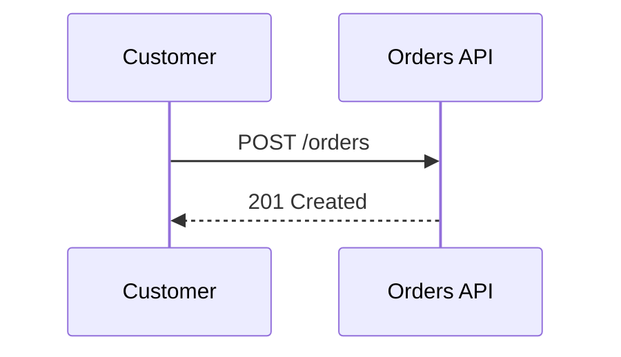
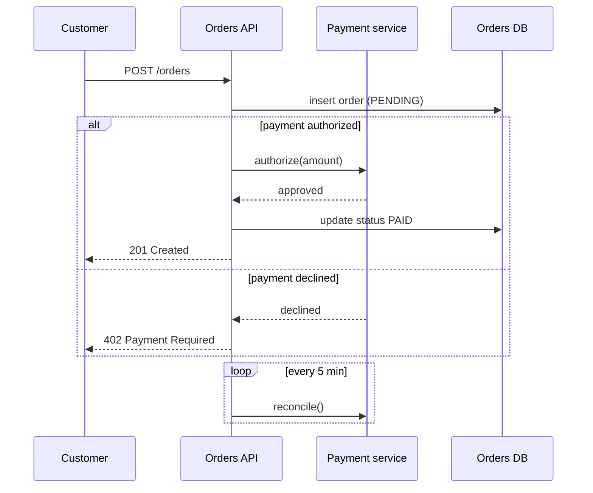

# Sequence diagram

Mermaid type: `sequenceDiagram` (Native fit). UML type: sequence diagram.

Shows messages exchanged between participants over time.

## Description

Ordered exchange of messages between participants over time, with fragments for alternatives, loops, and parallel flows.

## Example usages

- API call flows and request/response chains
- Authentication and authorization handshakes
- Error and retry handling scenarios
- Integration flows between services

## Example 1: Simple - Create an order

## Example 2: Complex - Payment with alternative and loop fragments

