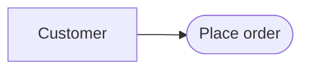
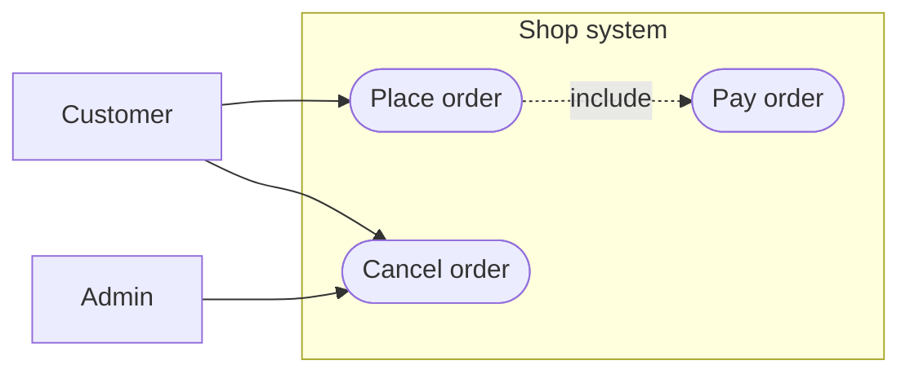

# Use case diagram

Mermaid type: `flowchart` (Approximate fit). UML type: use case diagram.

Mermaid has no use case diagram. Actors are drawn as rectangles and use cases as stadium-shaped nodes, with `include` and `extend` as dashed labeled edges.

## Description

Functional view from outside the system, showing actors and the use cases (goals) they achieve, plus include and extend relations.

## Example usages

- Capturing functional scope with stakeholders
- Identifying actors and system boundaries
- Linking use cases to acceptance tests
- Summarizing features per user role

## Example 1: Simple - Customer places an order

## Example 2: Complex - Actors, system boundary, and include relation

