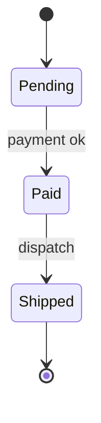
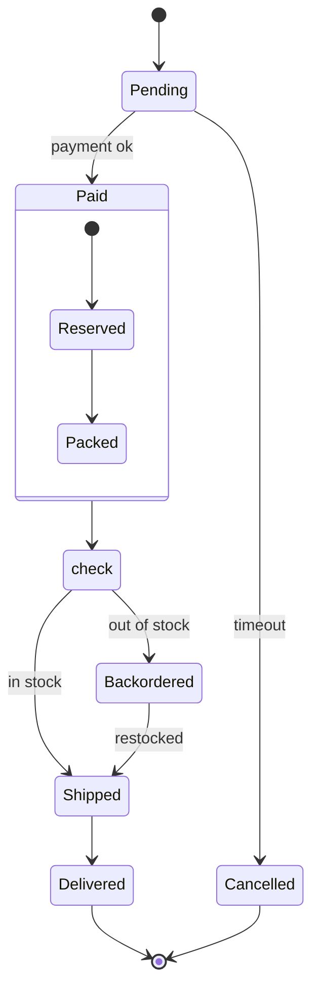

# State machine diagram

Mermaid type: `stateDiagram-v2` (Native fit). UML type: state machine diagram.

Shows states, transitions, composite states, and choice pseudostates.

## Description

Lifecycle of an object, showing states, events, guards, transitions, and composite states.

## Example usages

- Order, ticket, or payment lifecycle
- Protocol or connection states such as open, closed, or retrying
- Validating allowed transitions
- Modeling UI or workflow state

## Example 1: Simple - Order lifecycle

## Example 2: Complex - Composite state with choice and backorder

