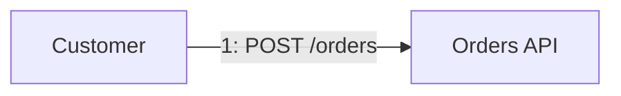
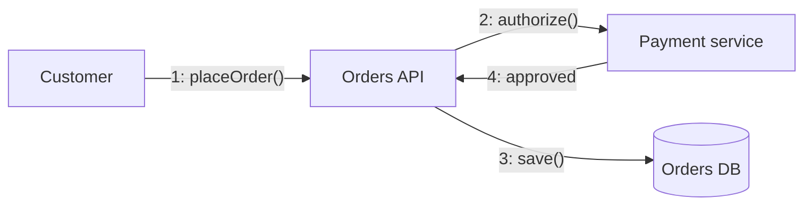

# Communication diagram

Mermaid type: `flowchart` (Approximate fit). UML type: communication diagram.

Mermaid has no communication diagram. Objects are nodes, and numbered messages are labeled edges. The sequence order is shown by the numbers, not by lifelines.

## Description

Objects and their links, with numbered messages showing the order of interactions. Emphasis is on structure rather than time.

## Example usages

- Showing collaboration among objects for one operation
- Compact alternative to sequence diagrams for small interactions
- Documenting which objects must be linked
- Reviewing responsibilities among collaborators

## Example 1: Simple - One message between two objects

## Example 2: Complex - Numbered messages across three objects

