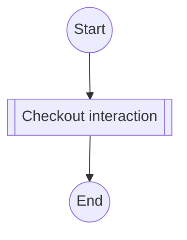
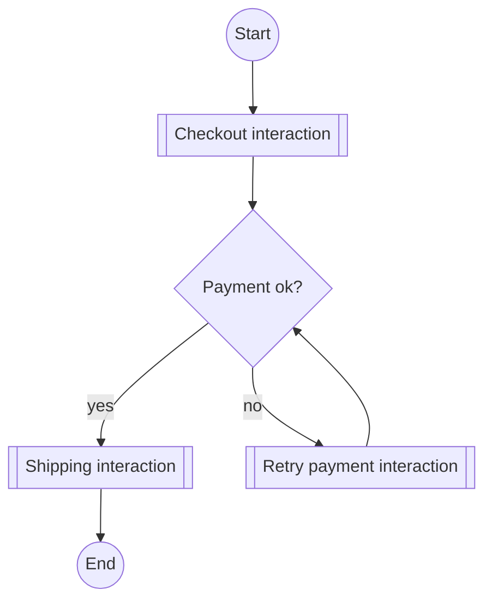

# Interaction overview diagram

Mermaid type: `flowchart` (Close fit). UML type: interaction overview diagram.

Control flow between interactions. Each interaction is a subroutine-shaped node. Decisions are diamonds.

## Description

High-level control flow among interactions (sequence diagrams), with decisions and merges linking them.

## Example usages

- Overview of a use case made of several sequence diagrams
- Checkout or onboarding flow across multiple scenarios
- Showing retry and fallback paths between interactions
- Navigating a large set of sequence diagrams

## Example 1: Simple - One interaction

## Example 2: Complex - Payment retry loop

