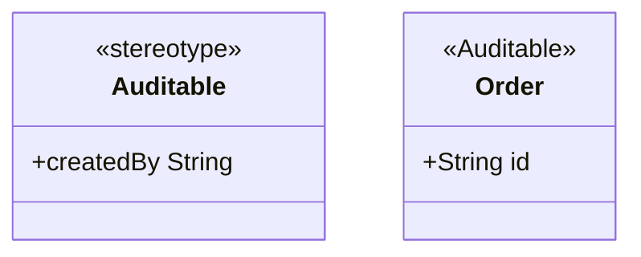
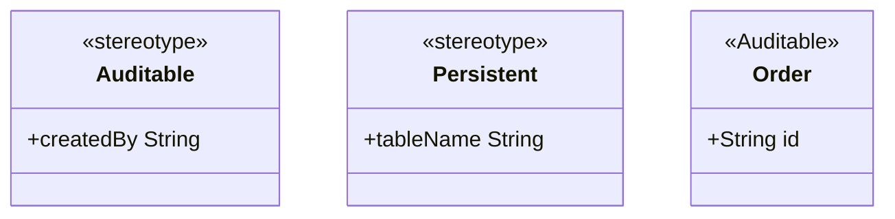

# Profile diagram

Mermaid type: `classDiagram` (Approximate fit). UML type: profile diagram.

Mermaid has no profile diagram and no metamodel extension. Stereotypes are shown as `<<annotation>>` lines on classes, which is enough for simple profile use.

## Description

Extension mechanism that defines stereotypes, tagged values, and constraints to adapt the UML metamodel to a domain or platform.

## Example usages

- Defining domain-specific annotations such as Auditable or Persistent
- Mapping models to a platform such as REST resources or EJB beans
- Standardizing modeling conventions across teams
- Generating code or documentation from stereotypes

## Example 1: Simple - Stereotype applied to a class

## Example 2: Complex - Several stereotypes on one class

