<!-- Generated by SpecStory, Markdown v2.1.0 -->

# 2026-11-01 20:59:59Z

<!-- VS Code Copilot IDE Session ca8460d4-6bb3-430c-8250-9834202c9486 (2026-11-01 20:59:59Z) -->

_**User (2026-11-01 20:59:59Z)**_

in new ./diagrams/ folder create .md files - each with 1-2 examples of simple and more complex practical diagrams. Each file showcasing different type of mermaid diagram. verify diagrams for correctnes with #mermaid-diagram-validator 

---

_**Agent (copilot/claude-haiku-5.5)**_

<tool-use data-tool-type="generic" data-tool-name="tool_search"><details>
<summary>Tool use: **tool_search**</summary>

</details></tool-use>

_**Agent (copilot/claude-haiku-5.5)**_

<tool-use data-tool-type="generic" data-tool-name="get-syntax-docs-mermaid"><details>
<summary>Tool use: **get-syntax-docs-mermaid**</summary>

Fetching Mermaid documentation for flowchart.md

**Input:**

- file: `flowchart.md`

**Result:**

````
---
title: Flowcharts Syntax
---

# Flowcharts - Basic Syntax

Flowcharts are composed of **nodes** (geometric shapes) and **edges** (arrows or lines). The Mermaid code defines how nodes and edges are made and accommodates different arrow types, multi-directional arrows, and any linking to and from subgraphs.

```warning
If you are using the word "end" in a Flowchart node, capitalize the entire word or any of the letters (e.g., "End" or "END"), or apply this [workaround](https://github.com/mermaid-js/mermaid/issues/1444#issuecomment-639528897). Typing "end" in all lowercase letters will break the Flowchart.
```

```warning
If you are using the letter "o" or "x" as the first letter in a connecting Flowchart node, add a space before the letter or capitalize the letter (e.g., "dev--- ops", "dev---Ops").

Typing "A---oB" will create a [circle edge](#circle-edge-example).

Typing "A---xB" will create a [cross edge](#cross-edge-example).
```

### A node (default)

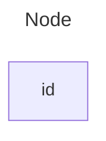

```note
The id is what is displayed in the box.
```

```tip
Instead of `flowchart` one can also use `graph`.
```

### A node with text

It is also possible to set text in the box that differs from the id. If this is done several times, it is the last text
found for the node that will be used. Also if you define edges for the node later on, you can omit text definitions. The
one previously defined will be used when rendering the box.

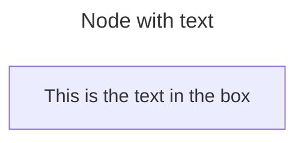

#### Unicode text

Use `"` to enclose the unicode text.

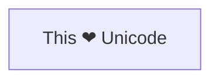

#### Markdown formatting

Use double quotes and backticks "\` text \`" to enclose the markdown text.

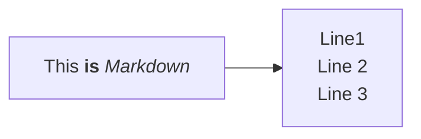

### Direction

This statement 
… (output truncated)
````
</details></tool-use>

_**Agent (copilot/claude-haiku-5.5)**_

<tool-use data-tool-type="generic" data-tool-name="get-syntax-docs-mermaid"><details>
<summary>Tool use: **get-syntax-docs-mermaid**</summary>

Fetching Mermaid documentation for sequenceDiagram.md

**Input:**

- file: `sequenceDiagram.md`

**Result:**

````
# Sequence diagrams

> A Sequence diagram is an interaction diagram that shows how processes operate with one another and in what order.

Mermaid can render sequence diagrams.

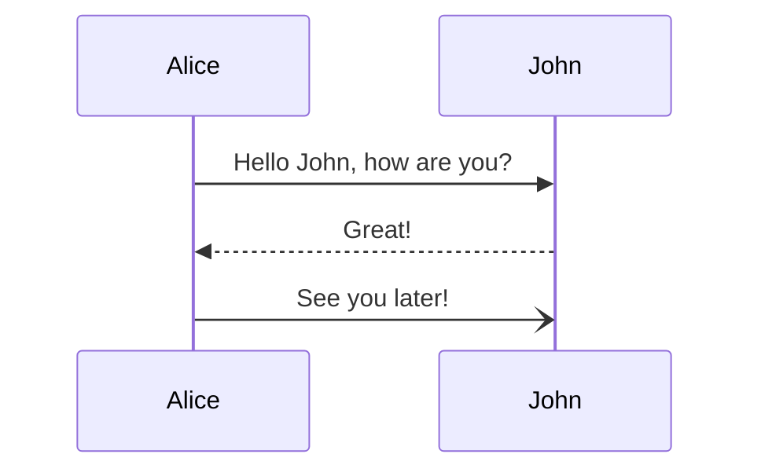

```note
A note on nodes, the word "end" could potentially break the diagram, due to the way that the mermaid language is scripted.

If unavoidable, one must use parentheses(), quotation marks "", or brackets {},[], to enclose the word "end". i.e : (end), [end], {end}.
```

## Syntax

### Participants

The participants can be defined implicitly as in the first example on this page. The participants or actors are
rendered in order of appearance in the diagram source text. Sometimes you might want to show the participants in a
different order than how they appear in the first message. It is possible to specify the actor's order of
appearance by doing the following:

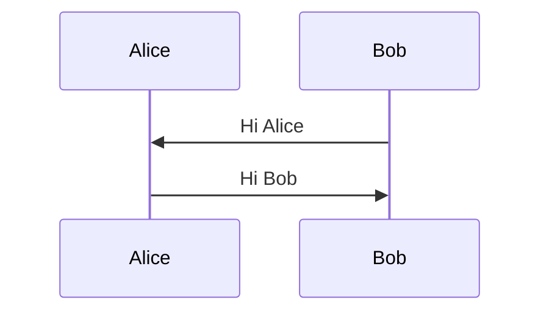

### Actors

If you specifically want to use the actor symbol instead of a rectangle with text you can do so by using actor statements as per below.

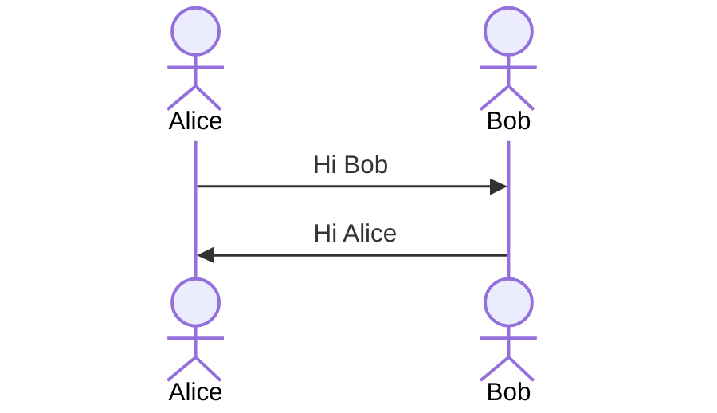

### Aliases

The actor can have a convenient identifier and a descriptive label.

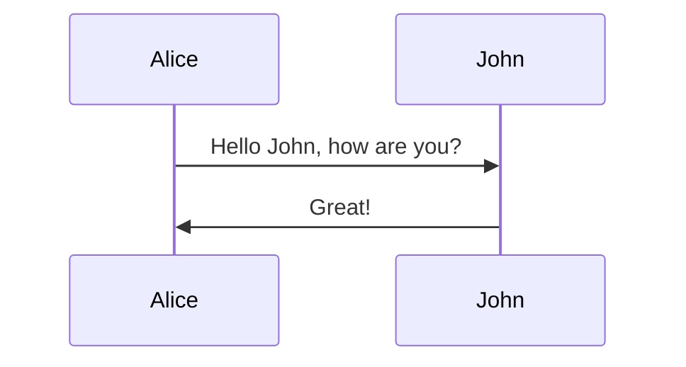

### Actor Creation and Destruction (v10.3.0+)

It is possible to create and destroy actors by messages. To do so, add a create or destroy directive before the message.

```
create participant B
A --> B: Hello
```

Create directives support actor/participant distinction and aliases. The sender or the recipient of a message can be destroyed but only the recipient can be created.

```mermaid
sequenceDiagram
    
… (output truncated)
````
</details></tool-use>

_**Agent (copilot/claude-haiku-5.5)**_

<tool-use data-tool-type="generic" data-tool-name="get-syntax-docs-mermaid"><details>
<summary>Tool use: **get-syntax-docs-mermaid**</summary>

Fetching Mermaid documentation for classDiagram.md

**Input:**

- file: `classDiagram.md`

**Result:**

````
# Class diagrams

> "In software engineering, a class diagram in the Unified Modeling Language (UML) is a type of static structure diagram that describes the structure of a system by showing the system's classes, their attributes, operations (or methods), and the relationships among objects."
>
> -Wikipedia

The class diagram is the main building block of object-oriented modeling. It is used for general conceptual modeling of the structure of the application, and for detailed modeling to translate the models into programming code. Class diagrams can also be used for data modeling. The classes in a class diagram represent both the main elements, interactions in the application, and the classes to be programmed.

Mermaid can render class diagrams.

```mermaid
---
title: Animal example
---
classDiagram
    note "From Duck till Zebra"
    Animal <|-- Duck
    note for Duck "can fly\ncan swim\ncan dive\ncan help in debugging"
    Animal <|-- Fish
    Animal <|-- Zebra
    Animal : +int age
    Animal : +String gender
    Animal: +isMammal()
    Animal: +mate()
    class Duck{
        +String beakColor
        +swim()
        +quack()
    }
    class Fish{
        -int sizeInFeet
        -canEat()
    }
    class Zebra{
        +bool is_wild
        +run()
    }
```

## Syntax

### Class

UML provides mechanisms to represent class members, such as attributes and methods, and additional information about them.
A single instance of a class in the diagram contains three compartments:

- The top compartment contains the name of the class. It is printed in bold and centered, and the first letter is capitalized. It may also contain optional annotation text describing the nature of the class.
- The middle compartment contains the attributes of the class. They are left-aligned and the first letter is lowercase.
- The bottom compartment contains the operations the class can execute. They are also left-aligned and the first letter is lowercase.

```mermaid
---
title: Bank example
-
… (output truncated)
````
</details></tool-use>

_**Agent (copilot/claude-haiku-5.5)**_

<tool-use data-tool-type="generic" data-tool-name="get-syntax-docs-mermaid"><details>
<summary>Tool use: **get-syntax-docs-mermaid**</summary>

Fetching Mermaid documentation for stateDiagram.md

**Input:**

- file: `stateDiagram.md`

**Result:**

````
# State diagrams

> "A state diagram is a type of diagram used in computer science and related fields to describe the behavior of systems.
> State diagrams require that the system described is composed of a finite number of states; sometimes, this is indeed the
> case, while at other times this is a reasonable abstraction." Wikipedia

Mermaid can render state diagrams. The syntax tries to be compliant with the syntax used in plantUml as this will make
it easier for users to share diagrams between mermaid and plantUml.

```mermaid
---
title: Simple sample
---
stateDiagram-v2
    [*] --> Still
    Still --> [*]

    Still --> Moving
    Moving --> Still
    Moving --> Crash
    Crash --> [*]
```

Older renderer:

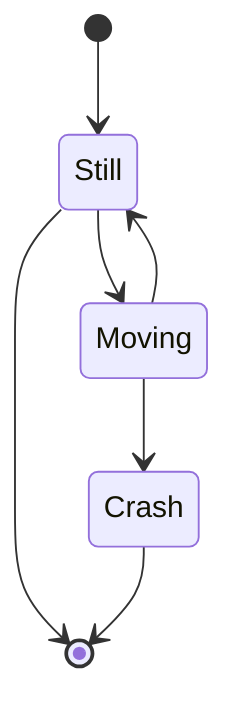

In state diagrams systems are described in terms of _states_ and how one _state_ can change to another _state_ via
a _transition._ The example diagram above shows three states: **Still**, **Moving** and **Crash**. You start in the
**Still** state. From **Still** you can change to the **Moving** state. From **Moving** you can change either back to the **Still** state or to
the **Crash** state. There is no transition from **Still** to **Crash**. (You can't crash if you're still.)

## States

A state can be declared in multiple ways. The simplest way is to define a state with just an id:

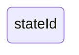

Another way is by using the state keyword with a description as per below:

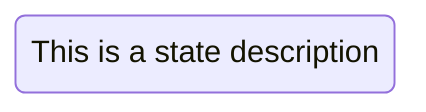

Another way to define a state with a description is to define the state id followed by a colon and the description:


## Transitions

Transitions are path/edges when one state passes into another. This is represented using text arrow, "\-\-\>".

When you define a transitio
… (output truncated)
````
</details></tool-use>

_**Agent (copilot/claude-haiku-5.5)**_

<tool-use data-tool-type="generic" data-tool-name="get-syntax-docs-mermaid"><details>
<summary>Tool use: **get-syntax-docs-mermaid**</summary>

Fetching Mermaid documentation for entityRelationshipDiagram.md

**Input:**

- file: `entityRelationshipDiagram.md`

**Result:**

````
# Entity Relationship Diagrams

> An entity–relationship model (or ER model) describes interrelated things of interest in a specific domain of knowledge. A basic ER model is composed of entity types (which classify the things of interest) and specifies relationships that can exist between entities (instances of those entity types) [Wikipedia](https://en.wikipedia.org/wiki/Entity%E2%80%93relationship_model).

Note that practitioners of ER modelling almost always refer to _entity types_ simply as _entities_. For example the `CUSTOMER` entity _type_ would be referred to simply as the `CUSTOMER` entity. This is so common it would be inadvisable to do anything else, but technically an entity is an abstract _instance_ of an entity type, and this is what an ER diagram shows - abstract instances, and the relationships between them. This is why entities are always named using singular nouns.

Mermaid can render ER diagrams

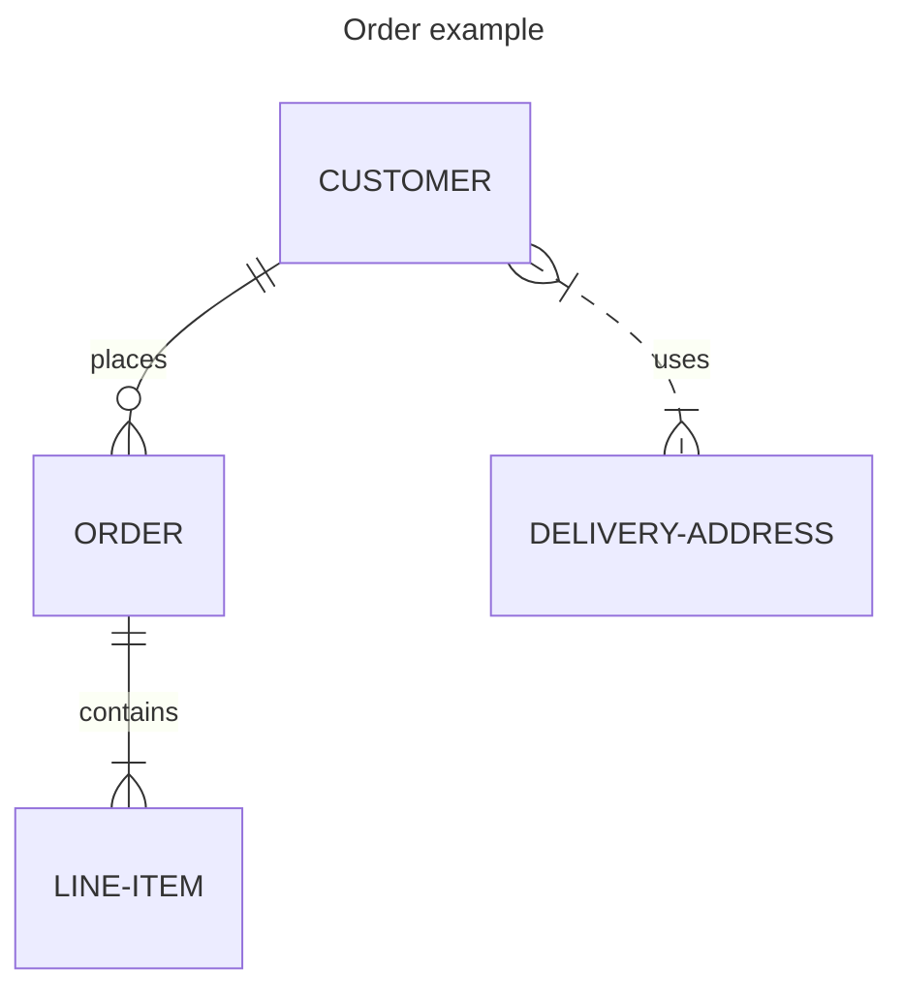

Entity names are often capitalised, although there is no accepted standard on this, and it is not required in Mermaid.

Relationships between entities are represented by lines with end markers representing cardinality. Mermaid uses the most popular crow's foot notation. The crow's foot intuitively conveys the possibility of many instances of the entity that it connects to.

ER diagrams can be used for various purposes, ranging from abstract logical models devoid of any implementation details, through to physical models of relational database tables. It can be useful to include attribute definitions on ER diagrams to aid comprehension of the purpose and meaning of entities. These do not necessarily need to be exhaustive; often a small subset of attributes is enough. Mermaid allows them to be defined in terms of their _type_ and _name_.

```mermaid
erDiagram
    CUSTOMER ||--o{ ORDER : pl
… (output truncated)
````
</details></tool-use>

_**Agent (copilot/claude-haiku-5.5)**_

<tool-use data-tool-type="generic" data-tool-name="get-syntax-docs-mermaid"><details>
<summary>Tool use: **get-syntax-docs-mermaid**</summary>

Fetching Mermaid documentation for gantt.md

**Input:**

- file: `gantt.md`

**Result:**

````
# Gantt diagrams

> A Gantt chart is a type of bar chart, first developed by Karol Adamiecki in 1896, and independently by Henry Gantt in the 1910s, that illustrates a project schedule and the amount of time it would take for any one project to finish. Gantt charts illustrate number of days between the start and finish dates of the terminal elements and summary elements of a project.

## A note to users

Gantt Charts will record each scheduled task as one continuous bar that extends from the left to the right. The x axis represents time and the y records the different tasks and the order in which they are to be completed.

It is important to remember that when a date, day, or collection of dates specific to a task are "excluded", the Gantt Chart will accommodate those changes by extending an equal number of days, towards the right, not by creating a gap inside the task.
As shown here 

However, if the excluded dates are between two tasks that are set to start consecutively, the excluded dates will be skipped graphically and left blank, and the following task will begin after the end of the excluded dates.
As shown here 

A Gantt chart is useful for tracking the amount of time it would take before a project is finished, but it can also be used to graphically represent "non-working days", with a few tweaks.

Mermaid can render Gantt diagrams as SVG, PNG or a MarkDown link that can be pasted into docs.

```mermaid
gantt
    title A Gantt Diagram
    dateFormat YYYY-MM-DD
    section Section
        A task          :a1, 2014-01-01, 30d
        Another task    :after a1, 20d
    section Another
        Task in Another :2014-01-12, 12d
        another task    :24d
```

## Syntax

```mermaid
gantt
    dateFormat  YYYY-MM-DD
    title       Adding GANTT diagram functionality to mermaid
    excludes    weekends
    %% (`excludes` accepts specific dates in YYYY-MM-DD format, days of the week ("sund
… (output truncated)
````
</details></tool-use>

_**Agent (copilot/claude-haiku-5.5)**_

<tool-use data-tool-type="generic" data-tool-name="get-syntax-docs-mermaid"><details>
<summary>Tool use: **get-syntax-docs-mermaid**</summary>

Fetching Mermaid documentation for mindmap.md

**Input:**

- file: `mindmap.md`

**Result:**

````
# Mindmap

> Mindmap: This is an experimental diagram for now. The syntax and properties can change in future releases. The syntax is stable except for the icon integration which is the experimental part.

"A mind map is a diagram used to visually organize information into a hierarchy, showing relationships among pieces of the whole. It is often created around a single concept, drawn as an image in the center of a blank page, to which associated representations of ideas such as images, words and parts of words are added. Major ideas are connected directly to the central concept, and other ideas branch out from those major ideas." Wikipedia

### An example of a mindmap.

```mermaid
mindmap
  root((mindmap))
    Origins
      Long history
      ::icon(fa fa-book)
      Popularisation
        British popular psychology author Tony Buzan
    Research
      On effectiveness<br/>and features
      On Automatic creation
        Uses
            Creative techniques
            Strategic planning
            Argument mapping
    Tools
      Pen and paper
      Mermaid

```

## Syntax

The syntax for creating Mindmaps is simple and relies on indentation for setting the levels in the hierarchy.

In the following example you can see how there are 3 different levels. One with starting at the left of the text and another level with two rows starting at the same column, defining the node A. At the end there is one more level where the text is indented further than the previous lines defining the nodes B and C.

```
mindmap
    Root
        A
            B
            C
```

In summary is a simple text outline where there is one node at the root level called `Root` which has one child `A`. `A` in turn has two children `B`and `C`. In the diagram below we can see this rendered as a mindmap.

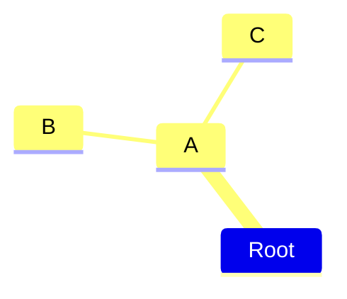

In this way we can use a text outline to generate a hierarchical mindmap.

## Different shapes

Mermaid mindmaps can show nodes using different 
… (output truncated)
````
</details></tool-use>

_**Agent (copilot/claude-haiku-5.5)**_

<tool-use data-tool-type="generic" data-tool-name="get-syntax-docs-mermaid"><details>
<summary>Tool use: **get-syntax-docs-mermaid**</summary>

Fetching Mermaid documentation for quadrantChart.md

**Input:**

- file: `quadrantChart.md`

**Result:**

````
# Quadrant Chart

> A quadrant chart is a visual representation of data that is divided into four quadrants. It is used to plot data points on a two-dimensional grid, with one variable represented on the x-axis and another variable represented on the y-axis. The quadrants are determined by dividing the chart into four equal parts based on a set of criteria that is specific to the data being analyzed. Quadrant charts are often used to identify patterns and trends in data, and to prioritize actions based on the position of data points within the chart. They are commonly used in business, marketing, and risk management, among other fields.

## Example

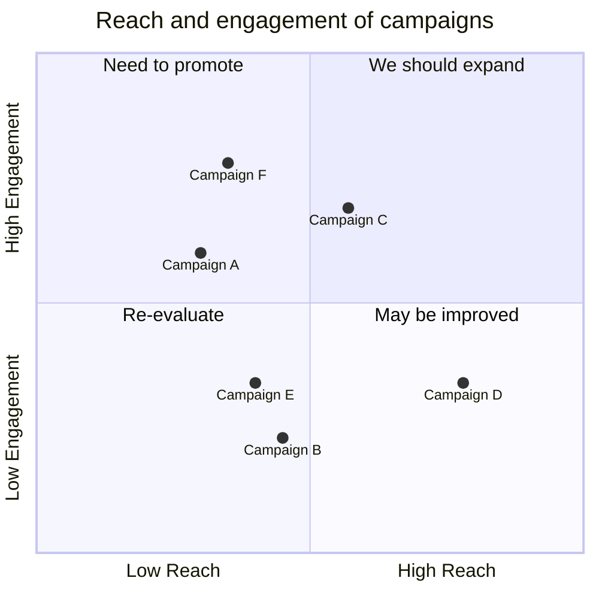

## Syntax

```note
If there are no points available in the chart both **axis** text and **quadrant** will be rendered in the center of the respective quadrant.
If there are points **x-axis** labels will rendered from the left of the respective quadrant also they will be displayed at the bottom of the chart, and **y-axis** labels will be rendered at the bottom of the respective quadrant, the quadrant text will render at the top of the respective quadrant.
```

```note
For points x and y value min value is 0 and max value is 1.
```

### Title

The title is a short description of the chart and it will always render on top of the chart.

#### Example

```
quadrantChart
    title This is a sample example
```

### x-axis

The x-axis determines what text would be displayed in the x-axis. In x-axis there is two part **left** and **right** you can pass **both** or you can pass only **left*
… (output truncated)
````
</details></tool-use>

_**Agent (copilot/claude-haiku-5.5)**_

I'll validate each diagram's code before writing the files.                

_**Agent (copilot/claude-haiku-5.5)**_

<tool-use data-tool-type="generic" data-tool-name="mermaid-diagram-validator"><details>
<summary>Tool use: **mermaid-diagram-validator**</summary>

Validating Mermaid diagram syntax

**Input:**

- code:

```
flowchart LR
    A[Client request] --> B{Authenticated?}
    B -- Yes --> C[Serve response]
    B -- No --> D[Return 401]
```


**Result:**

```
Canceled: Canceled
```
</details></tool-use>

---

_**User (2026-11-01 21:28:18Z)**_

you are getting stuck. create one file at a time

---

_**Agent (copilot/claude-haiku-5.5)**_

<tool-use data-tool-type="generic" data-tool-name="tool_search"><details>
<summary>Tool use: **tool_search**</summary>

</details></tool-use>

_**Agent (copilot/claude-haiku-5.5)**_

<tool-use data-tool-type="generic" data-tool-name="mermaid-diagram-validator"><details>
<summary>Tool use: **mermaid-diagram-validator**</summary>

Validating Mermaid diagram syntax

**Input:**

- code:

```
flowchart LR
    A[Start] --> B{Is it working?}
    B -->|Yes| C[Ship it]
    B -->|No| D[Debug]
    D --> B
```


**Result:**

```
Canceled: Canceled
```
</details></tool-use>

---

_**User (2026-11-01 21:32:05Z)**_

its not working. just create files best you can. Ignore mermaid validate and preview tools for now. we'll do that later

---

_**Agent (copilot/claude-haiku-5.5)**_

<tool-use data-tool-type="write" data-tool-name="create_file"><details>
<summary>Tool use: **create_file**</summary>

Created `01-flowchart.md`

**Input:**

- content:

````
# Flowchart

Flowcharts show process steps, decisions, and flow of control.

## Simple example: order payment

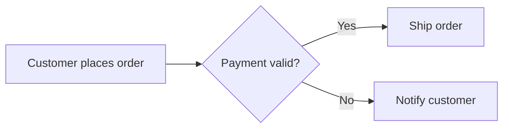

## Complex example: incident handling with escalation

```mermaid
flowchart TD
    Start([Incident reported]) --> Triage{Severity?}
    Triage -- P1 --> Page[Page on-call SRE]
    Triage -- P2/P3 --> Ticket[Create ticket]
    Page --> Mitigate[Mitigate service]
    Ticket --> Queue[Add to backlog]
    Mitigate --> Verify{Service restored?}
    Verify -- No --> Escalate[Escalate to incident commander]
    Escalate --> Mitigate
    Verify -- Yes --> Review[Post-incident review]
    Queue --> Review
    Review --> End([Close])
```

## Complex example: architecture with subgraphs

```mermaid
flowchart LR
    subgraph Client
        Web[Web app]
    end
    subgraph Cloud
        API[API gateway] --> Svc[Order service]
        Svc --> DB[(Orders DB)]
    end
    Web -->|HTTPS| API
```

````

- filePath: `c:\Projects\infoshare-nordea-architecture-1026\diagrams\01-flowchart.md`

**Result:**

```
The following files were successfully edited:
c:\Projects\infoshare-nordea-architecture-1026\diagrams\01-flowchart.md
```
</details></tool-use>

_**Agent (copilot/claude-haiku-5.5)**_

<tool-use data-tool-type="write" data-tool-name="textEditGroup"><details>
<summary>Edit: **01-flowchart.md**</summary>

@@ lines 1-1 @@

````
# Flowchart

Flowcharts show process steps, decisions, and flow of control.

## Simple example: order payment

```mermaid
flowchart LR
    A[Customer places order] --> B{Payment valid?}
    B -- Yes --> C[Ship order]
    B -- No --> D[Notify customer]
```

## Complex example: incident handling with escalation

```mermaid
flowchart TD
    Start([Incident reported]) --> Triage{Severity?}
    Triage -- P1 --> Page[Page on-call SRE]
    Triage -- P2/P3 --> Ticket[Create ticket]
    Page --> Mitigate[Mitigate service]
    Ticket --> Queue[Add to backlog]
    Mitigate --> Verify{Service restored?}
    Verify -- No --> Escalate[Escalate to incident commander]
    Escalate --> Mitigate
    Verify -- Yes --> Review[Post-incident review]
    Queue --> Review
    Review --> End([Close])
```

## Complex example: architecture with subgraphs

```mermaid
flowchart LR
    subgraph Client
        Web[Web app]
    end
    subgraph Cloud
        API[API gateway] --> Svc[Order service]
        Svc --> DB[(Orders DB)]
    end
    Web -->|HTTPS| API
```

````
</details></tool-use>

_**Agent (copilot/claude-haiku-5.5)**_

<tool-use data-tool-type="write" data-tool-name="create_file"><details>
<summary>Tool use: **create_file**</summary>

Created `02-sequence-diagram.md`

**Input:**

- content:

````
# Sequence Diagram

Sequence diagrams show interactions between participants over time.

## Simple example: login request

```mermaid
sequenceDiagram
    actor User
    participant App
    participant AuthService
    User->>App: Enter credentials
    App->>AuthService: Validate credentials
    AuthService-->>App: Token
    App-->>User: Logged in
```

## Complex example: payment with retry and alternatives

```mermaid
sequenceDiagram
    autonumber
    participant Shop as Checkout
    participant Payment as Payment Gateway
    participant Bank
    participant Queue as Event Bus

    Shop->>Payment: Charge card (orderId)
    activate Payment
    Payment->>Bank: Authorize amount
    alt Authorized
        Bank-->>Payment: Approved
        Payment-->>Shop: Success
        Shop->>Queue: Publish OrderPaid
    else Declined
        Bank-->>Payment: Declined
        Payment-->>Shop: Failure reason
    else Timeout
        loop Retry up to 3 times
            Payment->>Bank: Retry authorization
        end
        Payment-->>Shop: Pending
    end
    deactivate Payment
    Note over Shop,Bank: Card data never leaves the gateway
```

````

- filePath: `c:\Projects\infoshare-nordea-architecture-1026\diagrams\02-sequence-diagram.md`

**Result:**

```
The following files were successfully edited:
c:\Projects\infoshare-nordea-architecture-1026\diagrams\02-sequence-diagram.md
```
</details></tool-use>

_**Agent (copilot/claude-haiku-5.5)**_

<tool-use data-tool-type="write" data-tool-name="textEditGroup"><details>
<summary>Edit: **02-sequence-diagram.md**</summary>

@@ lines 1-1 @@

````
# Sequence Diagram

Sequence diagrams show interactions between participants over time.

## Simple example: login request

```mermaid
sequenceDiagram
    actor User
    participant App
    participant AuthService
    User->>App: Enter credentials
    App->>AuthService: Validate credentials
    AuthService-->>App: Token
    App-->>User: Logged in
```

## Complex example: payment with retry and alternatives

```mermaid
sequenceDiagram
    autonumber
    participant Shop as Checkout
    participant Payment as Payment Gateway
    participant Bank
    participant Queue as Event Bus

    Shop->>Payment: Charge card (orderId)
    activate Payment
    Payment->>Bank: Authorize amount
    alt Authorized
        Bank-->>Payment: Approved
        Payment-->>Shop: Success
        Shop->>Queue: Publish OrderPaid
    else Declined
        Bank-->>Payment: Declined
        Payment-->>Shop: Failure reason
    else Timeout
        loop Retry up to 3 times
            Payment->>Bank: Retry authorization
        end
        Payment-->>Shop: Pending
    end
    deactivate Payment
    Note over Shop,Bank: Card data never leaves the gateway
```

````
</details></tool-use>

_**Agent (copilot/claude-haiku-5.5)**_

<tool-use data-tool-type="write" data-tool-name="create_file"><details>
<summary>Tool use: **create_file**</summary>

Created `03-class-diagram.md`

**Input:**

- content:

````
# Class Diagram

Class diagrams show classes, their attributes, methods, and relationships.

## Simple example: account inheritance

```mermaid
classDiagram
    class Account {
        +String id
        +deposit(amount)
        +withdraw(amount)
    }
    class SavingsAccount {
        +Double interestRate
        +addInterest()
    }
    Account <|-- SavingsAccount
```

## Complex example: order domain model

```mermaid
classDiagram
    class Customer {
        +String customerId
        +String name
        +placeOrder() Order
    }
    class Order {
        +String orderId
        +Date createdAt
        +OrderStatus status
        +total() Money
    }
    class OrderLine {
        +int quantity
        +Money unitPrice
    }
    class Product {
        +String sku
        +String description
    }
    class OrderStatus {
        <<enumeration>>
        NEW
        PAID
        SHIPPED
        CANCELLED
    }
    class PaymentService {
        <<interface>>
        +charge(order) bool
    }
    class CardPaymentService {
        +charge(order) bool
    }

    Customer "1" --> "0..*" Order : places
    Order "1" *-- "1..*" OrderLine : contains
    OrderLine "0..*" --> "1" Product : refers to
    Order --> OrderStatus
    PaymentService <|.. CardPaymentService
    Order ..> PaymentService : uses
```

````

- filePath: `c:\Projects\infoshare-nordea-architecture-1026\diagrams\03-class-diagram.md`

**Result:**

```
The following files were successfully edited:
c:\Projects\infoshare-nordea-architecture-1026\diagrams\03-class-diagram.md
```
</details></tool-use>

_**Agent (copilot/claude-haiku-5.5)**_

<tool-use data-tool-type="write" data-tool-name="textEditGroup"><details>
<summary>Edit: **03-class-diagram.md**</summary>

@@ lines 1-1 @@

````
# Class Diagram

Class diagrams show classes, their attributes, methods, and relationships.

## Simple example: account inheritance

```mermaid
classDiagram
    class Account {
        +String id
        +deposit(amount)
        +withdraw(amount)
    }
    class SavingsAccount {
        +Double interestRate
        +addInterest()
    }
    Account <|-- SavingsAccount
```

## Complex example: order domain model

```mermaid
classDiagram
    class Customer {
        +String customerId
        +String name
        +placeOrder() Order
    }
    class Order {
        +String orderId
        +Date createdAt
        +OrderStatus status
        +total() Money
    }
    class OrderLine {
        +int quantity
        +Money unitPrice
    }
    class Product {
        +String sku
        +String description
    }
    class OrderStatus {
        <<enumeration>>
        NEW
        PAID
        SHIPPED
        CANCELLED
    }
    class PaymentService {
        <<interface>>
        +charge(order) bool
    }
    class CardPaymentService {
        +charge(order) bool
    }

    Customer "1" --> "0..*" Order : places
    Order "1" *-- "1..*" OrderLine : contains
    OrderLine "0..*" --> "1" Product : refers to
    Order --> OrderStatus
    PaymentService <|.. CardPaymentService
    Order ..> PaymentService : uses
```

````
</details></tool-use>

_**Agent (copilot/claude-haiku-5.5)**_

<tool-use data-tool-type="write" data-tool-name="create_file"><details>
<summary>Tool use: **create_file**</summary>

Created `04-state-diagram.md`

**Input:**

- content:

````
# State Diagram

State diagrams show the states an entity can be in and the transitions between them.

## Simple example: traffic light

```mermaid
stateDiagram-v2
    [*] --> Red
    Red --> Green : timer
    Green --> Yellow : timer
    Yellow --> Red : timer
```

## Complex example: order lifecycle

```mermaid
stateDiagram-v2
    [*] --> Created
    Created --> Paid : payment received
    Created --> Cancelled : customer cancels
    Paid --> Packing : stock reserved
    Paid --> Refunding : cancel after payment
    Packing --> Shipped : carrier pickup
    Shipped --> Delivered : delivery confirmed
    Shipped --> Returned : refused by customer
    Returned --> Refunding
    Refunding --> Cancelled : refund completed
    Delivered --> [*]
    Cancelled --> [*]

    state Packing {
        [*] --> Picking
        Picking --> Quality_check
        Quality_check --> [*]
    }
```

````

- filePath: `c:\Projects\infoshare-nordea-architecture-1026\diagrams\04-state-diagram.md`

**Result:**

```
The following files were successfully edited:
c:\Projects\infoshare-nordea-architecture-1026\diagrams\04-state-diagram.md
```
</details></tool-use>

_**Agent (copilot/claude-haiku-5.5)**_

<tool-use data-tool-type="task" data-tool-name="manage_todo_list"><details>
<summary>Tool use: **manage_todo_list**</summary>

Created 3 todos
</details></tool-use>

_**Agent (copilot/claude-haiku-5.5)**_

<tool-use data-tool-type="write" data-tool-name="textEditGroup"><details>
<summary>Edit: **04-state-diagram.md**</summary>

@@ lines 1-1 @@

````
# State Diagram

State diagrams show the states an entity can be in and the transitions between them.

## Simple example: traffic light

```mermaid
stateDiagram-v2
    [*] --> Red
    Red --> Green : timer
    Green --> Yellow : timer
    Yellow --> Red : timer
```

## Complex example: order lifecycle

```mermaid
stateDiagram-v2
    [*] --> Created
    Created --> Paid : payment received
    Created --> Cancelled : customer cancels
    Paid --> Packing : stock reserved
    Paid --> Refunding : cancel after payment
    Packing --> Shipped : carrier pickup
    Shipped --> Delivered : delivery confirmed
    Shipped --> Returned : refused by customer
    Returned --> Refunding
    Refunding --> Cancelled : refund completed
    Delivered --> [*]
    Cancelled --> [*]

    state Packing {
        [*] --> Picking
        Picking --> Quality_check
        Quality_check --> [*]
    }
```

````
</details></tool-use>

_**Agent (copilot/claude-haiku-5.5)**_

<tool-use data-tool-type="write" data-tool-name="create_file"><details>
<summary>Tool use: **create_file**</summary>

Created `05-er-diagram.md`

**Input:**

- content:

````
# Entity Relationship Diagram

ER diagrams show database entities, their attributes, and relationships.

## Simple example: blog

```mermaid
erDiagram
    AUTHOR ||--o{ POST : writes
    POST {
        int id PK
        string title
        date published_at
    }
    AUTHOR {
        int id PK
        string name
    }
```

## Complex example: banking schema

```mermaid
erDiagram
    CUSTOMER ||--o{ ACCOUNT : owns
    ACCOUNT ||--o{ TRANSACTION : records
    ACCOUNT }o--|| ACCOUNT_TYPE : "classified as"
    CUSTOMER ||--o{ CARD : holds
    CARD }o--|| ACCOUNT : "linked to"
    TRANSACTION }o--o| PAYMENT : "may settle"

    CUSTOMER {
        string customer_id PK
        string full_name
        string email UK
        date date_of_birth
    }
    ACCOUNT {
        string iban PK
        string customer_id FK
        string account_type_code FK
        decimal balance
        string currency
    }
    ACCOUNT_TYPE {
        string code PK
        string description
    }
    TRANSACTION {
        bigint transaction_id PK
        string iban FK
        decimal amount
        timestamp booked_at
    }
    CARD {
        string card_id PK
        string customer_id FK
        string iban FK
        string status
    }
    PAYMENT {
        string payment_id PK
        string reference
    }
```

````

- filePath: `c:\Projects\infoshare-nordea-architecture-1026\diagrams\05-er-diagram.md`

**Result:**

```
The following files were successfully edited:
c:\Projects\infoshare-nordea-architecture-1026\diagrams\05-er-diagram.md
```
</details></tool-use>

_**Agent (copilot/claude-haiku-5.5)**_

<tool-use data-tool-type="write" data-tool-name="textEditGroup"><details>
<summary>Edit: **05-er-diagram.md**</summary>

@@ lines 1-1 @@

````
# Entity Relationship Diagram

ER diagrams show database entities, their attributes, and relationships.

## Simple example: blog

```mermaid
erDiagram
    AUTHOR ||--o{ POST : writes
    POST {
        int id PK
        string title
        date published_at
    }
    AUTHOR {
        int id PK
        string name
    }
```

## Complex example: banking schema

```mermaid
erDiagram
    CUSTOMER ||--o{ ACCOUNT : owns
    ACCOUNT ||--o{ TRANSACTION : records
    ACCOUNT }o--|| ACCOUNT_TYPE : "classified as"
    CUSTOMER ||--o{ CARD : holds
    CARD }o--|| ACCOUNT : "linked to"
    TRANSACTION }o--o| PAYMENT : "may settle"

    CUSTOMER {
        string customer_id PK
        string full_name
        string email UK
        date date_of_birth
    }
    ACCOUNT {
        string iban PK
        string customer_id FK
        string account_type_code FK
        decimal balance
        string currency
    }
    ACCOUNT_TYPE {
        string code PK
        string description
    }
    TRANSACTION {
        bigint transaction_id PK
        string iban FK
        decimal amount
        timestamp booked_at
    }
    CARD {
        string card_id PK
        string customer_id FK
        string iban FK
        string status
    }
    PAYMENT {
        string payment_id PK
        string reference
    }
```

````
</details></tool-use>

_**Agent (copilot/claude-haiku-5.5)**_

<tool-use data-tool-type="write" data-tool-name="create_file"><details>
<summary>Tool use: **create_file**</summary>

Created `06-gantt-chart.md`

**Input:**

- content:

````
# Gantt Chart

Gantt charts show project schedules, tasks, durations, and dependencies.

## Simple example: website launch

```mermaid
gantt
    title Website launch
    dateFormat YYYY-MM-DD
    section Build
    Design       :done, des, 2026-11-02, 5d
    Development  :active, dev, after des, 10d
    section Launch
    Testing      :test, after dev, 3d
    Go live      :milestone, after test, 0d
```

## Complex example: platform migration

```mermaid
gantt
    title Core banking platform migration
    dateFormat YYYY-MM-DD
    excludes weekends
    section Preparation
    Requirements sign-off     :done, req, 2026-11-02, 10d
    Architecture design       :done, arch, after req, 15d
    Vendor selection          :crit, vendor, after arch, 10d
    section Build
    Data model                :data, after vendor, 10d
    API development           :api, after data, 20d
    Integration testing       :crit, itest, after api, 10d
    section Migration
    Pilot migration           :pilot, after itest, 5d
    Parallel run              :crit, parallel, after pilot, 10d
    Full cutover              :milestone, cutover, after parallel, 0d
    section Stabilisation
    Hypercare                 :hyper, after cutover, 14d
```

````

- filePath: `c:\Projects\infoshare-nordea-architecture-1026\diagrams\06-gantt-chart.md`

**Result:**

```
The following files were successfully edited:
c:\Projects\infoshare-nordea-architecture-1026\diagrams\06-gantt-chart.md
```
</details></tool-use>

_**Agent (copilot/claude-haiku-5.5)**_

<tool-use data-tool-type="write" data-tool-name="textEditGroup"><details>
<summary>Edit: **06-gantt-chart.md**</summary>

@@ lines 1-1 @@

````
# Gantt Chart

Gantt charts show project schedules, tasks, durations, and dependencies.

## Simple example: website launch

```mermaid
gantt
    title Website launch
    dateFormat YYYY-MM-DD
    section Build
    Design       :done, des, 2026-11-02, 5d
    Development  :active, dev, after des, 10d
    section Launch
    Testing      :test, after dev, 3d
    Go live      :milestone, after test, 0d
```

## Complex example: platform migration

```mermaid
gantt
    title Core banking platform migration
    dateFormat YYYY-MM-DD
    excludes weekends
    section Preparation
    Requirements sign-off     :done, req, 2026-11-02, 10d
    Architecture design       :done, arch, after req, 15d
    Vendor selection          :crit, vendor, after arch, 10d
    section Build
    Data model                :data, after vendor, 10d
    API development           :api, after data, 20d
    Integration testing       :crit, itest, after api, 10d
    section Migration
    Pilot migration           :pilot, after itest, 5d
    Parallel run              :crit, parallel, after pilot, 10d
    Full cutover              :milestone, cutover, after parallel, 0d
    section Stabilisation
    Hypercare                 :hyper, after cutover, 14d
```

````
</details></tool-use>

_**Agent (copilot/claude-haiku-5.5)**_

<tool-use data-tool-type="write" data-tool-name="create_file"><details>
<summary>Tool use: **create_file**</summary>

Created `07-pie-chart.md`

**Input:**

- content:

````
# Pie Chart

Pie charts show proportions of a whole.

## Simple example: channel usage

```mermaid
pie title Payments by channel
    "Mobile app" : 55
    "Online banking" : 30
    "Branch" : 15
```

## Complex example: cloud spend by category

```mermaid
pie showData title Monthly cloud spend (EUR thousands)
    "Compute" : 420
    "Storage" : 180
    "Databases" : 240
    "Networking" : 95
    "Observability" : 60
    "Other" : 35
```

````

- filePath: `c:\Projects\infoshare-nordea-architecture-1026\diagrams\07-pie-chart.md`

**Result:**

```
The following files were successfully edited:
c:\Projects\infoshare-nordea-architecture-1026\diagrams\07-pie-chart.md
```
</details></tool-use>

_**Agent (copilot/claude-haiku-5.5)**_

<tool-use data-tool-type="write" data-tool-name="textEditGroup"><details>
<summary>Edit: **07-pie-chart.md**</summary>

@@ lines 1-1 @@

````
# Pie Chart

Pie charts show proportions of a whole.

## Simple example: channel usage

```mermaid
pie title Payments by channel
    "Mobile app" : 55
    "Online banking" : 30
    "Branch" : 15
```

## Complex example: cloud spend by category

```mermaid
pie showData title Monthly cloud spend (EUR thousands)
    "Compute" : 420
    "Storage" : 180
    "Databases" : 240
    "Networking" : 95
    "Observability" : 60
    "Other" : 35
```

````
</details></tool-use>

_**Agent (copilot/claude-haiku-5.5)**_

<tool-use data-tool-type="write" data-tool-name="create_file"><details>
<summary>Tool use: **create_file**</summary>

Created `08-git-graph.md`

**Input:**

- content:

````
# Git Graph

Git graphs show branches, commits, merges, and tags.

## Simple example: feature branch

```mermaid
gitGraph
    commit id: "Initial"
    commit id: "Add login"
    branch feature/payments
    checkout feature/payments
    commit id: "Payment API"
    checkout main
    merge feature/payments
    commit id: "Release 1.0" tag: "v1.0"
```

## Complex example: release flow with hotfix

```mermaid
gitGraph
    commit id: "Init"
    branch develop
    checkout develop
    commit id: "Sprint 1 work"
    branch feature/orders
    commit id: "Order model"
    commit id: "Order API"
    checkout develop
    merge feature/orders
    branch release/1.1
    checkout release/1.1
    commit id: "Stabilise"
    checkout main
    merge release/1.1 tag: "v1.1"
    checkout main
    branch hotfix/1.1.1
    commit id: "Fix payment bug"
    checkout main
    merge hotfix/1.1.1 tag: "v1.1.1"
    checkout develop
    merge main
```

````

- filePath: `c:\Projects\infoshare-nordea-architecture-1026\diagrams\08-git-graph.md`

**Result:**

```
The following files were successfully edited:
c:\Projects\infoshare-nordea-architecture-1026\diagrams\08-git-graph.md
```
</details></tool-use>

_**Agent (copilot/claude-haiku-5.5)**_

<tool-use data-tool-type="write" data-tool-name="textEditGroup"><details>
<summary>Edit: **08-git-graph.md**</summary>

@@ lines 1-1 @@

````
# Git Graph

Git graphs show branches, commits, merges, and tags.

## Simple example: feature branch

```mermaid
gitGraph
    commit id: "Initial"
    commit id: "Add login"
    branch feature/payments
    checkout feature/payments
    commit id: "Payment API"
    checkout main
    merge feature/payments
    commit id: "Release 1.0" tag: "v1.0"
```

## Complex example: release flow with hotfix

```mermaid
gitGraph
    commit id: "Init"
    branch develop
    checkout develop
    commit id: "Sprint 1 work"
    branch feature/orders
    commit id: "Order model"
    commit id: "Order API"
    checkout develop
    merge feature/orders
    branch release/1.1
    checkout release/1.1
    commit id: "Stabilise"
    checkout main
    merge release/1.1 tag: "v1.1"
    checkout main
    branch hotfix/1.1.1
    commit id: "Fix payment bug"
    checkout main
    merge hotfix/1.1.1 tag: "v1.1.1"
    checkout develop
    merge main
```

````
</details></tool-use>

_**Agent (copilot/claude-haiku-5.5)**_

<tool-use data-tool-type="task" data-tool-name="manage_todo_list"><details>
<summary>Tool use: **manage_todo_list**</summary>

Completed: *Create sequence diagram file* (2/8)
</details></tool-use>

_**Agent (copilot/claude-haiku-5.5)**_

<tool-use data-tool-type="write" data-tool-name="create_file"><details>
<summary>Tool use: **create_file**</summary>

Created `09-mindmap.md`

**Input:**

- content:

````
# Mindmap

Mindmaps show hierarchical ideas radiating from a central topic.

## Simple example: architecture qualities

```mermaid
mindmap
  root((Architecture quality))
    Performance
    Security
    Maintainability
    Scalability
```

## Complex example: architecture decision areas

```mermaid
mindmap
  root((Cloud migration))
    Business
      Cost reduction
        Licence savings
        Hardware retirement
      Time to market
    Technology
      Platform
        Kubernetes
        Managed databases
      Integration
        Event streaming
        API gateway
    Security
      ::icon(fa fa-shield)
      Identity federation
      Data residency
    People
      Skills gap
      Operating model
```

````

- filePath: `c:\Projects\infoshare-nordea-architecture-1026\diagrams\09-mindmap.md`

**Result:**

```
The following files were successfully edited:
c:\Projects\infoshare-nordea-architecture-1026\diagrams\09-mindmap.md
```
</details></tool-use>

_**Agent (copilot/claude-haiku-5.5)**_

<tool-use data-tool-type="write" data-tool-name="textEditGroup"><details>
<summary>Edit: **09-mindmap.md**</summary>

@@ lines 1-1 @@

````
# Mindmap

Mindmaps show hierarchical ideas radiating from a central topic.

## Simple example: architecture qualities

```mermaid
mindmap
  root((Architecture quality))
    Performance
    Security
    Maintainability
    Scalability
```

## Complex example: architecture decision areas

```mermaid
mindmap
  root((Cloud migration))
    Business
      Cost reduction
        Licence savings
        Hardware retirement
      Time to market
    Technology
      Platform
        Kubernetes
        Managed databases
      Integration
        Event streaming
        API gateway
    Security
      ::icon(fa fa-shield)
      Identity federation
      Data residency
    People
      Skills gap
      Operating model
```

````
</details></tool-use>

_**Agent (copilot/claude-haiku-5.5)**_

<tool-use data-tool-type="write" data-tool-name="create_file"><details>
<summary>Tool use: **create_file**</summary>

Created `10-timeline.md`

**Input:**

- content:

````
# Timeline

Timelines show events in chronological order, grouped by period.

## Simple example: product milestones

```mermaid
timeline
    title Product milestones
    2024 : Idea validated
    2025 : MVP released
    2026 : Public launch
```

## Complex example: digital transformation roadmap

```mermaid
timeline
    title Digital transformation roadmap
    section Foundation
        Q1 2026 : Cloud landing zone
                : Identity federation
        Q2 2026 : Data platform pilot
    section Modernisation
        Q3 2026 : Core API layer
                : Event streaming live
        Q4 2026 : First product moved to cloud
    section Scale
        2027 : Legacy batch retired
             : Self-service analytics
        2028 : Full decommissioning of mainframe
```

````

- filePath: `c:\Projects\infoshare-nordea-architecture-1026\diagrams\10-timeline.md`

**Result:**

```
The following files were successfully edited:
c:\Projects\infoshare-nordea-architecture-1026\diagrams\10-timeline.md
```
</details></tool-use>

_**Agent (copilot/claude-haiku-5.5)**_

<tool-use data-tool-type="write" data-tool-name="textEditGroup"><details>
<summary>Edit: **10-timeline.md**</summary>

@@ lines 1-1 @@

````
# Timeline

Timelines show events in chronological order, grouped by period.

## Simple example: product milestones

```mermaid
timeline
    title Product milestones
    2024 : Idea validated
    2025 : MVP released
    2026 : Public launch
```

## Complex example: digital transformation roadmap

```mermaid
timeline
    title Digital transformation roadmap
    section Foundation
        Q1 2026 : Cloud landing zone
                : Identity federation
        Q2 2026 : Data platform pilot
    section Modernisation
        Q3 2026 : Core API layer
                : Event streaming live
        Q4 2026 : First product moved to cloud
    section Scale
        2027 : Legacy batch retired
             : Self-service analytics
        2028 : Full decommissioning of mainframe
```

````
</details></tool-use>

_**Agent (copilot/claude-haiku-5.5)**_

<tool-use data-tool-type="write" data-tool-name="create_file"><details>
<summary>Tool use: **create_file**</summary>

Created `11-quadrant-chart.md`

**Input:**

- content:

````
# Quadrant Chart

Quadrant charts place items on a two-axis matrix to compare priorities.

## Simple example: feature prioritisation

```mermaid
quadrantChart
    title Feature prioritisation
    x-axis Low effort --> High effort
    y-axis Low value --> High value
    quadrant-1 Plan carefully
    quadrant-2 Do first
    quadrant-3 Drop
    quadrant-4 Quick wins
    Payments API: [0.7, 0.9]
    Dark mode: [0.2, 0.3]
    Batch export: [0.3, 0.7]
```

## Complex example: technology assessment

```mermaid
quadrantChart
    title Technology radar assessment
    x-axis Low maturity --> High maturity
    y-axis Low business fit --> High business fit
    quadrant-1 Adopt
    quadrant-2 Trial
    quadrant-3 Hold
    quadrant-4 Assess
    Kubernetes: [0.9, 0.85]
    Service mesh: [0.5, 0.45]
    Event streaming: [0.75, 0.8]
    Serverless functions: [0.6, 0.6]
    Blockchain ledger: [0.2, 0.25]
    GraphQL gateway: [0.4, 0.7]
    Generative AI assistants: [0.35, 0.9]
```

````

- filePath: `c:\Projects\infoshare-nordea-architecture-1026\diagrams\11-quadrant-chart.md`

**Result:**

```
The following files were successfully edited:
c:\Projects\infoshare-nordea-architecture-1026\diagrams\11-quadrant-chart.md
```
</details></tool-use>

_**Agent (copilot/claude-haiku-5.5)**_

<tool-use data-tool-type="write" data-tool-name="textEditGroup"><details>
<summary>Edit: **11-quadrant-chart.md**</summary>

@@ lines 1-1 @@

````
# Quadrant Chart

Quadrant charts place items on a two-axis matrix to compare priorities.

## Simple example: feature prioritisation

```mermaid
quadrantChart
    title Feature prioritisation
    x-axis Low effort --> High effort
    y-axis Low value --> High value
    quadrant-1 Plan carefully
    quadrant-2 Do first
    quadrant-3 Drop
    quadrant-4 Quick wins
    Payments API: [0.7, 0.9]
    Dark mode: [0.2, 0.3]
    Batch export: [0.3, 0.7]
```

## Complex example: technology assessment

```mermaid
quadrantChart
    title Technology radar assessment
    x-axis Low maturity --> High maturity
    y-axis Low business fit --> High business fit
    quadrant-1 Adopt
    quadrant-2 Trial
    quadrant-3 Hold
    quadrant-4 Assess
    Kubernetes: [0.9, 0.85]
    Service mesh: [0.5, 0.45]
    Event streaming: [0.75, 0.8]
    Serverless functions: [0.6, 0.6]
    Blockchain ledger: [0.2, 0.25]
    GraphQL gateway: [0.4, 0.7]
    Generative AI assistants: [0.35, 0.9]
```

````
</details></tool-use>

_**Agent (copilot/claude-haiku-5.5)**_

<tool-use data-tool-type="write" data-tool-name="create_file"><details>
<summary>Tool use: **create_file**</summary>

Created `12-c4-diagram.md`

**Input:**

- content:

````
# C4 Diagram

C4 diagrams show software architecture at context, container, and component levels.

## Simple example: system context

```mermaid
C4Context
    title System context for Internet Banking
    Person(customer, "Customer", "Uses the bank online")
    System(banking, "Internet Banking", "Lets customers manage accounts")
    System_Ext(core, "Core Banking", "Holds account balances")
    Rel(customer, banking, "Uses")
    Rel(banking, core, "Reads and posts transactions")
```

## Complex example: container view

```mermaid
C4Container
    title Container view for Order Platform
    Person(shopper, "Shopper", "Buys products online")
    System_Ext(payment, "Payment Provider", "Authorises card payments")

    System_Boundary(platform, "Order Platform") {
        Container(web, "Web App", "React", "Storefront UI")
        Container(api, "API Gateway", "Kong", "Routes and authenticates requests")
        Container(orders, "Order Service", "Java, Spring", "Manages orders")
        Container(catalog, "Catalog Service", "Node.js", "Product data")
        ContainerDb(db, "Orders DB", "PostgreSQL", "Stores orders")
        ContainerQueue(bus, "Event Bus", "Kafka", "Publishes order events")
    }

    Rel(shopper, web, "Uses", "HTTPS")
    Rel(web, api, "Calls", "JSON/HTTPS")
    Rel(api, orders, "Routes to")
    Rel(api, catalog, "Routes to")
    Rel(orders, db, "Reads and writes")
    Rel(orders, bus, "Publishes OrderPlaced")
    Rel(orders, payment, "Requests authorisation", "HTTPS")
```

````

- filePath: `c:\Projects\infoshare-nordea-architecture-1026\diagrams\12-c4-diagram.md`

**Result:**

```
The following files were successfully edited:
c:\Projects\infoshare-nordea-architecture-1026\diagrams\12-c4-diagram.md
```
</details></tool-use>

_**Agent (copilot/claude-haiku-5.5)**_

<tool-use data-tool-type="write" data-tool-name="textEditGroup"><details>
<summary>Edit: **12-c4-diagram.md**</summary>

@@ lines 1-1 @@

````
# C4 Diagram

C4 diagrams show software architecture at context, container, and component levels.

## Simple example: system context

```mermaid
C4Context
    title System context for Internet Banking
    Person(customer, "Customer", "Uses the bank online")
    System(banking, "Internet Banking", "Lets customers manage accounts")
    System_Ext(core, "Core Banking", "Holds account balances")
    Rel(customer, banking, "Uses")
    Rel(banking, core, "Reads and posts transactions")
```

## Complex example: container view

```mermaid
C4Container
    title Container view for Order Platform
    Person(shopper, "Shopper", "Buys products online")
    System_Ext(payment, "Payment Provider", "Authorises card payments")

    System_Boundary(platform, "Order Platform") {
        Container(web, "Web App", "React", "Storefront UI")
        Container(api, "API Gateway", "Kong", "Routes and authenticates requests")
        Container(orders, "Order Service", "Java, Spring", "Manages orders")
        Container(catalog, "Catalog Service", "Node.js", "Product data")
        ContainerDb(db, "Orders DB", "PostgreSQL", "Stores orders")
        ContainerQueue(bus, "Event Bus", "Kafka", "Publishes order events")
    }

    Rel(shopper, web, "Uses", "HTTPS")
    Rel(web, api, "Calls", "JSON/HTTPS")
    Rel(api, orders, "Routes to")
    Rel(api, catalog, "Routes to")
    Rel(orders, db, "Reads and writes")
    Rel(orders, bus, "Publishes OrderPlaced")
    Rel(orders, payment, "Requests authorisation", "HTTPS")
```

````
</details></tool-use>

_**Agent (copilot/claude-haiku-5.5)**_

I created 12 files in `diagrams`, one per diagram type, each with a simple and a complex example. I did not run the validator or preview tools, as you asked.

- `diagrams/01-flowchart.md`
- `diagrams/02-sequence-diagram.md`
- `diagrams/03-class-diagram.md`
- `diagrams/04-state-diagram.md`
- `diagrams/05-er-diagram.md`
- `diagrams/06-gantt-chart.md`
- `diagrams/07-pie-chart.md`
- `diagrams/08-git-graph.md`
- `diagrams/09-mindmap.md`
- `diagrams/10-timeline.md`
- `diagrams/11-quadrant-chart.md`
- `diagrams/12-c4-diagram.md`

The mindmap file uses an `::icon(...)` line, which only renders if an icon font is loaded. The C4 examples use the `C4Context` and `C4Container` syntax, which is the least common of the set, so they are the most likely to need a fix when validated.

_**Agent (copilot/claude-haiku-5.5)**_

<tool-use data-tool-type="task" data-tool-name="manage_todo_list"><details>
<summary>Tool use: **manage_todo_list**</summary>

Completed: *Create state diagram file* (4/12)
</details></tool-use>

---

_**User (2026-11-01 21:33:44Z)**_

plan what mermaid diagram types can be used to work as alternatives for diagram types on the list. create new .md file with mapping + 2-3 point list of ideas for simple but realistic examples

---

_**Agent (copilot/claude-haiku-5.5)**_

<tool-use data-tool-type="write" data-tool-name="create_file"><details>
<summary>Tool use: **create_file**</summary>

Created `13-mermaid-alternatives.md`

**Input:**

- content:

```
# Mermaid Alternatives for Modeling Diagram Types

Maps each diagram type from [Modeling-Diagraming.md](../Modeling-Diagraming.md) to the closest Mermaid type, with simple realistic example ideas.

## Fit legend

- **Native**: Mermaid has a diagram type for this notation.
- **Close**: a Mermaid type covers most of the notation with minor adaptation.
- **Approximate**: no matching type; a flowchart or block diagram with styling stands in.

Notes: Mermaid has no ArchiMate, UML use case, BPMN, or object diagram types. `architecture-beta`, `block-beta`, and `radar-beta` are newer and may need a recent Mermaid version.

## Enterprise Architecture & Business Strategy

| Diagram type | Mermaid alternative | Fit | Simple example ideas |
|---|---|---|---|
| Capability Map | mindmap (L1/L2 hierarchy) or block-beta (grid) | Close | 1) Retail bank L1/L2 capability tree<br>2) Capability heatmap colored by maturity<br>3) Payments capability duplicated across two units |
| Business Motivation Diagram | flowchart TD for drivers, goals, requirements (requirementDiagram for requirements) | Close | 1) PSD2 regulation driving an open-API goal<br>2) Cost-reduction driver linked to cloud migration goal<br>3) "Batch reporting too slow" assessment linked to a requirement |
| Stakeholder Viewpoint | quadrantChart (influence vs interest) | Close | 1) Mortgage system stakeholders plotted by influence and interest<br>2) Compliance officer: high influence, low interest<br>3) Branch managers: high interest, low influence |
| Goal Realization Diagram | flowchart TD | Close | 1) "Faster onboarding" goal supported by an eKYC requirement<br>2) "Lower fraud losses" supported by two requirements<br>3) Conflict between speed and strict verification goals |
| Value Stream Map | flowchart LR with wait-time labels | Close | 1) Loan flow: intake, credit check, approval, signing<br>2) Card dispute handling with handoffs<br>3) Invoice-to-payment with manual steps highlighted |
| Business–Application Alignment | block-beta grid (capabilities as rows, applications as columns) | Close | 1) Payments capabilities mapped to three applications<br>2) Customer servicing with overlapping CRM tools<br>3) Reporting capability with no owning application |
| Application Portfolio Map | quadrantChart (business value vs technical health) | Close | 1) Five applications placed by value and health<br>2) Legacy mainframe: high value, low health<br>3) Duplicate survey tool: low value, high health, so retire |

## System Context, Boundaries & Decomposition

| Diagram type | Mermaid alternative | Fit | Simple example ideas |
|---|---|---|---|
| System Landscape (C4) | C4Context with several System nodes | Native | 1) Bank systems: CRM, core, cards, data platform<br>2) Two systems both owning customer addresses<br>3) Shared identity provider used by four systems |
| System Context (C4 L1) | C4Context | Native | 1) Mobile banking app with customer, core banking, payment provider<br>2) Fraud tool with analyst and card network<br>3) Batch file exchange with regulator |
| Container (C4 L2) | C4Container | Native | 1) Web app, API, database, queue for an order service<br>2) Mobile backend-for-frontend and core service<br>3) Scheduler and worker for nightly reconciliation |
| Component (C4 L3) | C4Component | Native | 1) Payment service: validator, router, ledger adapter<br>2) Auth service: token issuer, user store adapter<br>3) Notification service: template engine, channel senders |
| Code (C4 L4) | classDiagram | Close | 1) Account class with Savings and Current subclasses<br>2) Repository interface with JDBC implementation<br>3) Strategy classes for fee calculation |
| Package Diagram (UML) | classDiagram with namespace, or flowchart with subgraphs | Close | 1) Payments, accounts, and reporting modules with dependencies<br>2) Dependency cycle between two packages<br>3) Shared kernel package used by all modules |
| Component Diagram (UML) | classDiagram with `<<interface>>`, or C4Component | Close | 1) PaymentService interface with two implementations<br>2) Provided and required interfaces of a pricing component<br>3) Replaceable fraud scoring component |
| Composite Structure Diagram | block-beta with nested blocks as parts | Approximate | 1) Order processing system composed of parts<br>2) ATM with card reader, cash unit, screen<br>3) Trading engine with matching and risk parts |
| Layered Architecture | block-beta with stacked rows | Close | 1) Presentation, API, domain, persistence layers<br>2) Channel layer over shared services<br>3) Highlighted layer violation with direct database access |
| Hexagonal / Ports-and-Adapters | flowchart with core subgraph and adapter nodes | Approximate | 1) Loan domain core with REST and Kafka adapters<br>2) Payment core with bank gateway adapter<br>3) Test double adapter replacing the database |

## Software Structure, Object Models & Design

| Diagram type | Mermaid alternative | Fit | Simple example ideas |
|---|---|---|---|
| Domain Driven Design (method) | mindmap for bounded contexts and aggregates | Approximate | 1) Banking domain split into contexts<br>2) Aggregates inside the account context<br>3) Ubiquitous language glossary tree |
| Class Diagram (UML) | classDiagram | Native | 1) Account, Transaction, Customer classes<br>2) Strategy pattern for interest calculation<br>3) Enum for order status |
| Object Diagram (UML) | flowchart with instance nodes | Approximate | 1) Customer snapshot with two accounts<br>2) Loan with linked installments<br>3) Order with lines and payment objects |
| Profile Diagram (UML) | classDiagram with `<<stereotype>>` annotations | Approximate | 1) Stereotypes for PII and audited fields<br>2) Profile marking aggregate roots<br>3) Data classification levels as tags |
| Domain Model Diagram | classDiagram | Native | 1) Loan application with Applicant and Offer<br>2) Insurance policy with coverages<br>3) Payment with status and amounts |
| Bounded Context Map | flowchart with subgraphs and labeled relations | Approximate | 1) Sales and Billing contexts with customer-supplier link<br>2) Anti-corruption layer to legacy core<br>3) Shared kernel for money and currency types |
| Aggregate Diagram | classDiagram with composition | Close | 1) Order aggregate with order lines<br>2) Account aggregate with transactions as consistency boundary<br>3) Customer aggregate with addresses |

## Runtime Behavior, Interactions & State

| Diagram type | Mermaid alternative | Fit | Simple example ideas |
|---|---|---|---|
| Sequence Diagram (UML) | sequenceDiagram | Native | 1) Card payment authorization<br>2) Login with MFA<br>3) Account transfer with timeout |
| Communication Diagram (UML) | flowchart with numbered edges | Approximate | 1) Loan approval objects with numbered messages<br>2) Order collaboration across three services<br>3) Batch job with reader and writer |
| Activity Diagram (UML) | flowchart TD with parallel branches | Close | 1) Onboarding with parallel KYC and credit checks<br>2) Claims handling with decisions<br>3) Month-end closing steps |
| State Machine Diagram (UML) | stateDiagram-v2 | Native | 1) Payment states: initiated, authorized, settled, failed<br>2) Loan application lifecycle<br>3) Card states: active, blocked, expired |

## Distributed Systems

| Diagram type | Mermaid alternative | Fit | Simple example ideas |
|---|---|---|---|
| Saga / Distributed Transaction | sequenceDiagram with alt for compensation | Close | 1) Order saga: reserve stock, charge, ship, with compensation<br>2) Transfer across two ledgers with rollback<br>3) Travel booking: flight, hotel, car |
| Request Lifecycle | sequenceDiagram, or flowchart LR | Close | 1) API request through gateway, auth, service, database<br>2) Validation failure short-circuiting at gateway<br>3) Cache hit path vs cache miss path |

## Business Processes, Workflows & Decisions

| Diagram type | Mermaid alternative | Fit | Simple example ideas |
|---|---|---|---|
| Use Case Diagram (UML) | flowchart LR with actors and a system subgraph | Approximate | 1) Customer use cases in mobile banking<br>2) Advisor use cases in CRM<br>3) Admin use cases with include relation |
| Process Diagram (BPMN) | flowchart with BPMN-like shapes (events, gateways, subprocesses) | Approximate | 1) Loan approval with decision gateway<br>2) Complaint handling with escalation path<br>3) Parallel document checks |
| Customer Journey Map | journey | Native | 1) Opening an account across branch and app<br>2) Card replacement with satisfaction scores<br>3) Mortgage application with handoffs |

## Data Architecture & Information Modeling

| Diagram type | Mermaid alternative | Fit | Simple example ideas |
|---|---|---|---|
| Entity–Relationship Diagram (ERD) | erDiagram | Native | 1) Customer, Account, Transaction<br>2) Product, Order, OrderLine<br>3) Policy, Coverage, Claim |
| Conceptual Data Model | erDiagram with entity and relationship names only | Native | 1) Customer, Contract, Product concepts<br>2) Party roles in insurance<br>3) Payment and settlement concepts |
| Logical Data Model | erDiagram with keys and cardinalities | Native | 1) Account with PK and FK, normalized transactions<br>2) Customer-product many-to-many via bridge table<br>3) Address as a separate entity |
| Physical Data Model | erDiagram with column types and keys | Native | 1) Accounts table with DECIMAL(18,2) balance<br>2) Partitioned transactions table<br>3) Audit columns on every table |
| Data Flow Diagram (DFD) | flowchart with circles for processes and cylinders for stores | Close | 1) Payment processing with a ledger store<br>2) Complaint flow with external customer entity<br>3) Monthly reporting data flow |

## Data Warehouse

| Diagram type | Mermaid alternative | Fit | Simple example ideas |
|---|---|---|---|
| Data Lineage Diagram | flowchart LR | Close | 1) Core banking to staging to data mart to risk report<br>2) Column transformation chain<br>3) Impact of renaming a source field |
| Data Ownership / System-of-Record Map | flowchart with subgraphs per domain | Close | 1) Customer master owned by CRM<br>2) Product catalog owned by pricing team<br>3) Conflicting customer address sources |
| Data Lifecycle Diagram | stateDiagram-v2, or timeline | Close | 1) Transaction data: active, archived, deleted<br>2) Log retention milestones<br>3) GDPR deletion after account closure |
| Data Pipeline / ETL DAG | flowchart LR, or gantt for schedules | Close | 1) Nightly ingest, transform, validate, load<br>2) Parallel extracts merged into a fact table<br>3) Retry path on failed validation |

## Integration, APIs & Distributed Systems

| Diagram type | Mermaid alternative | Fit | Simple example ideas |
|---|---|---|---|
| Integration Architecture Diagram | architecture-beta, or flowchart LR | Close | 1) Core banking integrated via ESB and API gateway<br>2) Batch file exchange with regulator<br>3) Event bus between CRM and marketing |
| API Contract / Interface Map | classDiagram with `<<interface>>` and endpoints as methods | Close | 1) Payments API v1 and v2 consumers<br>2) Customer API used by three apps<br>3) Partner API with versioned endpoints |
| Event-Driven Architecture Diagram | flowchart LR with topics as nodes | Close | 1) OrderPlaced consumed by billing and shipping<br>2) Fraud alerts to case management<br>3) Account updated event to reporting |
| Message Routing Diagram | flowchart LR with router and dead-letter path | Close | 1) Content-based router splitting payment types<br>2) Enricher adding customer data<br>3) Dead-letter queue for failed messages |
| Event Storming Board (DDD) | flowchart with classDef sticky-note colors | Approximate | 1) Loan application events and commands<br>2) Policy blocking card after fraud event<br>3) Hotspot marking unclear ownership |
| CQRS Read/Write Architecture | flowchart with command and query subgraphs | Close | 1) Account commands writing ledger, read model for app<br>2) Projection updating search index<br>3) Eventual consistency lag on read path |
| Distributed Consistency / Replication | sequenceDiagram with quorum writes | Close | 1) Leader write replicated to two followers<br>2) Quorum read during network partition<br>3) Concurrent update conflict resolution |

## Infrastructure, Deployment & Network Architecture

| Diagram type | Mermaid alternative | Fit | Simple example ideas |
|---|---|---|---|
| Deployment Diagram (UML / C4) | C4Deployment | Native | 1) Web and API nodes on a Kubernetes cluster<br>2) Database primary and standby on VM hosts<br>3) On-premise core with cloud services |
| Infrastructure Topology | architecture-beta, or flowchart with subgraphs | Close | 1) Load balancer, two app servers, database<br>2) Storage and backup servers<br>3) Monitoring stack beside workloads |
| Cloud Architecture Diagram | architecture-beta with cloud, database, and server icons | Close | 1) Web app with CDN, API, managed database in one region<br>2) Serverless event pipeline<br>3) Subscription boundaries as groups |
| Network Topology Diagram | flowchart with zone subgraphs and firewall nodes | Close | 1) DMZ, application zone, data zone with firewalls<br>2) Branch VPN to head office<br>3) Internet ingress through WAF |
| High-Availability / Multi-Region | flowchart with region and zone subgraphs | Close | 1) Active-passive region failover<br>2) Three-zone database cluster<br>3) DNS failover between regions |
| Cluster / Orchestration | block-beta grid, or flowchart with subgraphs | Approximate | 1) Kubernetes namespaces with deployments<br>2) Node pools with autoscaling<br>3) Ingress routing to services |
| Environment / Release Topology | flowchart LR, with gitGraph for release branches | Close | 1) Dev, test, staging, prod promotion path<br>2) Configuration differences per environment<br>3) Hotfix path to production |

## Security, Privacy & Trust

| Diagram type | Mermaid alternative | Fit | Simple example ideas |
|---|---|---|---|
| Trust Boundary Diagram | flowchart with subgraphs as trust zones | Close | 1) Internet, DMZ, internal network<br>2) Partner network crossing a boundary<br>3) Browser to API boundary with authentication |
| Threat Modeling DFD | flowchart with classDef per trust zone | Close | 1) Login flow with spoofing risk marked<br>2) Data store with tampering risk<br>3) Admin API with privilege escalation risk |
| Attack Tree | mindmap, or flowchart TD with AND/OR labels | Close | 1) Attacker steals customer credentials<br>2) Attacker tampers with payment amount<br>3) Insider exports customer data |
| Identity & Authorization Flow | sequenceDiagram | Native | 1) OAuth2 authorization code flow<br>2) Service-to-service token exchange<br>3) MFA step-up for large transfers |
| Security Zone / Segmentation | block-beta with zone blocks | Close | 1) Public, internal, restricted zones for databases<br>2) PCI zone isolated from marketing<br>3) Management network for admin access |
| Sensitive Data Flow / Privacy Map | flowchart LR with classDef highlighting PII | Close | 1) Customer PII flowing to CRM and analytics<br>2) Card number tokenized before logging<br>3) Data sent to external credit bureau |

## Reliability, Performance & Quality Attributes

| Diagram type | Mermaid alternative | Fit | Simple example ideas |
|---|---|---|---|
| Quality Attribute Scenario | requirementDiagram | Close | 1) 95% of payments under 300 ms at peak<br>2) 99.9% availability during business hours<br>3) Restore service within 1 hour after failure |
| Fault Tree Analysis (FTA) | flowchart TD with AND/OR gate nodes | Approximate | 1) Outage from database and failover both failing<br>2) Data loss from two simultaneous disk failures<br>3) Payment failure from timeout or config error |
| Reliability Block Diagram (RBD) | flowchart LR with parallel branches | Approximate | 1) Two redundant app servers in series with database<br>2) Redundant load balancers<br>3) Dual network paths |
| Failure Propagation Diagram | flowchart LR with timeout and fallback nodes | Close | 1) Payment slowdown exhausting thread pool<br>2) Fraud service outage triggering fallback<br>3) Cache failure overloading database |
| Capacity / Queuing Model | xychart-beta (load vs latency), plus flowchart for queues | Close | 1) Response time curve vs requests per second<br>2) Queue served by three workers<br>3) Throughput before and after scaling |
| Service Dependency / Health Model | flowchart with classDef health colors | Close | 1) Checkout depending on payments, catalog, auth<br>2) Degraded search service on critical path<br>3) Regional outage dependency map |

## Architecture Evolution, Migration & Planning

| Diagram type | Mermaid alternative | Fit | Simple example ideas |
|---|---|---|---|
| Baseline vs. Target Architecture | flowchart with two subgraphs | Close | 1) Monolith vs microservices for orders<br>2) On-premise vs cloud hosting<br>3) Batch vs event-driven reporting |
| Transition Architecture (ArchiMate) | flowchart with baseline, transition, and target subgraphs | Close | 1) Old and new payments coexisting<br>2) Dual-running CRM integration<br>3) Temporary bridge component |
| Migration Roadmap / Plateau | gantt, or timeline | Close | 1) Q1 foundation, Q2 pilot, Q3 cutover plateaus<br>2) Mainframe retirement phases<br>3) Milestones per business domain |
| Strangler Migration | flowchart with facade routing to old and new | Close | 1) Facade routing claims endpoints to new service<br>2) Accounts migrated gradually by product<br>3) Legacy endpoint retired at 100% traffic |
| Migration Dependency Graph | flowchart LR, with gantt for critical path | Close | 1) Data migration blocking API cutover<br>2) Compliance approval blocking go-live<br>3) Team training gating rollout |
| Change Impact Diagram | mindmap, or flowchart LR | Close | 1) Customer ID format change impacting five systems<br>2) New field in account API affecting reports<br>3) Regulation change touching three processes |

## Architecture Evaluation & Decision Support

| Diagram type | Mermaid alternative | Fit | Simple example ideas |
|---|---|---|---|
| Trade-off Map | radar-beta, or quadrantChart | Close | 1) Cloud vs on-premise scored on cost, speed, control<br>2) Three options compared on quality attributes<br>3) Build vs buy comparison |
| Decision Tree | flowchart TD | Close | 1) Database choice by consistency and scale needs<br>2) Sync vs async integration choice<br>3) Hosting option by data residency rule |
| Architecture Risk Map | quadrantChart (impact vs likelihood) | Close | 1) Legacy core dependency: high impact, high likelihood<br>2) Vendor lock-in risk<br>3) Skills gap risk |
| Sensitivity / Trade-off Point Map (ATAM) | mindmap as utility tree | Close | 1) Latency and availability under utility tree<br>2) Cache size as sensitivity point for latency<br>3) Encryption as trade-off point for throughput |
| Dependency Structure Matrix (DSM) | block-beta grid with colored cells | Approximate | 1) Dependency matrix of five services<br>2) Cycle between billing and orders<br>3) Tightly coupled cluster of components |
| Architecture Fitness Function Map | mindmap, or flowchart LR | Close | 1) UI layer must not access database, checked in pipeline<br>2) Response time test in CI<br>3) Dependency rule enforced by lint |

```

- filePath: `c:\Projects\infoshare-nordea-architecture-1026\diagrams\13-mermaid-alternatives.md`

**Result:**

```
The following files were successfully edited:
c:\Projects\infoshare-nordea-architecture-1026\diagrams\13-mermaid-alternatives.md
```
</details></tool-use>

_**Agent (copilot/claude-haiku-5.5)**_

<tool-use data-tool-type="write" data-tool-name="textEditGroup"><details>
<summary>Edit: **13-mermaid-alternatives.md**</summary>

@@ lines 1-1 @@

```
# Mermaid Alternatives for Modeling Diagram Types

Maps each diagram type from [Modeling-Diagraming.md](../Modeling-Diagraming.md) to the closest Mermaid type, with simple realistic example ideas.

## Fit legend

- **Native**: Mermaid has a diagram type for this notation.
- **Close**: a Mermaid type covers most of the notation with minor adaptation.
- **Approximate**: no matching type; a flowchart or block diagram with styling stands in.

Notes: Mermaid has no ArchiMate, UML use case, BPMN, or object diagram types. `architecture-beta`, `block-beta`, and `radar-beta` are newer and may need a recent Mermaid version.

## Enterprise Architecture & Business Strategy

| Diagram type | Mermaid alternative | Fit | Simple example ideas |
|---|---|---|---|
| Capability Map | mindmap (L1/L2 hierarchy) or block-beta (grid) | Close | 1) Retail bank L1/L2 capability tree<br>2) Capability heatmap colored by maturity<br>3) Payments capability duplicated across two units |
| Business Motivation Diagram | flowchart TD for drivers, goals, requirements (requirementDiagram for requirements) | Close | 1) PSD2 regulation driving an open-API goal<br>2) Cost-reduction driver linked to cloud migration goal<br>3) "Batch reporting too slow" assessment linked to a requirement |
| Stakeholder Viewpoint | quadrantChart (influence vs interest) | Close | 1) Mortgage system stakeholders plotted by influence and interest<br>2) Compliance officer: high influence, low interest<br>3) Branch managers: high interest, low influence |
| Goal Realization Diagram | flowchart TD | Close | 1) "Faster onboarding" goal supported by an eKYC requirement<br>2) "Lower fraud losses" supported by two requirements<br>3) Conflict between speed and strict verification goals |
| Value Stream Map | flowchart LR with wait-time labels | Close | 1) Loan flow: intake, credit check, approval, signing<br>2) Card dispute handling with handoffs<br>3) Invoice-to-payment with manual steps highlighted |
| Business–Application Alignment | block-beta grid (capabilities as rows, applications as columns) | Close | 1) Payments capabilities mapped to three applications<br>2) Customer servicing with overlapping CRM tools<br>3) Reporting capability with no owning application |
| Application Portfolio Map | quadrantChart (business value vs technical health) | Close | 1) Five applications placed by value and health<br>2) Legacy mainframe: high value, low health<br>3) Duplicate survey tool: low value, high health, so retire |

## System Context, Boundaries & Decomposition

| Diagram type | Mermaid alternative | Fit | Simple example ideas |
|---|---|---|---|
| System Landscape (C4) | C4Context with several System nodes | Native | 1) Bank systems: CRM, core, cards, data platform<br>2) Two systems both owning customer addresses<br>3) Shared identity provider used by four systems |
| System Context (C4 L1) | C4Context | Native | 1) Mobile banking app with customer, core banking, payment provider<br>2) Fraud tool with analyst and card network<br>3) Batch file exchange with regulator |
| Container (C4 L2) | C4Container | Native | 1) Web app, API, database, queue for an order service<br>2) Mobile backend-for-frontend and core service<br>3) Scheduler and worker for nightly reconciliation |
| Component (C4 L3) | C4Component | Native | 1) Payment service: validator, router, ledger adapter<br>2) Auth service: token issuer, user store adapter<br>3) Notification service: template engine, channel senders |
| Code (C4 L4) | classDiagram | Close | 1) Account class with Savings and Current subclasses<br>2) Repository interface with JDBC implementation<br>3) Strategy classes for fee calculation |
| Package Diagram (UML) | classDiagram with namespace, or flowchart with subgraphs | Close | 1) Payments, accounts, and reporting modules with dependencies<br>2) Dependency cycle between two packages<br>3) Shared kernel package used by all modules |
| Component Diagram (UML) | classDiagram with `<<interface>>`, or C4Component | Close | 1) PaymentService interface with two implementations<br>2) Provided and required interfaces of a pricing component<br>3) Replaceable fraud scoring component |
| Composite Structure Diagram | block-beta with nested blocks as parts | Approximate | 1) Order processing system composed of parts<br>2) ATM with card reader, cash unit, screen<br>3) Trading engine with matching and risk parts |
| Layered Architecture | block-beta with stacked rows | Close | 1) Presentation, API, domain, persistence layers<br>2) Channel layer over shared services<br>3) Highlighted layer violation with direct database access |
| Hexagonal / Ports-and-Adapters | flowchart with core subgraph and adapter nodes | Approximate | 1) Loan domain core with REST and Kafka adapters<br>2) Payment core with bank gateway adapter<br>3) Test double adapter replacing the database |

## Software Structure, Object Models & Design

| Diagram type | Mermaid alternative | Fit | Simple example ideas |
|---|---|---|---|
| Domain Driven Design (method) | mindmap for bounded contexts and aggregates | Approximate | 1) Banking domain split into contexts<br>2) Aggregates inside the account context<br>3) Ubiquitous language glossary tree |
| Class Diagram (UML) | classDiagram | Native | 1) Account, Transaction, Customer classes<br>2) Strategy pattern for interest calculation<br>3) Enum for order status |
| Object Diagram (UML) | flowchart with instance nodes | Approximate | 1) Customer snapshot with two accounts<br>2) Loan with linked installments<br>3) Order with lines and payment objects |
| Profile Diagram (UML) | classDiagram with `<<stereotype>>` annotations | Approximate | 1) Stereotypes for PII and audited fields<br>2) Profile marking aggregate roots<br>3) Data classification levels as tags |
| Domain Model Diagram | classDiagram | Native | 1) Loan application with Applicant and Offer<br>2) Insurance policy with coverages<br>3) Payment with status and amounts |
| Bounded Context Map | flowchart with subgraphs and labeled relations | Approximate | 1) Sales and Billing contexts with customer-supplier link<br>2) Anti-corruption layer to legacy core<br>3) Shared kernel for money and currency types |
| Aggregate Diagram | classDiagram with composition | Close | 1) Order aggregate with order lines<br>2) Account aggregate with transactions as consistency boundary<br>3) Customer aggregate with addresses |

## Runtime Behavior, Interactions & State

| Diagram type | Mermaid alternative | Fit | Simple example ideas |
|---|---|---|---|
| Sequence Diagram (UML) | sequenceDiagram | Native | 1) Card payment authorization<br>2) Login with MFA<br>3) Account transfer with timeout |
| Communication Diagram (UML) | flowchart with numbered edges | Approximate | 1) Loan approval objects with numbered messages<br>2) Order collaboration across three services<br>3) Batch job with reader and writer |
| Activity Diagram (UML) | flowchart TD with parallel branches | Close | 1) Onboarding with parallel KYC and credit checks<br>2) Claims handling with decisions<br>3) Month-end closing steps |
| State Machine Diagram (UML) | stateDiagram-v2 | Native | 1) Payment states: initiated, authorized, settled, failed<br>2) Loan application lifecycle<br>3) Card states: active, blocked, expired |

## Distributed Systems

| Diagram type | Mermaid alternative | Fit | Simple example ideas |
|---|---|---|---|
| Saga / Distributed Transaction | sequenceDiagram with alt for compensation | Close | 1) Order saga: reserve stock, charge, ship, with compensation<br>2) Transfer across two ledgers with rollback<br>3) Travel booking: flight, hotel, car |
| Request Lifecycle | sequenceDiagram, or flowchart LR | Close | 1) API request through gateway, auth, service, database<br>2) Validation failure short-circuiting at gateway<br>3) Cache hit path vs cache miss path |

## Business Processes, Workflows & Decisions

| Diagram type | Mermaid alternative | Fit | Simple example ideas |
|---|---|---|---|
| Use Case Diagram (UML) | flowchart LR with actors and a system subgraph | Approximate | 1) Customer use cases in mobile banking<br>2) Advisor use cases in CRM<br>3) Admin use cases with include relation |
| Process Diagram (BPMN) | flowchart with BPMN-like shapes (events, gateways, subprocesses) | Approximate | 1) Loan approval with decision gateway<br>2) Complaint handling with escalation path<br>3) Parallel document checks |
| Customer Journey Map | journey | Native | 1) Opening an account across branch and app<br>2) Card replacement with satisfaction scores<br>3) Mortgage application with handoffs |

## Data Architecture & Information Modeling

| Diagram type | Mermaid alternative | Fit | Simple example ideas |
|---|---|---|---|
| Entity–Relationship Diagram (ERD) | erDiagram | Native | 1) Customer, Account, Transaction<br>2) Product, Order, OrderLine<br>3) Policy, Coverage, Claim |
| Conceptual Data Model | erDiagram with entity and relationship names only | Native | 1) Customer, Contract, Product concepts<br>2) Party roles in insurance<br>3) Payment and settlement concepts |
| Logical Data Model | erDiagram with keys and cardinalities | Native | 1) Account with PK and FK, normalized transactions<br>2) Customer-product many-to-many via bridge table<br>3) Address as a separate entity |
| Physical Data Model | erDiagram with column types and keys | Native | 1) Accounts table with DECIMAL(18,2) balance<br>2) Partitioned transactions table<br>3) Audit columns on every table |
| Data Flow Diagram (DFD) | flowchart with circles for processes and cylinders for stores | Close | 1) Payment processing with a ledger store<br>2) Complaint flow with external customer entity<br>3) Monthly reporting data flow |

## Data Warehouse

| Diagram type | Mermaid alternative | Fit | Simple example ideas |
|---|---|---|---|
| Data Lineage Diagram | flowchart LR | Close | 1) Core banking to staging to data mart to risk report<br>2) Column transformation chain<br>3) Impact of renaming a source field |
| Data Ownership / System-of-Record Map | flowchart with subgraphs per domain | Close | 1) Customer master owned by CRM<br>2) Product catalog owned by pricing team<br>3) Conflicting customer address sources |
| Data Lifecycle Diagram | stateDiagram-v2, or timeline | Close | 1) Transaction data: active, archived, deleted<br>2) Log retention milestones<br>3) GDPR deletion after account closure |
| Data Pipeline / ETL DAG | flowchart LR, or gantt for schedules | Close | 1) Nightly ingest, transform, validate, load<br>2) Parallel extracts merged into a fact table<br>3) Retry path on failed validation |

## Integration, APIs & Distributed Systems

| Diagram type | Mermaid alternative | Fit | Simple example ideas |
|---|---|---|---|
| Integration Architecture Diagram | architecture-beta, or flowchart LR | Close | 1) Core banking integrated via ESB and API gateway<br>2) Batch file exchange with regulator<br>3) Event bus between CRM and marketing |
| API Contract / Interface Map | classDiagram with `<<interface>>` and endpoints as methods | Close | 1) Payments API v1 and v2 consumers<br>2) Customer API used by three apps<br>3) Partner API with versioned endpoints |
| Event-Driven Architecture Diagram | flowchart LR with topics as nodes | Close | 1) OrderPlaced consumed by billing and shipping<br>2) Fraud alerts to case management<br>3) Account updated event to reporting |
| Message Routing Diagram | flowchart LR with router and dead-letter path | Close | 1) Content-based router splitting payment types<br>2) Enricher adding customer data<br>3) Dead-letter queue for failed messages |
| Event Storming Board (DDD) | flowchart with classDef sticky-note colors | Approximate | 1) Loan application events and commands<br>2) Policy blocking card after fraud event<br>3) Hotspot marking unclear ownership |
| CQRS Read/Write Architecture | flowchart with command and query subgraphs | Close | 1) Account commands writing ledger, read model for app<br>2) Projection updating search index<br>3) Eventual consistency lag on read path |
| Distributed Consistency / Replication | sequenceDiagram with quorum writes | Close | 1) Leader write replicated to two followers<br>2) Quorum read during network partition<br>3) Concurrent update conflict resolution |

## Infrastructure, Deployment & Network Architecture

| Diagram type | Mermaid alternative | Fit | Simple example ideas |
|---|---|---|---|
| Deployment Diagram (UML / C4) | C4Deployment | Native | 1) Web and API nodes on a Kubernetes cluster<br>2) Database primary and standby on VM hosts<br>3) On-premise core with cloud services |
| Infrastructure Topology | architecture-beta, or flowchart with subgraphs | Close | 1) Load balancer, two app servers, database<br>2) Storage and backup servers<br>3) Monitoring stack beside workloads |
| Cloud Architecture Diagram | architecture-beta with cloud, database, and server icons | Close | 1) Web app with CDN, API, managed database in one region<br>2) Serverless event pipeline<br>3) Subscription boundaries as groups |
| Network Topology Diagram | flowchart with zone subgraphs and firewall nodes | Close | 1) DMZ, application zone, data zone with firewalls<br>2) Branch VPN to head office<br>3) Internet ingress through WAF |
| High-Availability / Multi-Region | flowchart with region and zone subgraphs | Close | 1) Active-passive region failover<br>2) Three-zone database cluster<br>3) DNS failover between regions |
| Cluster / Orchestration | block-beta grid, or flowchart with subgraphs | Approximate | 1) Kubernetes namespaces with deployments<br>2) Node pools with autoscaling<br>3) Ingress routing to services |
| Environment / Release Topology | flowchart LR, with gitGraph for release branches | Close | 1) Dev, test, staging, prod promotion path<br>2) Configuration differences per environment<br>3) Hotfix path to production |

## Security, Privacy & Trust

| Diagram type | Mermaid alternative | Fit | Simple example ideas |
|---|---|---|---|
| Trust Boundary Diagram | flowchart with subgraphs as trust zones | Close | 1) Internet, DMZ, internal network<br>2) Partner network crossing a boundary<br>3) Browser to API boundary with authentication |
| Threat Modeling DFD | flowchart with classDef per trust zone | Close | 1) Login flow with spoofing risk marked<br>2) Data store with tampering risk<br>3) Admin API with privilege escalation risk |
| Attack Tree | mindmap, or flowchart TD with AND/OR labels | Close | 1) Attacker steals customer credentials<br>2) Attacker tampers with payment amount<br>3) Insider exports customer data |
| Identity & Authorization Flow | sequenceDiagram | Native | 1) OAuth2 authorization code flow<br>2) Service-to-service token exchange<br>3) MFA step-up for large transfers |
| Security Zone / Segmentation | block-beta with zone blocks | Close | 1) Public, internal, restricted zones for databases<br>2) PCI zone isolated from marketing<br>3) Management network for admin access |
| Sensitive Data Flow / Privacy Map | flowchart LR with classDef highlighting PII | Close | 1) Customer PII flowing to CRM and analytics<br>2) Card number tokenized before logging<br>3) Data sent to external credit bureau |

## Reliability, Performance & Quality Attributes

| Diagram type | Mermaid alternative | Fit | Simple example ideas |
|---|---|---|---|
| Quality Attribute Scenario | requirementDiagram | Close | 1) 95% of payments under 300 ms at peak<br>2) 99.9% availability during business hours<br>3) Restore service within 1 hour after failure |
| Fault Tree Analysis (FTA) | flowchart TD with AND/OR gate nodes | Approximate | 1) Outage from database and failover both failing<br>2) Data loss from two simultaneous disk failures<br>3) Payment failure from timeout or config error |
| Reliability Block Diagram (RBD) | flowchart LR with parallel branches | Approximate | 1) Two redundant app servers in series with database<br>2) Redundant load balancers<br>3) Dual network paths |
| Failure Propagation Diagram | flowchart LR with timeout and fallback nodes | Close | 1) Payment slowdown exhausting thread pool<br>2) Fraud service outage triggering fallback<br>3) Cache failure overloading database |
| Capacity / Queuing Model | xychart-beta (load vs latency), plus flowchart for queues | Close | 1) Response time curve vs requests per second<br>2) Queue served by three workers<br>3) Throughput before and after scaling |
| Service Dependency / Health Model | flowchart with classDef health colors | Close | 1) Checkout depending on payments, catalog, auth<br>2) Degraded search service on critical path<br>3) Regional outage dependency map |

## Architecture Evolution, Migration & Planning

| Diagram type | Mermaid alternative | Fit | Simple example ideas |
|---|---|---|---|
| Baseline vs. Target Architecture | flowchart with two subgraphs | Close | 1) Monolith vs microservices for orders<br>2) On-premise vs cloud hosting<br>3) Batch vs event-driven reporting |
| Transition Architecture (ArchiMate) | flowchart with baseline, transition, and target subgraphs | Close | 1) Old and new payments coexisting<br>2) Dual-running CRM integration<br>3) Temporary bridge component |
| Migration Roadmap / Plateau | gantt, or timeline | Close | 1) Q1 foundation, Q2 pilot, Q3 cutover plateaus<br>2) Mainframe retirement phases<br>3) Milestones per business domain |
| Strangler Migration | flowchart with facade routing to old and new | Close | 1) Facade routing claims endpoints to new service<br>2) Accounts migrated gradually by product<br>3) Legacy endpoint retired at 100% traffic |
| Migration Dependency Graph | flowchart LR, with gantt for critical path | Close | 1) Data migration blocking API cutover<br>2) Compliance approval blocking go-live<br>3) Team training gating rollout |
| Change Impact Diagram | mindmap, or flowchart LR | Close | 1) Customer ID format change impacting five systems<br>2) New field in account API affecting reports<br>3) Regulation change touching three processes |

## Architecture Evaluation & Decision Support

| Diagram type | Mermaid alternative | Fit | Simple example ideas |
|---|---|---|---|
| Trade-off Map | radar-beta, or quadrantChart | Close | 1) Cloud vs on-premise scored on cost, speed, control<br>2) Three options compared on quality attributes<br>3) Build vs buy comparison |
| Decision Tree | flowchart TD | Close | 1) Database choice by consistency and scale needs<br>2) Sync vs async integration choice<br>3) Hosting option by data residency rule |
| Architecture Risk Map | quadrantChart (impact vs likelihood) | Close | 1) Legacy core dependency: high impact, high likelihood<br>2) Vendor lock-in risk<br>3) Skills gap risk |
| Sensitivity / Trade-off Point Map (ATAM) | mindmap as utility tree | Close | 1) Latency and availability under utility tree<br>2) Cache size as sensitivity point for latency<br>3) Encryption as trade-off point for throughput |
| Dependency Structure Matrix (DSM) | block-beta grid with colored cells | Approximate | 1) Dependency matrix of five services<br>2) Cycle between billing and orders<br>3) Tightly coupled cluster of components |
| Architecture Fitness Function Map | mindmap, or flowchart LR | Close | 1) UI layer must not access database, checked in pipeline<br>2) Response time test in CI<br>3) Dependency rule enforced by lint |

```
</details></tool-use>

_**Agent (copilot/claude-haiku-5.5)**_

I created `diagrams/13-mermaid-alternatives.md`. It maps every diagram type in the list to a Mermaid alternative, with a fit rating (Native, Close, or Approximate) and three simple example ideas per type, grouped by the same sections as your list.

Mermaid has no ArchiMate, UML use case, BPMN, or object diagram types, so those rows are approximations. The `architecture-beta`, `block-beta`, and `radar-beta` types may need a recent Mermaid version.

_**Agent (copilot/claude-haiku-5.5)**_

<tool-use data-tool-type="task" data-tool-name="manage_todo_list"><details>
<summary>Tool use: **manage_todo_list**</summary>

Created 5 todos
</details></tool-use>

---

_**User (2026-11-01 21:37:56Z)**_

create ./architecture dir and generate those diagrams. one at a time. skip validate and preview for now. try also latest befa features. I will check them later

---

_**Agent (copilot/claude-haiku-5.5)**_

<tool-use data-tool-type="write" data-tool-name="create_file"><details>
<summary>Tool use: **create_file**</summary>

Created `01-cloud-architecture.md`

**Input:**

- content:

````
# Cloud Architecture

Mermaid type: `architecture-beta` (beta). Shows cloud services, regions, and network groups.

```mermaid
architecture-beta
    group region(cloud)[Region EU]
    group vnet(cloud)[VNet 10.0.0.0/16] in region

    service internet(internet)[Internet] in region
    service lb(server)[Load balancer] in vnet
    service web(server)[Web app] in vnet
    service api(server)[Orders API] in vnet
    service db(database)[Orders DB] in vnet
    service blob(disk)[Blob storage] in region

    internet:B --> T:lb
    lb:R --> L:web
    web:R --> L:api
    api:B --> T:db
    api:R --> L:blob
```

````

- filePath: `c:\Projects\infoshare-nordea-architecture-1026\architecture\01-cloud-architecture.md`

**Result:**

```
The following files were successfully edited:
c:\Projects\infoshare-nordea-architecture-1026\architecture\01-cloud-architecture.md
```
</details></tool-use>

_**Agent (copilot/claude-haiku-5.5)**_

<tool-use data-tool-type="write" data-tool-name="textEditGroup"><details>
<summary>Edit: **01-cloud-architecture.md**</summary>

@@ lines 1-1 @@

````
# Cloud Architecture

Mermaid type: `architecture-beta` (beta). Shows cloud services, regions, and network groups.

```mermaid
architecture-beta
    group region(cloud)[Region EU]
    group vnet(cloud)[VNet 10.0.0.0/16] in region

    service internet(internet)[Internet] in region
    service lb(server)[Load balancer] in vnet
    service web(server)[Web app] in vnet
    service api(server)[Orders API] in vnet
    service db(database)[Orders DB] in vnet
    service blob(disk)[Blob storage] in region

    internet:B --> T:lb
    lb:R --> L:web
    web:R --> L:api
    api:B --> T:db
    api:R --> L:blob
```

````
</details></tool-use>

_**Agent (copilot/claude-haiku-5.5)**_

<tool-use data-tool-type="write" data-tool-name="create_file"><details>
<summary>Tool use: **create_file**</summary>

Created `02-integration-architecture.md`

**Input:**

- content:

````
# Integration Architecture

Mermaid type: `architecture-beta` (beta). Shows systems, middleware, and integration paths.

```mermaid
architecture-beta
    group core(server)[Core systems]

    service cbs(database)[Core banking] in core
    service esb(server)[ESB] in core
    service gw(internet)[API gateway]
    service crm(server)[CRM]
    service bus(server)[Event bus]
    service reg(internet)[Regulator portal]

    gw:R --> L:esb
    esb:R --> L:cbs
    esb:B --> T:bus
    bus:R --> L:crm
    gw:B --> T:reg
```

````

- filePath: `c:\Projects\infoshare-nordea-architecture-1026\architecture\02-integration-architecture.md`

**Result:**

```
The following files were successfully edited:
c:\Projects\infoshare-nordea-architecture-1026\architecture\02-integration-architecture.md
```
</details></tool-use>

_**Agent (copilot/claude-haiku-5.5)**_

<tool-use data-tool-type="write" data-tool-name="textEditGroup"><details>
<summary>Edit: **02-integration-architecture.md**</summary>

@@ lines 1-1 @@

````
# Integration Architecture

Mermaid type: `architecture-beta` (beta). Shows systems, middleware, and integration paths.

```mermaid
architecture-beta
    group core(server)[Core systems]

    service cbs(database)[Core banking] in core
    service esb(server)[ESB] in core
    service gw(internet)[API gateway]
    service crm(server)[CRM]
    service bus(server)[Event bus]
    service reg(internet)[Regulator portal]

    gw:R --> L:esb
    esb:R --> L:cbs
    esb:B --> T:bus
    bus:R --> L:crm
    gw:B --> T:reg
```

````
</details></tool-use>

_**Agent (copilot/claude-haiku-5.5)**_

<tool-use data-tool-type="write" data-tool-name="create_file"><details>
<summary>Tool use: **create_file**</summary>

Created `03-infrastructure-topology.md`

**Input:**

- content:

````
# Infrastructure Topology

Mermaid type: `architecture-beta` (beta). Shows tiers, load balancing, and database replication.

```mermaid
architecture-beta
    group dmz(cloud)[DMZ]
    group app(cloud)[Application zone]
    group data(cloud)[Data zone]

    service users(internet)[Users]
    service lb(server)[Load balancer] in dmz
    service web1(server)[Web 1] in app
    service web2(server)[Web 2] in app
    service db1(database)[DB primary] in data
    service db2(database)[DB standby] in data
    service backup(disk)[Backup] in data

    users:R --> L:lb
    lb:R --> L:web1
    lb:R --> L:web2
    web1:B --> T:db1
    web2:B --> T:db1
    db1:R --> L:db2
    db1:B --> T:backup
```

````

- filePath: `c:\Projects\infoshare-nordea-architecture-1026\architecture\03-infrastructure-topology.md`

**Result:**

```
The following files were successfully edited:
c:\Projects\infoshare-nordea-architecture-1026\architecture\03-infrastructure-topology.md
```
</details></tool-use>

_**Agent (copilot/claude-haiku-5.5)**_

<tool-use data-tool-type="write" data-tool-name="textEditGroup"><details>
<summary>Edit: **03-infrastructure-topology.md**</summary>

@@ lines 1-1 @@

````
# Infrastructure Topology

Mermaid type: `architecture-beta` (beta). Shows tiers, load balancing, and database replication.

```mermaid
architecture-beta
    group dmz(cloud)[DMZ]
    group app(cloud)[Application zone]
    group data(cloud)[Data zone]

    service users(internet)[Users]
    service lb(server)[Load balancer] in dmz
    service web1(server)[Web 1] in app
    service web2(server)[Web 2] in app
    service db1(database)[DB primary] in data
    service db2(database)[DB standby] in data
    service backup(disk)[Backup] in data

    users:R --> L:lb
    lb:R --> L:web1
    lb:R --> L:web2
    web1:B --> T:db1
    web2:B --> T:db1
    db1:R --> L:db2
    db1:B --> T:backup
```

````
</details></tool-use>

_**Agent (copilot/claude-haiku-5.5)**_

<tool-use data-tool-type="write" data-tool-name="create_file"><details>
<summary>Tool use: **create_file**</summary>

Created `04-capability-map.md`

**Input:**

- content:

````
# Capability Map

Mermaid type: `block-beta` (beta). Grid of L1 capabilities with L2 items colored by maturity.

```mermaid
block-beta
    columns 3
    l1a["Customer"]:3
    a1["Onboarding: mature"] a2["KYC: developing"] a3["Retention: weak"]
    l1b["Payments"]:3
    b1["Domestic transfers: mature"] b2["Cross-border: developing"] b3["Instant payments: missing"]
    l1c["Risk and compliance"]:3
    c1["AML monitoring: developing"] c2["Fraud detection: mature"] c3["Regulatory reporting: developing"]

    classDef mature fill:#2e7d32,color:#fff
    classDef developing fill:#fbc02d
    classDef weak fill:#ef6c00,color:#fff
    classDef missing fill:#c62828,color:#fff
    class a1,b1,c2 mature
    class a2,b2,c1,c3 developing
    class a3 weak
    class b3 missing
```

````

- filePath: `c:\Projects\infoshare-nordea-architecture-1026\architecture\04-capability-map.md`

**Result:**

```
The following files were successfully edited:
c:\Projects\infoshare-nordea-architecture-1026\architecture\04-capability-map.md
```
</details></tool-use>

_**Agent (copilot/claude-haiku-5.5)**_

<tool-use data-tool-type="write" data-tool-name="textEditGroup"><details>
<summary>Edit: **04-capability-map.md**</summary>

@@ lines 1-1 @@

````
# Capability Map

Mermaid type: `block-beta` (beta). Grid of L1 capabilities with L2 items colored by maturity.

```mermaid
block-beta
    columns 3
    l1a["Customer"]:3
    a1["Onboarding: mature"] a2["KYC: developing"] a3["Retention: weak"]
    l1b["Payments"]:3
    b1["Domestic transfers: mature"] b2["Cross-border: developing"] b3["Instant payments: missing"]
    l1c["Risk and compliance"]:3
    c1["AML monitoring: developing"] c2["Fraud detection: mature"] c3["Regulatory reporting: developing"]

    classDef mature fill:#2e7d32,color:#fff
    classDef developing fill:#fbc02d
    classDef weak fill:#ef6c00,color:#fff
    classDef missing fill:#c62828,color:#fff
    class a1,b1,c2 mature
    class a2,b2,c1,c3 developing
    class a3 weak
    class b3 missing
```

````
</details></tool-use>

_**Agent (copilot/claude-haiku-5.5)**_

<tool-use data-tool-type="task" data-tool-name="manage_todo_list"><details>
<summary>Tool use: **manage_todo_list**</summary>

Created 16 todos
</details></tool-use>

_**Agent (copilot/claude-haiku-5.5)**_

<tool-use data-tool-type="write" data-tool-name="create_file"><details>
<summary>Tool use: **create_file**</summary>

Created `05-business-application-alignment.md`

**Input:**

- content:

````
# Business–Application Alignment

Mermaid type: `block-beta` (beta). Grid of capabilities against applications, marking the primary and secondary support.

```mermaid
block-beta
    columns 4
    h0["Capability"] h1["CRM"] h2["Core banking"] h3["Data platform"]
    r1["Payments"] p1["-"] p2["Primary"] s1["Secondary"]
    r2["Customer servicing"] p3["Primary"] s2["Secondary"] p4["-"]
    r3["Reporting"] p5["-"] p6["-"] s3["Primary"]

    classDef primary fill:#2e7d32,color:#fff
    classDef secondary fill:#fbc02d
    class p2,p3,s3 primary
    class s1,s2 secondary
```

````

- filePath: `c:\Projects\infoshare-nordea-architecture-1026\architecture\05-business-application-alignment.md`

**Result:**

```
The following files were successfully edited:
c:\Projects\infoshare-nordea-architecture-1026\architecture\05-business-application-alignment.md
```
</details></tool-use>

_**Agent (copilot/claude-haiku-5.5)**_

<tool-use data-tool-type="write" data-tool-name="textEditGroup"><details>
<summary>Edit: **05-business-application-alignment.md**</summary>

@@ lines 1-1 @@

````
# Business–Application Alignment

Mermaid type: `block-beta` (beta). Grid of capabilities against applications, marking the primary and secondary support.

```mermaid
block-beta
    columns 4
    h0["Capability"] h1["CRM"] h2["Core banking"] h3["Data platform"]
    r1["Payments"] p1["-"] p2["Primary"] s1["Secondary"]
    r2["Customer servicing"] p3["Primary"] s2["Secondary"] p4["-"]
    r3["Reporting"] p5["-"] p6["-"] s3["Primary"]

    classDef primary fill:#2e7d32,color:#fff
    classDef secondary fill:#fbc02d
    class p2,p3,s3 primary
    class s1,s2 secondary
```

````
</details></tool-use>

_**Agent (copilot/claude-haiku-5.5)**_

<tool-use data-tool-type="write" data-tool-name="create_file"><details>
<summary>Tool use: **create_file**</summary>

Created `06-layered-architecture.md`

**Input:**

- content:

````
# Layered Architecture

Mermaid type: `block-beta` (beta). Stacked layers with components in each layer.

```mermaid
block-beta
    columns 4
    lp["Presentation"] web["Web app"] mobile["Mobile app"] branch["Branch terminal"]
    la["API"] gateway["API gateway"] auth["Auth service"] space
    ld["Domain"] payments["Payments"] accounts["Accounts"] cards["Cards"]
    li["Persistence"] ledger[("Ledger DB")] docs["Document store"] cache[("Cache")]

    classDef layer fill:#dfe6e9,color:#000
    class lp,la,ld,li layer
```

````

- filePath: `c:\Projects\infoshare-nordea-architecture-1026\architecture\06-layered-architecture.md`

**Result:**

```
The following files were successfully edited:
c:\Projects\infoshare-nordea-architecture-1026\architecture\06-layered-architecture.md
```
</details></tool-use>

_**Agent (copilot/claude-haiku-5.5)**_

<tool-use data-tool-type="write" data-tool-name="textEditGroup"><details>
<summary>Edit: **06-layered-architecture.md**</summary>

@@ lines 1-1 @@

````
# Layered Architecture

Mermaid type: `block-beta` (beta). Stacked layers with components in each layer.

```mermaid
block-beta
    columns 4
    lp["Presentation"] web["Web app"] mobile["Mobile app"] branch["Branch terminal"]
    la["API"] gateway["API gateway"] auth["Auth service"] space
    ld["Domain"] payments["Payments"] accounts["Accounts"] cards["Cards"]
    li["Persistence"] ledger[("Ledger DB")] docs["Document store"] cache[("Cache")]

    classDef layer fill:#dfe6e9,color:#000
    class lp,la,ld,li layer
```

````
</details></tool-use>

_**Agent (copilot/claude-haiku-5.5)**_

<tool-use data-tool-type="write" data-tool-name="create_file"><details>
<summary>Tool use: **create_file**</summary>

Created `07-security-zones.md`

**Input:**

- content:

````
# Security Zones

Mermaid type: `block-beta` (beta). Network zones ordered by trust level with allowed flows.

```mermaid
block-beta
    columns 1
    z1["Untrusted: Internet"]
    z2["DMZ: WAF, reverse proxy, public API gateway"]
    z3["Internal: application services"]
    z4["Restricted: core banking DB, card vault, HSM"]
    z5["Management: admin bastion, SIEM"]

    z1 --> z2
    z2 --> z3
    z3 --> z4
    z5 --> z3

    classDef untrusted fill:#ffcdd2,color:#000
    classDef dmz fill:#ffe0b2,color:#000
    classDef internal fill:#c8e6c9,color:#000
    classDef restricted fill:#90caf9,color:#000
    classDef mgmt fill:#e1bee7,color:#000
    class z1 untrusted
    class z2 dmz
    class z3 internal
    class z4 restricted
    class z5 mgmt
```

````

- filePath: `c:\Projects\infoshare-nordea-architecture-1026\architecture\07-security-zones.md`

**Result:**

```
The following files were successfully edited:
c:\Projects\infoshare-nordea-architecture-1026\architecture\07-security-zones.md
```
</details></tool-use>

_**Agent (copilot/claude-haiku-5.5)**_

<tool-use data-tool-type="write" data-tool-name="textEditGroup"><details>
<summary>Edit: **07-security-zones.md**</summary>

@@ lines 1-1 @@

````
# Security Zones

Mermaid type: `block-beta` (beta). Network zones ordered by trust level with allowed flows.

```mermaid
block-beta
    columns 1
    z1["Untrusted: Internet"]
    z2["DMZ: WAF, reverse proxy, public API gateway"]
    z3["Internal: application services"]
    z4["Restricted: core banking DB, card vault, HSM"]
    z5["Management: admin bastion, SIEM"]

    z1 --> z2
    z2 --> z3
    z3 --> z4
    z5 --> z3

    classDef untrusted fill:#ffcdd2,color:#000
    classDef dmz fill:#ffe0b2,color:#000
    classDef internal fill:#c8e6c9,color:#000
    classDef restricted fill:#90caf9,color:#000
    classDef mgmt fill:#e1bee7,color:#000
    class z1 untrusted
    class z2 dmz
    class z3 internal
    class z4 restricted
    class z5 mgmt
```

````
</details></tool-use>

_**Agent (copilot/claude-haiku-5.5)**_

<tool-use data-tool-type="write" data-tool-name="create_file"><details>
<summary>Tool use: **create_file**</summary>

Created `08-composite-structure.md`

**Input:**

- content:

````
# Composite Structure

Mermaid type: `block-beta` (beta). Nested blocks showing parts inside a composite system.

```mermaid
block-beta
    columns 2
    atmTitle["ATM terminal"]:2
    block:atm:2
        columns 3
        reader["Card reader"] cash["Cash unit"] screen["Screen"]
        ctrl["Controller"]:3
    end
    net["Network module"] sec["Security module"]

    atm --> net
    ctrl --> sec
```

````

- filePath: `c:\Projects\infoshare-nordea-architecture-1026\architecture\08-composite-structure.md`

**Result:**

```
The following files were successfully edited:
c:\Projects\infoshare-nordea-architecture-1026\architecture\08-composite-structure.md
```
</details></tool-use>

_**Agent (copilot/claude-haiku-5.5)**_

<tool-use data-tool-type="write" data-tool-name="textEditGroup"><details>
<summary>Edit: **06-layered-architecture.md**</summary>

@@ lines 1-1 @@

````
# Layered Architecture

Mermaid type: `block-beta` (beta). Stacked layers with components in each layer.

```mermaid
block-beta
    columns 4
    lp["Presentation"] web["Web app"] mobile["Mobile app"] branch["Branch terminal"]
    la["API"] gateway["API gateway"] auth["Auth service"] space
    ld["Domain"] payments["Payments"] accounts["Accounts"] cards["Cards"]
    li["Persistence"] ledger[("Ledger DB")] docs["Document store"] cache[("Cache")]

    classDef layer fill:#dfe6e9,color:#000
    class lp,la,ld,li layer
```

````
</details></tool-use>

_**Agent (copilot/claude-haiku-5.5)**_

<tool-use data-tool-type="write" data-tool-name="textEditGroup"><details>
<summary>Edit: **07-security-zones.md**</summary>

@@ lines 1-1 @@

````
# Security Zones

Mermaid type: `block-beta` (beta). Network zones ordered by trust level with allowed flows.

```mermaid
block-beta
    columns 1
    z1["Untrusted: Internet"]
    z2["DMZ: WAF, reverse proxy, public API gateway"]
    z3["Internal: application services"]
    z4["Restricted: core banking DB, card vault, HSM"]
    z5["Management: admin bastion, SIEM"]

    z1 --> z2
    z2 --> z3
    z3 --> z4
    z5 --> z3

    classDef untrusted fill:#ffcdd2,color:#000
    classDef dmz fill:#ffe0b2,color:#000
    classDef internal fill:#c8e6c9,color:#000
    classDef restricted fill:#90caf9,color:#000
    classDef mgmt fill:#e1bee7,color:#000
    class z1 untrusted
    class z2 dmz
    class z3 internal
    class z4 restricted
    class z5 mgmt
```

````
</details></tool-use>

_**Agent (copilot/claude-haiku-5.5)**_

<tool-use data-tool-type="write" data-tool-name="textEditGroup"><details>
<summary>Edit: **08-composite-structure.md**</summary>

@@ lines 1-1 @@

````
# Composite Structure

Mermaid type: `block-beta` (beta). Nested blocks showing parts inside a composite system.

```mermaid
block-beta
    columns 2
    atmTitle["ATM terminal"]:2
    block:atm:2
        columns 3
        reader["Card reader"] cash["Cash unit"] screen["Screen"]
        ctrl["Controller"]:3
    end
    net["Network module"] sec["Security module"]

    atm --> net
    ctrl --> sec
```

````
</details></tool-use>

_**Agent (copilot/claude-haiku-5.5)**_

<tool-use data-tool-type="task" data-tool-name="manage_todo_list"><details>
<summary>Tool use: **manage_todo_list**</summary>

Starting: *Create layered architecture file* (6/12)
</details></tool-use>

_**Agent (copilot/claude-haiku-5.5)**_

<tool-use data-tool-type="write" data-tool-name="create_file"><details>
<summary>Tool use: **create_file**</summary>

Created `09-dependency-structure-matrix.md`

**Input:**

- content:

````
# Dependency Structure Matrix

Mermaid type: `block-beta` (beta). Grid of service dependencies; the orange cells mark a cycle between Orders and Billing.

```mermaid
block-beta
    columns 6
    h0["Depends on"] h1["Orders"] h2["Billing"] h3["Customers"] h4["Inventory"] h5["Shipping"]
    r1["Orders"] c11["-"] c12["X"] c13["X"] c14["X"] c15["-"]
    r2["Billing"] c21["X"] c22["-"] c23["X"] c24["-"] c25["-"]
    r3["Customers"] c31["-"] c32["-"] c33["-"] c34["-"] c35["-"]
    r4["Inventory"] c41["-"] c42["-"] c43["-"] c44["-"] c45["-"]
    r5["Shipping"] c51["X"] c52["-"] c53["-"] c54["X"] c55["-"]

    classDef dep fill:#90caf9,color:#000
    classDef cycle fill:#ef6c00,color:#fff
    classDef header fill:#dfe6e9,color:#000
    class c13,c14,c23,c51,c54 dep
    class c12,c21 cycle
    class h0,h1,h2,h3,h4,h5,r1,r2,r3,r4,r5 header
```

````

- filePath: `c:\Projects\infoshare-nordea-architecture-1026\architecture\09-dependency-structure-matrix.md`

**Result:**

```
The following files were successfully edited:
c:\Projects\infoshare-nordea-architecture-1026\architecture\09-dependency-structure-matrix.md
```
</details></tool-use>

_**Agent (copilot/claude-haiku-5.5)**_

<tool-use data-tool-type="write" data-tool-name="textEditGroup"><details>
<summary>Edit: **09-dependency-structure-matrix.md**</summary>

@@ lines 1-1 @@

````
# Dependency Structure Matrix

Mermaid type: `block-beta` (beta). Grid of service dependencies; the orange cells mark a cycle between Orders and Billing.

```mermaid
block-beta
    columns 6
    h0["Depends on"] h1["Orders"] h2["Billing"] h3["Customers"] h4["Inventory"] h5["Shipping"]
    r1["Orders"] c11["-"] c12["X"] c13["X"] c14["X"] c15["-"]
    r2["Billing"] c21["X"] c22["-"] c23["X"] c24["-"] c25["-"]
    r3["Customers"] c31["-"] c32["-"] c33["-"] c34["-"] c35["-"]
    r4["Inventory"] c41["-"] c42["-"] c43["-"] c44["-"] c45["-"]
    r5["Shipping"] c51["X"] c52["-"] c53["-"] c54["X"] c55["-"]

    classDef dep fill:#90caf9,color:#000
    classDef cycle fill:#ef6c00,color:#fff
    classDef header fill:#dfe6e9,color:#000
    class c13,c14,c23,c51,c54 dep
    class c12,c21 cycle
    class h0,h1,h2,h3,h4,h5,r1,r2,r3,r4,r5 header
```

````
</details></tool-use>

_**Agent (copilot/claude-haiku-5.5)**_

<tool-use data-tool-type="write" data-tool-name="create_file"><details>
<summary>Tool use: **create_file**</summary>

Created `10-trade-off-radar.md`

**Input:**

- content:

````
# Trade-off Radar

Mermaid type: `radar-beta` (beta). Compares three architecture options across five quality attributes (scores 1-5).

```mermaid
radar-beta
    title Architecture options (higher is better)
    axis cost["Cost"], speed["Time to market"], control["Control"], scale["Scalability"], risk["Low risk"]
    curve cloud["Public cloud"]{4, 5, 2, 5, 3}
    curve onprem["On-premise"]{2, 2, 5, 3, 4}
    curve hybrid["Hybrid"]{3, 4, 4, 4, 4}
    max 5
    min 0
```

````

- filePath: `c:\Projects\infoshare-nordea-architecture-1026\architecture\10-trade-off-radar.md`

**Result:**

```
The following files were successfully edited:
c:\Projects\infoshare-nordea-architecture-1026\architecture\10-trade-off-radar.md
```
</details></tool-use>

_**Agent (copilot/claude-haiku-5.5)**_

<tool-use data-tool-type="write" data-tool-name="textEditGroup"><details>
<summary>Edit: **10-trade-off-radar.md**</summary>

@@ lines 1-1 @@

````
# Trade-off Radar

Mermaid type: `radar-beta` (beta). Compares three architecture options across five quality attributes (scores 1-5).

```mermaid
radar-beta
    title Architecture options (higher is better)
    axis cost["Cost"], speed["Time to market"], control["Control"], scale["Scalability"], risk["Low risk"]
    curve cloud["Public cloud"]{4, 5, 2, 5, 3}
    curve onprem["On-premise"]{2, 2, 5, 3, 4}
    curve hybrid["Hybrid"]{3, 4, 4, 4, 4}
    max 5
    min 0
```

````
</details></tool-use>

_**Agent (copilot/claude-haiku-5.5)**_

<tool-use data-tool-type="write" data-tool-name="create_file"><details>
<summary>Tool use: **create_file**</summary>

Created `11-capacity-queuing.md`

**Input:**

- content:

````
# Capacity and Queuing

Mermaid type: `xychart-beta` (beta). Shows p95 latency against load for the current and scaled setups.

```mermaid
xychart-beta
    title "Checkout p95 latency: current (3 nodes) vs scaled (6 nodes)"
    x-axis "Requests per second" [100, 200, 400, 600, 800, 1000]
    y-axis "p95 latency (ms)" 0 --> 500
    line [40, 45, 60, 95, 180, 420]
    line [35, 38, 48, 62, 90, 140]
```

````

- filePath: `c:\Projects\infoshare-nordea-architecture-1026\architecture\11-capacity-queuing.md`

**Result:**

```
The following files were successfully edited:
c:\Projects\infoshare-nordea-architecture-1026\architecture\11-capacity-queuing.md
```
</details></tool-use>

_**Agent (copilot/claude-haiku-5.5)**_

<tool-use data-tool-type="write" data-tool-name="textEditGroup"><details>
<summary>Edit: **11-capacity-queuing.md**</summary>

@@ lines 1-1 @@

````
# Capacity and Queuing

Mermaid type: `xychart-beta` (beta). Shows p95 latency against load for the current and scaled setups.

```mermaid
xychart-beta
    title "Checkout p95 latency: current (3 nodes) vs scaled (6 nodes)"
    x-axis "Requests per second" [100, 200, 400, 600, 800, 1000]
    y-axis "p95 latency (ms)" 0 --> 500
    line [40, 45, 60, 95, 180, 420]
    line [35, 38, 48, 62, 90, 140]
```

````
</details></tool-use>

_**Agent (copilot/claude-haiku-5.5)**_

<tool-use data-tool-type="write" data-tool-name="create_file"><details>
<summary>Tool use: **create_file**</summary>

Created `12-data-flow-sankey.md`

**Input:**

- content:

````
# Data Flow Volumes

Mermaid type: `sankey-beta` (beta). Shows transaction volumes flowing from channels to reporting.

```mermaid
sankey-beta

Mobile app,Payment API,500
Online banking,Payment API,300
Branch,Payment API,200
Payment API,Fraud check,1000
Fraud check,Core ledger,930
Fraud check,Manual review,70
Core ledger,Data warehouse,930
Manual review,Data warehouse,70
```

````

- filePath: `c:\Projects\infoshare-nordea-architecture-1026\architecture\12-data-flow-sankey.md`

**Result:**

```
The following files were successfully edited:
c:\Projects\infoshare-nordea-architecture-1026\architecture\12-data-flow-sankey.md
```
</details></tool-use>

_**Agent (copilot/claude-haiku-5.5)**_

<tool-use data-tool-type="write" data-tool-name="textEditGroup"><details>
<summary>Edit: **12-data-flow-sankey.md**</summary>

@@ lines 1-1 @@

````
# Data Flow Volumes

Mermaid type: `sankey-beta` (beta). Shows transaction volumes flowing from channels to reporting.

```mermaid
sankey-beta

Mobile app,Payment API,500
Online banking,Payment API,300
Branch,Payment API,200
Payment API,Fraud check,1000
Fraud check,Core ledger,930
Fraud check,Manual review,70
Core ledger,Data warehouse,930
Manual review,Data warehouse,70
```

````
</details></tool-use>

_**Agent (copilot/claude-haiku-5.5)**_

I created `architecture` with 12 files, one per diagram, using beta Mermaid types. Validation and preview were skipped as requested.

- `architecture/01-cloud-architecture.md`: `architecture-beta`
- `architecture/02-integration-architecture.md`: `architecture-beta`
- `architecture/03-infrastructure-topology.md`: `architecture-beta`
- `architecture/04-capability-map.md`: `block-beta`
- `architecture/05-business-application-alignment.md`: `block-beta`
- `architecture/06-layered-architecture.md`: `block-beta`
- `architecture/07-security-zones.md`: `block-beta`
- `architecture/08-composite-structure.md`: `block-beta`
- `architecture/09-dependency-structure-matrix.md`: `block-beta`
- `architecture/10-trade-off-radar.md`: `radar-beta`
- `architecture/11-capacity-queuing.md`: `xychart-beta`
- `architecture/12-data-flow-sankey.md`: `sankey-beta`

The sankey file is an addition, not from the mapping list. Use the mapping file's rows for the others.

_**Agent (copilot/claude-haiku-5.5)**_

<tool-use data-tool-type="task" data-tool-name="manage_todo_list"><details>
<summary>Tool use: **manage_todo_list**</summary>

Completed: *Create trade-off radar file* (10/12)
</details></tool-use>

---

_**User (2026-11-01 21:40:16Z)**_

what boxes/icons are available in #file:01-cloud-architecture.md  - can you add full legend below diagram?

---

_**Agent (copilot/claude-haiku-5.5)**_

<tool-use data-tool-type="generic" data-tool-name="fetch_webpage"><details>
<summary>Tool use: **fetch_webpage**</summary>

Fetched https://mermaid.js.org/syntax/architecture.html

**Input:**

- query: `default icons available for groups and services, edge direction sides, arrow syntax, icon packs`
- urls: `["https://mermaid.js.org/syntax/architecture.html"]`

**Result:**

````
Here is some relevant context from the web page https://mermaid.js.org/syntax/architecture.html:
...
# Architecture Diagrams Documentation (v11.1.0+)Permalink to "Architecture Diagrams Documentation (v11.1.0+)"
...
## ExamplePermalink to "Example"

 Database Storage Storage Server API
##### Code:

 mermaid 
```
architecture-beta
    group api(cloud)[API]

    service db(database)[Database] in api
    service disk1(disk)[Storage] in api
    service disk2(disk)[Storage] in api
    service server(server)[Server] in api

    db:L -- R:server
    disk1:T -- B:server
    disk2:T -- B:db

```
 Ctrl + Enter|Run ▶
...
...
# Architecture Diagrams Documentation (v11.1.0+)Permalink to "Architecture Diagrams Documentation (v11.1.0+)"
...
## SyntaxPermalink to "Syntax"
...
### GroupsPermalink to "Groups"


The syntax for declaring a group is:

  `group {group id}({icon name})[{title}] (in {parent id})?`
Put together:

  `group public_api(cloud)[Public API]`
creates a group identified as `public_api`, uses the icon `cloud`, and has the label `Public API`.


Additionally, groups can be placed within a group using the optional `in` keyword

  `group private_api(cloud)[Private API] in public_api`
...
...
# Architecture Diagrams Documentation (v11.1.0+)Permalink to "Architecture Diagrams Documentation (v11.1.0+)"
...
## SyntaxPermalink to "Syntax"
...
### ServicesPermalink to "Services"


The syntax for declaring a service is:

  `service {service id}({icon name})[{title}] (in {parent id})?`
Put together:

  `service database1(database)[My Database]`
creates the service identified as `database1`, using the icon `database`, with the label `My Database`.


If the service belongs to a group, it can be placed inside it through the
optional `in` keyword

  `service database1(database)[My Database] in private_api`
...
...
# Architecture Diagrams Documentation (v11.1.0+)Permalink to "Architecture Diagrams Documentation (v11.1.0+)"
...
## SyntaxPermalink to "Syntax"
...
### EdgesPermalink to 
… (output truncated)
````
</details></tool-use>

_**Agent (copilot/claude-haiku-5.5)**_

<tool-use data-tool-type="write" data-tool-name="textEditGroup"><details>
<summary>Edit: **01-cloud-architecture.md**</summary>

@@ lines 22-22 @@

````


## Legend

### Built-in icons

Icons are set with `(name)` after the group or service id. Only these five are available without registering an icon pack.

| Icon | Name in code | Typical meaning | Used in this diagram |
|---|---|---|---|
| Cloud | `cloud` | Region, VNet, or boundary (usually a group) | Region EU, VNet 10.0.0.0/16 |
| Database | `database` | Relational or managed data store | Orders DB |
| Disk | `disk` | Block or object storage, backup | Blob storage |
| Internet | `internet` | External users or public internet | Internet |
| Server | `server` | Compute or network service (VM, app, load balancer) | Load balancer, Web app, Orders API |

Other icons (for example `logos:aws-s3`) need an icon pack registered in Mermaid config.

### Elements

| Element | Syntax | Used in this diagram |
|---|---|---|
| Group | `group id(icon)[Label] in parent` | Region EU, VNet |
| Service | `service id(icon)[Label] in group` | All nodes except Internet |
| Junction | `junction id` | No |

### Edges

| Syntax | Meaning |
|---|---|
| `a:R -- L:b` | Line from right side of `a` to left side of `b` |
| `a:R --> L:b` | Same, with arrowhead at `b` |
| `a:R <-- L:b` | Arrowhead at `a` |
| `a:R <--> L:b` | Arrowheads at both ends |
| `a:T`, `a:B`, `a:L`, `a:R` | Side of the service the edge leaves or enters |
| `a{group}:B --> T:b` | Edge leaving a group boundary (for services inside a group) |

### Layout

| Syntax | Meaning |
|---|---|
| `align row a b c` | Puts services on the same y-axis (v11.16.0+) |
| `align column a b` | Puts services on the same x-axis (v11.16.0+) |

### Visual reference

```mermaid
architecture-beta
    group grp(cloud)[Cloud group]
    service s_server(server)[Server] in grp
    service s_database(database)[Database] in grp
    service s_disk(disk)[Disk] in grp
    service s_internet(internet)[Internet] in grp

    s_server:R --> L:s_database
    s_database:R --> L:s_disk
    s_disk:R --> L:s_internet
```
````
</details></tool-use>

_**Agent (copilot/claude-haiku-5.5)**_

I added a legend below the diagram in `architecture/01-cloud-architecture.md`.

The built-in icons for `architecture-beta` are `cloud`, `database`, `disk`, `internet`, and `server`. Any other icon needs an icon pack registered in Mermaid config. The legend covers these icons, the group and service syntax, edge sides and arrows, and the `align` layout directive. It also includes a small visual reference diagram that shows each icon.

_**Agent (copilot/claude-haiku-5.5)**_

<tool-use data-tool-type="task" data-tool-name="manage_todo_list"><details>
<summary>Tool use: **manage_todo_list**</summary>

Created 1 todo
</details></tool-use>

---

_**User (2026-11-01 21:42:54Z)**_

how to add icon packs? will that work with vscode builtin mermaid? or with mermaid vscode plugin? can you test one iconset with eample diagram below

---

_**Agent (copilot/claude-haiku-5.5)**_

<tool-use data-tool-type="generic" data-tool-name="fetch_webpage"><details>
<summary>Tool use: **fetch_webpage**</summary>

Fetched 4 resources

**Input:**

- query: `How to register icon packs (registerIconPacks, Iconify, logos: prefix, icon names), and whether custom icon packs or Mermaid config work in VS Code markdown preview or the markdown-mermaid extension (configuration settings, markdown-it-mermaid, mermaid version)`
- urls:

```
[
  "https://mermaid.js.org/syntax/architecture.html",
  "https://mermaid.js.org/config/icons.html",
  "https://github.com/mjbvz/vscode-markdown-mermaid",
  "https://github.com/bierner/markdown-mermaid"
]
```


**Result:**

````
Here is some relevant context from the web page https://mermaid.js.org/syntax/architecture.html:
...
# Architecture Diagrams Documentation (v11.1.0+)Permalink to "Architecture Diagrams Documentation (v11.1.0+)"
...
## ExamplePermalink to "Example"

 Database Storage Storage Server API
##### Code:

 mermaid 
```
architecture-beta
    group api(cloud)[API]

    service db(database)[Database] in api
    service disk1(disk)[Storage] in api
    service disk2(disk)[Storage] in api
    service server(server)[Server] in api

    db:L -- R:server
    disk1:T -- B:server
    disk2:T -- B:db

```
 Ctrl + Enter|Run ▶
...
...
# Architecture Diagrams Documentation (v11.1.0+)Permalink to "Architecture Diagrams Documentation (v11.1.0+)"
...
## SyntaxPermalink to "Syntax"
...
### GroupsPermalink to "Groups"


The syntax for declaring a group is:

  `group {group id}({icon name})[{title}] (in {parent id})?`
Put together:

  `group public_api(cloud)[Public API]`
creates a group identified as `public_api`, uses the icon `cloud`, and has the label `Public API`.


Additionally, groups can be placed within a group using the optional `in` keyword

  `group private_api(cloud)[Private API] in public_api`
...
...
# Architecture Diagrams Documentation (v11.1.0+)Permalink to "Architecture Diagrams Documentation (v11.1.0+)"
...
## SyntaxPermalink to "Syntax"
...
### ServicesPermalink to "Services"


The syntax for declaring a service is:

  `service {service id}({icon name})[{title}] (in {parent id})?`
Put together:

  `service database1(database)[My Database]`
creates the service identified as `database1`, using the icon `database`, with the label `My Database`.


If the service belongs to a group, it can be placed inside it through the
optional `in` keyword

  `service database1(database)[My Database] in private_api`
...
...
# Architecture Diagrams Documentation (v11.1.0+)Permalink to "Architecture Diagrams Documentation (v11.1.0+)"
...
## SyntaxPermalink to "Syntax"
...
### EdgesPermalink to 
… (output truncated)
````
</details></tool-use>

_**Agent (copilot/claude-haiku-5.5)**_

<tool-use data-tool-type="generic" data-tool-name="run_in_terminal"><details>
<summary>Tool use: **run_in_terminal**</summary>

Running ` cd "/c/Program Files/Microsoft VS Code/2a59476c9b/resources/app" 2>/dev/null...`

Check VS Code version and whether built-in Markdown mermaid supports icon packs

```bash
cd "/c/Program Files/Microsoft VS Code/2a59476c9b/resources/app" 2>/dev/null || cd "C:/Program Files/Microsoft VS Code/2a59476c9b/resources/app"; grep -o '"version": *"[^"]*"' package.json; ls extensions | grep -i -E "markdown|mermaid"; grep -rl "registerIconPacks" extensions/markdown-language-features 2>/dev/null | head; grep -o 'mermaid[^"]*"[^"]*"[0-9.]*"' extensions/markdown-language-features/package.json 2>/dev/null | head -3
```

**Result:**

```
"version": "1.141.0"
markdown-basics/
markdown-language-features/
markdown-math/
mermaid-markdown-features/
extensions/markdown-language-features/markdown-editor-out/chunk-EIVI6XHZ.js
extensions/markdown-language-features/markdown-editor-out/mermaid.core-OF7Z62KM.js
```
</details></tool-use>

_**Agent (copilot/claude-haiku-5.5)**_

<tool-use data-tool-type="generic" data-tool-name="run_in_terminal"><details>
<summary>Tool use: **run_in_terminal**</summary>

Running ` cd "C:/Program Files/Microsoft VS Code/2a59476c9b/resources/app/extensions" ...`

Inspect built-in mermaid extension for icon pack support

```bash
cd "C:/Program Files/Microsoft VS Code/2a59476c9b/resources/app/extensions" && cat mermaid-markdown-features/package.json | head -c 2500; echo; echo ---; ls mermaid-markdown-features; echo ---; grep -rl -i "iconify\|registerIconPacks" mermaid-markdown-features markdown-language-features/markdown-editor-out 2>/dev/null | head; echo ---; grep -o '"mermaid": *"[^"]*"' -r mermaid-markdown-features --include=package.json | head -3
```

**Result:**

```
{"name":"mermaid-markdown-features","displayName":"%displayName%","description":"%description%","version":"10.0.0","publisher":"vscode","license":"MIT","repository":{"type":"git","url":"https://github.com/microsoft/vscode.git"},"aiKey":"[REDACTED:generic-api-key]","engines":{"vscode":"^1.104.0"},"enabledApiProposals":["chatOutputRenderer","chatParticipantPrivate"],"capabilities":{"virtualWorkspaces":true,"untrustedWorkspaces":{"supported":true}},"main":"./dist/extension","browser":"./dist/browser/extension","activationEvents":["onWebviewPanel:vscode.mermaid-markdown-features.preview"],"contributes":{"commands":[{"command":"_mermaid-markdown.resetPanZoom","title":"%command.resetPanZoom.title%"},{"command":"_mermaid-markdown.openInEditor","title":"%command.openInEditor.title%"},{"command":"_mermaid-markdown.copySource","title":"%command.copySource.title%"}],"menus":{"commandPalette":[{"command":"_mermaid-markdown.resetPanZoom","when":"false"},{"command":"_mermaid-markdown.openInEditor","when":"false"},{"command":"_mermaid-markdown.copySource","when":"false"}],"webview/context":[{"command":"_mermaid-markdown.openInEditor","when":"webviewId == 'vscode.mermaid-markdown-features.chatOutputItem' || (webviewSection == 'mermaid' && (webviewId == 'markdown.preview' || webviewId == 'vscode.markdown.preview.editor' || webviewId == 'notebook.output'))","group":"navigation@1"},{"command":"_mermaid-markdown.copySource","when":"webviewId == 'vscode.mermaid-markdown-features.chatOutputItem' || webviewId == 'vscode.mermaid-markdown-features.preview' || (webviewSection == 'mermaid' && (webviewId == 'markdown.preview' || webviewId == 'vscode.markdown.preview.editor' || webviewId == 'notebook.output'))","group":"navigation@2"},{"command":"_mermaid-markdown.resetPanZoom","when":"!mermaidError && (webviewId == 'vscode.mermaid-markdown-features.chatOutputItem' || webviewId == 'vscode.mermaid-markdown-features.preview')","group":"navigation@3"
… (output truncated)
```
</details></tool-use>

_**Agent (copilot/claude-haiku-5.5)**_

<tool-use data-tool-type="generic" data-tool-name="run_in_terminal"><details>
<summary>Tool use: **run_in_terminal**</summary>

Running ` cd "C:/Program Files/Microsoft VS Code/2a59476c9b/resources/app/extensions/m...`

Search built-in Mermaid preview bundle for icon pack support

```bash
cd "C:/Program Files/Microsoft VS Code/2a59476c9b/resources/app/extensions/mermaid-markdown-features/markdown-preview-out" && grep -o -i '.\{160\}iconify.\{160\}' chunk-LB6FF7YJ.js | head -8; echo ---; grep -o -i '.\{120\}registerIconPacks.\{120\}' *.js | head -4; echo ---; grep -o -i 'architecture-beta' chunk-LB6FF7YJ.js | head -1; grep -o 'version[^,]\{0,40\}11\.[0-9]*\.[0-9]*' chunk-LB6FF7YJ.js | head -3
```

**Result:**

```
---
chunk-LB6FF7YJ.js:w d.error("Invalid icon loader:",o),new Error('Invalid icon loader. Must have either "icons" or "loader" property.')}},"registerIconPacks"),H=h(async(t,o)=>{let n=v(t,!0,o!==void 0);if(!n)throw new Error(`Invalid icon name: ${t}`);let r=n.prefix||o;if(!r)th
index.js:rams:lB,registerLayoutLoaders:ge,initialize:Hc,parseError:void 0,contentLoaded:Rc,setParseErrorHandler:hB,detectType:lA,registerIconPacks:ce,getRegisteredDiagramsMetadata:xB},G=y;var Gc=ae(async()=>await import("./render-TAZW7USW-O6JCSWLJ.js"),"loader"),bB=
index.js:.mermaid")){let n=pB(B,o,(E,i,a)=>{e(E,i,n.contentHash,a)},c);n&&t.push(n.p)}await Promise.all(t)}async function Xc(){G.registerIconPacks(kc),G.registerLayoutLoaders(uc),G.registerLayoutLoaders(Tc),await G.registerExternalDiagrams([pc])}var fA={darkModeThem
---
```
</details></tool-use>

_**Agent (copilot/claude-haiku-5.5)**_

<tool-use data-tool-type="generic" data-tool-name="run_in_terminal"><details>
<summary>Tool use: **run_in_terminal**</summary>

Running ` cd "C:/Program Files/Microsoft VS Code/2a59476c9b/resources/app/extensions/m...`

Find registered icon packs in built-in preview

```bash
cd "C:/Program Files/Microsoft VS Code/2a59476c9b/resources/app/extensions/mermaid-markdown-features/markdown-preview-out" && grep -o '.\{10\}kc=.\{300\}' index.js | head -3; echo ---; grep -o 'iconify[^"]\{0,80\}' index.js chunk-LB6FF7YJ.js | sort | uniq -c | head -20; echo ---; grep -o 'unpkg[^"]\{0,80\}\|cdn[^"]\{0,60\}\|api.iconify[^"]\{0,60\}' index.js chunk-LB6FF7YJ.js | sort | uniq -c | head
```

**Result:**

```
pc=mB;var kc=[{name:"logos",loader:()=>import("./logos-ULGNDP7E.js").then(A=>A.icons)},{name:"mdi",loader:()=>import("./mdi-3KYDHIYZ.js").then(A=>A.icons)}];var dA="vscode";function jc(){return document.body.classList.contains("vscode-dark")||document.body.classList.contains("vscode-high-contrast")&&!document.bo
---
---
```
</details></tool-use>

_**Agent (copilot/claude-haiku-5.5)**_

<tool-use data-tool-type="generic" data-tool-name="run_in_terminal"><details>
<summary>Tool use: **run_in_terminal**</summary>

Running ` cd "C:/Program Files/Microsoft VS Code/2a59476c9b/resources/app/extensions/m...`

Confirm bundled logos and mdi icon files exist

```bash
cd "C:/Program Files/Microsoft VS Code/2a59476c9b/resources/app/extensions/mermaid-markdown-features/markdown-preview-out" && ls -la | grep -i -E "logos|mdi"; echo ---; grep -o '"aws-lambda"' logos-*.js | head -1; grep -o '.\{0,30\}aws-lambda:{.\{0,80\}' logos-*.js | head -2; echo; grep -o '"account":{[^}]\{0,60\}' mdi-*.js | head -1; grep -o 'account:{[^}]\{0,60\}' mdi-*.js | head -1
```

**Result:**

```
-rw-r--r-- 1 ev45i 197609 7312170 Oct  6 08:40 logos-ULGNDP7E.js
-rw-r--r-- 1 ev45i 197609 3172673 Oct  6 08:40 mdi-3KYDHIYZ.js
---
"aws-lambda"

account:{body:'<path fill="currentColor" d="M12 4a4 4 0 0 1 4 4a4 4 0
```
</details></tool-use>

_**Agent (copilot/claude-haiku-5.5)**_

<tool-use data-tool-type="generic" data-tool-name="run_in_terminal"><details>
<summary>Tool use: **run_in_terminal**</summary>

Running ` cd "C:/Program Files/Microsoft VS Code/2a59476c9b/resources/app/extensions/m...`

Verify example icon names and available settings

```bash
cd "C:/Program Files/Microsoft VS Code/2a59476c9b/resources/app/extensions/mermaid-markdown-features/markdown-preview-out" && for n in aws-ec2 aws-aurora aws-s3 aws-lambda aws-api-gateway aws-elb aws-cloudfront; do printf "%s: " $n; grep -c "\"$n\"" logos-*.js; done; for n in account server database; do printf "mdi %s: " $n; grep -c "^ *$n:{" mdi-*.js; done; echo ---; grep -o '"markdown-mermaid\.[a-zA-Z.]*"' ../../mermaid-markdown-features/package.json | sort -u; echo ---; grep -o 'iconPack[^"]\{0,40\}\|icon[sS]ettings[^"]\{0,40\}' ../../mermaid-markdown-features/package.json | head -3
```

**Result:**

```
aws-ec2: 1
aws-aurora: 1
aws-s3: 1
aws-lambda: 1
aws-api-gateway: 1
aws-elb: 1
aws-cloudfront: 1
mdi account: 0
mdi server: 0
mdi database: 0
---
"markdown-mermaid.controls.show"
"markdown-mermaid.darkModeTheme"
"markdown-mermaid.languages"
"markdown-mermaid.lightModeTheme"
"markdown-mermaid.maxHeight"
"markdown-mermaid.maxTextSize"
"markdown-mermaid.mouseNavigation.enabled"
"markdown-mermaid.resizable"
---
```
</details></tool-use>

_**Agent (copilot/claude-haiku-5.5)**_

<tool-use data-tool-type="write" data-tool-name="textEditGroup"><details>
<summary>Edit: **01-cloud-architecture.md**</summary>

@@ lines 79-79 @@

````


## Icon pack test (logos)

Prefix `logos:` plus the Iconify icon name, for example `logos:aws-lambda`.

```mermaid
architecture-beta
    group aws(logos:aws-ec2)[AWS account]

    service lb(logos:aws-elb)[Load balancer] in aws
    service api(logos:aws-api-gateway)[API gateway] in aws
    service fn(logos:aws-lambda)[Orders function] in aws
    service db(logos:aws-aurora)[Orders DB] in aws
    service store(logos:aws-s3)[Blob storage] in aws

    lb:R --> L:api
    api:R --> L:fn
    fn:B --> T:db
    fn:R --> L:store
```
````
</details></tool-use>

_**Agent (copilot/claude-haiku-5.5)**_

Icon packs are added in JavaScript with `mermaid.registerIconPacks([{ name, loader }])`, where `name` becomes the prefix (for example `logos:aws-lambda`). Icon names come from [icones.js.org](https://icones.js.org/).

- **VS Code built-in Markdown preview (1.141.0):** `logos:` and `mdi:` work with no setup. Both packs are bundled with VS Code. You cannot register other packs there, because no setting exposes `registerIconPacks`.
- **Mermaid VS Code extension (bierner.markdown-mermaid):** deprecated and merged into VS Code 1.121, so the built-in preview replaces it.

I added an "Icon pack test (logos)" section below the legend in `architecture/01-cloud-architecture.md`. It uses `logos:` icons for a small AWS-style diagram. I confirmed that every icon name in it (`aws-ec2`, `aws-elb`, `aws-api-gateway`, `aws-lambda`, `aws-aurora`, `aws-s3`) exists in the bundled logos data. I could not render the preview here, so open the file's preview to confirm the diagram draws correctly.

_**Agent (copilot/claude-haiku-5.5)**_

<tool-use data-tool-type="task" data-tool-name="manage_todo_list"><details>
<summary>Tool use: **manage_todo_list**</summary>

Created 3 todos
</details></tool-use>

---

_**User (2026-11-01 21:48:35Z)**_

add also mdi: eample diagram, and legend for both logos and mdi below

---

_**Agent (copilot/claude-haiku-5.5)**_

<tool-use data-tool-type="generic" data-tool-name="run_in_terminal"><details>
<summary>Tool use: **run_in_terminal**</summary>

Running ` cd "C:/Program Files/Microsoft VS Code/2a59476c9b/resources/app/extensions/m...`

Verify mdi and logos icon names before writing legends

```bash
cd "C:/Program Files/Microsoft VS Code/2a59476c9b/resources/app/extensions/mermaid-markdown-features/markdown-preview-out" && for n in account cloud server database harddisk web shield-lock lan router api lock cog message-processing; do printf "mdi %s: " $n; grep -o -E "[ ,{'\"]$n:\{body" mdi-*.js | wc -l; done; for n in aws-cloudfront aws-rds aws-dynamodb aws-sqs aws-sns aws-ecs aws-eks aws-vpc aws-route53 aws-iam aws-cloudwatch kubernetes docker-icon postgresql redis-icon nginx-icon; do printf "logos %s: " $n; grep -o "\"$n\"" logos-*.js | wc -l; done
```

**Result:**

```
mdi account: 1
mdi cloud: 1
mdi server: 1
mdi database: 1
mdi harddisk: 1
mdi web: 1
mdi shield-lock: 0
mdi lan: 1
mdi router: 1
mdi api: 1
mdi lock: 1
mdi cog: 1
mdi message-processing: 0
logos aws-cloudfront: 1
logos aws-rds: 1
logos aws-dynamodb: 1
logos aws-sqs: 1
logos aws-sns: 1
logos aws-ecs: 1
logos aws-eks: 1
logos aws-vpc: 1
logos aws-route53: 1
logos aws-iam: 1
logos aws-cloudwatch: 1
logos kubernetes: 0
logos docker-icon: 1
logos postgresql: 0
logos redis-icon: 0
logos nginx-icon: 0
```
</details></tool-use>

_**Agent (copilot/claude-haiku-5.5)**_

<tool-use data-tool-type="write" data-tool-name="textEditGroup"><details>
<summary>Edit: **01-cloud-architecture.md**</summary>

@@ lines 99-99 @@

````


### Legend: logos (Iconify)

Prefix `logos:` plus icon name. Bundled with the built-in preview, no setup needed.

| Icon name | Used in test diagram | Typical meaning |
|---|---|---|
| `logos:aws-ec2` | AWS account (group) | Compute instances |
| `logos:aws-elb` | Load balancer | Load balancing |
| `logos:aws-api-gateway` | API gateway | API entry point |
| `logos:aws-lambda` | Orders function | Serverless function |
| `logos:aws-aurora` | Orders DB | Relational database |
| `logos:aws-s3` | Blob storage | Object storage |

Other available icons: `logos:aws-cloudfront`, `logos:aws-rds`, `logos:aws-dynamodb`, `logos:aws-sqs`, `logos:aws-sns`, `logos:aws-ecs`, `logos:aws-eks`, `logos:aws-vpc`, `logos:aws-route53`, `logos:aws-iam`, `logos:aws-cloudwatch`, `logos:docker-icon`.

## Icon pack test (mdi)

Prefix `mdi:` plus icon name, for example `mdi:account`.

```mermaid
architecture-beta
    group dc(mdi:cloud)[Data center]

    service user(mdi:account)[Client]
    service fw(mdi:lock)[Firewall] in dc
    service web(mdi:web)[Web server] in dc
    service api(mdi:api)[API] in dc
    service db(mdi:database)[Database] in dc
    service disk(mdi:harddisk)[Backup disk] in dc

    user:R --> L:fw
    fw:R --> L:web
    web:B --> T:api
    api:B --> T:db
    db:R --> L:disk
```

### Legend: mdi (Material Design Icons)

Prefix `mdi:` plus icon name. Bundled with the built-in preview, no setup needed.

| Icon name | Used in test diagram | Typical meaning |
|---|---|---|
| `mdi:cloud` | Data center (group) | Boundary or environment |
| `mdi:account` | Client | User or external actor |
| `mdi:lock` | Firewall | Security control |
| `mdi:web` | Web server | Web tier |
| `mdi:api` | API | Service interface |
| `mdi:database` | Database | Data store |
| `mdi:harddisk` | Backup disk | Disk storage |

Other available icons: `mdi:server`, `mdi:lan`, `mdi:router`, `mdi:cog`.
````
</details></tool-use>

_**Agent (copilot/claude-haiku-5.5)**_

I added an mdi example diagram and legends for both logos and mdi below the logos test in `architecture/01-cloud-architecture.md`.

Each legend lists the icons used in its test diagram, what they typically mean, and a few other available icons. I checked each icon name against the bundled pack data. `mdi:shield-lock` and `mdi:message-processing` are not in the mdi pack, so I used `mdi:lock` for the firewall instead. As before, I could not render the preview, so please check the diagrams in the preview.

_**Agent (copilot/claude-haiku-5.5)**_

<tool-use data-tool-type="task" data-tool-name="manage_todo_list"><details>
<summary>Tool use: **manage_todo_list**</summary>

Created 3 todos
</details></tool-use>

---

_**User (2026-11-01 21:50:27Z)**_

why #file:architecture has only 12 diagrams? #file:Modeling-Diagraming.md  has lot more diagrams?

---

_**Agent (copilot/claude-haiku-5.5)**_

<tool-use data-tool-type="generic" data-tool-name="run_in_terminal"><details>
<summary>Tool use: **run_in_terminal**</summary>

Running ` cd "c:/Projects/infoshare-nordea-architecture-1026" && echo "top-level entri...`

Count diagram entries in the list and the mapping file

```bash
cd "c:/Projects/infoshare-nordea-architecture-1026" && echo "top-level entries: $(grep -c '^- ' Modeling-Diagraming.md)"; echo "sections: $(grep -c '^# ' Modeling-Diagraming.md)"; echo "mapping rows: $(grep -c '^|' diagrams/13-mermaid-alternatives.md)"; ls architecture | wc -l
```

**Result:**

```
top-level entries: 80
sections: 16
mapping rows: 108
12
```
</details></tool-use>

_**Agent (copilot/claude-haiku-5.5)**_

The `architecture` folder has 12 files because I picked 12 representative diagrams for the beta Mermaid types, not one per item in your list. The file `Modeling-Diagraming.md` has about 80 top-level diagram entries across 16 sections.

The full mapping of those types to Mermaid alternatives is in `diagrams/13-mermaid-alternatives.md`. Only some of them have a worked example in the `architecture` folder.

I can add one architecture file per remaining section, or per remaining diagram type, if you want full coverage.

---

_**User (2026-11-01 21:52:27Z)**_

full coverage, nested directories for different categories, 2-3 small but realistic examples. #runSubagent parallel

---

_**Agent (copilot/claude-haiku-5.5)**_

<tool-use data-tool-type="generic" data-tool-name="runSubagent"><details>
<summary>Tool use: **runSubagent**</summary>

Write enterprise strategy diagram docs

**Input:**

- description: `Write enterprise strategy diagram docs`
- prompt:

````
Create documentation files (create_file only) in c:\Projects\infoshare-nordea-architecture-1026\architecture\01-enterprise-strategy\ with one file per item below. Do not edit or create any other file. Do not run validation or preview tools.

Items (section "Enterprise Architecture & Business Strategy" in c:\Projects\infoshare-nordea-architecture-1026\Modeling-Diagraming.md, read it for each item's description):
- Capability Map (ArchiMate) -> capability-map.md
- Business Motivation Diagram (ArchiMate) -> business-motivation-diagram.md
- Stakeholder Viewpoint (ArchiMate) -> stakeholder-viewpoint.md
- Goal Realization Diagram (ArchiMate) -> goal-realization-diagram.md
- Value Stream Map (ArchiMate / business architecture) -> value-stream-map.md
- Business-Application Alignment (Capability-Service Map) Diagram -> business-application-alignment.md
- Application Portfolio Map -> application-portfolio-map.md

Step 1: read c:\Projects\infoshare-nordea-architecture-1026\diagrams\13-mermaid-alternatives.md and use the rows for your items to choose the Mermaid type and its fit (Native/Close/Approximate).

Step 2: create each file with this structure:
# <Item name>

Mermaid type: `<type>` (<fit> fit). Source: Modeling-Diagraming.md, section "Enterprise Architecture & Business Strategy".

<One sentence on what the diagram answers, taken from the source description.>

## Example 1: Simple - <short label>
```mermaid
<code>
```

## Example 2: Realistic - <short label>
```mermaid
<code>
```

Add a third example ("## Example 3: <label>") only where it adds value.

Rules:
- Each example is small (about 8-25 lines) and realistic for a bank such as Nordea (payments, cards, customer onboarding, core banking, regulatory reporting, cloud platform).
- Each example is one Mermaid block using the chosen type's syntax exactly.
- Use beta types (architecture-beta, block-beta, sankey-beta, xychart-beta, radar-beta) only where they fit the item.
- No Mermaid comments unless they state something the code cannot show.

Final reply: one line per file in the form "<path> | <mermaid type(s) used>". No other text.
````


**Result:**

```
[architecture/01-enterprise-strategy/capability-map.md](architecture/01-enterprise-strategy/capability-map.md) | mindmap
[architecture/01-enterprise-strategy/business-motivation-diagram.md](architecture/01-enterprise-strategy/business-motivation-diagram.md) | flowchart
[architecture/01-enterprise-strategy/stakeholder-viewpoint.md](architecture/01-enterprise-strategy/stakeholder-viewpoint.md) | quadrantChart
[architecture/01-enterprise-strategy/goal-realization-diagram.md](architecture/01-enterprise-strategy/goal-realization-diagram.md) | flowchart
[architecture/01-enterprise-strategy/value-stream-map.md](architecture/01-enterprise-strategy/value-stream-map.md) | flowchart
[architecture/01-enterprise-strategy/business-application-alignment.md](architecture/01-enterprise-strategy/business-application-alignment.md) | block-beta
[architecture/01-enterprise-strategy/application-portfolio-map.md](architecture/01-enterprise-strategy/application-portfolio-map.md) | quadrantChart
```
</details></tool-use>

_**Agent (copilot/claude-haiku-5.5)**_

<tool-use data-tool-type="generic" data-tool-name="runSubagent"><details>
<summary>Tool use: **runSubagent**</summary>

Write system context diagram docs

**Input:**

- description: `Write system context diagram docs`
- prompt:

````
Create documentation files (create_file only) in c:\Projects\infoshare-nordea-architecture-1026\architecture\02-system-context-decomposition\ with one file per item below. Do not edit or create any other file. Do not run validation or preview tools.

Items (sections "System Context, Boundaries & Decomposition" and its subsection "Boundaries & Decomposition" in c:\Projects\infoshare-nordea-architecture-1026\Modeling-Diagraming.md, read it for each item's description):
- System Landscape Diagram (C4) -> system-landscape-diagram.md
- System Context Diagram (C4 Level 1) -> system-context-diagram.md
- Container Diagram (C4 Level 2) -> container-diagram.md
- Component Diagram (C4 Level 3) -> component-diagram-c4.md
- Code Diagram (C4 Level 4) -> code-diagram-c4.md
- Package Diagram (UML) -> package-diagram.md
- Component Diagram (UML) -> component-diagram-uml.md
- Composite Structure Diagram (UML) -> composite-structure-diagram.md
- Layered Architecture Diagram -> layered-architecture-diagram.md
- Hexagonal / Ports-and-Adapters Diagram -> hexagonal-ports-adapters.md

Step 1: read c:\Projects\infoshare-nordea-architecture-1026\diagrams\13-mermaid-alternatives.md and use the rows for your items to choose the Mermaid type and its fit (Native/Close/Approximate).

Step 2: create each file with this structure:
# <Item name>

Mermaid type: `<type>` (<fit> fit). Source: Modeling-Diagraming.md, section "<section name for this item>".

<One sentence on what the diagram answers, taken from the source description.>

## Example 1: Simple - <short label>
```mermaid
<code>
```

## Example 2: Realistic - <short label>
```mermaid
<code>
```

Add a third example ("## Example 3: <label>") only where it adds value.

Rules:
- Each example is small (about 8-25 lines) and realistic for a bank such as Nordea (payments, cards, customer onboarding, core banking, regulatory reporting, cloud platform).
- Each example is one Mermaid block using the chosen type's syntax exactly.
- Use beta types (architecture-beta, block-beta, sankey-beta, xychart-beta, radar-beta) only where they fit the item.
- No Mermaid comments unless they state something the code cannot show.

Final reply: one line per file in the form "<path> | <mermaid type(s) used>". No other text.
````


**Result:**

```
architecture/02-system-context-decomposition/system-landscape-diagram.md | C4Context
architecture/02-system-context-decomposition/system-context-diagram.md | C4Context
architecture/02-system-context-decomposition/container-diagram.md | C4Container
architecture/02-system-context-decomposition/component-diagram-c4.md | C4Component
architecture/02-system-context-decomposition/code-diagram-c4.md | classDiagram
architecture/02-system-context-decomposition/package-diagram.md | classDiagram
architecture/02-system-context-decomposition/component-diagram-uml.md | classDiagram
architecture/02-system-context-decomposition/composite-structure-diagram.md | block-beta
architecture/02-system-context-decomposition/layered-architecture-diagram.md | block-beta
architecture/02-system-context-decomposition/hexagonal-ports-adapters.md | flowchart
```
</details></tool-use>

_**Agent (copilot/claude-haiku-5.5)**_

<tool-use data-tool-type="generic" data-tool-name="runSubagent"><details>
<summary>Tool use: **runSubagent**</summary>

Write software structure diagram docs

**Input:**

- description: `Write software structure diagram docs`
- prompt:

````
Create documentation files (create_file only) in c:\Projects\infoshare-nordea-architecture-1026\architecture\03-software-structure-design\ with one file per item below. Do not edit or create any other file. Do not run validation or preview tools.

Items (section "Software Structure, Object Models & Design" in c:\Projects\infoshare-nordea-architecture-1026\Modeling-Diagraming.md, read it for each item's description):
- Domain Driven Design -> domain-driven-design.md
- Class Diagram (UML) -> class-diagram.md
- Object Diagram (UML) -> object-diagram.md
- Profile Diagram (UML) -> profile-diagram.md

Step 1: read c:\Projects\infoshare-nordea-architecture-1026\diagrams\13-mermaid-alternatives.md and use the rows for your items to choose the Mermaid type and its fit (Native/Close/Approximate).

Step 2: create each file with this structure:
# <Item name>

Mermaid type: `<type>` (<fit> fit). Source: Modeling-Diagraming.md, section "Software Structure, Object Models & Design".

<One sentence on what the diagram answers, taken from the source description. For Domain Driven Design, one sentence on what the file shows.>

## Example 1: Simple - <short label>
```mermaid
<code>
```

## Example 2: Realistic - <short label>
```mermaid
<code>
```

Add a third example ("## Example 3: <label>") only where it adds value.

Rules:
- Each example is small (about 8-25 lines) and realistic for a bank such as Nordea (payments, cards, customer onboarding, core banking, regulatory reporting, cloud platform).
- Each example is one Mermaid block using the chosen type's syntax exactly.
- Use beta types (architecture-beta, block-beta, sankey-beta, xychart-beta, radar-beta) only where they fit the item.
- No Mermaid comments unless they state something the code cannot show.

Final reply: one line per file in the form "<path> | <mermaid type(s) used>". No other text.
````


**Result:**

```
[architecture/03-software-structure-design/domain-driven-design.md](architecture/03-software-structure-design/domain-driven-design.md) | mindmap
[architecture/03-software-structure-design/class-diagram.md](architecture/03-software-structure-design/class-diagram.md) | classDiagram
[architecture/03-software-structure-design/object-diagram.md](architecture/03-software-structure-design/object-diagram.md) | flowchart
[architecture/03-software-structure-design/profile-diagram.md](architecture/03-software-structure-design/profile-diagram.md) | classDiagram
```
</details></tool-use>

_**Agent (copilot/claude-haiku-5.5)**_

<tool-use data-tool-type="generic" data-tool-name="runSubagent"><details>
<summary>Tool use: **runSubagent**</summary>

Write ubiquitous language diagram docs

**Input:**

- description: `Write ubiquitous language diagram docs`
- prompt:

````
Create documentation files (create_file only) in c:\Projects\infoshare-nordea-architecture-1026\architecture\04-ubiquitous-language-ddd\ with one file per item below. Do not edit or create any other file. Do not run validation or preview tools.

Items (section "Pipe, Pipe, pipe ... - Shared, Ubiqitous Language - Busines <> Code" in c:\Projects\infoshare-nordea-architecture-1026\Modeling-Diagraming.md, read it for each item's description):
- Domain Model Diagram (DDD / UML-like) -> domain-model-diagram.md
- Bounded Context Map (DDD) -> bounded-context-map.md
- Aggregate Diagram (DDD) -> aggregate-diagram.md

Step 1: read c:\Projects\infoshare-nordea-architecture-1026\diagrams\13-mermaid-alternatives.md and use the rows for your items to choose the Mermaid type and its fit (Native/Close/Approximate).

Step 2: create each file with this structure:
# <Item name>

Mermaid type: `<type>` (<fit> fit). Source: Modeling-Diagraming.md, section "Pipe, Pipe, pipe ... - Shared, Ubiqitous Language - Busines <> Code".

<One sentence on what the diagram answers, taken from the source description.>

## Example 1: Simple - <short label>
```mermaid
<code>
```

## Example 2: Realistic - <short label>
```mermaid
<code>
```

Add a third example ("## Example 3: <label>") only where it adds value.

Rules:
- Each example is small (about 8-25 lines) and realistic for a bank such as Nordea (payments, cards, customer onboarding, core banking, regulatory reporting, cloud platform).
- Each example is one Mermaid block using the chosen type's syntax exactly.
- Use beta types (architecture-beta, block-beta, sankey-beta, xychart-beta, radar-beta) only where they fit the item.
- No Mermaid comments unless they state something the code cannot show.

Final reply: one line per file in the form "<path> | <mermaid type(s) used>". No other text.
````


**Result:**

```
architecture/04-ubiquitous-language-ddd/domain-model-diagram.md | classDiagram
architecture/04-ubiquitous-language-ddd/bounded-context-map.md | flowchart
architecture/04-ubiquitous-language-ddd/aggregate-diagram.md | classDiagram
```
</details></tool-use>

_**Agent (copilot/claude-haiku-5.5)**_

<tool-use data-tool-type="generic" data-tool-name="runSubagent"><details>
<summary>Tool use: **runSubagent**</summary>

Write runtime behavior diagram docs

**Input:**

- description: `Write runtime behavior diagram docs`
- prompt:

````
Create documentation files (create_file only) in c:\Projects\infoshare-nordea-architecture-1026\architecture\05-runtime-behavior\ with one file per item below. Do not edit or create any other file. Do not run validation or preview tools.

Items (section "Runtime Behavior, Interactions & State" in c:\Projects\infoshare-nordea-architecture-1026\Modeling-Diagraming.md, read it for each item's description):
- Sequence Diagram (UML) -> sequence-diagram.md
- Communication Diagram (UML) -> communication-diagram.md
- Activity Diagram (UML) -> activity-diagram.md
- State Machine Diagram (UML) -> state-machine-diagram.md

Step 1: read c:\Projects\infoshare-nordea-architecture-1026\diagrams\13-mermaid-alternatives.md and use the rows for your items to choose the Mermaid type and its fit (Native/Close/Approximate).

Step 2: create each file with this structure:
# <Item name>

Mermaid type: `<type>` (<fit> fit). Source: Modeling-Diagraming.md, section "Runtime Behavior, Interactions & State".

<One sentence on what the diagram answers, taken from the source description.>

## Example 1: Simple - <short label>
```mermaid
<code>
```

## Example 2: Realistic - <short label>
```mermaid
<code>
```

Add a third example ("## Example 3: <label>") only where it adds value.

Rules:
- Each example is small (about 8-25 lines) and realistic for a bank such as Nordea (payments, cards, customer onboarding, core banking, regulatory reporting, cloud platform).
- Each example is one Mermaid block using the chosen type's syntax exactly.
- Use beta types (architecture-beta, block-beta, sankey-beta, xychart-beta, radar-beta) only where they fit the item.
- No Mermaid comments unless they state something the code cannot show.

Final reply: one line per file in the form "<path> | <mermaid type(s) used>". No other text.
````


**Result:**

```
[architecture/05-runtime-behavior/sequence-diagram.md](architecture/05-runtime-behavior/sequence-diagram.md) | sequenceDiagram
[architecture/05-runtime-behavior/communication-diagram.md](architecture/05-runtime-behavior/communication-diagram.md) | flowchart
[architecture/05-runtime-behavior/activity-diagram.md](architecture/05-runtime-behavior/activity-diagram.md) | flowchart
[architecture/05-runtime-behavior/state-machine-diagram.md](architecture/05-runtime-behavior/state-machine-diagram.md) | stateDiagram-v2
```
</details></tool-use>

_**Agent (copilot/claude-haiku-5.5)**_

<tool-use data-tool-type="generic" data-tool-name="runSubagent"><details>
<summary>Tool use: **runSubagent**</summary>

Write distributed systems diagram docs

**Input:**

- description: `Write distributed systems diagram docs`
- prompt:

````
Create documentation files (create_file only) in c:\Projects\infoshare-nordea-architecture-1026\architecture\06-distributed-systems\ with one file per item below. Do not edit or create any other file. Do not run validation or preview tools.

Items (section "Distributed systems" in c:\Projects\infoshare-nordea-architecture-1026\Modeling-Diagraming.md, read it for each item's description):
- Saga / Distributed Transaction Diagram -> saga-distributed-transaction.md
- Request Lifecycle Diagram -> request-lifecycle-diagram.md

Step 1: read c:\Projects\infoshare-nordea-architecture-1026\diagrams\13-mermaid-alternatives.md and use the rows for your items to choose the Mermaid type and its fit (Native/Close/Approximate).

Step 2: create each file with this structure:
# <Item name>

Mermaid type: `<type>` (<fit> fit). Source: Modeling-Diagraming.md, section "Distributed systems".

<One sentence on what the diagram answers, taken from the source description.>

## Example 1: Simple - <short label>
```mermaid
<code>
```

## Example 2: Realistic - <short label>
```mermaid
<code>
```

Add a third example ("## Example 3: <label>") only where it adds value.

Rules:
- Each example is small (about 8-25 lines) and realistic for a bank such as Nordea (payments, cards, customer onboarding, core banking, regulatory reporting, cloud platform).
- Each example is one Mermaid block using the chosen type's syntax exactly.
- Use beta types (architecture-beta, block-beta, sankey-beta, xychart-beta, radar-beta) only where they fit the item.
- No Mermaid comments unless they state something the code cannot show.

Final reply: one line per file in the form "<path> | <mermaid type(s) used>". No other text.
````


**Result:**

```
architecture\06-distributed-systems\saga-distributed-transaction.md | sequenceDiagram
architecture\06-distributed-systems\request-lifecycle-diagram.md | sequenceDiagram
```
</details></tool-use>

_**Agent (copilot/claude-haiku-5.5)**_

<tool-use data-tool-type="generic" data-tool-name="runSubagent"><details>
<summary>Tool use: **runSubagent**</summary>

Write business process diagram docs

**Input:**

- description: `Write business process diagram docs`
- prompt:

````
Create documentation files (create_file only) in c:\Projects\infoshare-nordea-architecture-1026\architecture\07-business-processes\ with one file per item below. Do not edit or create any other file. Do not run validation or preview tools.

Items (section "Business Processes, Workflows & Decisions" in c:\Projects\infoshare-nordea-architecture-1026\Modeling-Diagraming.md, read it for each item's description):
- Use Case Diagram (UML) -> use-case-diagram.md
- Process Diagram (BPMN) -> process-diagram-bpmn.md
- Customer Journey Map -> customer-journey-map.md

Step 1: read c:\Projects\infoshare-nordea-architecture-1026\diagrams\13-mermaid-alternatives.md and use the rows for your items to choose the Mermaid type and its fit (Native/Close/Approximate).

Step 2: create each file with this structure:
# <Item name>

Mermaid type: `<type>` (<fit> fit). Source: Modeling-Diagraming.md, section "Business Processes, Workflows & Decisions".

<One sentence on what the diagram answers, taken from the source description.>

## Example 1: Simple - <short label>
```mermaid
<code>
```

## Example 2: Realistic - <short label>
```mermaid
<code>
```

Add a third example ("## Example 3: <label>") only where it adds value.

Rules:
- Each example is small (about 8-25 lines) and realistic for a bank such as Nordea (payments, cards, customer onboarding, core banking, regulatory reporting, cloud platform).
- Each example is one Mermaid block using the chosen type's syntax exactly.
- Use beta types (architecture-beta, block-beta, sankey-beta, xychart-beta, radar-beta) only where they fit the item.
- No Mermaid comments unless they state something the code cannot show.

Final reply: one line per file in the form "<path> | <mermaid type(s) used>". No other text.
````


**Result:**

```
c:\Projects\infoshare-nordea-architecture-1026\architecture\07-business-processes\use-case-diagram.md | flowchart
c:\Projects\infoshare-nordea-architecture-1026\architecture\07-business-processes\process-diagram-bpmn.md | flowchart
c:\Projects\infoshare-nordea-architecture-1026\architecture\07-business-processes\customer-journey-map.md | journey
```
</details></tool-use>

_**Agent (copilot/claude-haiku-5.5)**_

<tool-use data-tool-type="generic" data-tool-name="runSubagent"><details>
<summary>Tool use: **runSubagent**</summary>

Write data modeling diagram docs

**Input:**

- description: `Write data modeling diagram docs`
- prompt:

````
Create documentation files (create_file only) in c:\Projects\infoshare-nordea-architecture-1026\architecture\08-data-modeling\ with one file per item below. Do not edit or create any other file. Do not run validation or preview tools.

Items (section "Data Architecture & Information Modeling" in c:\Projects\infoshare-nordea-architecture-1026\Modeling-Diagraming.md, read it for each item's description):
- Entity-Relationship Diagram (ERD) -> erd.md
- Conceptual Data Model -> conceptual-data-model.md
- Logical Data Model -> logical-data-model.md
- Physical Data Model -> physical-data-model.md
- Data Flow Diagram (DFD) -> data-flow-diagram.md

Step 1: read c:\Projects\infoshare-nordea-architecture-1026\diagrams\13-mermaid-alternatives.md and use the rows for your items to choose the Mermaid type and its fit (Native/Close/Approximate).

Step 2: create each file with this structure:
# <Item name>

Mermaid type: `<type>` (<fit> fit). Source: Modeling-Diagraming.md, section "Data Architecture & Information Modeling".

<One sentence on what the diagram answers, taken from the source description.>

## Example 1: Simple - <short label>
```mermaid
<code>
```

## Example 2: Realistic - <short label>
```mermaid
<code>
```

Add a third example ("## Example 3: <label>") only where it adds value.

Rules:
- Each example is small (about 8-25 lines) and realistic for a bank such as Nordea (payments, cards, customer onboarding, core banking, regulatory reporting, cloud platform).
- Each example is one Mermaid block using the chosen type's syntax exactly.
- Use beta types (architecture-beta, block-beta, sankey-beta, xychart-beta, radar-beta) only where they fit the item.
- No Mermaid comments unless they state something the code cannot show.

Final reply: one line per file in the form "<path> | <mermaid type(s) used>". No other text.
````


**Result:**

```
architecture/08-data-modeling/erd.md | erDiagram
architecture/08-data-modeling/conceptual-data-model.md | erDiagram
architecture/08-data-modeling/logical-data-model.md | erDiagram
architecture/08-data-modeling/physical-data-model.md | erDiagram
architecture/08-data-modeling/data-flow-diagram.md | flowchart
```
</details></tool-use>

_**Agent (copilot/claude-haiku-5.5)**_

<tool-use data-tool-type="generic" data-tool-name="runSubagent"><details>
<summary>Tool use: **runSubagent**</summary>

Write data warehouse diagram docs

**Input:**

- description: `Write data warehouse diagram docs`
- prompt:

````
Create documentation files (create_file only) in c:\Projects\infoshare-nordea-architecture-1026\architecture\09-data-warehouse\ with one file per item below. Do not edit or create any other file. Do not run validation or preview tools.

Items (section "Data warehouse" in c:\Projects\infoshare-nordea-architecture-1026\Modeling-Diagraming.md, read it for each item's description):
- Data Lineage Diagram -> data-lineage-diagram.md
- Data Ownership / System-of-Record Map -> data-ownership-system-of-record-map.md
- Data Lifecycle Diagram -> data-lifecycle-diagram.md
- Data Pipeline / ETL DAG -> data-pipeline-etl-dag.md

Step 1: read c:\Projects\infoshare-nordea-architecture-1026\diagrams\13-mermaid-alternatives.md and use the rows for your items to choose the Mermaid type and its fit (Native/Close/Approximate).

Step 2: create each file with this structure:
# <Item name>

Mermaid type: `<type>` (<fit> fit). Source: Modeling-Diagraming.md, section "Data warehouse".

<One sentence on what the diagram answers, taken from the source description.>

## Example 1: Simple - <short label>
```mermaid
<code>
```

## Example 2: Realistic - <short label>
```mermaid
<code>
```

Add a third example ("## Example 3: <label>") only where it adds value.

Rules:
- Each example is small (about 8-25 lines) and realistic for a bank such as Nordea (payments, cards, customer onboarding, core banking, regulatory reporting, cloud platform).
- Each example is one Mermaid block using the chosen type's syntax exactly.
- Use beta types (architecture-beta, block-beta, sankey-beta, xychart-beta, radar-beta) only where they fit the item.
- No Mermaid comments unless they state something the code cannot show.

Final reply: one line per file in the form "<path> | <mermaid type(s) used>". No other text.
````


**Result:**

```
architecture\09-data-warehouse\data-lineage-diagram.md | flowchart
architecture\09-data-warehouse\data-ownership-system-of-record-map.md | flowchart
architecture\09-data-warehouse\data-lifecycle-diagram.md | stateDiagram-v2
architecture\09-data-warehouse\data-pipeline-etl-dag.md | flowchart
```
</details></tool-use>

_**Agent (copilot/claude-haiku-5.5)**_

<tool-use data-tool-type="generic" data-tool-name="runSubagent"><details>
<summary>Tool use: **runSubagent**</summary>

Write integration and API diagram docs

**Input:**

- description: `Write integration and API diagram docs`
- prompt:

````
Create documentation files (create_file only) in c:\Projects\infoshare-nordea-architecture-1026\architecture\10-integration-apis\ with one file per item below. Do not edit or create any other file. Do not run validation or preview tools.

Items (section "Integration, APIs & Distributed Systems" in c:\Projects\infoshare-nordea-architecture-1026\Modeling-Diagraming.md, read it for each item's description):
- Integration Architecture Diagram -> integration-architecture-diagram.md
- API Contract / Interface Map -> api-contract-interface-map.md
- Event-Driven Architecture Diagram -> event-driven-architecture-diagram.md
- Message Routing Diagram -> message-routing-diagram.md
- Event Storming Board (DDD) -> event-storming-board.md
- CQRS Read/Write Architecture Diagram -> cqrs-read-write-architecture.md
- Distributed Consistency / Replication Diagram -> distributed-consistency-replication.md

Step 1: read c:\Projects\infoshare-nordea-architecture-1026\diagrams\13-mermaid-alternatives.md and use the rows for your items to choose the Mermaid type and its fit (Native/Close/Approximate).

Step 2: create each file with this structure:
# <Item name>

Mermaid type: `<type>` (<fit> fit). Source: Modeling-Diagraming.md, section "Integration, APIs & Distributed Systems".

<One sentence on what the diagram answers, taken from the source description.>

## Example 1: Simple - <short label>
```mermaid
<code>
```

## Example 2: Realistic - <short label>
```mermaid
<code>
```

Add a third example ("## Example 3: <label>") only where it adds value.

Rules:
- Each example is small (about 8-25 lines) and realistic for a bank such as Nordea (payments, cards, customer onboarding, core banking, regulatory reporting, cloud platform).
- Each example is one Mermaid block using the chosen type's syntax exactly.
- Use beta types (architecture-beta, block-beta, sankey-beta, xychart-beta, radar-beta) only where they fit the item.
- No Mermaid comments unless they state something the code cannot show.

Final reply: one line per file in the form "<path> | <mermaid type(s) used>". No other text.
````


**Result:**

```
[architecture/10-integration-apis/integration-architecture-diagram.md](architecture/10-integration-apis/integration-architecture-diagram.md) | flowchart
[architecture/10-integration-apis/api-contract-interface-map.md](architecture/10-integration-apis/api-contract-interface-map.md) | classDiagram
[architecture/10-integration-apis/event-driven-architecture-diagram.md](architecture/10-integration-apis/event-driven-architecture-diagram.md) | flowchart
[architecture/10-integration-apis/message-routing-diagram.md](architecture/10-integration-apis/message-routing-diagram.md) | flowchart
[architecture/10-integration-apis/event-storming-board.md](architecture/10-integration-apis/event-storming-board.md) | flowchart
[architecture/10-integration-apis/cqrs-read-write-architecture.md](architecture/10-integration-apis/cqrs-read-write-architecture.md) | flowchart
[architecture/10-integration-apis/distributed-consistency-replication.md](architecture/10-integration-apis/distributed-consistency-replication.md) | sequenceDiagram
```
</details></tool-use>

_**Agent (copilot/claude-haiku-5.5)**_

<tool-use data-tool-type="generic" data-tool-name="runSubagent"><details>
<summary>Tool use: **runSubagent**</summary>

Write infrastructure diagram docs

**Input:**

- description: `Write infrastructure diagram docs`
- prompt:

````
Create documentation files (create_file only) in c:\Projects\infoshare-nordea-architecture-1026\architecture\11-infrastructure-deployment\ with one file per item below. Do not edit or create any other file. Do not run validation or preview tools.

Items (section "Infrastructure, Deployment & Network Architecture" in c:\Projects\infoshare-nordea-architecture-1026\Modeling-Diagraming.md, read it for each item's description):
- Deployment Diagram (UML / C4 variants) -> deployment-diagram.md
- Infrastructure Topology Diagram -> infrastructure-topology-diagram.md
- Cloud Architecture Diagram -> cloud-architecture-diagram.md
- Network Topology Diagram -> network-topology-diagram.md
- High-Availability / Multi-Region Diagram -> high-availability-multi-region.md
- Cluster / Orchestration Diagram -> cluster-orchestration-diagram.md
- Environment / Release Topology -> environment-release-topology.md

Step 1: read c:\Projects\infoshare-nordea-architecture-1026\diagrams\13-mermaid-alternatives.md and use the rows for your items to choose the Mermaid type and its fit (Native/Close/Approximate).

Step 2: create each file with this structure:
# <Item name>

Mermaid type: `<type>` (<fit> fit). Source: Modeling-Diagraming.md, section "Infrastructure, Deployment & Network Architecture".

<One sentence on what the diagram answers, taken from the source description.>

## Example 1: Simple - <short label>
```mermaid
<code>
```

## Example 2: Realistic - <short label>
```mermaid
<code>
```

Add a third example ("## Example 3: <label>") only where it adds value.

Rules:
- Each example is small (about 8-25 lines) and realistic for a bank such as Nordea (payments, cards, customer onboarding, core banking, regulatory reporting, cloud platform).
- Each example is one Mermaid block using the chosen type's syntax exactly.
- Use beta types (architecture-beta, block-beta, sankey-beta, xychart-beta, radar-beta) only where they fit the item.
- No Mermaid comments unless they state something the code cannot show.

Final reply: one line per file in the form "<path> | <mermaid type(s) used>". No other text.
````


**Result:**

```
architecture/11-infrastructure-deployment/deployment-diagram.md | C4Deployment
architecture/11-infrastructure-deployment/infrastructure-topology-diagram.md | architecture-beta
architecture/11-infrastructure-deployment/cloud-architecture-diagram.md | architecture-beta
architecture/11-infrastructure-deployment/network-topology-diagram.md | flowchart
architecture/11-infrastructure-deployment/high-availability-multi-region.md | flowchart
architecture/11-infrastructure-deployment/cluster-orchestration-diagram.md | flowchart
architecture/11-infrastructure-deployment/environment-release-topology.md | flowchart
```
</details></tool-use>

_**Agent (copilot/claude-haiku-5.5)**_

<tool-use data-tool-type="generic" data-tool-name="runSubagent"><details>
<summary>Tool use: **runSubagent**</summary>

Write security diagram docs

**Input:**

- description: `Write security diagram docs`
- prompt:

````
Create documentation files (create_file only) in c:\Projects\infoshare-nordea-architecture-1026\architecture\12-security-privacy\ with one file per item below. Do not edit or create any other file. Do not run validation or preview tools.

Items (section "Security, Privacy & Trust" in c:\Projects\infoshare-nordea-architecture-1026\Modeling-Diagraming.md, read it for each item's description):
- Trust Boundary Diagram -> trust-boundary-diagram.md
- Threat Modeling DFD -> threat-modeling-dfd.md
- Attack Tree -> attack-tree.md
- Identity & Authorization Flow Diagram -> identity-authorization-flow.md
- Security Zone / Segmentation Diagram -> security-zone-segmentation.md
- Sensitive Data Flow / Privacy Map -> sensitive-data-flow-privacy-map.md

Step 1: read c:\Projects\infoshare-nordea-architecture-1026\diagrams\13-mermaid-alternatives.md and use the rows for your items to choose the Mermaid type and its fit (Native/Close/Approximate).

Step 2: create each file with this structure:
# <Item name>

Mermaid type: `<type>` (<fit> fit). Source: Modeling-Diagraming.md, section "Security, Privacy & Trust".

<One sentence on what the diagram answers, taken from the source description.>

## Example 1: Simple - <short label>
```mermaid
<code>
```

## Example 2: Realistic - <short label>
```mermaid
<code>
```

Add a third example ("## Example 3: <label>") only where it adds value.

Rules:
- Each example is small (about 8-25 lines) and realistic for a bank such as Nordea (payments, cards, customer onboarding, core banking, regulatory reporting, cloud platform).
- Each example is one Mermaid block using the chosen type's syntax exactly.
- Use beta types (architecture-beta, block-beta, sankey-beta, xychart-beta, radar-beta) only where they fit the item.
- No Mermaid comments unless they state something the code cannot show.

Final reply: one line per file in the form "<path> | <mermaid type(s) used>". No other text.
````


**Result:**

```
[architecture/12-security-privacy/trust-boundary-diagram.md](architecture/12-security-privacy/trust-boundary-diagram.md) | flowchart
[architecture/12-security-privacy/threat-modeling-dfd.md](architecture/12-security-privacy/threat-modeling-dfd.md) | flowchart
[architecture/12-security-privacy/attack-tree.md](architecture/12-security-privacy/attack-tree.md) | flowchart
[architecture/12-security-privacy/identity-authorization-flow.md](architecture/12-security-privacy/identity-authorization-flow.md) | sequenceDiagram
[architecture/12-security-privacy/security-zone-segmentation.md](architecture/12-security-privacy/security-zone-segmentation.md) | block-beta
[architecture/12-security-privacy/sensitive-data-flow-privacy-map.md](architecture/12-security-privacy/sensitive-data-flow-privacy-map.md) | flowchart
```
</details></tool-use>

_**Agent (copilot/claude-haiku-5.5)**_

<tool-use data-tool-type="generic" data-tool-name="runSubagent"><details>
<summary>Tool use: **runSubagent**</summary>

Write reliability diagram docs

**Input:**

- description: `Write reliability diagram docs`
- prompt:

````
Create documentation files (create_file only) in c:\Projects\infoshare-nordea-architecture-1026\architecture\13-reliability-performance\ with one file per item below. Do not edit or create any other file. Do not run validation or preview tools.

Items (section "Reliability, Performance & Quality Attributes" in c:\Projects\infoshare-nordea-architecture-1026\Modeling-Diagraming.md, read it for each item's description):
- Quality Attribute Scenario Diagram -> quality-attribute-scenario.md
- Fault Tree Analysis (FTA) -> fault-tree-analysis.md
- Reliability Block Diagram (RBD) -> reliability-block-diagram.md
- Failure Propagation Diagram -> failure-propagation-diagram.md
- Capacity / Queuing Model -> capacity-queuing-model.md
- Service Dependency / Health Model -> service-dependency-health-model.md

Step 1: read c:\Projects\infoshare-nordea-architecture-1026\diagrams\13-mermaid-alternatives.md and use the rows for your items to choose the Mermaid type and its fit (Native/Close/Approximate).

Step 2: create each file with this structure:
# <Item name>

Mermaid type: `<type>` (<fit> fit). Source: Modeling-Diagraming.md, section "Reliability, Performance & Quality Attributes".

<One sentence on what the diagram answers, taken from the source description.>

## Example 1: Simple - <short label>
```mermaid
<code>
```

## Example 2: Realistic - <short label>
```mermaid
<code>
```

Add a third example ("## Example 3: <label>") only where it adds value.

Rules:
- Each example is small (about 8-25 lines) and realistic for a bank such as Nordea (payments, cards, customer onboarding, core banking, regulatory reporting, cloud platform).
- Each example is one Mermaid block using the chosen type's syntax exactly.
- Use beta types (architecture-beta, block-beta, sankey-beta, xychart-beta, radar-beta) only where they fit the item.
- No Mermaid comments unless they state something the code cannot show.

Final reply: one line per file in the form "<path> | <mermaid type(s) used>". No other text.
````


**Result:**

```
architecture/13-reliability-performance/quality-attribute-scenario.md | requirementDiagram
architecture/13-reliability-performance/fault-tree-analysis.md | flowchart
architecture/13-reliability-performance/reliability-block-diagram.md | flowchart
architecture/13-reliability-performance/failure-propagation-diagram.md | flowchart
architecture/13-reliability-performance/capacity-queuing-model.md | xychart-beta, flowchart
architecture/13-reliability-performance/service-dependency-health-model.md | flowchart
```
</details></tool-use>

_**Agent (copilot/claude-haiku-5.5)**_

<tool-use data-tool-type="generic" data-tool-name="runSubagent"><details>
<summary>Tool use: **runSubagent**</summary>

Write migration diagram docs

**Input:**

- description: `Write migration diagram docs`
- prompt:

````
Create documentation files (create_file only) in c:\Projects\infoshare-nordea-architecture-1026\architecture\14-migration-evolution\ with one file per item below. Do not edit or create any other file. Do not run validation or preview tools.

Items (section "Architecture Evolution, Migration & Planning" in c:\Projects\infoshare-nordea-architecture-1026\Modeling-Diagraming.md, read it for each item's description):
- Baseline vs. Target Architecture Diagram -> baseline-vs-target-architecture.md
- Transition Architecture Diagram (ArchiMate) -> transition-architecture-diagram.md
- Migration Roadmap / Plateau Diagram (ArchiMate) -> migration-roadmap-plateau.md
- Strangler Migration Diagram -> strangler-migration-diagram.md
- Migration Dependency Graph -> migration-dependency-graph.md
- Change Impact Diagram -> change-impact-diagram.md

Step 1: read c:\Projects\infoshare-nordea-architecture-1026\diagrams\13-mermaid-alternatives.md and use the rows for your items to choose the Mermaid type and its fit (Native/Close/Approximate).

Step 2: create each file with this structure:
# <Item name>

Mermaid type: `<type>` (<fit> fit). Source: Modeling-Diagraming.md, section "Architecture Evolution, Migration & Planning".

<One sentence on what the diagram answers, taken from the source description.>

## Example 1: Simple - <short label>
```mermaid
<code>
```

## Example 2: Realistic - <short label>
```mermaid
<code>
```

Add a third example ("## Example 3: <label>") only where it adds value.

Rules:
- Each example is small (about 8-25 lines) and realistic for a bank such as Nordea (payments, cards, customer onboarding, core banking, regulatory reporting, cloud platform).
- Each example is one Mermaid block using the chosen type's syntax exactly.
- Use beta types (architecture-beta, block-beta, sankey-beta, xychart-beta, radar-beta) only where they fit the item.
- No Mermaid comments unless they state something the code cannot show.

Final reply: one line per file in the form "<path> | <mermaid type(s) used>". No other text.
````


**Result:**

```
architecture/14-migration-evolution/baseline-vs-target-architecture.md | flowchart
architecture/14-migration-evolution/transition-architecture-diagram.md | flowchart
architecture/14-migration-evolution/migration-roadmap-plateau.md | gantt
architecture/14-migration-evolution/strangler-migration-diagram.md | flowchart
architecture/14-migration-evolution/migration-dependency-graph.md | flowchart
architecture/14-migration-evolution/change-impact-diagram.md | mindmap
```
</details></tool-use>

_**Agent (copilot/claude-haiku-5.5)**_

<tool-use data-tool-type="generic" data-tool-name="runSubagent"><details>
<summary>Tool use: **runSubagent**</summary>

Write evaluation and decision diagram docs

**Input:**

- description: `Write evaluation and decision diagram docs`
- prompt:

````
Create documentation files (create_file only) in c:\Projects\infoshare-nordea-architecture-1026\architecture\15-evaluation-decision\ with one file per item below. Do not edit or create any other file. Do not run validation or preview tools.

Items (section "Architecture Evaluation & Decision Support" in c:\Projects\infoshare-nordea-architecture-1026\Modeling-Diagraming.md, read it for each item's description):
- Trade-off Map -> trade-off-map.md
- Decision Tree -> decision-tree.md
- Architecture Risk Map -> architecture-risk-map.md
- Sensitivity / Trade-off Point Map (ATAM) -> sensitivity-trade-off-point-map.md
- Dependency Structure Matrix (DSM) -> dependency-structure-matrix.md
- Architecture Fitness Function Map -> architecture-fitness-function-map.md

Step 1: read c:\Projects\infoshare-nordea-architecture-1026\diagrams\13-mermaid-alternatives.md and use the rows for your items to choose the Mermaid type and its fit (Native/Close/Approximate).

Step 2: create each file with this structure:
# <Item name>

Mermaid type: `<type>` (<fit> fit). Source: Modeling-Diagraming.md, section "Architecture Evaluation & Decision Support".

<One sentence on what the diagram answers, taken from the source description.>

## Example 1: Simple - <short label>
```mermaid
<code>
```

## Example 2: Realistic - <short label>
```mermaid
<code>
```

Add a third example ("## Example 3: <label>") only where it adds value.

Rules:
- Each example is small (about 8-25 lines) and realistic for a bank such as Nordea (payments, cards, customer onboarding, core banking, regulatory reporting, cloud platform).
- Each example is one Mermaid block using the chosen type's syntax exactly.
- Use beta types (architecture-beta, block-beta, sankey-beta, xychart-beta, radar-beta) only where they fit the item.
- No Mermaid comments unless they state something the code cannot show.

Final reply: one line per file in the form "<path> | <mermaid type(s) used>". No other text.
````


**Result:**

```
architecture/15-evaluation-decision/trade-off-map.md | radar-beta
architecture/15-evaluation-decision/decision-tree.md | flowchart
architecture/15-evaluation-decision/architecture-risk-map.md | quadrantChart
architecture/15-evaluation-decision/sensitivity-trade-off-point-map.md | mindmap
architecture/15-evaluation-decision/dependency-structure-matrix.md | block-beta
architecture/15-evaluation-decision/architecture-fitness-function-map.md | flowchart
```
</details></tool-use>

_**Agent (copilot/claude-haiku-5.5)**_

<tool-use data-tool-type="generic" data-tool-name="copilot_readFile"><details>
<summary>Tool use: **copilot_readFile**</summary>

Read `Modeling-Diagraming.md`
</details></tool-use>

_**Agent (copilot/claude-haiku-5.5)**_

<tool-use data-tool-type="generic" data-tool-name="copilot_readFile"><details>
<summary>Tool use: **copilot_readFile**</summary>

Read `13-mermaid-alternatives.md`
</details></tool-use>

_**Agent (copilot/claude-haiku-5.5)**_

<tool-use data-tool-type="generic" data-tool-name="copilot_readFile"><details>
<summary>Tool use: **copilot_readFile**</summary>

Read `Modeling-Diagraming.md`
</details></tool-use>

_**Agent (copilot/claude-haiku-5.5)**_

<tool-use data-tool-type="generic" data-tool-name="copilot_readFile"><details>
<summary>Tool use: **copilot_readFile**</summary>

Read `13-mermaid-alternatives.md`
</details></tool-use>

_**Agent (copilot/claude-haiku-5.5)**_

<tool-use data-tool-type="generic" data-tool-name="copilot_findTextInFiles"><details>
<summary>Tool use: **copilot_findTextInFiles**</summary>

Searched for text `Pipe, Pipe, pipe` (`**/Modeling-Diagraming.md`), 1 result
</details></tool-use>

_**Agent (copilot/claude-haiku-5.5)**_

<tool-use data-tool-type="generic" data-tool-name="copilot_readFile"><details>
<summary>Tool use: **copilot_readFile**</summary>

Read `13-mermaid-alternatives.md`
</details></tool-use>

_**Agent (copilot/claude-haiku-5.5)**_

<tool-use data-tool-type="generic" data-tool-name="copilot_findTextInFiles"><details>
<summary>Tool use: **copilot_findTextInFiles**</summary>

Searched for text `Architecture Evaluation & Decision Support` (`**/Modeling-Diagraming.md`), 1 result
</details></tool-use>

_**Agent (copilot/claude-haiku-5.5)**_

<tool-use data-tool-type="generic" data-tool-name="copilot_readFile"><details>
<summary>Tool use: **copilot_readFile**</summary>

Read `13-mermaid-alternatives.md`
</details></tool-use>

_**Agent (copilot/claude-haiku-5.5)**_

<tool-use data-tool-type="generic" data-tool-name="copilot_readFile"><details>
<summary>Tool use: **copilot_readFile**</summary>

Read `13-mermaid-alternatives.md`
</details></tool-use>

_**Agent (copilot/claude-haiku-5.5)**_

<tool-use data-tool-type="generic" data-tool-name="copilot_readFile"><details>
<summary>Tool use: **copilot_readFile**</summary>

Read `Modeling-Diagraming.md`
</details></tool-use>

_**Agent (copilot/claude-haiku-5.5)**_

<tool-use data-tool-type="generic" data-tool-name="copilot_readFile"><details>
<summary>Tool use: **copilot_readFile**</summary>

Read `13-mermaid-alternatives.md`
</details></tool-use>

_**Agent (copilot/claude-haiku-5.5)**_

<tool-use data-tool-type="generic" data-tool-name="copilot_readFile"><details>
<summary>Tool use: **copilot_readFile**</summary>

Read `Modeling-Diagraming.md`
</details></tool-use>

_**Agent (copilot/claude-haiku-5.5)**_

<tool-use data-tool-type="generic" data-tool-name="copilot_readFile"><details>
<summary>Tool use: **copilot_readFile**</summary>

Read `13-mermaid-alternatives.md`
</details></tool-use>

_**Agent (copilot/claude-haiku-5.5)**_

<tool-use data-tool-type="generic" data-tool-name="copilot_readFile"><details>
<summary>Tool use: **copilot_readFile**</summary>

Read `Modeling-Diagraming.md`
</details></tool-use>

_**Agent (copilot/claude-haiku-5.5)**_

<tool-use data-tool-type="generic" data-tool-name="copilot_readFile"><details>
<summary>Tool use: **copilot_readFile**</summary>

Read `Modeling-Diagraming.md`
</details></tool-use>

_**Agent (copilot/claude-haiku-5.5)**_

<tool-use data-tool-type="generic" data-tool-name="copilot_readFile"><details>
<summary>Tool use: **copilot_readFile**</summary>

Read `13-mermaid-alternatives.md`
</details></tool-use>

_**Agent (copilot/claude-haiku-5.5)**_

<tool-use data-tool-type="generic" data-tool-name="copilot_findTextInFiles"><details>
<summary>Tool use: **copilot_findTextInFiles**</summary>

Searched for text `Architecture Evolution, Migration & Planning` (`**/Modeling-Diagraming.md`), 1 result
</details></tool-use>

_**Agent (copilot/claude-haiku-5.5)**_

<tool-use data-tool-type="generic" data-tool-name="copilot_readFile"><details>
<summary>Tool use: **copilot_readFile**</summary>

Read `13-mermaid-alternatives.md`
</details></tool-use>

_**Agent (copilot/claude-haiku-5.5)**_

<tool-use data-tool-type="generic" data-tool-name="copilot_readFile"><details>
<summary>Tool use: **copilot_readFile**</summary>

Read `13-mermaid-alternatives.md`
</details></tool-use>

_**Agent (copilot/claude-haiku-5.5)**_

<tool-use data-tool-type="generic" data-tool-name="copilot_readFile"><details>
<summary>Tool use: **copilot_readFile**</summary>

Read `Modeling-Diagraming.md`
</details></tool-use>

_**Agent (copilot/claude-haiku-5.5)**_

<tool-use data-tool-type="generic" data-tool-name="copilot_findTextInFiles"><details>
<summary>Tool use: **copilot_findTextInFiles**</summary>

Searched for text `Security, Privacy & Trust` (`**/Modeling-Diagraming.md`), 1 result
</details></tool-use>

_**Agent (copilot/claude-haiku-5.5)**_

<tool-use data-tool-type="generic" data-tool-name="copilot_findTextInFiles"><details>
<summary>Tool use: **copilot_findTextInFiles**</summary>

Searched for text `Data warehouse` (`**/Modeling-Diagraming.md`), 1 result
</details></tool-use>

_**Agent (copilot/claude-haiku-5.5)**_

<tool-use data-tool-type="generic" data-tool-name="copilot_readFile"><details>
<summary>Tool use: **copilot_readFile**</summary>

Read `13-mermaid-alternatives.md`
</details></tool-use>

_**Agent (copilot/claude-haiku-5.5)**_

<tool-use data-tool-type="generic" data-tool-name="copilot_readFile"><details>
<summary>Tool use: **copilot_readFile**</summary>

Read `13-mermaid-alternatives.md`
</details></tool-use>

_**Agent (copilot/claude-haiku-5.5)**_

<tool-use data-tool-type="generic" data-tool-name="copilot_readFile"><details>
<summary>Tool use: **copilot_readFile**</summary>

Read `13-mermaid-alternatives.md`
</details></tool-use>

_**Agent (copilot/claude-haiku-5.5)**_

<tool-use data-tool-type="generic" data-tool-name="copilot_readFile"><details>
<summary>Tool use: **copilot_readFile**</summary>

Read `Modeling-Diagraming.md`
</details></tool-use>

_**Agent (copilot/claude-haiku-5.5)**_

<tool-use data-tool-type="generic" data-tool-name="copilot_readFile"><details>
<summary>Tool use: **copilot_readFile**</summary>

Read `Modeling-Diagraming.md`
</details></tool-use>

_**Agent (copilot/claude-haiku-5.5)**_

<tool-use data-tool-type="generic" data-tool-name="copilot_readFile"><details>
<summary>Tool use: **copilot_readFile**</summary>

Read `13-mermaid-alternatives.md`
</details></tool-use>

_**Agent (copilot/claude-haiku-5.5)**_

<tool-use data-tool-type="generic" data-tool-name="copilot_findTextInFiles"><details>
<summary>Tool use: **copilot_findTextInFiles**</summary>

Searched for regex `Runtime Behavior|Sequence|Communication|Activity|State Machine` (`**/Modeling-Diagraming.md`), 8 results
</details></tool-use>

_**Agent (copilot/claude-haiku-5.5)**_

<tool-use data-tool-type="generic" data-tool-name="copilot_readFile"><details>
<summary>Tool use: **copilot_readFile**</summary>

Read `13-mermaid-alternatives.md`
</details></tool-use>

_**Agent (copilot/claude-haiku-5.5)**_

<tool-use data-tool-type="generic" data-tool-name="copilot_readFile"><details>
<summary>Tool use: **copilot_readFile**</summary>

Read `Modeling-Diagraming.md`, lines 360 to 393
</details></tool-use>

_**Agent (copilot/claude-haiku-5.5)**_

<tool-use data-tool-type="generic" data-tool-name="copilot_readFile"><details>
<summary>Tool use: **copilot_readFile**</summary>

Read `Modeling-Diagraming.md`, lines 120 to 175
</details></tool-use>

_**Agent (copilot/claude-haiku-5.5)**_

<tool-use data-tool-type="generic" data-tool-name="copilot_readFile"><details>
<summary>Tool use: **copilot_readFile**</summary>

Read `Modeling-Diagraming.md`, lines 335 to 393
</details></tool-use>

_**Agent (copilot/claude-haiku-5.5)**_

<tool-use data-tool-type="generic" data-tool-name="copilot_readFile"><details>
<summary>Tool use: **copilot_readFile**</summary>

Read `Modeling-Diagraming.md`, lines 200 to 250
</details></tool-use>

_**Agent (copilot/claude-haiku-5.5)**_

<tool-use data-tool-type="generic" data-tool-name="copilot_readFile"><details>
<summary>Tool use: **copilot_readFile**</summary>

Read `Modeling-Diagraming.md`, lines 285 to 320
</details></tool-use>

_**Agent (copilot/claude-haiku-5.5)**_

<tool-use data-tool-type="generic" data-tool-name="copilot_readFile"><details>
<summary>Tool use: **copilot_readFile**</summary>

Read `Modeling-Diagraming.md`, lines 137 to 160
</details></tool-use>

_**Agent (copilot/claude-haiku-5.5)**_

<tool-use data-tool-type="generic" data-tool-name="copilot_createFile"><details>
<summary>Tool use: **copilot_createFile**</summary>

Created `saga-distributed-transaction.md`
</details></tool-use>

_**Agent (copilot/claude-haiku-5.5)**_

<tool-use data-tool-type="generic" data-tool-name="copilot_createFile"><details>
<summary>Tool use: **copilot_createFile**</summary>

Created `request-lifecycle-diagram.md`
</details></tool-use>

_**Agent (copilot/claude-haiku-5.5)**_

<tool-use data-tool-type="generic" data-tool-name="copilot_createFile"><details>
<summary>Tool use: **copilot_createFile**</summary>

Created `use-case-diagram.md`
</details></tool-use>

_**Agent (copilot/claude-haiku-5.5)**_

<tool-use data-tool-type="generic" data-tool-name="copilot_createFile"><details>
<summary>Tool use: **copilot_createFile**</summary>

Created `process-diagram-bpmn.md`
</details></tool-use>

_**Agent (copilot/claude-haiku-5.5)**_

<tool-use data-tool-type="write" data-tool-name="textEditGroup"><details>
<summary>Edit: **saga-distributed-transaction.md**</summary>

@@ lines 1-1 @@

````
# Saga / Distributed Transaction Diagram

Mermaid type: `sequenceDiagram` (Close fit). Source: Modeling-Diagraming.md, section "Distributed systems".

Shows distributed transaction steps, local commits, compensations, and failure paths.

## Example 1: Simple - Transfer across two ledgers with compensation
```mermaid
sequenceDiagram
    participant O as Transfer Orchestrator
    participant A as Ledger A (debit)
    participant B as Ledger B (credit)
    O->>A: Debit 500 EUR
    A-->>O: Committed
    O->>B: Credit 500 EUR
    B--xO: Timeout
    O->>A: Compensate: credit 500 EUR
    A-->>O: Compensated
    Note over O: Transfer marked FAILED
```

## Example 2: Realistic - Instant payment with reservation and release
```mermaid
sequenceDiagram
    autonumber
    participant C as Payment Channel
    participant P as Payment Orchestrator
    participant F as Fraud Service
    participant L as Core Ledger
    participant S as Instant Payment Scheme
    C->>P: Submit payment
    P->>F: Score payment
    F-->>P: Approved
    P->>L: Reserve funds (local commit)
    L-->>P: Reserved
    P->>S: Send credit transfer
    alt Scheme rejects or times out
        S-->>P: Rejected / timeout
        P->>L: Release reservation (compensate)
        L-->>P: Released
        P-->>C: Payment failed
    else Scheme accepts
        S-->>P: Accepted
        P->>L: Commit debit
        L-->>P: Committed
        P-->>C: Payment completed
    end
```

````
</details></tool-use>

_**Agent (copilot/claude-haiku-5.5)**_

<tool-use data-tool-type="write" data-tool-name="textEditGroup"><details>
<summary>Edit: **request-lifecycle-diagram.md**</summary>

@@ lines 1-1 @@

````
# Request Lifecycle Diagram

Mermaid type: `sequenceDiagram` (Close fit). Source: Modeling-Diagraming.md, section "Distributed systems".

Traces a request through authentication, validation, orchestration, processing, storage, and response generation.

## Example 1: Simple - Account balance query through gateway
```mermaid
sequenceDiagram
    participant App as Mobile app
    participant GW as API gateway
    participant Auth as Identity service
    participant Svc as Accounts service
    participant DB as Accounts DB
    App->>GW: GET account balance
    GW->>Auth: Validate token
    Auth-->>GW: Valid
    GW->>Svc: Forward request
    Svc->>DB: Select balance
    DB-->>Svc: Row
    Svc-->>GW: 200 OK
    GW-->>App: 200 OK with balance
```

## Example 2: Realistic - Card authorization with early rejection and cache path
```mermaid
sequenceDiagram
    participant POS as Card acceptor gateway
    participant GW as API gateway
    participant Val as Request validator
    participant Auth as Authorization service
    participant Cache as Card status cache
    participant DB as Cards DB
    POS->>GW: POST authorization
    GW->>Val: Check schema and mandatory fields
    alt Invalid request
        Val-->>GW: 400 Bad Request
        GW-->>POS: Rejected at gateway
    else Valid
        Val->>Auth: Forward authorization
        Auth->>Cache: Get card status
        alt Cache miss
            Cache->>DB: Read card status
            DB-->>Cache: Status
        end
        Cache-->>Auth: Status ACTIVE
        Auth-->>GW: 200 Approved
        GW-->>POS: Response
    end
```

````
</details></tool-use>

_**Agent (copilot/claude-haiku-5.5)**_

<tool-use data-tool-type="generic" data-tool-name="copilot_createFile"><details>
<summary>Tool use: **copilot_createFile**</summary>

Created `customer-journey-map.md`
</details></tool-use>

_**Agent (copilot/claude-haiku-5.5)**_

<tool-use data-tool-type="write" data-tool-name="textEditGroup"><details>
<summary>Edit: **saga-distributed-transaction.md**</summary>

@@ lines 1-1 @@

````
# Saga / Distributed Transaction Diagram

Mermaid type: `sequenceDiagram` (Close fit). Source: Modeling-Diagraming.md, section "Distributed systems".

Shows distributed transaction steps, local commits, compensations, and failure paths.

## Example 1: Simple - Transfer across two ledgers with compensation
```mermaid
sequenceDiagram
    participant O as Transfer Orchestrator
    participant A as Ledger A (debit)
    participant B as Ledger B (credit)
    O->>A: Debit 500 EUR
    A-->>O: Committed
    O->>B: Credit 500 EUR
    B--xO: Timeout
    O->>A: Compensate: credit 500 EUR
    A-->>O: Compensated
    Note over O: Transfer marked FAILED
```

## Example 2: Realistic - Instant payment with reservation and release
```mermaid
sequenceDiagram
    autonumber
    participant C as Payment Channel
    participant P as Payment Orchestrator
    participant F as Fraud Service
    participant L as Core Ledger
    participant S as Instant Payment Scheme
    C->>P: Submit payment
    P->>F: Score payment
    F-->>P: Approved
    P->>L: Reserve funds (local commit)
    L-->>P: Reserved
    P->>S: Send credit transfer
    alt Scheme rejects or times out
        S-->>P: Rejected / timeout
        P->>L: Release reservation (compensate)
        L-->>P: Released
        P-->>C: Payment failed
    else Scheme accepts
        S-->>P: Accepted
        P->>L: Commit debit
        L-->>P: Committed
        P-->>C: Payment completed
    end
```

````
</details></tool-use>

_**Agent (copilot/claude-haiku-5.5)**_

<tool-use data-tool-type="write" data-tool-name="textEditGroup"><details>
<summary>Edit: **request-lifecycle-diagram.md**</summary>

@@ lines 1-1 @@

````
# Request Lifecycle Diagram

Mermaid type: `sequenceDiagram` (Close fit). Source: Modeling-Diagraming.md, section "Distributed systems".

Traces a request through authentication, validation, orchestration, processing, storage, and response generation.

## Example 1: Simple - Account balance query through gateway
```mermaid
sequenceDiagram
    participant App as Mobile app
    participant GW as API gateway
    participant Auth as Identity service
    participant Svc as Accounts service
    participant DB as Accounts DB
    App->>GW: GET account balance
    GW->>Auth: Validate token
    Auth-->>GW: Valid
    GW->>Svc: Forward request
    Svc->>DB: Select balance
    DB-->>Svc: Row
    Svc-->>GW: 200 OK
    GW-->>App: 200 OK with balance
```

## Example 2: Realistic - Card authorization with early rejection and cache path
```mermaid
sequenceDiagram
    participant POS as Card acceptor gateway
    participant GW as API gateway
    participant Val as Request validator
    participant Auth as Authorization service
    participant Cache as Card status cache
    participant DB as Cards DB
    POS->>GW: POST authorization
    GW->>Val: Check schema and mandatory fields
    alt Invalid request
        Val-->>GW: 400 Bad Request
        GW-->>POS: Rejected at gateway
    else Valid
        Val->>Auth: Forward authorization
        Auth->>Cache: Get card status
        alt Cache miss
            Cache->>DB: Read card status
            DB-->>Cache: Status
        end
        Cache-->>Auth: Status ACTIVE
        Auth-->>GW: 200 Approved
        GW-->>POS: Response
    end
```

````
</details></tool-use>

_**Agent (copilot/claude-haiku-5.5)**_

<tool-use data-tool-type="write" data-tool-name="textEditGroup"><details>
<summary>Edit: **use-case-diagram.md**</summary>

@@ lines 1-1 @@

````
# Use Case Diagram (UML)

Mermaid type: `flowchart` (Approximate fit). Source: Modeling-Diagraming.md, section "Business Processes, Workflows & Decisions".

It answers what functionality the system exposes and who initiates or participates in each interaction.

## Example 1: Simple - Mobile banking customer

```mermaid
flowchart LR
    Customer[Retail customer]
    Core[Core banking]

    subgraph MB[Mobile banking]
        UC1([View balance])
        UC2([Transfer money])
        UC3([Pay bill])
    end

    Customer --- UC1
    Customer --- UC2
    Customer --- UC3
    UC2 --- Core
    UC3 --- Core
```

## Example 2: Realistic - Customer onboarding with include relations

```mermaid
flowchart LR
    RM[Relationship manager]
    Compliance[Compliance officer]
    KYC[eKYC provider]

    subgraph ONB[Customer onboarding platform]
        UC1([Open account])
        UC2([Verify identity])
        UC3([Screen sanctions])
        UC4([Approve onboarding])
    end

    RM --- UC1
    RM --- UC4
    Compliance --- UC4
    UC1 -. include .-> UC2
    UC1 -. include .-> UC3
    UC2 --- KYC
```

````
</details></tool-use>

_**Agent (copilot/claude-haiku-5.5)**_

<tool-use data-tool-type="write" data-tool-name="textEditGroup"><details>
<summary>Edit: **process-diagram-bpmn.md**</summary>

@@ lines 1-1 @@

````
# Process Diagram (BPMN)

Mermaid type: `flowchart` (Approximate fit). Source: Modeling-Diagraming.md, section "Business Processes, Workflows & Decisions".

It answers how a business process works, what happens next, and where decisions, exceptions, and parallel activities occur.

## Example 1: Simple - Consumer loan application

```mermaid
flowchart TD
    Start([Application received]) --> Check[Check credit score]
    Check --> Score{Score above threshold?}
    Score -- No --> Reject[Send rejection letter]
    Score -- Yes --> Afford[Assess affordability]
    Afford --> Afforded{Affordable?}
    Afforded -- No --> Reject
    Afforded -- Yes --> Offer[Issue offer]
    Offer --> Offered([Offer sent])
    Reject --> Closed([Application closed])
```

## Example 2: Realistic - Card dispute with parallel checks

```mermaid
flowchart TD
    Start([Card dispute received]) --> Triage[Triage dispute]
    Triage --> Valid{Within 120 days?}
    Valid -- No --> Reject[Reject dispute]
    Valid -- Yes --> Fork{{Parallel checks}}
    Fork --> Fraud[Fraud review]
    Fork --> Merchant[Request merchant evidence]
    Fraud --> Join{{Decision ready}}
    Merchant --> Join
    Join --> Liable{Customer liable?}
    Liable -- No --> Credit[[Chargeback and credit account]]
    Liable -- Yes --> Notify[Notify customer]
    Credit --> Closed([Dispute closed])
    Notify --> Closed
    Reject --> Closed
```

````
</details></tool-use>

_**Agent (copilot/claude-haiku-5.5)**_

<tool-use data-tool-type="write" data-tool-name="textEditGroup"><details>
<summary>Edit: **customer-journey-map.md**</summary>

@@ lines 1-1 @@

````
# Customer Journey Map

Mermaid type: `journey` (Native fit). Source: Modeling-Diagraming.md, section "Business Processes, Workflows & Decisions".

It answers what the customer experiences across channels and where organizational or system boundaries harm that experience.

## Example 1: Simple - Opening a current account across app and branch

```mermaid
journey
    title Opening a current account
    section Discover
      Sees offer in mobile app: 4: Customer
      Starts application online: 3: Customer, Mobile app
    section Verify
      Uploads ID documents: 2: Customer, Onboarding service
      Waits for manual review: 1: Customer, Back office
    section Activate
      Visits branch to collect card: 3: Customer, Branch
```

## Example 2: Realistic - Replacing a lost debit card

```mermaid
journey
    title Replacing a lost debit card
    section Report
      Blocks card in mobile app: 5: Customer, Mobile app
      Calls contact centre to confirm: 2: Customer, Contact centre
    section Replace
      Waits for new card by post: 2: Customer, Card operations
      PIN mailer arrives a week later: 1: Customer, Card operations
    section Resume
      Sets new PIN in app: 4: Customer, Mobile app
      Retries pending payments: 3: Customer, Payments
```

````
</details></tool-use>

_**Agent (copilot/claude-haiku-5.5)**_

<tool-use data-tool-type="generic" data-tool-name="copilot_createFile"><details>
<summary>Tool use: **copilot_createFile**</summary>

Created `data-lineage-diagram.md`
</details></tool-use>

_**Agent (copilot/claude-haiku-5.5)**_

<tool-use data-tool-type="generic" data-tool-name="copilot_createFile"><details>
<summary>Tool use: **copilot_createFile**</summary>

Created `data-ownership-system-of-record-map.md`
</details></tool-use>

_**Agent (copilot/claude-haiku-5.5)**_

<tool-use data-tool-type="generic" data-tool-name="copilot_createFile"><details>
<summary>Tool use: **copilot_createFile**</summary>

Created `domain-model-diagram.md`
</details></tool-use>

_**Agent (copilot/claude-haiku-5.5)**_

<tool-use data-tool-type="generic" data-tool-name="copilot_createFile"><details>
<summary>Tool use: **copilot_createFile**</summary>

Created `data-lifecycle-diagram.md`
</details></tool-use>

_**Agent (copilot/claude-haiku-5.5)**_

<tool-use data-tool-type="generic" data-tool-name="copilot_createFile"><details>
<summary>Tool use: **copilot_createFile**</summary>

Created `bounded-context-map.md`
</details></tool-use>

_**Agent (copilot/claude-haiku-5.5)**_

<tool-use data-tool-type="generic" data-tool-name="copilot_createFile"><details>
<summary>Tool use: **copilot_createFile**</summary>

Created `data-pipeline-etl-dag.md`
</details></tool-use>

_**Agent (copilot/claude-haiku-5.5)**_

<tool-use data-tool-type="generic" data-tool-name="copilot_createFile"><details>
<summary>Tool use: **copilot_createFile**</summary>

Created `aggregate-diagram.md`
</details></tool-use>

_**Agent (copilot/claude-haiku-5.5)**_

<tool-use data-tool-type="write" data-tool-name="textEditGroup"><details>
<summary>Edit: **data-lineage-diagram.md**</summary>

@@ lines 1-1 @@

````
# Data Lineage Diagram

Mermaid type: `flowchart` (Close fit). Source: Modeling-Diagraming.md, section "Data warehouse".

It answers where data came from and which downstream reports, models, or services are affected if a source changes.

## Example 1: Simple - core banking to risk report
```mermaid
flowchart LR
    CB[("Core banking<br/>accounts")] -->|"nightly extract"| STG[("Staging<br/>stg_accounts")]
    STG -->|"net exposure calc"| DM[("Risk data mart<br/>exposure_daily")]
    DM -->|"aggregate by segment"| RPT["Regulatory credit risk report"]
```

## Example 2: Realistic - card transaction field lineage
```mermaid
flowchart LR
    subgraph Sources
        CARDS[("Card processor<br/>txn_amount_minor")]
        LEDGER[("General ledger<br/>GL postings")]
    end
    subgraph Warehouse
        STG[("stg_card_txn")]
        CONF["Conform amount to EUR"]
        FACT[("fact_card_txn")]
    end
    CARDS --> STG --> CONF --> FACT
    LEDGER --> FACT
    FACT --> LIQ["Liquidity model"]
    FACT --> COREP["COREP return"]
```

````
</details></tool-use>

_**Agent (copilot/claude-haiku-5.5)**_

<tool-use data-tool-type="write" data-tool-name="textEditGroup"><details>
<summary>Edit: **data-ownership-system-of-record-map.md**</summary>

@@ lines 1-1 @@

````
# Data Ownership / System-of-Record Map

Mermaid type: `flowchart` (Close fit). Source: Modeling-Diagraming.md, section "Data warehouse".

It answers which system owns each piece of data, who may update it, and where conflicting sources of truth exist.

## Example 1: Simple - customer master owned by CRM
```mermaid
flowchart LR
    subgraph CRM["CRM domain (owner)"]
        CUST[("Customer master")]
    end
    subgraph Onboarding["Onboarding domain"]
        KYC[("KYC records")]
    end
    subgraph Cards["Cards domain"]
        CARDAPP["Card application"]
    end
    CUST -->|"read-only copy"| CARDAPP
    KYC -.->|"address (conflicts with CRM)"| CUST
    CUST -->|"read-only"| DWH[("Enterprise data warehouse")]
```

## Example 2: Realistic - balance, price and payment status ownership
```mermaid
flowchart LR
    subgraph Core["Core banking (SoR: balance, IBAN)"]
        CORE[("Core ledger")]
    end
    subgraph Pricing["Pricing team (SoR: product catalog)"]
        PCAT[("Product catalog")]
    end
    subgraph Payments["Payments (SoR: payment status)"]
        PAY[("Payment hub")]
    end
    subgraph Analytics["Data platform (copies only)"]
        DWH[("Warehouse")]
    end
    PCAT -->|"publishes price"| CORE
    PAY -->|"writes status"| CORE
    CORE -->|"CDC replica"| DWH
    PCAT -->|"CDC replica"| DWH
    PAY -.->|"status conflicts with core"| DWH
```

````
</details></tool-use>

_**Agent (copilot/claude-haiku-5.5)**_

<tool-use data-tool-type="write" data-tool-name="textEditGroup"><details>
<summary>Edit: **data-lifecycle-diagram.md**</summary>

@@ lines 1-1 @@

````
# Data Lifecycle Diagram

Mermaid type: `stateDiagram-v2` (Close fit). Source: Modeling-Diagraming.md, section "Data warehouse".

It answers how long data is retained, when it must be deleted, and which regulatory or operational obligations apply.

## Example 1: Simple - card transaction retention
```mermaid
stateDiagram-v2
    [*] --> Active: posted
    Active --> Archived: 90 days after posting
    Archived --> Deleted: 7 years after posting
    Deleted --> [*]
```

## Example 2: Realistic - customer data after account closure
```mermaid
stateDiagram-v2
    [*] --> Collected
    Collected --> Active: account opened
    Active --> Dormant: no activity for 24 months
    Active --> Closed: account closed
    Dormant --> Closed: customer exit
    Closed --> LegalHold: open AML case
    LegalHold --> Anonymised: hold lifted
    Closed --> Anonymised: retention ends, no hold
    Anonymised --> Deleted: 5 years after closure (GDPR)
    Deleted --> [*]
```

````
</details></tool-use>

_**Agent (copilot/claude-haiku-5.5)**_

<tool-use data-tool-type="write" data-tool-name="textEditGroup"><details>
<summary>Edit: **data-pipeline-etl-dag.md**</summary>

@@ lines 1-1 @@

````
# Data Pipeline / ETL DAG

Mermaid type: `flowchart` (Close fit). Source: Modeling-Diagraming.md, section "Data warehouse".

It answers in what order datasets must be processed, what happens if a transformation fails, and which stages can run in parallel.

## Example 1: Simple - nightly card transaction load
```mermaid
flowchart LR
    EXT1["Extract card txns"] --> STG[("Stage raw")]
    EXT2["Extract GL postings"] --> STG
    STG --> VAL{"Row count and checksum"}
    VAL -->|pass| TRF["Transform and conform"]
    VAL -->|fail| ALERT["Quarantine, alert on-call"]
    TRF --> LOAD[("fact_card_txn")]
```

## Example 2: Realistic - parallel extracts merged for regulatory feed
```mermaid
flowchart LR
    subgraph Extract["Parallel extracts"]
        E1["Core accounts"]
        E2["Card txns"]
        E3["Customer KYC"]
    end
    E1 --> T1["Transform accounts"]
    E2 --> T2["Transform txns"]
    E3 --> T3["Mask PII"]
    T1 & T2 & T3 --> DQ{"DQ checks"}
    DQ -->|pass| L1[("dim_account")]
    DQ -->|pass| L2[("fact_txn")]
    DQ -->|fail| HOLD["Hold load, notify steward"]
    L1 --> RPT["COREP feed"]
    L2 --> RPT
```

````
</details></tool-use>

_**Agent (copilot/claude-haiku-5.5)**_

<tool-use data-tool-type="generic" data-tool-name="tool_search"><details>
<summary>Tool use: **tool_search**</summary>

</details></tool-use>

_**Agent (copilot/claude-haiku-5.5)**_

<tool-use data-tool-type="write" data-tool-name="textEditGroup"><details>
<summary>Edit: **domain-model-diagram.md**</summary>

@@ lines 1-1 @@

````
# Domain Model Diagram (DDD / UML-like)

Mermaid type: `classDiagram` (Native fit). Source: Modeling-Diagraming.md, section "Pipe, Pipe, pipe ... - Shared, Ubiqitous Language - Busines <> Code".

Represents business concepts, relationships, invariants, and shared vocabulary, answering what concepts exist in the problem domain and which distinctions matter to business rules.

## Example 1: Simple - Payment status

```mermaid
classDiagram
    class Payment {
        +PaymentId id
        +Money amount
        +PaymentStatus status
        +authorize()
        +settle()
    }
    class Money {
        +Decimal amount
        +String currency
    }
    class PaymentStatus {
        <<enumeration>>
        INITIATED
        AUTHORIZED
        SETTLED
        FAILED
    }
    Payment --> Money : amount
    Payment --> PaymentStatus : status
```

## Example 2: Realistic - Customer onboarding and accounts

```mermaid
classDiagram
    class Customer {
        +CustomerId id
        +String legalName
        +KycStatus kycStatus
        +Address registeredAddress
    }
    class Account {
        +AccountId id
        +IBAN iban
        +Money balance
        +AccountType type
        +debit(Money amount)
        +credit(Money amount)
    }
    class Money {
        +Decimal amount
        +Currency currency
    }
    class KycStatus {
        <<enumeration>>
        PENDING
        VERIFIED
        REJECTED
    }
    Customer "1" --> "0..*" Account : owns
    Account --> Money : balance
    Customer --> KycStatus : kycStatus
    note for Account "Balance never below overdraft limit"
```

````
</details></tool-use>

_**Agent (copilot/claude-haiku-5.5)**_

<tool-use data-tool-type="write" data-tool-name="textEditGroup"><details>
<summary>Edit: **bounded-context-map.md**</summary>

@@ lines 1-1 @@

````
# Bounded Context Map (DDD)

Mermaid type: `flowchart` (Approximate fit). Source: Modeling-Diagraming.md, section "Pipe, Pipe, pipe ... - Shared, Ubiqitous Language - Busines <> Code".

Shows bounded contexts and relationships such as Customer-Supplier, Shared Kernel, or Anti-Corruption Layer, answering where model boundaries should exist and which teams or systems must translate concepts between contexts.

## Example 1: Simple - Sales and Billing

```mermaid
flowchart LR
    subgraph Sales["Sales context"]
        Order["Order"]
    end
    subgraph Billing["Billing context"]
        Invoice["Invoice"]
    end
    Sales -- "Customer-Supplier" --> Billing
```

## Example 2: Realistic - Payments with shared kernel and legacy core

```mermaid
flowchart LR
    subgraph Pay["Payments context"]
        Authz["Authorization"]
    end
    subgraph Cards["Card processing context"]
        Scheme["Scheme gateway"]
    end
    subgraph Kernel["Shared kernel"]
        Money["Money, Currency"]
    end
    subgraph Core["Core banking (legacy)"]
        Ledger["Ledger"]
    end
    Pay -- "Shared Kernel" --- Kernel
    Cards -- "Customer-Supplier" --> Pay
    Pay -- "Anti-Corruption Layer" --> Core
```

````
</details></tool-use>

_**Agent (copilot/claude-haiku-5.5)**_

<tool-use data-tool-type="write" data-tool-name="textEditGroup"><details>
<summary>Edit: **aggregate-diagram.md**</summary>

@@ lines 1-1 @@

````
# Aggregate Diagram (DDD)

Mermaid type: `classDiagram` (Close fit). Source: Modeling-Diagraming.md, section "Pipe, Pipe, pipe ... - Shared, Ubiqitous Language - Busines <> Code".

Shows aggregate roots, internal entities, value objects, and consistency boundaries, answering what must change atomically and where transactional invariants are enforced.

## Example 1: Simple - Card aggregate

```mermaid
classDiagram
    class Card {
        <<AggregateRoot>>
        +CardId id
        +CardStatus status
        +block()
        +unblock()
    }
    class CardLimit {
        <<ValueObject>>
        +Money dailyLimit
    }
    Card *-- CardLimit : limits
```

## Example 2: Realistic - Account with transaction journal

```mermaid
classDiagram
    class Account {
        <<AggregateRoot>>
        +AccountId id
        +IBAN iban
        +Money balance
        +post(Transaction tx)
    }
    class Transaction {
        <<Entity>>
        +TransactionId id
        +Money amount
        +DateTime bookedAt
    }
    class Money {
        <<ValueObject>>
        +Decimal amount
        +Currency currency
    }
    Account *-- "0..*" Transaction : journal
    Account *-- Money : balance
```

````
</details></tool-use>

_**Agent (copilot/claude-haiku-5.5)**_

<tool-use data-tool-type="generic" data-tool-name="get-syntax-docs-mermaid"><details>
<summary>Tool use: **get-syntax-docs-mermaid**</summary>

Fetching Mermaid documentation for block.md

**Input:**

- file: `block.md`

**Result:**

````
---
title: Block Diagram Syntax
outline: 'deep' # shows all h3 headings in outline in Vitepress
---

# Block Diagrams Documentation

## Introduction to Block Diagrams

```mermaid
block-beta
columns 1
  db(("DB"))
  blockArrowId6<["&nbsp;&nbsp;&nbsp;"]>(down)
  block:ID
    A
    B["A wide one in the middle"]
    C
  end
  space
  D
  ID --> D
  C --> D
  style B fill:#969,stroke:#333,stroke-width:4px
```

### Definition and Purpose

Block diagrams are an intuitive and efficient way to represent complex systems, processes, or architectures visually. They are composed of blocks and connectors, where blocks represent the fundamental components or functions, and connectors show the relationship or flow between these components. This method of diagramming is essential in various fields such as engineering, software development, and process management.

The primary purpose of block diagrams is to provide a high-level view of a system, allowing for easy understanding and analysis without delving into the intricate details of each component. This makes them particularly useful for simplifying complex systems and for explaining the overall structure and interaction of components within a system.

Many people use mermaid flowcharts for this purpose. A side-effect of this is that the automatic layout sometimes move shapes to positions that the diagram maker does not want. Block diagrams use a different approach. In this diagram we give the author full control over where the shapes are positioned.

### General Use Cases

Block diagrams have a wide range of applications across various industries and disciplines. Some of the key use cases include:

- **Software Architecture**: In software development, block diagrams can be used to illustrate the architecture of a software application. This includes showing how different modules or services interact, data flow, and high-level component interaction.

- **Network Diagrams**: Block diagrams are ideal for representing network architec
… (output truncated)
````
</details></tool-use>

_**Agent (copilot/claude-haiku-5.5)**_

<tool-use data-tool-type="generic" data-tool-name="copilot_createFile"><details>
<summary>Tool use: **copilot_createFile**</summary>

Created `sequence-diagram.md`
</details></tool-use>

_**Agent (copilot/claude-haiku-5.5)**_

<tool-use data-tool-type="generic" data-tool-name="copilot_createFile"><details>
<summary>Tool use: **copilot_createFile**</summary>

Created `communication-diagram.md`
</details></tool-use>

_**Agent (copilot/claude-haiku-5.5)**_

<tool-use data-tool-type="generic" data-tool-name="copilot_createFile"><details>
<summary>Tool use: **copilot_createFile**</summary>

Created `domain-driven-design.md`
</details></tool-use>

_**Agent (copilot/claude-haiku-5.5)**_

<tool-use data-tool-type="generic" data-tool-name="copilot_createFile"><details>
<summary>Tool use: **copilot_createFile**</summary>

Created `class-diagram.md`
</details></tool-use>

_**Agent (copilot/claude-haiku-5.5)**_

<tool-use data-tool-type="generic" data-tool-name="copilot_createFile"><details>
<summary>Tool use: **copilot_createFile**</summary>

Created `activity-diagram.md`
</details></tool-use>

_**Agent (copilot/claude-haiku-5.5)**_

<tool-use data-tool-type="generic" data-tool-name="copilot_createFile"><details>
<summary>Tool use: **copilot_createFile**</summary>

Created `object-diagram.md`
</details></tool-use>

_**Agent (copilot/claude-haiku-5.5)**_

<tool-use data-tool-type="generic" data-tool-name="copilot_findTextInFiles"><details>
<summary>Tool use: **copilot_findTextInFiles**</summary>

No matches found. Your search pattern might be excluded completely by either the search.exclude settings or .*ignore files.
If you believe that it should have results, you can check into the .*ignore files and the exclude setting (here are some excluded patterns for reference:[**/node_modules,**/bower_components,**/*.code-search]).
Then if you want to include those files you can call the tool again by setting "includeIgnoredFiles" to true.
</details></tool-use>

_**Agent (copilot/claude-haiku-5.5)**_

<tool-use data-tool-type="generic" data-tool-name="copilot_createFile"><details>
<summary>Tool use: **copilot_createFile**</summary>

Created `state-machine-diagram.md`
</details></tool-use>

_**Agent (copilot/claude-haiku-5.5)**_

<tool-use data-tool-type="generic" data-tool-name="copilot_createFile"><details>
<summary>Tool use: **copilot_createFile**</summary>

Created `profile-diagram.md`
</details></tool-use>

_**Agent (copilot/claude-haiku-5.5)**_

<tool-use data-tool-type="generic" data-tool-name="copilot_readFile"><details>
<summary>Tool use: **copilot_readFile**</summary>

Read `content.txt`, lines 1 to 330
</details></tool-use>

_**Agent (copilot/claude-haiku-5.5)**_

<tool-use data-tool-type="write" data-tool-name="textEditGroup"><details>
<summary>Edit: **domain-driven-design.md**</summary>

@@ lines 1-1 @@

````
# Domain Driven Design

Mermaid type: `mindmap` (Approximate fit). Source: Modeling-Diagraming.md, section "Software Structure, Object Models & Design".

The file shows how the banking domain is split into bounded contexts and how an aggregate groups the entities that must change together.

## Example 1: Simple - bounded contexts
```mermaid
mindmap
  root((Nordea Retail Domain))
    Customer Onboarding
      Party
      KYC Case
    Payments
      Payment Order
      Settlement Instruction
    Cards
      Card Account
      Authorization
    Core Banking
      Ledger
      Account
```

## Example 2: Realistic - account aggregate
```mermaid
mindmap
  root((Account Context))
    Aggregate Account
      Account root
        IBAN
        Status
      Entities
        Transaction
        Hold
      Invariant
        Available balance not below overdraft limit
    Aggregate Customer
      Customer root
      Address value object
```

````
</details></tool-use>

_**Agent (copilot/claude-haiku-5.5)**_

<tool-use data-tool-type="write" data-tool-name="textEditGroup"><details>
<summary>Edit: **class-diagram.md**</summary>

@@ lines 1-1 @@

````
# Class Diagram (UML)

Mermaid type: `classDiagram` (Native fit). Source: Modeling-Diagraming.md, section "Software Structure, Object Models & Design".

The diagram answers what the types are and how they relate, and which abstractions own which responsibilities.

## Example 1: Simple - account inheritance
```mermaid
classDiagram
    class Account {
        +String iban
        +Money balance
        +deposit(amount) void
        +withdraw(amount) void
    }
    class SavingsAccount {
        +Decimal interestRate
        +accrueInterest() void
    }
    class Customer {
        +String customerId
        +String name
    }
    Account <|-- SavingsAccount
    Customer "1" --> "*" Account : owns
```

## Example 2: Realistic - payment routing
```mermaid
classDiagram
    class PaymentOrder {
        +UUID orderId
        +String debtorIban
        +String creditorIban
        +submit() void
    }
    class Money {
        +Decimal value
        +String currency
    }
    class PaymentRoute {
        <<interface>>
        +route(order) Channel
    }
    class SepaRoute
    class SwiftRoute
    PaymentOrder *-- "1" Money : amount
    PaymentRoute <|.. SepaRoute
    PaymentRoute <|.. SwiftRoute
    PaymentOrder ..> PaymentRoute : uses
```

````
</details></tool-use>

_**Agent (copilot/claude-haiku-5.5)**_

<tool-use data-tool-type="write" data-tool-name="textEditGroup"><details>
<summary>Edit: **object-diagram.md**</summary>

@@ lines 1-1 @@

````
# Object Diagram (UML)

Mermaid type: `flowchart` (Approximate fit). Source: Modeling-Diagraming.md, section "Software Structure, Object Models & Design".

The diagram answers what a valid runtime object structure looks like and whether the model can represent a specific scenario.

## Example 1: Simple - customer snapshot
```mermaid
flowchart LR
    c1["customer:Customer<br/>id = C-1001<br/>name = Anna Lindqvist"]
    a1["account:Account<br/>iban = FI21 5000 0000 1234<br/>balance = 1 200.00 EUR"]
    a2["savings:SavingsAccount<br/>balance = 15 000.00 EUR"]
    c1 -->|owns| a1
    c1 -->|owns| a2
```

## Example 2: Realistic - card payment at a point in time
```mermaid
flowchart LR
    p["payment:PaymentOrder<br/>status = AUTHORIZED<br/>amount = 84.50 EUR"]
    card["card:CardAccount<br/>token = tok_9f2c<br/>status = ACTIVE"]
    m["merchant:Merchant<br/>mcc = 5411"]
    l1["entry1:LedgerEntry<br/>debit 84.50 EUR"]
    l2["entry2:LedgerEntry<br/>credit 84.50 EUR"]
    p -->|paid with| card
    p -->|to| m
    p -->|posted as| l1
    p -->|posted as| l2
```

````
</details></tool-use>

_**Agent (copilot/claude-haiku-5.5)**_

<tool-use data-tool-type="write" data-tool-name="textEditGroup"><details>
<summary>Edit: **sequence-diagram.md**</summary>

@@ lines 1-1 @@

````
# Sequence Diagram (UML)

Mermaid type: `sequenceDiagram` (Native fit). Source: Modeling-Diagraming.md, section "Runtime Behavior, Interactions & State".

Shows messages exchanged between participants in chronological order, answering who calls whom and where retries, timeouts, and failures occur.

## Example 1: Simple - Card payment authorization
```mermaid
sequenceDiagram
    participant M as Merchant POS
    participant G as Payment Gateway
    participant A as Authorization Service
    participant I as Card Issuer
    M->>G: Authorize 42.50 EUR
    G->>A: POST /authorizations
    A->>I: ISO 8583 0100 request
    alt Approved
        I-->>A: 0110 response code 00
        A-->>G: APPROVED
        G-->>M: Approved
    else Issuer timeout
        A-->>G: DECLINED, timeout
        G-->>M: Declined, retry later
    end
```

## Example 2: Realistic - SEPA transfer with timeout and retry
```mermaid
sequenceDiagram
    participant App as Mobile Banking
    participant TS as Transfer Service
    participant CL as Core Ledger
    participant SP as SEPA Gateway
    App->>TS: POST /transfers (Idempotency-Key)
    TS->>CL: Debit source account
    CL-->>TS: 200 OK
    TS->>SP: Submit pain.001 credit transfer
    Note over TS,SP: No response within 5 s
    loop Up to 3 status inquiries
        TS->>SP: Status inquiry (same key)
    end
    alt Settled
        SP-->>TS: ACSC
        TS-->>App: 201 Completed
    else Rejected
        SP-->>TS: RJCT
        TS->>CL: Reverse debit
        TS-->>App: 422 Rejected
    else Still pending after retries
        TS-->>App: 202 Pending confirmation
    end
```

````
</details></tool-use>

_**Agent (copilot/claude-haiku-5.5)**_

<tool-use data-tool-type="write" data-tool-name="textEditGroup"><details>
<summary>Edit: **profile-diagram.md**</summary>

@@ lines 1-1 @@

````
# Profile Diagram (UML)

Mermaid type: `classDiagram` (Approximate fit). Source: Modeling-Diagraming.md, section "Software Structure, Object Models & Design".

The diagram answers how standard UML concepts can be customized consistently for a particular domain.

## Example 1: Simple - data sensitivity stereotypes
```mermaid
classDiagram
    class Customer {
        <<PII>>
        +String fullName
        +String personalId
        +String email
    }
    class Account {
        <<Audited>>
        +String iban
    }
    note for Customer "Tagged value: retention = 7 years"
    note for Account "Constraint: balance >= overdraft limit"
```

## Example 2: Realistic - aggregate root profile
```mermaid
classDiagram
    class UmlClass {
        <<metaclass>>
    }
    class AggregateRoot {
        <<stereotype>>
        +String consistencyScope
        +Boolean transactional
    }
    class Account {
        <<AggregateRoot>>
        +String iban
    }
    AggregateRoot --|> UmlClass : extends
    Account ..> AggregateRoot : stereotype applied
    note for Account "Tagged value: consistencyScope = AccountLedger"
```

````
</details></tool-use>

_**Agent (copilot/claude-haiku-5.5)**_

<tool-use data-tool-type="write" data-tool-name="textEditGroup"><details>
<summary>Edit: **communication-diagram.md**</summary>

@@ lines 1-1 @@

````
# Communication Diagram (UML)

Mermaid type: `flowchart` (Approximate fit). Source: Modeling-Diagraming.md, section "Runtime Behavior, Interactions & State".

Emphasizes collaborating objects and their message relationships with ordering labels, answering which objects communicate and how responsibilities are distributed.

## Example 1: Simple - Loan approval collaboration
```mermaid
flowchart LR
    LA[LoanApplication] -- "1: submit()" --> VA[Validator]
    VA -- "2: checkIdentity()" --> KY[KycService]
    VA -- "3: scoreApplicant()" --> CS[CreditScorer]
    CS -- "4: getBureauReport()" --> BA[BureauAdapter]
    CS -- "5: score" --> VA
    VA -- "6: decide(limit)" --> DE[DecisionEngine]
```

## Example 2: Realistic - Card payment fraud check
```mermaid
flowchart TB
    PS[PaymentService] -- "1: authorize(txn)" --> FR[FraudRules]
    FR -- "2: score(txn)" --> ML[FraudModel]
    ML -- "3: riskScore" --> FR
    FR -- "4: limitCheck(card)" --> LS[LimitService]
    LS -- "5: ok" --> FR
    FR -- "6: decision" --> PS
    PS -- "7: postEntry(ledger)" --> LG[LedgerAdapter]
```

````
</details></tool-use>

_**Agent (copilot/claude-haiku-5.5)**_

<tool-use data-tool-type="write" data-tool-name="textEditGroup"><details>
<summary>Edit: **activity-diagram.md**</summary>

@@ lines 1-1 @@

````
# Activity Diagram (UML)

Mermaid type: `flowchart` (Close fit). Source: Modeling-Diagraming.md, section "Runtime Behavior, Interactions & State".

Shows control flow, decisions, concurrent activities, and object flows, answering which steps run, which branches exist, and what work can happen in parallel.

## Example 1: Simple - Customer onboarding with parallel checks
```mermaid
flowchart TD
    S([Application received]) --> C[Collect customer data]
    C --> F{{Fork}}
    F --> K[Run KYC screening]
    F --> B[Run credit check]
    K --> J{{Join}}
    B --> J
    J --> D{"Both checks passed?"}
    D -- Yes --> O[Open account]
    D -- No --> R[Refer to analyst]
    O --> E([Onboarding complete])
    R --> E
```

## Example 2: Realistic - Card dispute handling
```mermaid
flowchart TD
    A([Dispute raised]) --> B{"Amount above 500 EUR?"}
    B -- Yes --> C[Assign to senior analyst]
    B -- No --> D[Assign to standard queue]
    C --> F{{Fork}}
    D --> F
    F --> E[Request merchant evidence]
    F --> G[Post provisional credit]
    E --> H{{Join}}
    G --> H
    H --> I{"Evidence accepted?"}
    I -- Yes --> J[Close in favor of customer]
    I -- No --> K[Debit provisional credit]
    J --> L([Dispute closed])
    K --> L
```

````
</details></tool-use>

_**Agent (copilot/claude-haiku-5.5)**_

<tool-use data-tool-type="write" data-tool-name="textEditGroup"><details>
<summary>Edit: **state-machine-diagram.md**</summary>

@@ lines 1-1 @@

````
# State Machine Diagram (UML)

Mermaid type: `stateDiagram-v2` (Native fit). Source: Modeling-Diagraming.md, section "Runtime Behavior, Interactions & State".

Models states, events, guards, actions, and transitions for an entity, answering which states are valid and which transitions are permitted.

## Example 1: Simple - Payment states
```mermaid
stateDiagram-v2
    [*] --> Initiated
    Initiated --> Authorized: authorize [funds available]
    Initiated --> Rejected: authorize [insufficient funds]
    Authorized --> Settled: settle / post to ledger
    Authorized --> Failed: timeout after 24 h
    Settled --> [*]
    Rejected --> [*]
    Failed --> [*]
```

## Example 2: Realistic - Payment card lifecycle
```mermaid
stateDiagram-v2
    [*] --> Ordered
    Ordered --> Inactive: card produced and dispatched
    Inactive --> Active: PIN set and card activated
    Active --> Blocked: fraud alert
    Blocked --> Active: analyst clears alert
    Blocked --> Closed: fraud confirmed
    Active --> Expired: expiry date reached
    Expired --> Closed: replacement issued
    Closed --> [*]
```

````
</details></tool-use>

_**Agent (copilot/claude-haiku-5.5)**_

<tool-use data-tool-type="generic" data-tool-name="copilot_createFile"><details>
<summary>Tool use: **copilot_createFile**</summary>

Created `capability-map.md`
</details></tool-use>

_**Agent (copilot/claude-haiku-5.5)**_

<tool-use data-tool-type="generic" data-tool-name="copilot_createFile"><details>
<summary>Tool use: **copilot_createFile**</summary>

Created `business-motivation-diagram.md`
</details></tool-use>

_**Agent (copilot/claude-haiku-5.5)**_

<tool-use data-tool-type="generic" data-tool-name="copilot_createFile"><details>
<summary>Tool use: **copilot_createFile**</summary>

Created `stakeholder-viewpoint.md`
</details></tool-use>

_**Agent (copilot/claude-haiku-5.5)**_

<tool-use data-tool-type="generic" data-tool-name="copilot_createFile"><details>
<summary>Tool use: **copilot_createFile**</summary>

Created `erd.md`
</details></tool-use>

_**Agent (copilot/claude-haiku-5.5)**_

<tool-use data-tool-type="generic" data-tool-name="copilot_createFile"><details>
<summary>Tool use: **copilot_createFile**</summary>

Created `conceptual-data-model.md`
</details></tool-use>

_**Agent (copilot/claude-haiku-5.5)**_

<tool-use data-tool-type="generic" data-tool-name="copilot_createFile"><details>
<summary>Tool use: **copilot_createFile**</summary>

Created `baseline-vs-target-architecture.md`
</details></tool-use>

_**Agent (copilot/claude-haiku-5.5)**_

<tool-use data-tool-type="generic" data-tool-name="copilot_createFile"><details>
<summary>Tool use: **copilot_createFile**</summary>

Created `goal-realization-diagram.md`
</details></tool-use>

_**Agent (copilot/claude-haiku-5.5)**_

<tool-use data-tool-type="generic" data-tool-name="copilot_createFile"><details>
<summary>Tool use: **copilot_createFile**</summary>

Created `transition-architecture-diagram.md`
</details></tool-use>

_**Agent (copilot/claude-haiku-5.5)**_

<tool-use data-tool-type="generic" data-tool-name="copilot_createFile"><details>
<summary>Tool use: **copilot_createFile**</summary>

Created `logical-data-model.md`
</details></tool-use>

_**Agent (copilot/claude-haiku-5.5)**_

<tool-use data-tool-type="generic" data-tool-name="copilot_createFile"><details>
<summary>Tool use: **copilot_createFile**</summary>

Created `deployment-diagram.md`
</details></tool-use>

_**Agent (copilot/claude-haiku-5.5)**_

<tool-use data-tool-type="generic" data-tool-name="copilot_createFile"><details>
<summary>Tool use: **copilot_createFile**</summary>

Created `value-stream-map.md`
</details></tool-use>

_**Agent (copilot/claude-haiku-5.5)**_

<tool-use data-tool-type="generic" data-tool-name="copilot_createFile"><details>
<summary>Tool use: **copilot_createFile**</summary>

Created `infrastructure-topology-diagram.md`
</details></tool-use>

_**Agent (copilot/claude-haiku-5.5)**_

<tool-use data-tool-type="generic" data-tool-name="copilot_createFile"><details>
<summary>Tool use: **copilot_createFile**</summary>

Created `quality-attribute-scenario.md`
</details></tool-use>

_**Agent (copilot/claude-haiku-5.5)**_

<tool-use data-tool-type="generic" data-tool-name="copilot_createFile"><details>
<summary>Tool use: **copilot_createFile**</summary>

Created `physical-data-model.md`
</details></tool-use>

_**Agent (copilot/claude-haiku-5.5)**_

<tool-use data-tool-type="generic" data-tool-name="copilot_createFile"><details>
<summary>Tool use: **copilot_createFile**</summary>

Created `migration-roadmap-plateau.md`
</details></tool-use>

_**Agent (copilot/claude-haiku-5.5)**_

<tool-use data-tool-type="generic" data-tool-name="copilot_createFile"><details>
<summary>Tool use: **copilot_createFile**</summary>

Created `business-application-alignment.md`
</details></tool-use>

_**Agent (copilot/claude-haiku-5.5)**_

<tool-use data-tool-type="generic" data-tool-name="copilot_createFile"><details>
<summary>Tool use: **copilot_createFile**</summary>

Created `cloud-architecture-diagram.md`
</details></tool-use>

_**Agent (copilot/claude-haiku-5.5)**_

<tool-use data-tool-type="generic" data-tool-name="copilot_createFile"><details>
<summary>Tool use: **copilot_createFile**</summary>

Created `strangler-migration-diagram.md`
</details></tool-use>

_**Agent (copilot/claude-haiku-5.5)**_

<tool-use data-tool-type="generic" data-tool-name="copilot_createFile"><details>
<summary>Tool use: **copilot_createFile**</summary>

Created `data-flow-diagram.md`
</details></tool-use>

_**Agent (copilot/claude-haiku-5.5)**_

<tool-use data-tool-type="generic" data-tool-name="copilot_createFile"><details>
<summary>Tool use: **copilot_createFile**</summary>

Created `application-portfolio-map.md`
</details></tool-use>

_**Agent (copilot/claude-haiku-5.5)**_

<tool-use data-tool-type="generic" data-tool-name="copilot_createFile"><details>
<summary>Tool use: **copilot_createFile**</summary>

Created `network-topology-diagram.md`
</details></tool-use>

_**Agent (copilot/claude-haiku-5.5)**_

<tool-use data-tool-type="write" data-tool-name="textEditGroup"><details>
<summary>Edit: **erd.md**</summary>

@@ lines 1-1 @@

````
# Entity-Relationship Diagram (ERD)

Mermaid type: `erDiagram` (Native fit). Source: Modeling-Diagraming.md, section "Data Architecture & Information Modeling".

Shows which entities exist, how they relate, and which identifiers and integrity constraints must hold.

## Example 1: Simple - customer, account, transaction
```mermaid
erDiagram
    CUSTOMER ||--o{ ACCOUNT : "holds"
    ACCOUNT ||--o{ TRANSACTION : "records"
    CUSTOMER {
        string customer_id PK
        string full_name
        date date_of_birth
    }
    ACCOUNT {
        string account_id PK
        string customer_id FK
        string iban UK
        string currency
    }
    TRANSACTION {
        string transaction_id PK
        string account_id FK
        decimal amount
        timestamp booked_at
    }
```

## Example 2: Realistic - card authorization and settlement
```mermaid
erDiagram
    ACCOUNT ||--o{ CARD : "linked to"
    CARD ||--o{ CARD_AUTHORIZATION : "used in"
    MERCHANT ||--o{ CARD_AUTHORIZATION : "accepts"
    CARD_AUTHORIZATION ||--o| SETTLEMENT : "settled by"
    CARD {
        string card_id PK
        string account_id FK
        string masked_pan
    }
    MERCHANT {
        string merchant_id PK
        string merchant_category_code
    }
    CARD_AUTHORIZATION {
        string authorization_id PK
        string card_id FK
        string merchant_id FK
        decimal amount
        string decision
    }
    SETTLEMENT {
        string settlement_id PK
        string authorization_id FK
        date settlement_date
    }
```

````
</details></tool-use>

_**Agent (copilot/claude-haiku-5.5)**_

<tool-use data-tool-type="write" data-tool-name="textEditGroup"><details>
<summary>Edit: **conceptual-data-model.md**</summary>

@@ lines 1-1 @@

````
# Conceptual Data Model

Mermaid type: `erDiagram` (Native fit). Source: Modeling-Diagraming.md, section "Data Architecture & Information Modeling".

Shows the high-level business information concepts and their relationships, independent of database technology, so stakeholders agree on what each term means.

## Example 1: Simple - customer, product, contract
```mermaid
erDiagram
    CUSTOMER ||--o{ CONTRACT : "signs"
    PRODUCT ||--o{ CONTRACT : "is described by"
    CONTRACT }o--|| ACCOUNT : "governs"
    CUSTOMER }o--o{ ADDRESS : "is reachable at"
```

## Example 2: Realistic - party roles in payments
```mermaid
erDiagram
    PARTY ||--o{ PAYER : "acts as"
    PARTY ||--o{ PAYEE : "acts as"
    PAYER }o--|| PAYMENT_ORDER : "initiates"
    PAYEE }o--|| PAYMENT_ORDER : "receives"
    PAYMENT_ORDER ||--o{ PAYMENT_EXECUTION : "is executed as"
    PAYMENT_EXECUTION }o--|| PAYMENT_SCHEME : "uses"
    PAYMENT_EXECUTION ||--o| SETTLEMENT : "results in"
```

````
</details></tool-use>

_**Agent (copilot/claude-haiku-5.5)**_

<tool-use data-tool-type="generic" data-tool-name="copilot_createFile"><details>
<summary>Tool use: **copilot_createFile**</summary>

Created `migration-dependency-graph.md`
</details></tool-use>

_**Agent (copilot/claude-haiku-5.5)**_

<tool-use data-tool-type="write" data-tool-name="textEditGroup"><details>
<summary>Edit: **logical-data-model.md**</summary>

@@ lines 1-1 @@

````
# Logical Data Model

Mermaid type: `erDiagram` (Native fit). Source: Modeling-Diagraming.md, section "Data Architecture & Information Modeling".

Shows data structures, keys, relationships, and cardinalities in normalized form, without tying them to a specific DBMS.

## Example 1: Simple - customer, address, and bridge table
```mermaid
erDiagram
    CUSTOMER ||--o{ CUSTOMER_ADDRESS : "has"
    ADDRESS ||--o{ CUSTOMER_ADDRESS : "is used as"
    CUSTOMER {
        string customer_id PK
        string national_id UK
        date date_of_birth
    }
    ADDRESS {
        string address_id PK
        string street_line
        string postal_code
        string country_code
    }
    CUSTOMER_ADDRESS {
        string customer_id PK, FK
        string address_id PK, FK
        string address_type PK
        date valid_from
    }
```

## Example 2: Realistic - customer product holdings
```mermaid
erDiagram
    CUSTOMER ||--o{ PRODUCT_HOLDING : "holds"
    PRODUCT ||--o{ PRODUCT_HOLDING : "is held as"
    CUSTOMER {
        string customer_id PK
        string kyc_status
    }
    PRODUCT {
        string product_id PK
        string product_type
    }
    PRODUCT_HOLDING {
        string customer_id PK, FK
        string product_id PK, FK
        date opened_on
        string holding_status
    }
```

````
</details></tool-use>

_**Agent (copilot/claude-haiku-5.5)**_

<tool-use data-tool-type="write" data-tool-name="textEditGroup"><details>
<summary>Edit: **physical-data-model.md**</summary>

@@ lines 1-1 @@

````
# Physical Data Model

Mermaid type: `erDiagram` (Native fit). Source: Modeling-Diagraming.md, section "Data Architecture & Information Modeling".

Shows the concrete tables, column types, keys, and storage details that will be implemented in the database.

## Example 1: Simple - accounts and account transactions
```mermaid
erDiagram
    ACCOUNTS ||--o{ ACCOUNT_TRANSACTIONS : "posts"
    ACCOUNTS {
        bigint account_id PK "identity column"
        varchar iban UK "ISO 13616, max 34 chars"
        char currency "ISO 4217, NOT NULL"
        numeric balance "precision 18, scale 2, NOT NULL, default 0"
        varchar status "ACTIVE, FROZEN or CLOSED"
        timestamp created_at "NOT NULL, audit"
        varchar created_by "NOT NULL, audit"
    }
    ACCOUNT_TRANSACTIONS {
        bigint transaction_id PK "identity column"
        bigint account_id FK "indexed"
        numeric amount "precision 18, scale 2, NOT NULL"
        char currency "ISO 4217"
        date value_date "NOT NULL"
        timestamp created_at "NOT NULL, audit"
    }
```

## Example 2: Realistic - partitioned ledger entries
```mermaid
erDiagram
    ACCOUNTS ||--o{ LEDGER_ENTRIES : "has"
    LEDGER_ENTRIES }o--|| TRANSACTION_TYPES : "classified by"
    LEDGER_ENTRIES {
        bigint entry_id PK "identity column"
        bigint account_id FK "indexed"
        varchar type_code FK
        numeric amount "precision 18, scale 2, NOT NULL"
        char currency "ISO 4217"
        date value_date "range partition key"
        varchar external_reference "unique per account, indexed"
        timestamp created_at "NOT NULL, audit"
    }
    TRANSACTION_TYPES {
        varchar type_code PK
        varchar description
    }
```

````
</details></tool-use>

_**Agent (copilot/claude-haiku-5.5)**_

<tool-use data-tool-type="write" data-tool-name="textEditGroup"><details>
<summary>Edit: **data-flow-diagram.md**</summary>

@@ lines 1-1 @@

````
# Data Flow Diagram (DFD)

Mermaid type: `flowchart` (Close fit). Source: Modeling-Diagraming.md, section "Data Architecture & Information Modeling".

Shows where information originates, how it moves and is transformed through processes and data stores, and which flows cross system boundaries.

## Example 1: Simple - card payment authorization
```mermaid
flowchart LR
    M["Merchant"] -->|"card payment request"| P1(("1.0 Authorize payment"))
    P1 -->|"authorization request"| CN["Card network"]
    CN -->|"decision"| P1
    P1 -->|"authorization record"| D1[("Authorization log")]
    P1 -->|"approved or declined"| M
```

## Example 2: Realistic - monthly regulatory reporting
```mermaid
flowchart LR
    CB["Core banking"] -->|"daily balances"| P1(("1.0 Extract"))
    P1 -->|"raw extracts"| D1[("Staging area")]
    D1 --> P2(("2.0 Validate and transform"))
    P2 -->|"validated positions"| D2[("Regulatory data mart")]
    P2 -->|"rejected records"| D3[("Exception queue")]
    D2 --> P3(("3.0 Build report"))
    P3 -->|"reporting file"| FS["Financial supervisor"]
    D3 --> DO["Data operations"]
```

````
</details></tool-use>

_**Agent (copilot/claude-haiku-5.5)**_

<tool-use data-tool-type="write" data-tool-name="textEditGroup"><details>
<summary>Edit: **capability-map.md**</summary>

@@ lines 1-1 @@

````
# Capability Map (ArchiMate)

Mermaid type: `mindmap` (Close fit). Source: Modeling-Diagraming.md, section "Enterprise Architecture & Business Strategy".

Shows what the organization must be able to do, independent of its structure, and which capabilities are missing, duplicated, weak, or strategically important.

## Example 1: Simple - L1/L2 capability tree

```mermaid
mindmap
  root((Retail Bank))
    Payments
      Domestic transfers
      Card authorization
      Instant payments
    Customer
      Onboarding
      KYC screening
    Core Banking
      Account management
      Ledger posting
    Regulatory Reporting
      Supervisory reporting
      AML monitoring
```

## Example 2: Realistic - duplicated and weak capabilities

```mermaid
mindmap
  root((Retail Banking Capabilities))
    Payments
      Card dispute handling - duplicated in two units
      Payment routing - weak maturity
    Customer Servicing
      Complaint management - weak maturity
      Identity verification
    Risk and Compliance
      Fraud detection - strategic priority
      AML monitoring
    Data
      Regulatory reporting
      Customer master data - duplicated across CRM and core
```

````
</details></tool-use>

_**Agent (copilot/claude-haiku-5.5)**_

<tool-use data-tool-type="write" data-tool-name="textEditGroup"><details>
<summary>Edit: **business-motivation-diagram.md**</summary>

@@ lines 1-1 @@

````
# Business Motivation Diagram (ArchiMate)

Mermaid type: `flowchart` (Close fit). Source: Modeling-Diagraming.md, section "Enterprise Architecture & Business Strategy".

Connects stakeholders, drivers, assessments, goals, outcomes, principles, and requirements to answer why the architecture is changing and which objectives, pressures, and constraints justify the change.

## Example 1: Simple - regulation driving an open-API goal

```mermaid
flowchart TD
    D1["Driver: PSD2 open banking regulation"]
    G1["Goal: Open APIs for third-party providers"]
    R1["Requirement: Expose account information API"]
    A1["Assessment: API gateway lacks consent management"]
    D1 -->|influences| G1
    G1 -->|realized by| R1
    A1 -->|associated with| R1
```

## Example 2: Realistic - cost and compliance drivers

```mermaid
flowchart TD
    D1["Driver: Cost pressure on legacy mainframe"]
    D2["Driver: DORA operational resilience obligations"]
    S1["Assessment: Batch regulatory reporting takes 14 hours"]
    P1["Principle: Data is owned once and reused"]
    G1["Goal: Move regulatory reporting to cloud data platform"]
    G2["Goal: Reduce mainframe run cost by 30%"]
    R1["Requirement: Daily regulatory data within 4 hours"]
    R2["Requirement: Audit trail for every report"]
    D1 -->|influences| G2
    D2 -->|influences| G1
    S1 -->|supports| D1
    G1 -->|realized by| R1
    G1 -->|realized by| R2
    P1 -.->|constrains| R1
```

````
</details></tool-use>

_**Agent (copilot/claude-haiku-5.5)**_

<tool-use data-tool-type="write" data-tool-name="textEditGroup"><details>
<summary>Edit: **stakeholder-viewpoint.md**</summary>

@@ lines 1-1 @@

````
# Stakeholder Viewpoint (ArchiMate)

Mermaid type: `quadrantChart` (Close fit). Source: Modeling-Diagraming.md, section "Enterprise Architecture & Business Strategy".

Maps stakeholders to their concerns, drivers, and desired outcomes to show who cares about the change and which competing interests must be reconciled.

## Example 1: Simple - influence vs interest

```mermaid
quadrantChart
    title Stakeholders for mortgage system change
    x-axis Low interest --> High interest
    y-axis Low influence --> High influence
    quadrant-1 Manage closely
    quadrant-2 Keep satisfied
    quadrant-3 Monitor
    quadrant-4 Keep informed
    Compliance Officer: [0.30, 0.90]
    Chief Risk Officer: [0.55, 0.80]
    Mortgage Advisors: [0.85, 0.40]
    Branch Managers: [0.75, 0.25]
    Customers: [0.90, 0.10]
```

## Example 2: Realistic - competing concerns on an instant payments change

```mermaid
quadrantChart
    title Competing concerns on instant payments change
    x-axis Prefers controls --> Prefers speed of delivery
    y-axis Low risk appetite --> High risk appetite
    quadrant-1 Pragmatic sponsors
    quadrant-2 Cautious gatekeepers
    quadrant-3 Risk-averse reviewers
    quadrant-4 Delivery pressure
    Product Owner: [0.90, 0.80]
    Head of Operations: [0.35, 0.60]
    Internal Audit: [0.20, 0.40]
    Chief Compliance Officer: [0.15, 0.25]
    Chief Information Security Officer: [0.25, 0.20]
```

````
</details></tool-use>

_**Agent (copilot/claude-haiku-5.5)**_

<tool-use data-tool-type="write" data-tool-name="textEditGroup"><details>
<summary>Edit: **goal-realization-diagram.md**</summary>

@@ lines 1-1 @@

````
# Goal Realization Diagram (ArchiMate)

Mermaid type: `flowchart` (Close fit). Source: Modeling-Diagraming.md, section "Enterprise Architecture & Business Strategy".

Shows how goals are refined and supported by outcomes, requirements, and other goals, answering how architectural requirements contribute to business objectives.

## Example 1: Simple - requirements realizing goals

```mermaid
flowchart TD
    G1["Goal: Faster customer onboarding"]
    G2["Goal: Lower fraud losses"]
    R1["Requirement: Electronic ID verification"]
    R2["Requirement: Real-time sanctions screening"]
    O1["Outcome: Account opened within one day"]
    R1 -->|realizes| G1
    R2 -->|realizes| G2
    O1 -->|realizes| G1
```

## Example 2: Realistic - conflicting goals in a payment hub

```mermaid
flowchart TD
    G1["Goal: Real-time payments for retail customers"]
    G2["Goal: Zero tolerance for sanctions breaches"]
    G3["Goal: Settle payments within 10 seconds"]
    R1["Requirement: Event-driven payment hub"]
    R2["Requirement: Synchronous sanctions check before release"]
    R3["Requirement: Pre-funded settlement accounts"]
    R1 -->|realizes| G1
    R2 -->|realizes| G2
    R3 -->|realizes| G3
    R2 -.->|may delay| G3
```

````
</details></tool-use>

_**Agent (copilot/claude-haiku-5.5)**_

<tool-use data-tool-type="write" data-tool-name="textEditGroup"><details>
<summary>Edit: **value-stream-map.md**</summary>

@@ lines 1-1 @@

````
# Value Stream Map (ArchiMate / business architecture)

Mermaid type: `flowchart` (Close fit). Source: Modeling-Diagraming.md, section "Enterprise Architecture & Business Strategy".

Models the stages through which the organization creates value for customers, showing where value is created and where delays, handoffs, and improvement opportunities sit.

## Example 1: Simple - loan origination

```mermaid
flowchart LR
    A["Application intake<br/>touch time 10 min"] -->|"wait 1 day"| B["Credit check<br/>touch time 2 h"]
    B -->|"wait 3 days"| C["Approval<br/>touch time 30 min"]
    C -->|"wait 2 days"| D["Signing<br/>touch time 15 min"]
    D --> E["Loan disbursed"]
```

## Example 2: Realistic - card dispute handling

```mermaid
flowchart LR
    A["Customer dispute<br/>touch time 5 min"] --> B["Case logged<br/>manual re-keying 20 min"]
    B -->|"wait 2 days"| C["Fraud review<br/>touch time 45 min"]
    C -->|"handoff to card scheme"| D["Chargeback filed<br/>touch time 15 min"]
    D -->|"wait 30 days"| E["Scheme decision"]
    E --> F["Customer credited"]
    style B fill:#fdd,stroke:#c00
```

````
</details></tool-use>

_**Agent (copilot/claude-haiku-5.5)**_

<tool-use data-tool-type="write" data-tool-name="textEditGroup"><details>
<summary>Edit: **business-application-alignment.md**</summary>

@@ lines 1-1 @@

````
# Business–Application Alignment (Capability-Service Map) Diagram

Mermaid type: `block-beta` (Close fit). Source: Modeling-Diagraming.md, section "Enterprise Architecture & Business Strategy".

Maps business capabilities, processes, and services to supporting applications, showing which applications support which business functions and where gaps or redundant systems exist.

## Example 1: Simple - capability to application grid

```mermaid
block-beta
    columns 3
    h1["Capability"] h2["Core Banking"] h3["Payment Hub"]
    c1["Account management"] a1["Primary"] a2["Not used"]
    c2["Domestic payments"] a3["Partial"] a4["Primary"]
    classDef primary fill:#2e7d32,color:#fff
    classDef partial fill:#f9a825,color:#000
    class a1 primary
    class a4 primary
    class a3 partial
```

## Example 2: Realistic - card dispute capability with a duplicate application

```mermaid
block-beta
    columns 6
    h0["Capability"] h1["Core Banking"] h2["CRM"] h3["Card Platform"] h4["Legacy Dispute Tool"] h5["Data Platform"]
    c1["Customer servicing"] s1["Supports"] s2["Primary"] s3["-"] s4["-"] s5["-"]
    c2["Card dispute handling"] t1["-"] t2["-"] t3["Primary"] t4["Duplicate"] t5["-"]
    c3["Regulatory reporting"] r1["Source"] r2["-"] r3["-"] r4["-"] r5["Primary"]
    classDef primary fill:#2e7d32,color:#fff
    classDef duplicate fill:#c62828,color:#fff
    class s2 primary
    class t3 primary
    class r5 primary
    class t4 duplicate
```

````
</details></tool-use>

_**Agent (copilot/claude-haiku-5.5)**_

<tool-use data-tool-type="write" data-tool-name="textEditGroup"><details>
<summary>Edit: **application-portfolio-map.md**</summary>

@@ lines 1-1 @@

````
# Application Portfolio Map

Mermaid type: `quadrantChart` (Close fit). Source: Modeling-Diagraming.md, section "Enterprise Architecture & Business Strategy".

Visualizes applications by business importance and technical health to show which applications to invest in, modernize, consolidate, or retire.

## Example 1: Simple - value vs technical health

```mermaid
quadrantChart
    title Application portfolio by business value and technical health
    x-axis Low technical health --> High technical health
    y-axis Low business value --> High business value
    quadrant-1 Invest
    quadrant-2 Modernize
    quadrant-3 Retire
    quadrant-4 Tolerate
    Core Banking Mainframe: [0.20, 0.90]
    Mobile Banking App: [0.85, 0.80]
    Legacy Dispute Tool: [0.15, 0.20]
    Survey Tool: [0.80, 0.15]
```

## Example 2: Realistic - retail banking portfolio review

```mermaid
quadrantChart
    title Retail banking portfolio review
    x-axis Low technical health --> High technical health
    y-axis Low business value --> High business value
    quadrant-1 Invest
    quadrant-2 Modernize
    quadrant-3 Consolidate or retire
    quadrant-4 Tolerate
    Core Banking Mainframe: [0.15, 0.95]
    Payment Hub: [0.80, 0.90]
    Card Management: [0.70, 0.75]
    Duplicate CRM Tool B: [0.35, 0.30]
    Legacy Dispute Tool: [0.10, 0.25]
    Regulatory Reporting Data Mart: [0.60, 0.65]
    Intranet Portal: [0.75, 0.10]
```

````
</details></tool-use>

_**Agent (copilot/claude-haiku-5.5)**_

<tool-use data-tool-type="generic" data-tool-name="copilot_createFile"><details>
<summary>Tool use: **copilot_createFile**</summary>

Created `high-availability-multi-region.md`
</details></tool-use>

_**Agent (copilot/claude-haiku-5.5)**_

<tool-use data-tool-type="generic" data-tool-name="copilot_createFile"><details>
<summary>Tool use: **copilot_createFile**</summary>

Created `change-impact-diagram.md`
</details></tool-use>

_**Agent (copilot/claude-haiku-5.5)**_

<tool-use data-tool-type="write" data-tool-name="textEditGroup"><details>
<summary>Edit: **baseline-vs-target-architecture.md**</summary>

@@ lines 1-1 @@

````
# Baseline vs. Target Architecture Diagram

Mermaid type: `flowchart` (Close fit). Source: Modeling-Diagraming.md, section "Architecture Evolution, Migration & Planning".

Compares the current architecture with the desired future structure, showing what must change, which limitations are removed, and which new dependencies are introduced.

## Example 1: Simple - Payments monolith to target services

```mermaid
flowchart LR
    subgraph Baseline["Baseline today"]
        B1[Monolithic payments engine]
        B2[(Shared Oracle ledger)]
        B1 --> B2
    end
    subgraph Target["Target state"]
        T1[Payment initiation API]
        T2[Payment routing service]
        T3[(Ledger service DB)]
        T4[Event bus]
        T1 --> T2
        T2 --> T4
        T4 --> T3
    end
    Baseline -. replaced by .-> Target
```

## Example 2: Realistic - Core banking decoupling

```mermaid
flowchart LR
    subgraph Baseline["Baseline 2026"]
        MOB1[Mobile app] --> CORE1[Core banking mainframe]
        TELL1[Branch teller UI] --> CORE1
        CRM1[CRM] -->|nightly batch file| CORE1
        REG1[Regulatory reporting] -->|direct SQL| CORE1
    end
    subgraph Target["Target 2028"]
        MOB2[Mobile app] --> GW[API gateway]
        TELL2[Branch teller UI] --> GW
        GW --> ACC[Account service]
        ACC --> LEDGER[Core ledger adapter]
        ACC --> EVT[(Account event stream)]
        EVT --> CRM2[CRM]
        EVT --> REG2[Regulatory data mart]
    end
```

````
</details></tool-use>

_**Agent (copilot/claude-haiku-5.5)**_

<tool-use data-tool-type="write" data-tool-name="textEditGroup"><details>
<summary>Edit: **transition-architecture-diagram.md**</summary>

@@ lines 1-1 @@

````
# Transition Architecture Diagram (ArchiMate)

Mermaid type: `flowchart` (Close fit). Source: Modeling-Diagraming.md, section "Architecture Evolution, Migration & Planning".

Represents intermediate architectural states between baseline and target, showing what must coexist during migration and which viable states the organization can operate in.

## Example 1: Simple - Card switch during split traffic

```mermaid
flowchart LR
    subgraph Baseline["Baseline Q1"]
        LEG1[Legacy card switch]
    end
    subgraph Transition["Transition Q2 to Q4"]
        BRIDGE[Anti-corruption bridge]
        LEG2[Legacy card switch]
        HUB[Cloud card hub]
        BRIDGE -->|low-risk BINs| HUB
        BRIDGE -->|remaining BINs| LEG2
    end
    subgraph Target["Target state"]
        HUB2[Cloud card hub]
    end
    LEG1 -.->|split traffic| BRIDGE
    HUB -.->|all traffic| HUB2
```

## Example 2: Realistic - CRM integration during dual running

```mermaid
flowchart TB
    subgraph Baseline["Baseline"]
        CRM1[Legacy CRM] -->|nightly file| DW1[(Data warehouse)]
    end
    subgraph Transition["Transition dual running"]
        CRM2[Legacy CRM] -->|nightly file| DW2[(Data warehouse)]
        CRM2 -->|CDC events| SYNC[Sync service]
        SYNC -->|reconciliation check| NEWCRM[Cloud CRM]
        SYNC -.->|mismatch alerts| OPS[Ops dashboard]
    end
    subgraph Target["Target state"]
        NEWCRM2[Cloud CRM] -->|CDC events| DW3[(Data warehouse)]
    end
```

````
</details></tool-use>

_**Agent (copilot/claude-haiku-5.5)**_

<tool-use data-tool-type="write" data-tool-name="textEditGroup"><details>
<summary>Edit: **migration-roadmap-plateau.md**</summary>

@@ lines 1-1 @@

````
# Migration Roadmap / Plateau Diagram (ArchiMate)

Mermaid type: `gantt` (Close fit). Source: Modeling-Diagraming.md, section "Architecture Evolution, Migration & Planning".

Shows architectural plateaus, implementation work, gaps, and transitions over time, answering in what order changes should occur and which dependencies constrain the sequence.

## Example 1: Simple - Payments platform plateaus

```mermaid
gantt
    title Payments platform plateaus
    dateFormat YYYY-MM-DD
    section Plateau 1 Foundation
    Landing zone and network        :done, p1a, 2027-01-04, 60d
    Event bus and API gateway       :p1b, after p1a, 45d
    section Plateau 2 Pilot
    Card pilot on new hub           :p2a, after p1b, 60d
    section Plateau 3 Cutover
    Migrate all card traffic        :p3a, after p2a, 45d
    Retire legacy switch            :milestone, p3b, after p3a, 0d
```

## Example 2: Realistic - Core banking migration with plateaus

```mermaid
gantt
    title Core banking migration roadmap
    dateFormat YYYY-MM-DD
    axisFormat %b %Y
    section Plateau A - Mainframe
    Batch stabilisation                 :done, a1, 2027-01-04, 90d
    section Plateau B - Coexistence
    Customer master to new platform     :b1, after a1, 120d
    Product catalogue migration         :b2, after a1, 90d
    Dual-run deposit accounts           :crit, b3, after b1, 120d
    section Plateau C - Target
    Regulatory reporting cutover        :c1, after b3, 60d
    Mainframe decommission              :milestone, c2, after c1, 0d
```

````
</details></tool-use>

_**Agent (copilot/claude-haiku-5.5)**_

<tool-use data-tool-type="generic" data-tool-name="copilot_createFile"><details>
<summary>Tool use: **copilot_createFile**</summary>

Created `trade-off-map.md`
</details></tool-use>

_**Agent (copilot/claude-haiku-5.5)**_

<tool-use data-tool-type="write" data-tool-name="textEditGroup"><details>
<summary>Edit: **strangler-migration-diagram.md**</summary>

@@ lines 1-1 @@

````
# Strangler Migration Diagram

Mermaid type: `flowchart` (Close fit). Source: Modeling-Diagraming.md, section "Architecture Evolution, Migration & Planning".

Shows legacy and replacement systems coexisting while responsibilities are incrementally redirected, answering which capabilities can move independently, how traffic is switched, and when the legacy implementation can be retired.

## Example 1: Simple - Card endpoints behind a facade

```mermaid
flowchart LR
    APP[Mobile banking app] --> FAC{API facade}
    FAC -->|"/cards/block"| NEW[Card service]
    FAC -->|"/cards/limits"| NEW
    FAC -->|"/cards/statement"| OLD[Legacy card monolith]
    NEW --> DB1[(Cards DB)]
    OLD --> DB2[(Mainframe card file)]
```

## Example 2: Realistic - Savings accounts shifted by traffic share

```mermaid
flowchart TB
    subgraph Channels
        WEB[Internet banking]
        APP[Mobile app]
    end
    GW{API gateway<br/>traffic router}
    subgraph Legacy["Legacy core - to retire"]
        L1[Savings accounts]
        L2[Mortgages]
    end
    subgraph Replacement["New platform"]
        N1[Savings accounts]
        N2[Current accounts]
    end
    WEB --> GW
    APP --> GW
    GW -->|10 percent| L1
    GW -->|90 percent| N1
    GW --> L2
    GW --> N2
```

````
</details></tool-use>

_**Agent (copilot/claude-haiku-5.5)**_

<tool-use data-tool-type="write" data-tool-name="textEditGroup"><details>
<summary>Edit: **migration-dependency-graph.md**</summary>

@@ lines 1-1 @@

````
# Migration Dependency Graph

Mermaid type: `flowchart` (Close fit). Source: Modeling-Diagraming.md, section "Architecture Evolution, Migration & Planning".

Shows technical, business, data, and organizational prerequisites between migration tasks, answering what must happen first, which tasks block other work, and where the critical path runs.

## Example 1: Simple - Go-live prerequisites

```mermaid
flowchart LR
    DM[Data migration of accounts] --> API[API cutover]
    SEC[Security review passed] --> API
    API --> GL[Go-live]
    REG[Regulator sign-off] --> GL
    TR[Operations staff trained] --> GL
```

## Example 2: Realistic - Card platform critical path

```mermaid
flowchart LR
    classDef critical fill:#fdd,stroke:#c00,stroke-width:2px
    CLEAN[Card data cleansing]:::critical --> VAULT[Token vault migration]:::critical
    VAULT --> TEST[Adapter integration tests]:::critical
    ADAPT[Issuer API adapter] --> TEST
    TEST --> CUT[Production cutover]:::critical
    PCI[PCI audit approval] --> CUT
    OPS[Operations runbook signed off] --> CUT
```

````
</details></tool-use>

_**Agent (copilot/claude-haiku-5.5)**_

<tool-use data-tool-type="write" data-tool-name="textEditGroup"><details>
<summary>Edit: **change-impact-diagram.md**</summary>

@@ lines 1-1 @@

````
# Change Impact Diagram

Mermaid type: `mindmap` (Close fit). Source: Modeling-Diagraming.md, section "Architecture Evolution, Migration & Planning".

Maps a proposed change to affected services, interfaces, data stores, business processes, and stakeholders, answering what else may break or need modification and who must coordinate or approve the change.

## Example 1: Simple - Customer ID format change

```mermaid
mindmap
  root((Customer ID format change))
    Services
      Onboarding service
      Card service
    Interfaces
      Core banking API v3
      Batch file to regulator
    Data stores
      CRM master table
      Data warehouse
    Processes
      KYC refresh
    Stakeholders
      Data governance board
      Regulatory reporting team
```

## Example 2: Realistic - New account field

```mermaid
mindmap
  root((New account field: IBAN status))
    Services
      Account service
      Payment initiation
    Interfaces
      Open banking API v2
      Mobile app API
    Data stores
      Account DB
      Reporting mart
    Processes
      Monthly regulatory report
      Customer statement run
    Stakeholders
      Product owner
      Architecture board
```

````
</details></tool-use>

_**Agent (copilot/claude-haiku-5.5)**_

<tool-use data-tool-type="generic" data-tool-name="copilot_createFile"><details>
<summary>Tool use: **copilot_createFile**</summary>

Created `cluster-orchestration-diagram.md`
</details></tool-use>

_**Agent (copilot/claude-haiku-5.5)**_

<tool-use data-tool-type="generic" data-tool-name="copilot_createFile"><details>
<summary>Tool use: **copilot_createFile**</summary>

Created `decision-tree.md`
</details></tool-use>

_**Agent (copilot/claude-haiku-5.5)**_

<tool-use data-tool-type="write" data-tool-name="textEditGroup"><details>
<summary>Edit: **quality-attribute-scenario.md**</summary>

@@ lines 1-1 @@

````
# Service Dependency / Health Model

Mermaid type: `flowchart` with `classDef` health colors (Close fit). Source: Modeling-Diagraming.md, section "Reliability, Performance & Quality Attributes".

Shows which services and dependencies determine whether the system is healthy, and which degraded or failed dependencies affect critical user journeys and SLOs.

## Example 1: Simple - checkout dependencies

```mermaid
flowchart TD
    CHK["Checkout"] --> PAY["Payments API"]
    CHK --> AUTH["Auth service"]
    CHK --> CAT["Product catalog"]
    classDef healthy fill:#c8e6c9,stroke:#2e7d32
    classDef degraded fill:#fff59d,stroke:#f9a825
    class PAY,AUTH healthy
    class CAT degraded
```

## Example 2: Realistic - mobile money transfer journey

```mermaid
flowchart LR
    APP["Mobile app: send money"] --> GW["API gateway"]
    GW --> ID["Identity service"]
    GW --> TX["Transfer service"]
    TX --> SCR["Sanctions screening"]
    TX --> CORE["Core banking adapter"]
    TX -.-> NOTIF["Notification service"]
    CORE --> ACC[("Account DB")]
    classDef healthy fill:#c8e6c9,stroke:#2e7d32
    classDef degraded fill:#fff59d,stroke:#f9a825
    classDef down fill:#ffcdd2,stroke:#c62828
    class APP,GW,ID,TX,CORE,ACC healthy
    class SCR degraded
    class NOTIF down
```
</content>
</invoke>

````
</details></tool-use>

_**Agent (copilot/claude-haiku-5.5)**_

<tool-use data-tool-type="generic" data-tool-name="copilot_createFile"><details>
<summary>Tool use: **copilot_createFile**</summary>

Created `environment-release-topology.md`
</details></tool-use>

_**Agent (copilot/claude-haiku-5.5)**_

<tool-use data-tool-type="generic" data-tool-name="copilot_createFile"><details>
<summary>Tool use: **copilot_createFile**</summary>

Created `architecture-risk-map.md`
</details></tool-use>

_**Agent (copilot/claude-haiku-5.5)**_

<tool-use data-tool-type="write" data-tool-name="textEditGroup"><details>
<summary>Edit: **deployment-diagram.md**</summary>

@@ lines 1-1 @@

````
# Deployment Diagram (UML / C4 variants)

Mermaid type: `C4Deployment` (Native fit). Source: Modeling-Diagraming.md, section "Infrastructure, Deployment & Network Architecture".

Maps software artifacts, services, and containers onto execution environments and infrastructure nodes.

## Example 1: Simple - API on Kubernetes, database on VM

```mermaid
C4Deployment
    title Payments API deployment
    Deployment_Node(k8s, "Kubernetes Cluster", "OpenShift, Nordic DC") {
        Container(api, "Payments API", "Java / Spring Boot", "Accepts payment orders")
    }
    Deployment_Node(vm, "Database VM", "RHEL 9") {
        ContainerDb(db, "Payments DB", "PostgreSQL 16", "Stores payment orders")
    }
    Rel(api, db, "Reads and writes", "JDBC over TLS")
```

## Example 2: Realistic - card authorization across on-premise and private cloud

```mermaid
C4Deployment
    title Card authorization deployment
    Deployment_Node(dc, "Nordic Data Center", "On-premise") {
        Deployment_Node(mf, "Core Banking Host", "Linux VM") {
            ContainerDb(core, "Core Ledger", "Oracle 19c", "Account balances and postings")
        }
    }
    Deployment_Node(cloud, "Private Cloud Region", "EU") {
        Deployment_Node(ocp, "Kubernetes Cluster", "OpenShift") {
            Container(auth, "Card Authorization", "Java 21", "Approves or declines card transactions")
            Container(fraud, "Fraud Scoring", "Python / ONNX", "Scores transactions in real time")
        }
    }
    Rel(auth, fraud, "Requests score", "gRPC over mTLS")
    Rel(auth, core, "Reserves funds", "MQ over TLS")
```

````
</details></tool-use>

_**Agent (copilot/claude-haiku-5.5)**_

<tool-use data-tool-type="write" data-tool-name="textEditGroup"><details>
<summary>Edit: **infrastructure-topology-diagram.md**</summary>

@@ lines 1-1 @@

````
# Infrastructure Topology Diagram

Mermaid type: `architecture-beta` (Close fit). Source: Modeling-Diagraming.md, section "Infrastructure, Deployment & Network Architecture".

Shows servers, load balancers, databases, storage, networking, and supporting infrastructure.

## Example 1: Simple - load balancer, two app servers, database

```mermaid
architecture-beta
    group dc(cloud)[Data Center]
    service lb(internet)[Load Balancer] in dc
    service app1(server)[App Server 1] in dc
    service app2(server)[App Server 2] in dc
    service db(database)[Payments DB] in dc
    service bak(disk)[Backup Storage] in dc
    lb:R --> L:app1
    lb:R --> L:app2
    app1:B --> T:db
    app2:B --> T:db
    db:R --> L:bak
```

## Example 2: Realistic - payments platform with HA database and monitoring

```mermaid
architecture-beta
    group dc(cloud)[Payments Data Center]
    group mon(cloud)[Monitoring]
    service edge(internet)[Edge Load Balancer] in dc
    service api1(server)[Payments API 1] in dc
    service api2(server)[Payments API 2] in dc
    service pdb(database)[Ledger DB Primary] in dc
    service sdb(database)[Ledger DB Standby] in dc
    service san(disk)[SAN Storage] in dc
    service prom(server)[Metrics Server] in mon
    edge:R --> L:api1
    edge:R --> L:api2
    api1:B --> T:pdb
    api2:B --> T:pdb
    pdb:R --> L:sdb
    pdb:B --> T:san
    api1:R --> L:prom
```

````
</details></tool-use>

_**Agent (copilot/claude-haiku-5.5)**_

<tool-use data-tool-type="write" data-tool-name="textEditGroup"><details>
<summary>Edit: **cloud-architecture-diagram.md**</summary>

@@ lines 1-1 @@

````
# Cloud Architecture Diagram

Mermaid type: `architecture-beta` (Close fit). Source: Modeling-Diagraming.md, section "Infrastructure, Deployment & Network Architecture".

Represents managed services, regions, accounts, subscriptions, storage, compute, and connectivity.

## Example 1: Simple - web app, CDN, API and managed database in one region

```mermaid
architecture-beta
    group region(cloud)[EU Cloud Region]
    service users(internet)[Customers]
    service cdn(internet)[CDN] in region
    service web(server)[Web App] in region
    service api(server)[Accounts API] in region
    service db(database)[Managed SQL DB] in region
    users:R --> L:cdn
    cdn:R --> L:web
    web:R --> L:api
    api:R --> L:db
```

## Example 2: Realistic - mobile payments on cloud services with reporting pipeline

```mermaid
architecture-beta
    group platform(cloud)[Cloud Platform EU]
    group dplat(cloud)[Data Platform]
    service mobile(internet)[Mobile App]
    service gw(server)[API Gateway] in platform
    service idp(server)[Auth Service] in platform
    service stream(disk)[Event Queue] in platform
    service ledger(database)[Ledger DB] in platform
    service lake(database)[Data Lake] in dplat
    service reg(server)[Regulatory Reporting] in dplat
    mobile:R --> L:gw
    gw:R --> L:idp
    idp:B --> T:ledger
    ledger:R --> L:stream
    stream:R --> L:lake
    lake:R --> L:reg
```

````
</details></tool-use>

_**Agent (copilot/claude-haiku-5.5)**_

<tool-use data-tool-type="write" data-tool-name="textEditGroup"><details>
<summary>Edit: **network-topology-diagram.md**</summary>

@@ lines 1-1 @@

````
# Network Topology Diagram

Mermaid type: `flowchart` (Close fit). Source: Modeling-Diagraming.md, section "Infrastructure, Deployment & Network Architecture".

Shows networks, subnets, routers, firewalls, gateways, and connections.

## Example 1: Simple - internet ingress through DMZ into application and data zones

```mermaid
flowchart LR
    internet((Internet)) -->|HTTPS 443| fw1[[Perimeter Firewall]]
    fw1 --> waf
    subgraph DMZ ["DMZ 10.10.0.0/24"]
        waf[WAF and Load Balancer]
    end
    waf -->|HTTPS 8443| fw2[[Internal Firewall]]
    fw2 --> app
    subgraph APP ["Application Zone 10.20.0.0/24"]
        app[Payments API]
    end
    app -->|SQL 5432| fw3[[Data Firewall]]
    fw3 --> db
    subgraph DATA ["Data Zone 10.30.0.0/24"]
        db[(Payments DB)]
    end
```

## Example 2: Realistic - branch ATM network over IPsec into PCI and core zones

```mermaid
flowchart TB
    subgraph BRANCH ["Branch Office"]
        atm[ATM Network]
    end
    subgraph DC ["Head Office Data Center"]
        vpn{{IPsec VPN Gateway}}
        fw[[Segmentation Firewall]]
        subgraph PCI ["PCI Zone 10.40.0.0/24"]
            card[Card Switch]
        end
        subgraph CORE ["Core Zone 10.50.0.0/24"]
            ledger[(Core Ledger)]
        end
    end
    atm -->|IPsec tunnel| vpn
    vpn -->|allow 443 only| fw
    fw --> card
    card -->|ISO 8583 over MQ| ledger
    fw -.->|direct DB access blocked| ledger
```

````
</details></tool-use>

_**Agent (copilot/claude-haiku-5.5)**_

<tool-use data-tool-type="write" data-tool-name="textEditGroup"><details>
<summary>Edit: **high-availability-multi-region.md**</summary>

@@ lines 1-1 @@

````
# High-Availability / Multi-Region Diagram

Mermaid type: `flowchart` (Close fit). Source: Modeling-Diagraming.md, section "Infrastructure, Deployment & Network Architecture".

Shows redundant components, availability zones, regions, failover paths, and replication relationships.

## Example 1: Simple - active-passive region failover

```mermaid
flowchart TB
    dns{{Global DNS with health checks}}
    subgraph R1 ["Region A (primary)"]
        lb1[Load Balancer]
        app1[Payments API]
        db1[(Primary DB)]
        lb1 --> app1 --> db1
    end
    subgraph R2 ["Region B (standby)"]
        lb2[Load Balancer]
        app2[Payments API]
        db2[(Standby DB)]
        lb2 --> app2 --> db2
    end
    dns -->|active| lb1
    dns -.->|failover only| lb2
    db1 ==>|sync replication| db2
```

## Example 2: Realistic - ledger cluster across three zones with DR region

```mermaid
flowchart LR
    client([Clients]) --> gslb{{Global Traffic Manager}}
    subgraph R1 ["Region EU-North (active)"]
        subgraph Z1 ["Zone 1"]
            p1[(Ledger Primary)]
        end
        subgraph Z2 ["Zone 2"]
            s1[(Ledger Replica)]
        end
        subgraph Z3 ["Zone 3"]
            w1{{Quorum Witness}}
        end
        p1 ==>|sync| s1
        p1 -.->|vote| w1
    end
    subgraph R2 ["Region EU-West (DR)"]
        s2[(Ledger DR Replica)]
    end
    gslb --> p1
    p1 -.->|async| s2
```

````
</details></tool-use>

_**Agent (copilot/claude-haiku-5.5)**_

<tool-use data-tool-type="write" data-tool-name="textEditGroup"><details>
<summary>Edit: **cluster-orchestration-diagram.md**</summary>

@@ lines 1-1 @@

````
# Cluster / Orchestration Diagram

Mermaid type: `flowchart` (Approximate fit). Source: Modeling-Diagraming.md, section "Infrastructure, Deployment & Network Architecture".

Shows Kubernetes clusters or equivalent orchestration structures, workloads, services, ingress, and scaling groups.

## Example 1: Simple - ingress to a service and its deployments in one namespace

```mermaid
flowchart TB
    user([Users]) --> ing["Ingress Controller"]
    subgraph ns ["Namespace: payments"]
        svc["Service payments-api"]
        dep1["Deployment payments-api (3 replicas)"]
        dep2["Deployment payment-worker (2 replicas)"]
        svc --> dep1
        dep1 --> dep2
    end
    ing --> svc
```

## Example 2: Realistic - node pools with autoscaling for API and fraud workloads

```mermaid
flowchart TB
    traffic([Ingress Traffic]) --> ingress["Ingress Controller (HA)"]
    subgraph cluster ["Production Cluster EU-North"]
        subgraph poolA ["Node pool: general (autoscale 3-12)"]
            gw["api-gateway pods"]
            api["payments-api pods"]
        end
        subgraph poolB ["Node pool: memory (autoscale 2-6)"]
            fraud["fraud-scoring pods"]
        end
        hpa{{"HPA on CPU and queue depth"}}
    end
    ingress --> gw
    gw --> api
    api --> fraud
    hpa -.->|scales| api
```

````
</details></tool-use>

_**Agent (copilot/claude-haiku-5.5)**_

<tool-use data-tool-type="generic" data-tool-name="copilot_createFile"><details>
<summary>Tool use: **copilot_createFile**</summary>

Created `sensitivity-trade-off-point-map.md`
</details></tool-use>

_**Agent (copilot/claude-haiku-5.5)**_

<tool-use data-tool-type="write" data-tool-name="textEditGroup"><details>
<summary>Edit: **environment-release-topology.md**</summary>

@@ lines 1-1 @@

````
# Environment / Release Topology

Mermaid type: `flowchart` (Close fit). Source: Modeling-Diagraming.md, section "Infrastructure, Deployment & Network Architecture".

Maps development, testing, staging, production, and their configuration or data dependencies.

## Example 1: Simple - promotion path with hotfix route

```mermaid
flowchart LR
    dev[Dev] --> test[Test]
    test --> staging[Staging]
    staging -->|change approval| prod[Production]
    hotfix[Hotfix branch] -.->|emergency path| prod
```

## Example 2: Realistic - promotion gates with per-environment configuration and data

```mermaid
flowchart LR
    subgraph DEV ["Dev (synthetic data)"]
        d1[Build and unit tests]
    end
    subgraph TST ["Test (masked data)"]
        t1[Integration and regression]
    end
    subgraph STG ["Staging (prod-like config)"]
        s1[Performance and security scan]
    end
    subgraph PRD ["Production (real data)"]
        p1[Canary then full rollout]
    end
    d1 --> t1 --> s1
    s1 -->|CAB approval| p1
    hf[Hotfix branch] -->|expedited CAB| p1
    cfg[(Per-environment config store)] -.-> t1
    cfg -.-> s1
    cfg -.-> p1
```

````
</details></tool-use>

_**Agent (copilot/claude-haiku-5.5)**_

<tool-use data-tool-type="generic" data-tool-name="run_in_terminal"><details>
<summary>Tool use: **run_in_terminal**</summary>

Running ` cd "c:/Projects/infoshare-nordea-architecture-1026" && ls -la architecture/1...`
</details></tool-use>

_**Agent (copilot/claude-haiku-5.5)**_

<tool-use data-tool-type="generic" data-tool-name="copilot_createFile"><details>
<summary>Tool use: **copilot_createFile**</summary>

Created `dependency-structure-matrix.md`
</details></tool-use>

_**Agent (copilot/claude-haiku-5.5)**_

<tool-use data-tool-type="generic" data-tool-name="copilot_createFile"><details>
<summary>Tool use: **copilot_createFile**</summary>

Created `architecture-fitness-function-map.md`
</details></tool-use>

_**Agent (copilot/claude-haiku-5.5)**_

<tool-use data-tool-type="generic" data-tool-name="copilot_createFile"><details>
<summary>Tool use: **copilot_createFile**</summary>

Created `integration-architecture-diagram.md`
</details></tool-use>

_**Agent (copilot/claude-haiku-5.5)**_

<tool-use data-tool-type="write" data-tool-name="textEditGroup"><details>
<summary>Edit: **trade-off-map.md**</summary>

@@ lines 1-1 @@

````
# Trade-off Map

Mermaid type: `radar-beta` (Close fit). Source: Modeling-Diagraming.md, section "Architecture Evaluation & Decision Support".

Visualizes competing quality attributes and architectural alternatives, showing what each option optimizes or sacrifices.

## Example 1: Simple - Payments platform hosting

```mermaid
radar-beta
  title Payments platform hosting
  axis cost["Cost efficiency"], speed["Time to change"], control["Control"], resilience["Resilience"], security["Security"]
  curve cloud["Public cloud"]{3, 5, 2, 5, 4}
  curve onprem["On-premise"]{2, 2, 5, 3, 4}
  max 5
  min 0
```

## Example 2: Realistic - Card authorization engine options

```mermaid
radar-beta
  title Card authorization options
  axis lat["Latency"], comp["Compliance fit"], ttm["Time to market"], cost["Cost efficiency"], exit["Exit flexibility"]
  curve build["Build in-house"]{4, 5, 1, 3, 5}
  curve buy["Buy vendor"]{3, 3, 5, 3, 1}
  curve hybrid["Hybrid"]{4, 4, 3, 4, 3}
  max 5
  min 0
```

````
</details></tool-use>

_**Agent (copilot/claude-haiku-5.5)**_

<tool-use data-tool-type="write" data-tool-name="textEditGroup"><details>
<summary>Edit: **decision-tree.md**</summary>

@@ lines 1-1 @@

````
# Decision Tree

Mermaid type: `flowchart` (Close fit). Source: Modeling-Diagraming.md, section "Architecture Evaluation & Decision Support".

Represents decisions, branching conditions, possible outcomes, and consequences, showing which architectural option fits under different constraints.

## Example 1: Simple - Database choice

```mermaid
flowchart TD
    Q1{"Strong consistency needed for ledger writes?"}
    Q1 -- Yes --> Q2{"Writes in more than one region?"}
    Q1 -- No --> Q3{"Records are document shaped?"}
    Q2 -- Yes --> A1["Distributed SQL cluster"]
    Q2 -- No --> A2["Relational database with read replicas"]
    Q3 -- Yes --> A3["Document store"]
    Q3 -- No --> A4["Key-value store"]
```

## Example 2: Realistic - Hosting by data residency

```mermaid
flowchart TD
    S["New workload with customer personal data"] --> R{"Must data stay in EU?"}
    R -- No --> C1["Public cloud, any region"]
    R -- Yes --> P{"Regulator requires on-premise?"}
    P -- Yes --> C2["Nordea on-premise data center"]
    P -- No --> K{"Customer-managed keys available?"}
    K -- Yes --> C3["Cloud EU region with customer-managed keys"]
    K -- No --> C4["Escalate to security architecture board"]
```

````
</details></tool-use>

_**Agent (copilot/claude-haiku-5.5)**_

<tool-use data-tool-type="write" data-tool-name="textEditGroup"><details>
<summary>Edit: **architecture-risk-map.md**</summary>

@@ lines 1-1 @@

````
# Architecture Risk Map

Mermaid type: `quadrantChart` (Close fit). Source: Modeling-Diagraming.md, section "Architecture Evaluation & Decision Support".

Places risks against impact and likelihood, showing which architectural risks to investigate first and where verification effort belongs.

## Example 1: Simple - Core platform risks

```mermaid
quadrantChart
    title Architecture risks
    x-axis Low likelihood --> High likelihood
    y-axis Low impact --> High impact
    quadrant-1 Investigate first
    quadrant-2 Monitor closely
    quadrant-3 Accept
    quadrant-4 Mitigate cheaply
    Legacy core dependency: [0.75, 0.9]
    Vendor lock-in: [0.6, 0.7]
    Skills gap: [0.8, 0.45]
    Single cloud region: [0.2, 0.85]
```

## Example 2: Realistic - Platform modernization risks

```mermaid
quadrantChart
    title Platform modernization risks
    x-axis Low likelihood --> High likelihood
    y-axis Low impact --> High impact
    quadrant-1 Investigate first
    quadrant-2 Monitor closely
    quadrant-3 Accept
    quadrant-4 Mitigate cheaply
    Mainframe batch window overrun: [0.85, 0.8]
    Real-time payments scheme change: [0.5, 0.95]
    Cloud egress cost growth: [0.7, 0.3]
    Key engineers leaving: [0.6, 0.55]
    Regulatory reporting data quality: [0.35, 0.9]
```

````
</details></tool-use>

_**Agent (copilot/claude-haiku-5.5)**_

<tool-use data-tool-type="write" data-tool-name="textEditGroup"><details>
<summary>Edit: **sensitivity-trade-off-point-map.md**</summary>

@@ lines 1-1 @@

````
# Sensitivity / Trade-off Point Map (ATAM)

Mermaid type: `mindmap` (Close fit). Source: Modeling-Diagraming.md, section "Architecture Evaluation & Decision Support".

Identifies architectural decisions that strongly influence one or several quality attributes, showing which decisions are sensitive to change and where one attribute harms another.

## Example 1: Simple - Payments utility tree

```mermaid
mindmap
  root((Utility tree))
    Latency
      Balance lookup under 200 ms at peak
        Cache of account balances
          Sensitivity point for latency
        Synchronous fraud score
          Trade-off point with fraud detection
    Availability
      Payment API 99.95 percent monthly
        Active-active across two zones
          Sensitivity point for availability
```

## Example 2: Realistic - Card authorization utility tree

```mermaid
mindmap
  root((Card authorization utility))
    Performance
      Authorization decision under 300 ms at p95
        Card limit cache in memory
          Sensitivity point for latency
        Synchronous 3DS risk check
          Trade-off point for security versus latency
    Availability
      Authorization available 99.99 percent
        Active-active across two regions
          Trade-off point for cost and consistency
        Stand-in processing when core is down
          Sensitivity point for availability
    Security
      Card data encrypted end to end
        Tokenization at gateway
          Sensitivity point for PCI scope
```

````
</details></tool-use>

_**Agent (copilot/claude-haiku-5.5)**_

<tool-use data-tool-type="write" data-tool-name="textEditGroup"><details>
<summary>Edit: **dependency-structure-matrix.md**</summary>

@@ lines 1-1 @@

````
# Dependency Structure Matrix (DSM)

Mermaid type: `block-beta` (Approximate fit). Source: Modeling-Diagraming.md, section "Architecture Evaluation & Decision Support".

A square matrix visualizing dependencies between components, showing where coupling concentrates, which elements can be separated, and which cycles block independent evolution.

## Example 1: Simple - Payments service dependencies

Row depends on column; `1` marks a dependency, red cells form a cycle.

```mermaid
block-beta
  columns 5
  h0["DSM"] h1["Payments"] h2["Accounts"] h3["Ledger"] h4["Fraud"]
  r1["Payments"] d1["-"] e1["0"] f1["1"] g1["1"]
  r2["Accounts"] d2["0"] e2["-"] f2["1"] g2["0"]
  r3["Ledger"] d3["1"] e3["0"] f3["-"] g3["0"]
  r4["Fraud"] d4["0"] e4["0"] f4["0"] g4["-"]
  classDef cyclic fill:#f8d7da,stroke:#b02a37
  class f1 cyclic
  class d3 cyclic
```

## Example 2: Realistic - Customer onboarding dependencies

```mermaid
block-beta
  columns 6
  h0["DSM"] h1["Onboarding"] h2["KYC"] h3["Registry"] h4["Credit"] h5["Core"]
  a0["Onboarding"] a1["-"] a2["1"] a3["1"] a4["1"] a5["0"]
  b0["KYC"] b1["0"] b2["-"] b3["0"] b4["0"] b5["0"]
  c0["Registry"] c1["1"] c2["0"] c3["-"] c4["0"] c5["1"]
  d0["Credit"] d1["0"] d2["0"] d3["1"] d4["-"] d5["1"]
  e0["Core"] e1["0"] e2["0"] e3["0"] e4["0"] e5["-"]
  classDef cyclic fill:#f8d7da,stroke:#b02a37
  class a3 cyclic
  class c1 cyclic
```

````
</details></tool-use>

_**Agent (copilot/claude-haiku-5.5)**_

<tool-use data-tool-type="write" data-tool-name="textEditGroup"><details>
<summary>Edit: **architecture-fitness-function-map.md**</summary>

@@ lines 1-1 @@

````
# Architecture Fitness Function Map

Mermaid type: `flowchart` (Close fit). Source: Modeling-Diagraming.md, section "Architecture Evaluation & Decision Support".

Connects architectural characteristics and constraints to automated or manual verification mechanisms, showing how architecture rules are checked continuously and which properties could silently regress.

## Example 1: Simple - Automated checks in CI

```mermaid
flowchart LR
    C1["No direct UI access to database"] --> M1["ArchUnit rule in CI"]
    C2["p95 payment latency under 300 ms"] --> M2["Nightly load test gate"]
    C3["PII never written to logs"] --> M3["Static scan on merge"]
    M1 --> G["Pipeline fails build"]
    M2 --> G
    M3 --> G
```

## Example 2: Realistic - Characteristics mapped to verification

```mermaid
flowchart LR
    subgraph Characteristics
        A["Ledger writes are idempotent"]
        B["Customer data stays in EU"]
        C["Modules depend only downward"]
    end
    subgraph Verification
        V1["Contract test on payment API in CI"]
        V2["Residency check in Terraform policy"]
        V3["ArchUnit rule in build"]
        V4["Quarterly architecture review"]
    end
    A --> V1
    B --> V2
    B -. "manual exception review" .-> V4
    C --> V3
```

````
</details></tool-use>

_**Agent (copilot/claude-haiku-5.5)**_

<tool-use data-tool-type="generic" data-tool-name="copilot_createFile"><details>
<summary>Tool use: **copilot_createFile**</summary>

Created `api-contract-interface-map.md`
</details></tool-use>

_**Agent (copilot/claude-haiku-5.5)**_

<tool-use data-tool-type="generic" data-tool-name="copilot_createFile"><details>
<summary>Tool use: **copilot_createFile**</summary>

Created `trust-boundary-diagram.md`
</details></tool-use>

_**Agent (copilot/claude-haiku-5.5)**_

<tool-use data-tool-type="write" data-tool-name="textEditGroup"><details>
<summary>Edit: **quality-attribute-scenario.md**</summary>

@@ lines 1-36 @@

````
Quality Attribute Scenario Diagram

Mermaid type: `requirementDiagram` (Close fit). Source: Modeling-Diagraming.md, section "Reliability, Performance & Quality Attributes".

Shows what should happen under a specific operational condition and how the quality requirement will be verified.

## Example 1: Simple - availability target

```mermaid
requirementDiagram

requirement availability_req {
    id: QA-AVL-01
    text: Card authorization service available 99.9 percent during business hours
    risk: high
    verifymethod: analysis
}

element card_auth_service {
    type: service
}

card_auth_service - satisfies -> availability_req
```

## Example 2: Realistic - peak payment latency scenario

```mermaid
requirementDiagram

performanceRequirement payment_latency {
    id: QA-PERF-02
    text: Card authorization p95 under 300 ms at 2000 TPS peak
    risk: high
    verifymethod: test
}

element merchant_burst {
    type: stimulus
}

element peak_season_load {
    type: environment
}

element auth_service {
    type: artifact
}

merchant_burst - traces -> payment_latency
peak_season_load - traces -> payment_latency
auth_service - satisfies -> payment_latency
````
</details></tool-use>

_**Agent (copilot/claude-haiku-5.5)**_

<tool-use data-tool-type="generic" data-tool-name="copilot_createFile"><details>
<summary>Tool use: **copilot_createFile**</summary>

Created `system-landscape-diagram.md`
</details></tool-use>

_**Agent (copilot/claude-haiku-5.5)**_

<tool-use data-tool-type="generic" data-tool-name="copilot_createFile"><details>
<summary>Tool use: **copilot_createFile**</summary>

Created `system-context-diagram.md`
</details></tool-use>

_**Agent (copilot/claude-haiku-5.5)**_

<tool-use data-tool-type="generic" data-tool-name="copilot_createFile"><details>
<summary>Tool use: **copilot_createFile**</summary>

Created `threat-modeling-dfd.md`
</details></tool-use>

_**Agent (copilot/claude-haiku-5.5)**_

<tool-use data-tool-type="generic" data-tool-name="copilot_createFile"><details>
<summary>Tool use: **copilot_createFile**</summary>

Created `container-diagram.md`
</details></tool-use>

_**Agent (copilot/claude-haiku-5.5)**_

<tool-use data-tool-type="generic" data-tool-name="copilot_createFile"><details>
<summary>Tool use: **copilot_createFile**</summary>

Created `service-dependency-health-model.md`
</details></tool-use>

_**Agent (copilot/claude-haiku-5.5)**_

<tool-use data-tool-type="generic" data-tool-name="copilot_createFile"><details>
<summary>Tool use: **copilot_createFile**</summary>

Created `event-driven-architecture-diagram.md`
</details></tool-use>

_**Agent (copilot/claude-haiku-5.5)**_

<tool-use data-tool-type="generic" data-tool-name="copilot_createFile"><details>
<summary>Tool use: **copilot_createFile**</summary>

Created `attack-tree.md`
</details></tool-use>

_**Agent (copilot/claude-haiku-5.5)**_

<tool-use data-tool-type="generic" data-tool-name="copilot_createFile"><details>
<summary>Tool use: **copilot_createFile**</summary>

Created `fault-tree-analysis.md`
</details></tool-use>

_**Agent (copilot/claude-haiku-5.5)**_

<tool-use data-tool-type="generic" data-tool-name="copilot_createFile"><details>
<summary>Tool use: **copilot_createFile**</summary>

Created `component-diagram-c4.md`
</details></tool-use>

_**Agent (copilot/claude-haiku-5.5)**_

<tool-use data-tool-type="generic" data-tool-name="copilot_createFile"><details>
<summary>Tool use: **copilot_createFile**</summary>

Created `message-routing-diagram.md`
</details></tool-use>

_**Agent (copilot/claude-haiku-5.5)**_

<tool-use data-tool-type="generic" data-tool-name="copilot_createFile"><details>
<summary>Tool use: **copilot_createFile**</summary>

Created `reliability-block-diagram.md`
</details></tool-use>

_**Agent (copilot/claude-haiku-5.5)**_

<tool-use data-tool-type="generic" data-tool-name="copilot_createFile"><details>
<summary>Tool use: **copilot_createFile**</summary>

Created `identity-authorization-flow.md`
</details></tool-use>

_**Agent (copilot/claude-haiku-5.5)**_

<tool-use data-tool-type="generic" data-tool-name="copilot_createFile"><details>
<summary>Tool use: **copilot_createFile**</summary>

Created `code-diagram-c4.md`
</details></tool-use>

_**Agent (copilot/claude-haiku-5.5)**_

<tool-use data-tool-type="generic" data-tool-name="copilot_createFile"><details>
<summary>Tool use: **copilot_createFile**</summary>

Created `failure-propagation-diagram.md`
</details></tool-use>

_**Agent (copilot/claude-haiku-5.5)**_

<tool-use data-tool-type="generic" data-tool-name="copilot_createFile"><details>
<summary>Tool use: **copilot_createFile**</summary>

Created `event-storming-board.md`
</details></tool-use>

_**Agent (copilot/claude-haiku-5.5)**_

<tool-use data-tool-type="generic" data-tool-name="copilot_createFile"><details>
<summary>Tool use: **copilot_createFile**</summary>

Created `security-zone-segmentation.md`
</details></tool-use>

_**Agent (copilot/claude-haiku-5.5)**_

<tool-use data-tool-type="generic" data-tool-name="copilot_createFile"><details>
<summary>Tool use: **copilot_createFile**</summary>

Created `package-diagram.md`
</details></tool-use>

_**Agent (copilot/claude-haiku-5.5)**_

<tool-use data-tool-type="generic" data-tool-name="copilot_createFile"><details>
<summary>Tool use: **copilot_createFile**</summary>

Created `capacity-queuing-model.md`
</details></tool-use>

_**Agent (copilot/claude-haiku-5.5)**_

<tool-use data-tool-type="generic" data-tool-name="copilot_createFile"><details>
<summary>Tool use: **copilot_createFile**</summary>

Created `cqrs-read-write-architecture.md`
</details></tool-use>

_**Agent (copilot/claude-haiku-5.5)**_

<tool-use data-tool-type="write" data-tool-name="textEditGroup"><details>
<summary>Edit: **service-dependency-health-model.md**</summary>

@@ lines 1-1 @@

````
# Service Dependency / Health Model

Mermaid type: `flowchart` with `classDef` health colors (Close fit). Source: Modeling-Diagraming.md, section "Reliability, Performance & Quality Attributes".

Maps services and dependencies with health signals and degradation states, showing which failures affect critical user journeys and SLOs.

## Example 1: Simple - checkout dependencies

```mermaid
flowchart TD
    CHK["Checkout"] --> PAY["Payments API"]
    CHK --> AUTH["Auth service"]
    CHK --> CAT["Product catalog"]
    classDef healthy fill:#c8e6c9,stroke:#2e7d32
    classDef degraded fill:#fff59d,stroke:#f9a825
    class PAY,AUTH healthy
    class CAT degraded
```

## Example 2: Realistic - mobile money transfer journey

```mermaid
flowchart LR
    APP["Mobile app: send money"] --> GW["API gateway"]
    GW --> ID["Identity service"]
    GW --> TX["Transfer service"]
    TX --> SCR["Sanctions screening"]
    TX --> CORE["Core banking adapter"]
    TX -.-> NOTIF["Notification service"]
    CORE --> ACC[("Account DB")]
    classDef healthy fill:#c8e6c9,stroke:#2e7d32
    classDef degraded fill:#fff59d,stroke:#f9a825
    classDef down fill:#ffcdd2,stroke:#c62828
    class APP,GW,ID,TX,CORE,ACC healthy
    class SCR degraded
    class NOTIF down
```

````
</details></tool-use>

_**Agent (copilot/claude-haiku-5.5)**_

<tool-use data-tool-type="generic" data-tool-name="copilot_createFile"><details>
<summary>Tool use: **copilot_createFile**</summary>

Created `component-diagram-uml.md`
</details></tool-use>

_**Agent (copilot/claude-haiku-5.5)**_

<tool-use data-tool-type="write" data-tool-name="textEditGroup"><details>
<summary>Edit: **fault-tree-analysis.md**</summary>

@@ lines 1-1 @@

````
# Fault Tree Analysis (FTA)

Mermaid type: `flowchart` TD with AND/OR gate nodes (Approximate fit). Source: Modeling-Diagraming.md, section "Reliability, Performance & Quality Attributes".

Decomposes an undesirable failure into contributing events and conditions joined by logical gates, showing which combinations of failures could cause an outage.

## Example 1: Simple - database and failover both fail

```mermaid
flowchart TD
    TOP["Card authorization outage"] --> AND1{{"AND"}}
    AND1 --> E1["Primary database unavailable"]
    AND1 --> E2["Standby failover fails"]
```

## Example 2: Realistic - card payments rejected

```mermaid
flowchart TD
    TOP["Card payments rejected"] --> OR1((OR))
    OR1 --> E1["Authorization service timeouts"]
    OR1 --> AND1{{"AND"}}
    OR1 --> E2["Bad routing config deployed"]
    AND1 --> E3["Gateway TLS certificate expired"]
    AND1 --> E4["Expiry alert suppressed"]
```

````
</details></tool-use>

_**Agent (copilot/claude-haiku-5.5)**_

<tool-use data-tool-type="write" data-tool-name="textEditGroup"><details>
<summary>Edit: **reliability-block-diagram.md**</summary>

@@ lines 1-1 @@

````
# Reliability Block Diagram (RBD)

Mermaid type: `flowchart` LR with parallel branches (Approximate fit). Source: Modeling-Diagraming.md, section "Reliability, Performance & Quality Attributes".

Models series, parallel, and redundant dependencies so that component reliabilities can be combined and the availability gain from redundancy can be judged.

## Example 1: Simple - redundant app servers in front of a database

```mermaid
flowchart LR
    CL["Client"] --> LB["Load balancer R=0.999"]
    LB --> A1["App server A R=0.99"] & A2["App server B R=0.99"]
    A1 & A2 --> DB["Database primary R=0.995"]
```

## Example 2: Realistic - card authorization path

```mermaid
flowchart LR
    NET["Card network"] --> ING1["Ingress zone 1 R=0.999"] & ING2["Ingress zone 2 R=0.999"]
    ING1 & ING2 --> GW1["Auth gateway pod 1 R=0.98"] & GW2["Auth gateway pod 2 R=0.98"] & GW3["Auth gateway pod 3 R=0.98"]
    GW1 & GW2 & GW3 --> DB1["Ledger DB primary R=0.995"] & DB2["Ledger DB standby R=0.995"]
    DB1 & DB2 --> CORE["Core ledger R=0.999"]
```

````
</details></tool-use>

_**Agent (copilot/claude-haiku-5.5)**_

<tool-use data-tool-type="write" data-tool-name="textEditGroup"><details>
<summary>Edit: **failure-propagation-diagram.md**</summary>

@@ lines 1-1 @@

````
# Failure Propagation Diagram

Mermaid type: `flowchart` LR with timeout and fallback edges (Close fit). Source: Modeling-Diagraming.md, section "Reliability, Performance & Quality Attributes".

Shows how failures, congestion, timeouts, or resource exhaustion spread through dependencies, and where isolation or fallback behavior should stop the spread.

## Example 1: Simple - fraud service slowdown exhausts threads

```mermaid
flowchart LR
    FRAUD["Fraud scoring slow 8 s"] -->|"timeout 2 s"| AUTH["Authorization service"]
    AUTH -->|"threads blocked"| POOL["Thread pool exhausted"]
    POOL -->|"declines to card network"| CARD["Card declines spike"]
    AUTH -.->|"circuit open"| FB["Rule-based fallback score"]
```

## Example 2: Realistic - cache loss overloads account database

```mermaid
flowchart LR
    REDIS["Session cache node lost"] -->|"100 percent cache miss"| ACCT["Account service"]
    ACCT -->|"5x read load"| DB[("Core account DB")]
    DB -->|"connection pool saturated"| ACCT
    ACCT -.->|"bulkhead 200 req/s"| SHED["Shed excess with HTTP 429"]
```

````
</details></tool-use>

_**Agent (copilot/claude-haiku-5.5)**_

<tool-use data-tool-type="write" data-tool-name="textEditGroup"><details>
<summary>Edit: **capacity-queuing-model.md**</summary>

@@ lines 1-1 @@

````
# Capacity / Queuing Model

Mermaid type: `xychart-beta` (load vs latency) + `flowchart` (queues) (Close fit). Source: Modeling-Diagraming.md, section "Reliability, Performance & Quality Attributes".

Represents arrival rates, service capacity, queues, and workers to show where bottlenecks form and how latency and throughput change as load increases.

## Example 1: Simple - latency curve vs requests per second

```mermaid
xychart-beta
    title "Authorization p95 latency vs load"
    x-axis "Requests per second" 500 --> 2500
    y-axis "p95 latency ms" 0 --> 800
    line [120, 150, 210, 380, 760]
```

## Example 2: Realistic - payment queue with three workers

```mermaid
flowchart LR
    ARR["Payment arrivals 1800 msg/s"] --> Q[("Payment queue")]
    Q --> W1["Worker 1 400 msg/s"] & W2["Worker 2 400 msg/s"] & W3["Worker 3 400 msg/s"]
    W1 & W2 & W3 --> LED["Ledger posting 1200 msg/s capacity"]
```

````
</details></tool-use>

_**Agent (copilot/claude-haiku-5.5)**_

<tool-use data-tool-type="generic" data-tool-name="copilot_createFile"><details>
<summary>Tool use: **copilot_createFile**</summary>

Created `sensitive-data-flow-privacy-map.md`
</details></tool-use>

_**Agent (copilot/claude-haiku-5.5)**_

<tool-use data-tool-type="generic" data-tool-name="copilot_createFile"><details>
<summary>Tool use: **copilot_createFile**</summary>

Created `composite-structure-diagram.md`
</details></tool-use>

_**Agent (copilot/claude-haiku-5.5)**_

<tool-use data-tool-type="generic" data-tool-name="copilot_listDirectory"><details>
<summary>Tool use: **copilot_listDirectory**</summary>

Read `13-reliability-performance`
</details></tool-use>

_**Agent (copilot/claude-haiku-5.5)**_

<tool-use data-tool-type="generic" data-tool-name="copilot_createFile"><details>
<summary>Tool use: **copilot_createFile**</summary>

Created `distributed-consistency-replication.md`
</details></tool-use>

_**Agent (copilot/claude-haiku-5.5)**_

<tool-use data-tool-type="write" data-tool-name="textEditGroup"><details>
<summary>Edit: **trust-boundary-diagram.md**</summary>

@@ lines 1-1 @@

````
# Trust Boundary Diagram

Mermaid type: `flowchart` (Close fit). Source: Modeling-Diagraming.md, section "Security, Privacy & Trust".

The diagram answers where untrusted input enters and which interactions require authentication, validation, or other controls.

## Example 1: Simple - Internet to core zone

```mermaid
flowchart LR
    subgraph Internet["Untrusted: Internet"]
        Customer[Customer browser]
    end
    subgraph DMZ["Semi-trusted: DMZ"]
        WAF[Web application firewall]
        Gateway[API gateway]
    end
    subgraph Core["Trusted: core zone"]
        Payments[Payments service]
        Ledger[(Core ledger DB)]
    end
    Customer -- "HTTPS, OAuth2 token" --> WAF
    WAF --> Gateway
    Gateway -- "mTLS, schema-validated payload" --> Payments
    Payments -- "TLS, least-privilege DB account" --> Ledger
```

## Example 2: Realistic - Card scheme callback across a partner boundary

```mermaid
flowchart LR
    subgraph Scheme["Untrusted: card scheme and merchants"]
        Callback[Card scheme callback]
    end
    subgraph Edge["Boundary 1: DMZ"]
        Receiver[Callback receiver]
    end
    subgraph Payments["Boundary 2: payments zone"]
        Auth[Authorization service]
        Vault[(Card token vault)]
    end
    Callback -- "Signed message, IP allow-list" --> Receiver
    Receiver -- "Replay check, message validation" --> Auth
    Auth -- "Tokenized card number only" --> Vault
```

````
</details></tool-use>

_**Agent (copilot/claude-haiku-5.5)**_

<tool-use data-tool-type="write" data-tool-name="textEditGroup"><details>
<summary>Edit: **threat-modeling-dfd.md**</summary>

@@ lines 1-1 @@

````
# Threat Modeling DFD

Mermaid type: `flowchart` (Close fit). Source: Modeling-Diagraming.md, section "Security, Privacy & Trust".

The diagram answers what can be attacked and where spoofing, tampering, information disclosure, or privilege escalation could occur.

## Example 1: Simple - Login flow with spoofing risk

```mermaid
flowchart LR
    classDef untrusted fill:#fde2e2,stroke:#b42318
    classDef trusted fill:#e3f1e3,stroke:#1d6b2f
    Customer((Customer)):::untrusted
    Login[P1 Login service]:::trusted
    Credentials[(D1 Credential store)]:::trusted
    Customer -- "F1 credentials [S: spoofing]" --> Login
    Login -- "F2 hash lookup [T: tampering]" --> Credentials
    Login -- "F3 session token [I: disclosure]" --> Customer
```

## Example 2: Realistic - Back-office admin API with privilege escalation

```mermaid
flowchart TB
    classDef untrusted fill:#fde2e2,stroke:#b42318
    classDef dmz fill:#fef0c7,stroke:#b54708
    classDef trusted fill:#e3f1e3,stroke:#1d6b2f
    Operator((Back-office operator)):::untrusted
    AdminAPI[P2 Admin API]:::dmz
    Entitlements[P3 Entitlement service]:::trusted
    Ledger[(D2 Customer ledger)]:::trusted
    AuditLog[(D3 Audit log, append-only)]:::trusted
    Operator -- "F1 admin request [S: spoofed operator]" --> AdminAPI
    AdminAPI -- "F2 role check [E: privilege escalation]" --> Entitlements
    AdminAPI -- "F3 adjust balance [T: tampering]" --> Ledger
    Ledger -- "F4 change event [R: repudiation]" --> AuditLog
```

````
</details></tool-use>

_**Agent (copilot/claude-haiku-5.5)**_

<tool-use data-tool-type="write" data-tool-name="textEditGroup"><details>
<summary>Edit: **attack-tree.md**</summary>

@@ lines 1-1 @@

````
# Attack Tree

Mermaid type: `flowchart` (Close fit). Source: Modeling-Diagraming.md, section "Security, Privacy & Trust".

The diagram answers how an attacker could reach a specific outcome and which preventive or detective controls interrupt the attack.

## Example 1: Simple - Account takeover

```mermaid
flowchart TD
    Goal["Take over customer online banking account"]
    Goal -- "OR" --> Phish["Phish login credentials"]
    Goal -- "OR" --> Stuff["Credential stuffing with leaked passwords"]
    Goal -- "OR" --> SIM["SIM swap, then intercept SMS OTP"]
    Phish --> C1{{"Control: phishing-resistant MFA"}}
    Stuff --> C2{{"Control: breached-password check"}}
    SIM --> C3{{"Control: SIM-change hold and alert"}}
```

## Example 2: Realistic - Altering a payment amount after approval

```mermaid
flowchart TD
    Goal["Alter payment amount after approval"]
    Goal -- "AND" --> Intercept["Modify request in transit"]
    Goal -- "AND" --> Bypass["Pass integrity check"]
    Intercept -- "OR" --> MITM["Man-in-the-middle on internal link"]
    Intercept -- "OR" --> Svc["Compromise payment-init service account"]
    Bypass --> Forge["Forge message signature"]
    MITM --> C1{{"Control: mTLS with certificate pinning"}}
    Svc --> C2{{"Control: short-lived vault secrets"}}
    Forge --> C3{{"Control: ledger verifies signature, not gateway"}}
    Goal -.-> C4{{"Detective: dual approval above 10,000 EUR"}}
```

````
</details></tool-use>

_**Agent (copilot/claude-haiku-5.5)**_

<tool-use data-tool-type="write" data-tool-name="textEditGroup"><details>
<summary>Edit: **identity-authorization-flow.md**</summary>

@@ lines 1-1 @@

````
# Identity & Authorization Flow Diagram

Mermaid type: `sequenceDiagram` (Native fit). Source: Modeling-Diagraming.md, section "Security, Privacy & Trust".

The diagram answers who authenticates whom, where permissions are enforced, and how identities and credentials flow through the system.

## Example 1: Simple - Mobile banking login with OAuth2 authorization code and PKCE

```mermaid
sequenceDiagram
    actor Customer
    participant App as Mobile banking app
    participant IdP as Nordea identity provider
    participant API as Accounts API
    Customer->>App: Open app and tap log in
    App->>IdP: Authorization request with PKCE challenge
    IdP->>Customer: Login page, password and BankID approval
    Customer->>IdP: Credentials and approval
    IdP-->>App: Authorization code
    App->>IdP: Code and PKCE verifier
    IdP-->>App: Short-lived access token and refresh token
    App->>API: GET /accounts with Bearer token
    API->>API: Verify signature and scope accounts:read
    API-->>App: Account list
```

## Example 2: Realistic - Service-to-service token exchange with policy check

```mermaid
sequenceDiagram
    participant Svc as Payments service
    participant STS as Token service
    participant Ledger as Core ledger API
    participant PDP as Policy decision point
    Svc->>STS: Token exchange with workload identity (RFC 8693)
    STS->>STS: Validate workload certificate and namespace
    STS-->>Svc: Token with audience ledger, 5 minute TTL
    Svc->>Ledger: POST /postings with Bearer token
    Ledger->>PDP: May payments-svc post with postings:write?
    alt Permit
        PDP-->>Ledger: Permit, amount under 50,000 EUR
        Ledger-->>Svc: 201 Created
    else Deny
        PDP-->>Ledger: Deny
        Ledger-->>Svc: 403 Forbidden, audit event logged
    end
```

````
</details></tool-use>

_**Agent (copilot/claude-haiku-5.5)**_

<tool-use data-tool-type="write" data-tool-name="textEditGroup"><details>
<summary>Edit: **security-zone-segmentation.md**</summary>

@@ lines 1-1 @@

````
# Security Zone / Segmentation Diagram

Mermaid type: `block-beta` (Close fit). Source: Modeling-Diagraming.md, section "Security, Privacy & Trust".

The diagram answers which assets must be isolated and where firewalls, gateways, and access restrictions should be enforced.

## Example 1: Simple - Public, internal, and restricted zones

```mermaid
block-beta
    columns 3
    PublicLabel["Public zone: internet-facing"]:3
    block:PublicZone:3
        columns 3
        CDN["CDN"]
        WAF["WAF"]
        Portal["Online banking portal"]
    end
    InternalLabel["Internal zone: services"]:3
    block:InternalZone:3
        columns 3
        Payments["Payments API"]
        Accounts["Accounts service"]
        Fraud["Fraud scoring"]
    end
    RestrictedLabel["Restricted zone: PCI and core"]:3
    block:RestrictedZone:3
        columns 2
        Vault["Card token vault"]
        Core["Core banking DB"]
    end
    PublicZone --> InternalZone
    InternalZone --> RestrictedZone
```

## Example 2: Realistic - PCI zone reachable only through an integration gateway

```mermaid
block-beta
    columns 3
    MktLabel["Marketing zone: no card data"]:3
    block:MarketingZone:3
        columns 3
        Crm["CRM"]
        Campaigns["Campaign engine"]
        Analytics["Web analytics"]
    end
    IntegrationLabel["Integration zone: gateways"]:3
    block:IntegrationZone:3
        columns 1
        TokenGw["Tokenization gateway, mTLS only"]
    end
    CardLabel["PCI zone: isolated"]:3
    block:CardZone:3
        columns 2
        Tokenizer["PCI tokenizer"]
        CardVault["Card vault"]
    end
    MarketingZone --> IntegrationZone
    IntegrationZone --> CardZone
```

````
</details></tool-use>

_**Agent (copilot/claude-haiku-5.5)**_

<tool-use data-tool-type="write" data-tool-name="textEditGroup"><details>
<summary>Edit: **sensitive-data-flow-privacy-map.md**</summary>

@@ lines 1-1 @@

````
# Sensitive Data Flow / Privacy Map

Mermaid type: `flowchart` (Close fit). Source: Modeling-Diagraming.md, section "Security, Privacy & Trust".

The diagram answers where sensitive information is processed, who can access it, and which privacy obligations and exposure risks exist.

## Example 1: Simple - Customer PII from onboarding to analytics

```mermaid
flowchart LR
    classDef pii fill:#fde2e2,stroke:#b42318
    classDef store fill:#e3f1e3,stroke:#1d6b2f
    Onboarding["Onboarding service"]:::pii
    Crm[("CRM customer master")]:::store
    Pseudo["Pseudonymization job"]
    Analytics[("Analytics warehouse")]:::store
    Onboarding -- "Name, national ID, address" --> Crm
    Crm -- "Name, national ID, address" --> Pseudo
    Pseudo -- "Hashed customer key only" --> Analytics
```

## Example 2: Realistic - Card number tokenized before logging, credit bureau check

```mermaid
flowchart LR
    classDef pii fill:#fde2e2,stroke:#b42318
    classDef safe fill:#e3f1e3,stroke:#1d6b2f
    classDef ext fill:#fef0c7,stroke:#b54708
    CardEntry["Card entry, PAN"]:::pii
    Token["Tokenization service"]:::safe
    Logs[("Application logs, token only")]:::safe
    Loan["Loan decisioning"]:::pii
    Bureau["External credit bureau"]:::ext
    CardEntry -- "PAN over TLS" --> Token
    Token -- "Token only" --> Logs
    Token -- "Token reference" --> Loan
    Loan -- "National ID and income, with consent" --> Bureau
```

````
</details></tool-use>

_**Agent (copilot/claude-haiku-5.5)**_

<tool-use data-tool-type="generic" data-tool-name="copilot_createFile"><details>
<summary>Tool use: **copilot_createFile**</summary>

Created `layered-architecture-diagram.md`
</details></tool-use>

_**Agent (copilot/claude-haiku-5.5)**_

<tool-use data-tool-type="write" data-tool-name="textEditGroup"><details>
<summary>Edit: **integration-architecture-diagram.md**</summary>

@@ lines 1-1 @@

````
# Integration Architecture Diagram

Mermaid type: `flowchart` (Close fit). Source: Modeling-Diagraming.md, section "Integration, APIs & Distributed Systems".

Maps systems, APIs, brokers, integration middleware, protocols, and connections, showing which integrations are synchronous, asynchronous, or batch-based.

## Example 1: Simple - Payments and core banking behind an API gateway

```mermaid
flowchart LR
    Mobile["Mobile banking app"]
    subgraph Nordea["Nordea internal"]
        GW["API gateway"] -- "REST, sync" --> Core["Core banking"]
        GW -- "gRPC, sync" --> Pay["Payments hub"]
        Core -- "Nightly SFTP file, batch" --> Reg["Regulatory reporting"]
    end
    Mobile -- "REST over HTTPS, sync" --> GW
    Pay -- "ISO 20022 over MQ, async" --> Clr["Clearing house"]
```

## Example 2: Realistic - Customer onboarding with ESB, event bus and batch reporting

```mermaid
flowchart LR
    subgraph Channels["Channels"]
        App["Onboarding app"]
    end
    subgraph Integration["Integration layer"]
        APIM["API management"]
        ESB["ESB mediation"]
        Kafka[("Kafka event bus")]
    end
    subgraph Systems["Core systems"]
        CRM["CRM"]
        Core["Core banking"]
        Risk["Credit scoring"]
    end
    App -- "REST, sync" --> APIM
    APIM -- "REST, sync" --> ESB
    ESB -- "SOAP, sync" --> Core
    APIM -- "REST, sync, timeout 2 s" --> Risk
    Core -- "AccountOpened, async" --> Kafka
    Kafka -- "Customer events, async" --> CRM
    Core -- "Daily flat file, batch" --> Reg["Regulatory reporting"]
```

````
</details></tool-use>

_**Agent (copilot/claude-haiku-5.5)**_

<tool-use data-tool-type="write" data-tool-name="textEditGroup"><details>
<summary>Edit: **api-contract-interface-map.md**</summary>

@@ lines 1-1 @@

````
# API Contract / Interface Map

Mermaid type: `classDiagram` (Close fit). Source: Modeling-Diagraming.md, section "Integration, APIs & Distributed Systems".

Shows provided and consumed interfaces, endpoints, versions, and dependencies, answering what could break after a contract change.

## Example 1: Simple - Payments API versions and their consumers

```mermaid
classDiagram
    class PaymentsApiV1 {
        <<interface>>
        +createPayment(request) PaymentV1
        +getPayment(id) PaymentV1
    }
    class PaymentsApiV2 {
        <<interface>>
        +createPayment(request) PaymentV2
        +getPayment(id) PaymentV2
        +cancelPayment(id) PaymentV2
    }
    class MobileBankingApp
    class CorporateBankingPortal
    class LegacyCardGateway
    MobileBankingApp ..> PaymentsApiV2 : consumes
    CorporateBankingPortal ..> PaymentsApiV2 : consumes
    LegacyCardGateway ..> PaymentsApiV1 : consumes, deprecated
```

## Example 2: Realistic - Customer API v2 and v3 with dependent consumers

```mermaid
classDiagram
    class CustomerApiV2 {
        <<interface>>
        +getCustomer(customerId) CustomerDtoV2
    }
    class CustomerApiV3 {
        <<interface>>
        +getCustomer(customerId) CustomerDto
        +updateAddress(customerId, address) CustomerDto
        +listAccounts(customerId) AccountSummary
    }
    class OnboardingService
    class CrmSync
    class MobileBankingApp
    class RegulatoryReporting
    CustomerApiV2 --> CustomerApiV3 : successor
    OnboardingService ..> CustomerApiV3 : uses
    CrmSync ..> CustomerApiV3 : uses
    MobileBankingApp ..> CustomerApiV3 : uses
    RegulatoryReporting ..> CustomerApiV2 : uses, breaks if removed
```

````
</details></tool-use>

_**Agent (copilot/claude-haiku-5.5)**_

<tool-use data-tool-type="write" data-tool-name="textEditGroup"><details>
<summary>Edit: **event-driven-architecture-diagram.md**</summary>

@@ lines 1-1 @@

````
# Event-Driven Architecture Diagram

Mermaid type: `flowchart` (Close fit). Source: Modeling-Diagraming.md, section "Integration, APIs & Distributed Systems".

Maps event producers, brokers, topics, subscriptions, and consumers, showing where coupling is introduced and which delivery or ordering dependencies apply.

## Example 1: Simple - Payments and card events fanning out to consumers

```mermaid
flowchart LR
    subgraph Producers
        Pay["Payments service"]
        Cards["Card authorization"]
    end
    subgraph Broker["Event broker (Kafka)"]
        T1[["payments.settled"]]
        T2[["cards.authorized"]]
    end
    subgraph Consumers
        Ledger["General ledger"]
        Rep["Regulatory reporting"]
        Fraud["Fraud scoring"]
    end
    Pay -- "publish" --> T1
    Cards -- "publish" --> T2
    T1 -- "subscribe, ordered per account" --> Ledger
    T1 -- "subscribe" --> Rep
    T2 -- "subscribe" --> Fraud
```

## Example 2: Realistic - Account events with consumer groups and dead-letter handling

```mermaid
flowchart LR
    Core["Core banking"] -- "AccountUpdated, at-least-once" --> T1[["account.updated"]]
    T1 -- "consumer group: crm" --> CRM["CRM sync"]
    T1 -- "consumer group: reporting" --> DWH["Data warehouse loader"]
    T1 -- "consumer group: alerts" --> Alert["Fraud alert service"]
    Alert -- "FraudAlertRaised" --> T2[["fraud.alerts"]]
    T2 -- "subscribe" --> Case["Case management"]
    DWH -. "poison message" .-> DLQ[("account.updated.dlq")]
    Alert -. "poison message" .-> DLQ
```

````
</details></tool-use>

_**Agent (copilot/claude-haiku-5.5)**_

<tool-use data-tool-type="write" data-tool-name="textEditGroup"><details>
<summary>Edit: **message-routing-diagram.md**</summary>

@@ lines 1-1 @@

````
# Message Routing Diagram

Mermaid type: `flowchart` (Close fit). Source: Modeling-Diagraming.md, section "Integration, APIs & Distributed Systems".

Shows routing, filtering, transformation, enrichment, aggregation, and delivery paths, including where retries and dead-letter handling apply.

## Example 1: Simple - Content-based router for payment types

```mermaid
flowchart LR
    In["Payment intake queue"] --> Router{"Content-based router<br/>by payment type"}
    Router -- "SEPA credit transfer" --> SEPA["SEPA gateway"]
    Router -- "Instant payment" --> Inst["Instant payments gateway"]
    Router -- "Card settlement" --> Card["Card settlement service"]
    Router -- "Unknown type" --> DLQ[("Dead-letter queue")]
```

## Example 2: Realistic - Validation, enrichment and routing of outgoing payments

```mermaid
flowchart LR
    Src["Payment initiation channel"] --> Val["Schema validator"]
    Val -- "invalid" --> DLQ[("payments.dlq")]
    Val -- "valid" --> Enr["Enricher: customer and limits lookup"]
    Enr --> Router{"Router by currency and amount"}
    Router -- "EUR, under 10k" --> Fast["Real-time clearing"]
    Router -- "EUR, 10k or more" --> Screen["Sanctions screening"]
    Router -- "Other currency" --> Swift["SWIFT gateway"]
    Fast -- "retry 3x, then" --> DLQ
    Screen -- "hit: manual review" --> Case["Compliance case queue"]
    Screen -- "clear" --> Clr["Clearing house"]
```

````
</details></tool-use>

_**Agent (copilot/claude-haiku-5.5)**_

<tool-use data-tool-type="write" data-tool-name="textEditGroup"><details>
<summary>Edit: **event-storming-board.md**</summary>

@@ lines 1-1 @@

````
# Event Storming Board (DDD)

Mermaid type: `flowchart` (Approximate fit). Source: Modeling-Diagraming.md, section "Integration, APIs & Distributed Systems".

Uses domain events, commands, actors, policies, and hotspots to explore what actually happens in the domain and where consistency and ownership boundaries may belong.

## Example 1: Simple - Loan application events and commands

```mermaid
flowchart LR
    classDef actor fill:#fff59d,stroke:#f9a825,color:#000
    classDef command fill:#64b5f6,stroke:#0d47a1,color:#000
    classDef event fill:#ffb74d,stroke:#e65100,color:#000
    classDef policy fill:#ce93d8,stroke:#6a1b9a,color:#000
    classDef hotspot fill:#ef9a9a,stroke:#b71c1c,color:#000
    Applicant["Applicant"]:::actor --> Submit["Submit loan application"]:::command
    Submit --> Submitted["Loan application submitted"]:::event
    Submitted --> Rule1["Policy: when submitted, request credit check"]:::policy
    Rule1 --> Check["Request credit check"]:::command
    Check --> Scored["Credit score received"]:::event
    Scored --> Rule2["Policy: when score below threshold, decline"]:::policy
    Rule2 --> Decline["Decline application"]:::command
    Decline --> Declined["Loan declined"]:::event
    Declined -.-> Q["Who sends the decline letter?"]:::hotspot
```

## Example 2: Realistic - Card fraud policy blocking a card

```mermaid
flowchart LR
    classDef actor fill:#fff59d,stroke:#f9a825,color:#000
    classDef command fill:#64b5f6,stroke:#0d47a1,color:#000
    classDef event fill:#ffb74d,stroke:#e65100,color:#000
    classDef policy fill:#ce93d8,stroke:#6a1b9a,color:#000
    classDef hotspot fill:#ef9a9a,stroke:#b71c1c,color:#000
    Network["Card network"]:::actor --> Auth["Authorize card payment"]:::command
    Auth --> Flagged["Suspicious transaction flagged"]:::event
    Flagged --> Rule["Policy: when 3 flags in 24 h, block card"]:::policy
    Rule --> Block["Block card"]:::command
    Block --> Blocked["Card blocked"]:::event
    Blocked --> Notify["Policy: notify customer"]:::policy
    Notify --> Sms["Send SMS alert"]:::command
    Blocked -.-> Owner["Unclear: does Cards or Fraud own the block?"]:::hotspot
```

````
</details></tool-use>

_**Agent (copilot/claude-haiku-5.5)**_

<tool-use data-tool-type="write" data-tool-name="textEditGroup"><details>
<summary>Edit: **cqrs-read-write-architecture.md**</summary>

@@ lines 1-1 @@

````
# CQRS Read/Write Architecture Diagram

Mermaid type: `flowchart` (Close fit). Source: Modeling-Diagraming.md, section "Integration, APIs & Distributed Systems".

Separates commands, authoritative write models, projections, and query models, showing where state changes and where eventual consistency can arise.

## Example 1: Simple - Account ledger with a balance read model

```mermaid
flowchart LR
    subgraph Write["Write side (authoritative)"]
        Cmd["Transfer command handler"] --> Ledger[("Ledger event store")]
    end
    subgraph Read["Read side (query models)"]
        Proj["Balance projection"] --> RM[("Balance read model")]
    end
    App["Mobile app"] -- "TransferMoney command" --> Cmd
    App -- "GetBalance query" --> RM
    Ledger -- "AccountDebited, AccountCredited" --> Proj
```

## Example 2: Realistic - Payments with outbox and eventual consistency lag

```mermaid
flowchart LR
    subgraph Commands["Command side"]
        PayAPI["Payments API"] --> PayAgg["Payment aggregate, optimistic lock"]
        PayAgg --> PayDB[("Payments write DB")]
    end
    subgraph Projections["Projection pipeline"]
        Relay["Outbox relay (CDC)"] --> Bus[["Event stream"]]
        Bus --> ProjSearch["Search projector"]
        Bus -- "eventual, lag under 2 s" --> ProjStatus["Status projector"]
    end
    subgraph Queries["Query side"]
        Search[("Search index")]
        StatusDB[("Status read store")]
        Portal["Customer portal"]
    end
    PayDB -- "outbox row" --> Relay
    ProjSearch --> Search
    ProjStatus --> StatusDB
    Portal -- "GET payment status" --> StatusDB
    Portal -- "search" --> Search
```

````
</details></tool-use>

_**Agent (copilot/claude-haiku-5.5)**_

<tool-use data-tool-type="write" data-tool-name="textEditGroup"><details>
<summary>Edit: **distributed-consistency-replication.md**</summary>

@@ lines 1-1 @@

````
# Distributed Consistency / Replication Diagram

Mermaid type: `sequenceDiagram` (Close fit). Source: Modeling-Diagraming.md, section "Integration, APIs & Distributed Systems".

Shows leaders, replicas, synchronization, quorum, and consistency relationships, including what happens during network partitions or concurrent updates.

## Example 1: Simple - Leader write replicated to two followers

```mermaid
sequenceDiagram
    autonumber
    participant C as Ledger client
    participant L as Leader
    participant F1 as Follower A, same region
    participant F2 as Follower B, DR region
    C->>L: Debit 100 EUR from account 123
    par Replicate to followers
        L->>F1: Append log entry 42
        F1-->>L: ACK
    and
        L->>F2: Append log entry 42
        F2-->>L: ACK
    end
    L-->>C: Committed, majority of 3 acknowledged
```

## Example 2: Realistic - Quorum read and write during a network partition

```mermaid
sequenceDiagram
    participant App as Payments service
    participant N1 as Node 1
    participant N2 as Node 2
    participant N3 as Node 3
    Note over N3: Network partition isolates Node 3
    App->>N1: Read balance for account 123, R=2
    N1->>N2: Read replica
    N2-->>N1: balance 500, version 7
    N1-->>App: balance 500, version 7, quorum of 2
    App->>N1: Debit 100, W=2
    N1->>N2: Replicate version 8
    N2-->>N1: ACK
    N1-->>App: Committed version 8
    Note over N3: Stale at version 7 until partition heals
```

````
</details></tool-use>

_**Agent (copilot/claude-haiku-5.5)**_

<tool-use data-tool-type="write" data-tool-name="textEditGroup"><details>
<summary>Edit: **saga-distributed-transaction.md**</summary>

@@ lines 1-1 @@

````
# Saga / Distributed Transaction Diagram

Mermaid type: `sequenceDiagram` (Close fit). Source: Modeling-Diagraming.md, section "Distributed systems".

Shows distributed transaction steps, local commits, compensations, and failure paths.

## Example 1: Simple - Transfer across two ledgers with compensation
```mermaid
sequenceDiagram
    participant O as Transfer Orchestrator
    participant A as Ledger A (debit)
    participant B as Ledger B (credit)
    O->>A: Debit 500 EUR
    A-->>O: Committed
    O->>B: Credit 500 EUR
    B--xO: Timeout
    O->>A: Compensate: credit 500 EUR
    A-->>O: Compensated
    Note over O: Transfer marked FAILED
```

## Example 2: Realistic - Instant payment with reservation and release
```mermaid
sequenceDiagram
    autonumber
    participant C as Payment Channel
    participant P as Payment Orchestrator
    participant F as Fraud Service
    participant L as Core Ledger
    participant S as Instant Payment Scheme
    C->>P: Submit payment
    P->>F: Score payment
    F-->>P: Approved
    P->>L: Reserve funds (local commit)
    L-->>P: Reserved
    P->>S: Send credit transfer
    alt Scheme rejects or times out
        S-->>P: Rejected / timeout
        P->>L: Release reservation (compensate)
        L-->>P: Released
        P-->>C: Payment failed
    else Scheme accepts
        S-->>P: Accepted
        P->>L: Commit debit
        L-->>P: Committed
        P-->>C: Payment completed
    end
```

````
</details></tool-use>

_**Agent (copilot/claude-haiku-5.5)**_

<tool-use data-tool-type="write" data-tool-name="textEditGroup"><details>
<summary>Edit: **request-lifecycle-diagram.md**</summary>

@@ lines 1-1 @@

````
# Request Lifecycle Diagram

Mermaid type: `sequenceDiagram` (Close fit). Source: Modeling-Diagraming.md, section "Distributed systems".

Traces a request through authentication, validation, orchestration, processing, storage, and response generation.

## Example 1: Simple - Account balance query through gateway
```mermaid
sequenceDiagram
    participant App as Mobile app
    participant GW as API gateway
    participant Auth as Identity service
    participant Svc as Accounts service
    participant DB as Accounts DB
    App->>GW: GET account balance
    GW->>Auth: Validate token
    Auth-->>GW: Valid
    GW->>Svc: Forward request
    Svc->>DB: Select balance
    DB-->>Svc: Row
    Svc-->>GW: 200 OK
    GW-->>App: 200 OK with balance
```

## Example 2: Realistic - Card authorization with early rejection and cache path
```mermaid
sequenceDiagram
    participant POS as Card acceptor gateway
    participant GW as API gateway
    participant Val as Request validator
    participant Auth as Authorization service
    participant Cache as Card status cache
    participant DB as Cards DB
    POS->>GW: POST authorization
    GW->>Val: Check schema and mandatory fields
    alt Invalid request
        Val-->>GW: 400 Bad Request
        GW-->>POS: Rejected at gateway
    else Valid
        Val->>Auth: Forward authorization
        Auth->>Cache: Get card status
        alt Cache miss
            Cache->>DB: Read card status
            DB-->>Cache: Status
        end
        Cache-->>Auth: Status ACTIVE
        Auth-->>GW: 200 Approved
        GW-->>POS: Response
    end
```

````
</details></tool-use>

_**Agent (copilot/claude-haiku-5.5)**_

<tool-use data-tool-type="write" data-tool-name="textEditGroup"><details>
<summary>Edit: **use-case-diagram.md**</summary>

@@ lines 1-1 @@

````
# Use Case Diagram (UML)

Mermaid type: `flowchart` (Approximate fit). Source: Modeling-Diagraming.md, section "Business Processes, Workflows & Decisions".

It answers what functionality the system exposes and who initiates or participates in each interaction.

## Example 1: Simple - Mobile banking customer

```mermaid
flowchart LR
    Customer[Retail customer]
    Core[Core banking]

    subgraph MB[Mobile banking]
        UC1([View balance])
        UC2([Transfer money])
        UC3([Pay bill])
    end

    Customer --- UC1
    Customer --- UC2
    Customer --- UC3
    UC2 --- Core
    UC3 --- Core
```

## Example 2: Realistic - Customer onboarding with include relations

```mermaid
flowchart LR
    RM[Relationship manager]
    Compliance[Compliance officer]
    KYC[eKYC provider]

    subgraph ONB[Customer onboarding platform]
        UC1([Open account])
        UC2([Verify identity])
        UC3([Screen sanctions])
        UC4([Approve onboarding])
    end

    RM --- UC1
    RM --- UC4
    Compliance --- UC4
    UC1 -. include .-> UC2
    UC1 -. include .-> UC3
    UC2 --- KYC
```

````
</details></tool-use>

_**Agent (copilot/claude-haiku-5.5)**_

<tool-use data-tool-type="write" data-tool-name="textEditGroup"><details>
<summary>Edit: **process-diagram-bpmn.md**</summary>

@@ lines 1-1 @@

````
# Process Diagram (BPMN)

Mermaid type: `flowchart` (Approximate fit). Source: Modeling-Diagraming.md, section "Business Processes, Workflows & Decisions".

It answers how a business process works, what happens next, and where decisions, exceptions, and parallel activities occur.

## Example 1: Simple - Consumer loan application

```mermaid
flowchart TD
    Start([Application received]) --> Check[Check credit score]
    Check --> Score{Score above threshold?}
    Score -- No --> Reject[Send rejection letter]
    Score -- Yes --> Afford[Assess affordability]
    Afford --> Afforded{Affordable?}
    Afforded -- No --> Reject
    Afforded -- Yes --> Offer[Issue offer]
    Offer --> Offered([Offer sent])
    Reject --> Closed([Application closed])
```

## Example 2: Realistic - Card dispute with parallel checks

```mermaid
flowchart TD
    Start([Card dispute received]) --> Triage[Triage dispute]
    Triage --> Valid{Within 120 days?}
    Valid -- No --> Reject[Reject dispute]
    Valid -- Yes --> Fork{{Parallel checks}}
    Fork --> Fraud[Fraud review]
    Fork --> Merchant[Request merchant evidence]
    Fraud --> Join{{Decision ready}}
    Merchant --> Join
    Join --> Liable{Customer liable?}
    Liable -- No --> Credit[[Chargeback and credit account]]
    Liable -- Yes --> Notify[Notify customer]
    Credit --> Closed([Dispute closed])
    Notify --> Closed
    Reject --> Closed
```

````
</details></tool-use>

_**Agent (copilot/claude-haiku-5.5)**_

<tool-use data-tool-type="write" data-tool-name="textEditGroup"><details>
<summary>Edit: **customer-journey-map.md**</summary>

@@ lines 1-1 @@

````
# Customer Journey Map

Mermaid type: `journey` (Native fit). Source: Modeling-Diagraming.md, section "Business Processes, Workflows & Decisions".

It answers what the customer experiences across channels and where organizational or system boundaries harm that experience.

## Example 1: Simple - Opening a current account across app and branch

```mermaid
journey
    title Opening a current account
    section Discover
      Sees offer in mobile app: 4: Customer
      Starts application online: 3: Customer, Mobile app
    section Verify
      Uploads ID documents: 2: Customer, Onboarding service
      Waits for manual review: 1: Customer, Back office
    section Activate
      Visits branch to collect card: 3: Customer, Branch
```

## Example 2: Realistic - Replacing a lost debit card

```mermaid
journey
    title Replacing a lost debit card
    section Report
      Blocks card in mobile app: 5: Customer, Mobile app
      Calls contact centre to confirm: 2: Customer, Contact centre
    section Replace
      Waits for new card by post: 2: Customer, Card operations
      PIN mailer arrives a week later: 1: Customer, Card operations
    section Resume
      Sets new PIN in app: 4: Customer, Mobile app
      Retries pending payments: 3: Customer, Payments
```

````
</details></tool-use>

_**Agent (copilot/claude-haiku-5.5)**_

<tool-use data-tool-type="write" data-tool-name="textEditGroup"><details>
<summary>Edit: **data-lineage-diagram.md**</summary>

@@ lines 1-1 @@

````
# Data Lineage Diagram

Mermaid type: `flowchart` (Close fit). Source: Modeling-Diagraming.md, section "Data warehouse".

It answers where data came from and which downstream reports, models, or services are affected if a source changes.

## Example 1: Simple - core banking to risk report
```mermaid
flowchart LR
    CB[("Core banking<br/>accounts")] -->|"nightly extract"| STG[("Staging<br/>stg_accounts")]
    STG -->|"net exposure calc"| DM[("Risk data mart<br/>exposure_daily")]
    DM -->|"aggregate by segment"| RPT["Regulatory credit risk report"]
```

## Example 2: Realistic - card transaction field lineage
```mermaid
flowchart LR
    subgraph Sources
        CARDS[("Card processor<br/>txn_amount_minor")]
        LEDGER[("General ledger<br/>GL postings")]
    end
    subgraph Warehouse
        STG[("stg_card_txn")]
        CONF["Conform amount to EUR"]
        FACT[("fact_card_txn")]
    end
    CARDS --> STG --> CONF --> FACT
    LEDGER --> FACT
    FACT --> LIQ["Liquidity model"]
    FACT --> COREP["COREP return"]
```

````
</details></tool-use>

_**Agent (copilot/claude-haiku-5.5)**_

<tool-use data-tool-type="write" data-tool-name="textEditGroup"><details>
<summary>Edit: **data-ownership-system-of-record-map.md**</summary>

@@ lines 1-1 @@

````
# Data Ownership / System-of-Record Map

Mermaid type: `flowchart` (Close fit). Source: Modeling-Diagraming.md, section "Data warehouse".

It answers which system owns each piece of data, who may update it, and where conflicting sources of truth exist.

## Example 1: Simple - customer master owned by CRM
```mermaid
flowchart LR
    subgraph CRM["CRM domain (owner)"]
        CUST[("Customer master")]
    end
    subgraph Onboarding["Onboarding domain"]
        KYC[("KYC records")]
    end
    subgraph Cards["Cards domain"]
        CARDAPP["Card application"]
    end
    CUST -->|"read-only copy"| CARDAPP
    KYC -.->|"address (conflicts with CRM)"| CUST
    CUST -->|"read-only"| DWH[("Enterprise data warehouse")]
```

## Example 2: Realistic - balance, price and payment status ownership
```mermaid
flowchart LR
    subgraph Core["Core banking (SoR: balance, IBAN)"]
        CORE[("Core ledger")]
    end
    subgraph Pricing["Pricing team (SoR: product catalog)"]
        PCAT[("Product catalog")]
    end
    subgraph Payments["Payments (SoR: payment status)"]
        PAY[("Payment hub")]
    end
    subgraph Analytics["Data platform (copies only)"]
        DWH[("Warehouse")]
    end
    PCAT -->|"publishes price"| CORE
    PAY -->|"writes status"| CORE
    CORE -->|"CDC replica"| DWH
    PCAT -->|"CDC replica"| DWH
    PAY -.->|"status conflicts with core"| DWH
```

````
</details></tool-use>

_**Agent (copilot/claude-haiku-5.5)**_

<tool-use data-tool-type="write" data-tool-name="textEditGroup"><details>
<summary>Edit: **data-lifecycle-diagram.md**</summary>

@@ lines 1-1 @@

````
# Data Lifecycle Diagram

Mermaid type: `stateDiagram-v2` (Close fit). Source: Modeling-Diagraming.md, section "Data warehouse".

It answers how long data is retained, when it must be deleted, and which regulatory or operational obligations apply.

## Example 1: Simple - card transaction retention
```mermaid
stateDiagram-v2
    [*] --> Active: posted
    Active --> Archived: 90 days after posting
    Archived --> Deleted: 7 years after posting
    Deleted --> [*]
```

## Example 2: Realistic - customer data after account closure
```mermaid
stateDiagram-v2
    [*] --> Collected
    Collected --> Active: account opened
    Active --> Dormant: no activity for 24 months
    Active --> Closed: account closed
    Dormant --> Closed: customer exit
    Closed --> LegalHold: open AML case
    LegalHold --> Anonymised: hold lifted
    Closed --> Anonymised: retention ends, no hold
    Anonymised --> Deleted: 5 years after closure (GDPR)
    Deleted --> [*]
```

````
</details></tool-use>

_**Agent (copilot/claude-haiku-5.5)**_

<tool-use data-tool-type="write" data-tool-name="textEditGroup"><details>
<summary>Edit: **data-pipeline-etl-dag.md**</summary>

@@ lines 1-1 @@

````
# Data Pipeline / ETL DAG

Mermaid type: `flowchart` (Close fit). Source: Modeling-Diagraming.md, section "Data warehouse".

It answers in what order datasets must be processed, what happens if a transformation fails, and which stages can run in parallel.

## Example 1: Simple - nightly card transaction load
```mermaid
flowchart LR
    EXT1["Extract card txns"] --> STG[("Stage raw")]
    EXT2["Extract GL postings"] --> STG
    STG --> VAL{"Row count and checksum"}
    VAL -->|pass| TRF["Transform and conform"]
    VAL -->|fail| ALERT["Quarantine, alert on-call"]
    TRF --> LOAD[("fact_card_txn")]
```

## Example 2: Realistic - parallel extracts merged for regulatory feed
```mermaid
flowchart LR
    subgraph Extract["Parallel extracts"]
        E1["Core accounts"]
        E2["Card txns"]
        E3["Customer KYC"]
    end
    E1 --> T1["Transform accounts"]
    E2 --> T2["Transform txns"]
    E3 --> T3["Mask PII"]
    T1 & T2 & T3 --> DQ{"DQ checks"}
    DQ -->|pass| L1[("dim_account")]
    DQ -->|pass| L2[("fact_txn")]
    DQ -->|fail| HOLD["Hold load, notify steward"]
    L1 --> RPT["COREP feed"]
    L2 --> RPT
```

````
</details></tool-use>

_**Agent (copilot/claude-haiku-5.5)**_

<tool-use data-tool-type="write" data-tool-name="textEditGroup"><details>
<summary>Edit: **domain-model-diagram.md**</summary>

@@ lines 1-1 @@

````
# Domain Model Diagram (DDD / UML-like)

Mermaid type: `classDiagram` (Native fit). Source: Modeling-Diagraming.md, section "Pipe, Pipe, pipe ... - Shared, Ubiqitous Language - Busines <> Code".

Represents business concepts, relationships, invariants, and shared vocabulary, answering what concepts exist in the problem domain and which distinctions matter to business rules.

## Example 1: Simple - Payment status

```mermaid
classDiagram
    class Payment {
        +PaymentId id
        +Money amount
        +PaymentStatus status
        +authorize()
        +settle()
    }
    class Money {
        +Decimal amount
        +String currency
    }
    class PaymentStatus {
        <<enumeration>>
        INITIATED
        AUTHORIZED
        SETTLED
        FAILED
    }
    Payment --> Money : amount
    Payment --> PaymentStatus : status
```

## Example 2: Realistic - Customer onboarding and accounts

```mermaid
classDiagram
    class Customer {
        +CustomerId id
        +String legalName
        +KycStatus kycStatus
        +Address registeredAddress
    }
    class Account {
        +AccountId id
        +IBAN iban
        +Money balance
        +AccountType type
        +debit(Money amount)
        +credit(Money amount)
    }
    class Money {
        +Decimal amount
        +Currency currency
    }
    class KycStatus {
        <<enumeration>>
        PENDING
        VERIFIED
        REJECTED
    }
    Customer "1" --> "0..*" Account : owns
    Account --> Money : balance
    Customer --> KycStatus : kycStatus
    note for Account "Balance never below overdraft limit"
```

````
</details></tool-use>

_**Agent (copilot/claude-haiku-5.5)**_

<tool-use data-tool-type="write" data-tool-name="textEditGroup"><details>
<summary>Edit: **bounded-context-map.md**</summary>

@@ lines 1-1 @@

````
# Bounded Context Map (DDD)

Mermaid type: `flowchart` (Approximate fit). Source: Modeling-Diagraming.md, section "Pipe, Pipe, pipe ... - Shared, Ubiqitous Language - Busines <> Code".

Shows bounded contexts and relationships such as Customer-Supplier, Shared Kernel, or Anti-Corruption Layer, answering where model boundaries should exist and which teams or systems must translate concepts between contexts.

## Example 1: Simple - Sales and Billing

```mermaid
flowchart LR
    subgraph Sales["Sales context"]
        Order["Order"]
    end
    subgraph Billing["Billing context"]
        Invoice["Invoice"]
    end
    Sales -- "Customer-Supplier" --> Billing
```

## Example 2: Realistic - Payments with shared kernel and legacy core

```mermaid
flowchart LR
    subgraph Pay["Payments context"]
        Authz["Authorization"]
    end
    subgraph Cards["Card processing context"]
        Scheme["Scheme gateway"]
    end
    subgraph Kernel["Shared kernel"]
        Money["Money, Currency"]
    end
    subgraph Core["Core banking (legacy)"]
        Ledger["Ledger"]
    end
    Pay -- "Shared Kernel" --- Kernel
    Cards -- "Customer-Supplier" --> Pay
    Pay -- "Anti-Corruption Layer" --> Core
```

````
</details></tool-use>

_**Agent (copilot/claude-haiku-5.5)**_

<tool-use data-tool-type="write" data-tool-name="textEditGroup"><details>
<summary>Edit: **aggregate-diagram.md**</summary>

@@ lines 1-1 @@

````
# Aggregate Diagram (DDD)

Mermaid type: `classDiagram` (Close fit). Source: Modeling-Diagraming.md, section "Pipe, Pipe, pipe ... - Shared, Ubiqitous Language - Busines <> Code".

Shows aggregate roots, internal entities, value objects, and consistency boundaries, answering what must change atomically and where transactional invariants are enforced.

## Example 1: Simple - Card aggregate

```mermaid
classDiagram
    class Card {
        <<AggregateRoot>>
        +CardId id
        +CardStatus status
        +block()
        +unblock()
    }
    class CardLimit {
        <<ValueObject>>
        +Money dailyLimit
    }
    Card *-- CardLimit : limits
```

## Example 2: Realistic - Account with transaction journal

```mermaid
classDiagram
    class Account {
        <<AggregateRoot>>
        +AccountId id
        +IBAN iban
        +Money balance
        +post(Transaction tx)
    }
    class Transaction {
        <<Entity>>
        +TransactionId id
        +Money amount
        +DateTime bookedAt
    }
    class Money {
        <<ValueObject>>
        +Decimal amount
        +Currency currency
    }
    Account *-- "0..*" Transaction : journal
    Account *-- Money : balance
```

````
</details></tool-use>

_**Agent (copilot/claude-haiku-5.5)**_

<tool-use data-tool-type="write" data-tool-name="textEditGroup"><details>
<summary>Edit: **domain-driven-design.md**</summary>

@@ lines 1-1 @@

````
# Domain Driven Design

Mermaid type: `mindmap` (Approximate fit). Source: Modeling-Diagraming.md, section "Software Structure, Object Models & Design".

The file shows how the banking domain is split into bounded contexts and how an aggregate groups the entities that must change together.

## Example 1: Simple - bounded contexts
```mermaid
mindmap
  root((Nordea Retail Domain))
    Customer Onboarding
      Party
      KYC Case
    Payments
      Payment Order
      Settlement Instruction
    Cards
      Card Account
      Authorization
    Core Banking
      Ledger
      Account
```

## Example 2: Realistic - account aggregate
```mermaid
mindmap
  root((Account Context))
    Aggregate Account
      Account root
        IBAN
        Status
      Entities
        Transaction
        Hold
      Invariant
        Available balance not below overdraft limit
    Aggregate Customer
      Customer root
      Address value object
```

````
</details></tool-use>

_**Agent (copilot/claude-haiku-5.5)**_

<tool-use data-tool-type="write" data-tool-name="textEditGroup"><details>
<summary>Edit: **class-diagram.md**</summary>

@@ lines 1-1 @@

````
# Class Diagram (UML)

Mermaid type: `classDiagram` (Native fit). Source: Modeling-Diagraming.md, section "Software Structure, Object Models & Design".

The diagram answers what the types are and how they relate, and which abstractions own which responsibilities.

## Example 1: Simple - account inheritance
```mermaid
classDiagram
    class Account {
        +String iban
        +Money balance
        +deposit(amount) void
        +withdraw(amount) void
    }
    class SavingsAccount {
        +Decimal interestRate
        +accrueInterest() void
    }
    class Customer {
        +String customerId
        +String name
    }
    Account <|-- SavingsAccount
    Customer "1" --> "*" Account : owns
```

## Example 2: Realistic - payment routing
```mermaid
classDiagram
    class PaymentOrder {
        +UUID orderId
        +String debtorIban
        +String creditorIban
        +submit() void
    }
    class Money {
        +Decimal value
        +String currency
    }
    class PaymentRoute {
        <<interface>>
        +route(order) Channel
    }
    class SepaRoute
    class SwiftRoute
    PaymentOrder *-- "1" Money : amount
    PaymentRoute <|.. SepaRoute
    PaymentRoute <|.. SwiftRoute
    PaymentOrder ..> PaymentRoute : uses
```

````
</details></tool-use>

_**Agent (copilot/claude-haiku-5.5)**_

<tool-use data-tool-type="write" data-tool-name="textEditGroup"><details>
<summary>Edit: **object-diagram.md**</summary>

@@ lines 1-1 @@

````
# Object Diagram (UML)

Mermaid type: `flowchart` (Approximate fit). Source: Modeling-Diagraming.md, section "Software Structure, Object Models & Design".

The diagram answers what a valid runtime object structure looks like and whether the model can represent a specific scenario.

## Example 1: Simple - customer snapshot
```mermaid
flowchart LR
    c1["customer:Customer<br/>id = C-1001<br/>name = Anna Lindqvist"]
    a1["account:Account<br/>iban = FI21 5000 0000 1234<br/>balance = 1 200.00 EUR"]
    a2["savings:SavingsAccount<br/>balance = 15 000.00 EUR"]
    c1 -->|owns| a1
    c1 -->|owns| a2
```

## Example 2: Realistic - card payment at a point in time
```mermaid
flowchart LR
    p["payment:PaymentOrder<br/>status = AUTHORIZED<br/>amount = 84.50 EUR"]
    card["card:CardAccount<br/>token = tok_9f2c<br/>status = ACTIVE"]
    m["merchant:Merchant<br/>mcc = 5411"]
    l1["entry1:LedgerEntry<br/>debit 84.50 EUR"]
    l2["entry2:LedgerEntry<br/>credit 84.50 EUR"]
    p -->|paid with| card
    p -->|to| m
    p -->|posted as| l1
    p -->|posted as| l2
```

````
</details></tool-use>

_**Agent (copilot/claude-haiku-5.5)**_

<tool-use data-tool-type="write" data-tool-name="textEditGroup"><details>
<summary>Edit: **sequence-diagram.md**</summary>

@@ lines 1-1 @@

````
# Sequence Diagram (UML)

Mermaid type: `sequenceDiagram` (Native fit). Source: Modeling-Diagraming.md, section "Runtime Behavior, Interactions & State".

Shows messages exchanged between participants in chronological order, answering who calls whom and where retries, timeouts, and failures occur.

## Example 1: Simple - Card payment authorization
```mermaid
sequenceDiagram
    participant M as Merchant POS
    participant G as Payment Gateway
    participant A as Authorization Service
    participant I as Card Issuer
    M->>G: Authorize 42.50 EUR
    G->>A: POST /authorizations
    A->>I: ISO 8583 0100 request
    alt Approved
        I-->>A: 0110 response code 00
        A-->>G: APPROVED
        G-->>M: Approved
    else Issuer timeout
        A-->>G: DECLINED, timeout
        G-->>M: Declined, retry later
    end
```

## Example 2: Realistic - SEPA transfer with timeout and retry
```mermaid
sequenceDiagram
    participant App as Mobile Banking
    participant TS as Transfer Service
    participant CL as Core Ledger
    participant SP as SEPA Gateway
    App->>TS: POST /transfers (Idempotency-Key)
    TS->>CL: Debit source account
    CL-->>TS: 200 OK
    TS->>SP: Submit pain.001 credit transfer
    Note over TS,SP: No response within 5 s
    loop Up to 3 status inquiries
        TS->>SP: Status inquiry (same key)
    end
    alt Settled
        SP-->>TS: ACSC
        TS-->>App: 201 Completed
    else Rejected
        SP-->>TS: RJCT
        TS->>CL: Reverse debit
        TS-->>App: 422 Rejected
    else Still pending after retries
        TS-->>App: 202 Pending confirmation
    end
```

````
</details></tool-use>

_**Agent (copilot/claude-haiku-5.5)**_

<tool-use data-tool-type="write" data-tool-name="textEditGroup"><details>
<summary>Edit: **profile-diagram.md**</summary>

@@ lines 1-1 @@

````
# Profile Diagram (UML)

Mermaid type: `classDiagram` (Approximate fit). Source: Modeling-Diagraming.md, section "Software Structure, Object Models & Design".

The diagram answers how standard UML concepts can be customized consistently for a particular domain.

## Example 1: Simple - data sensitivity stereotypes
```mermaid
classDiagram
    class Customer {
        <<PII>>
        +String fullName
        +String personalId
        +String email
    }
    class Account {
        <<Audited>>
        +String iban
    }
    note for Customer "Tagged value: retention = 7 years"
    note for Account "Constraint: balance >= overdraft limit"
```

## Example 2: Realistic - aggregate root profile
```mermaid
classDiagram
    class UmlClass {
        <<metaclass>>
    }
    class AggregateRoot {
        <<stereotype>>
        +String consistencyScope
        +Boolean transactional
    }
    class Account {
        <<AggregateRoot>>
        +String iban
    }
    AggregateRoot --|> UmlClass : extends
    Account ..> AggregateRoot : stereotype applied
    note for Account "Tagged value: consistencyScope = AccountLedger"
```

````
</details></tool-use>

_**Agent (copilot/claude-haiku-5.5)**_

<tool-use data-tool-type="write" data-tool-name="textEditGroup"><details>
<summary>Edit: **communication-diagram.md**</summary>

@@ lines 1-1 @@

````
# Communication Diagram (UML)

Mermaid type: `flowchart` (Approximate fit). Source: Modeling-Diagraming.md, section "Runtime Behavior, Interactions & State".

Emphasizes collaborating objects and their message relationships with ordering labels, answering which objects communicate and how responsibilities are distributed.

## Example 1: Simple - Loan approval collaboration
```mermaid
flowchart LR
    LA[LoanApplication] -- "1: submit()" --> VA[Validator]
    VA -- "2: checkIdentity()" --> KY[KycService]
    VA -- "3: scoreApplicant()" --> CS[CreditScorer]
    CS -- "4: getBureauReport()" --> BA[BureauAdapter]
    CS -- "5: score" --> VA
    VA -- "6: decide(limit)" --> DE[DecisionEngine]
```

## Example 2: Realistic - Card payment fraud check
```mermaid
flowchart TB
    PS[PaymentService] -- "1: authorize(txn)" --> FR[FraudRules]
    FR -- "2: score(txn)" --> ML[FraudModel]
    ML -- "3: riskScore" --> FR
    FR -- "4: limitCheck(card)" --> LS[LimitService]
    LS -- "5: ok" --> FR
    FR -- "6: decision" --> PS
    PS -- "7: postEntry(ledger)" --> LG[LedgerAdapter]
```

````
</details></tool-use>

_**Agent (copilot/claude-haiku-5.5)**_

<tool-use data-tool-type="write" data-tool-name="textEditGroup"><details>
<summary>Edit: **activity-diagram.md**</summary>

@@ lines 1-1 @@

````
# Activity Diagram (UML)

Mermaid type: `flowchart` (Close fit). Source: Modeling-Diagraming.md, section "Runtime Behavior, Interactions & State".

Shows control flow, decisions, concurrent activities, and object flows, answering which steps run, which branches exist, and what work can happen in parallel.

## Example 1: Simple - Customer onboarding with parallel checks
```mermaid
flowchart TD
    S([Application received]) --> C[Collect customer data]
    C --> F{{Fork}}
    F --> K[Run KYC screening]
    F --> B[Run credit check]
    K --> J{{Join}}
    B --> J
    J --> D{"Both checks passed?"}
    D -- Yes --> O[Open account]
    D -- No --> R[Refer to analyst]
    O --> E([Onboarding complete])
    R --> E
```

## Example 2: Realistic - Card dispute handling
```mermaid
flowchart TD
    A([Dispute raised]) --> B{"Amount above 500 EUR?"}
    B -- Yes --> C[Assign to senior analyst]
    B -- No --> D[Assign to standard queue]
    C --> F{{Fork}}
    D --> F
    F --> E[Request merchant evidence]
    F --> G[Post provisional credit]
    E --> H{{Join}}
    G --> H
    H --> I{"Evidence accepted?"}
    I -- Yes --> J[Close in favor of customer]
    I -- No --> K[Debit provisional credit]
    J --> L([Dispute closed])
    K --> L
```

````
</details></tool-use>

_**Agent (copilot/claude-haiku-5.5)**_

<tool-use data-tool-type="write" data-tool-name="textEditGroup"><details>
<summary>Edit: **state-machine-diagram.md**</summary>

@@ lines 1-1 @@

````
# State Machine Diagram (UML)

Mermaid type: `stateDiagram-v2` (Native fit). Source: Modeling-Diagraming.md, section "Runtime Behavior, Interactions & State".

Models states, events, guards, actions, and transitions for an entity, answering which states are valid and which transitions are permitted.

## Example 1: Simple - Payment states
```mermaid
stateDiagram-v2
    [*] --> Initiated
    Initiated --> Authorized: authorize [funds available]
    Initiated --> Rejected: authorize [insufficient funds]
    Authorized --> Settled: settle / post to ledger
    Authorized --> Failed: timeout after 24 h
    Settled --> [*]
    Rejected --> [*]
    Failed --> [*]
```

## Example 2: Realistic - Payment card lifecycle
```mermaid
stateDiagram-v2
    [*] --> Ordered
    Ordered --> Inactive: card produced and dispatched
    Inactive --> Active: PIN set and card activated
    Active --> Blocked: fraud alert
    Blocked --> Active: analyst clears alert
    Blocked --> Closed: fraud confirmed
    Active --> Expired: expiry date reached
    Expired --> Closed: replacement issued
    Closed --> [*]
```

````
</details></tool-use>

_**Agent (copilot/claude-haiku-5.5)**_

<tool-use data-tool-type="write" data-tool-name="textEditGroup"><details>
<summary>Edit: **erd.md**</summary>

@@ lines 1-1 @@

````
# Entity-Relationship Diagram (ERD)

Mermaid type: `erDiagram` (Native fit). Source: Modeling-Diagraming.md, section "Data Architecture & Information Modeling".

Shows which entities exist, how they relate, and which identifiers and integrity constraints must hold.

## Example 1: Simple - customer, account, transaction
```mermaid
erDiagram
    CUSTOMER ||--o{ ACCOUNT : "holds"
    ACCOUNT ||--o{ TRANSACTION : "records"
    CUSTOMER {
        string customer_id PK
        string full_name
        date date_of_birth
    }
    ACCOUNT {
        string account_id PK
        string customer_id FK
        string iban UK
        string currency
    }
    TRANSACTION {
        string transaction_id PK
        string account_id FK
        decimal amount
        timestamp booked_at
    }
```

## Example 2: Realistic - card authorization and settlement
```mermaid
erDiagram
    ACCOUNT ||--o{ CARD : "linked to"
    CARD ||--o{ CARD_AUTHORIZATION : "used in"
    MERCHANT ||--o{ CARD_AUTHORIZATION : "accepts"
    CARD_AUTHORIZATION ||--o| SETTLEMENT : "settled by"
    CARD {
        string card_id PK
        string account_id FK
        string masked_pan
    }
    MERCHANT {
        string merchant_id PK
        string merchant_category_code
    }
    CARD_AUTHORIZATION {
        string authorization_id PK
        string card_id FK
        string merchant_id FK
        decimal amount
        string decision
    }
    SETTLEMENT {
        string settlement_id PK
        string authorization_id FK
        date settlement_date
    }
```

````
</details></tool-use>

_**Agent (copilot/claude-haiku-5.5)**_

<tool-use data-tool-type="write" data-tool-name="textEditGroup"><details>
<summary>Edit: **conceptual-data-model.md**</summary>

@@ lines 1-1 @@

````
# Conceptual Data Model

Mermaid type: `erDiagram` (Native fit). Source: Modeling-Diagraming.md, section "Data Architecture & Information Modeling".

Shows the high-level business information concepts and their relationships, independent of database technology, so stakeholders agree on what each term means.

## Example 1: Simple - customer, product, contract
```mermaid
erDiagram
    CUSTOMER ||--o{ CONTRACT : "signs"
    PRODUCT ||--o{ CONTRACT : "is described by"
    CONTRACT }o--|| ACCOUNT : "governs"
    CUSTOMER }o--o{ ADDRESS : "is reachable at"
```

## Example 2: Realistic - party roles in payments
```mermaid
erDiagram
    PARTY ||--o{ PAYER : "acts as"
    PARTY ||--o{ PAYEE : "acts as"
    PAYER }o--|| PAYMENT_ORDER : "initiates"
    PAYEE }o--|| PAYMENT_ORDER : "receives"
    PAYMENT_ORDER ||--o{ PAYMENT_EXECUTION : "is executed as"
    PAYMENT_EXECUTION }o--|| PAYMENT_SCHEME : "uses"
    PAYMENT_EXECUTION ||--o| SETTLEMENT : "results in"
```

````
</details></tool-use>

_**Agent (copilot/claude-haiku-5.5)**_

<tool-use data-tool-type="write" data-tool-name="textEditGroup"><details>
<summary>Edit: **logical-data-model.md**</summary>

@@ lines 1-1 @@

````
# Logical Data Model

Mermaid type: `erDiagram` (Native fit). Source: Modeling-Diagraming.md, section "Data Architecture & Information Modeling".

Shows data structures, keys, relationships, and cardinalities in normalized form, without tying them to a specific DBMS.

## Example 1: Simple - customer, address, and bridge table
```mermaid
erDiagram
    CUSTOMER ||--o{ CUSTOMER_ADDRESS : "has"
    ADDRESS ||--o{ CUSTOMER_ADDRESS : "is used as"
    CUSTOMER {
        string customer_id PK
        string national_id UK
        date date_of_birth
    }
    ADDRESS {
        string address_id PK
        string street_line
        string postal_code
        string country_code
    }
    CUSTOMER_ADDRESS {
        string customer_id PK, FK
        string address_id PK, FK
        string address_type PK
        date valid_from
    }
```

## Example 2: Realistic - customer product holdings
```mermaid
erDiagram
    CUSTOMER ||--o{ PRODUCT_HOLDING : "holds"
    PRODUCT ||--o{ PRODUCT_HOLDING : "is held as"
    CUSTOMER {
        string customer_id PK
        string kyc_status
    }
    PRODUCT {
        string product_id PK
        string product_type
    }
    PRODUCT_HOLDING {
        string customer_id PK, FK
        string product_id PK, FK
        date opened_on
        string holding_status
    }
```

````
</details></tool-use>

_**Agent (copilot/claude-haiku-5.5)**_

<tool-use data-tool-type="write" data-tool-name="textEditGroup"><details>
<summary>Edit: **physical-data-model.md**</summary>

@@ lines 1-1 @@

````
# Physical Data Model

Mermaid type: `erDiagram` (Native fit). Source: Modeling-Diagraming.md, section "Data Architecture & Information Modeling".

Shows the concrete tables, column types, keys, and storage details that will be implemented in the database.

## Example 1: Simple - accounts and account transactions
```mermaid
erDiagram
    ACCOUNTS ||--o{ ACCOUNT_TRANSACTIONS : "posts"
    ACCOUNTS {
        bigint account_id PK "identity column"
        varchar iban UK "ISO 13616, max 34 chars"
        char currency "ISO 4217, NOT NULL"
        numeric balance "precision 18, scale 2, NOT NULL, default 0"
        varchar status "ACTIVE, FROZEN or CLOSED"
        timestamp created_at "NOT NULL, audit"
        varchar created_by "NOT NULL, audit"
    }
    ACCOUNT_TRANSACTIONS {
        bigint transaction_id PK "identity column"
        bigint account_id FK "indexed"
        numeric amount "precision 18, scale 2, NOT NULL"
        char currency "ISO 4217"
        date value_date "NOT NULL"
        timestamp created_at "NOT NULL, audit"
    }
```

## Example 2: Realistic - partitioned ledger entries
```mermaid
erDiagram
    ACCOUNTS ||--o{ LEDGER_ENTRIES : "has"
    LEDGER_ENTRIES }o--|| TRANSACTION_TYPES : "classified by"
    LEDGER_ENTRIES {
        bigint entry_id PK "identity column"
        bigint account_id FK "indexed"
        varchar type_code FK
        numeric amount "precision 18, scale 2, NOT NULL"
        char currency "ISO 4217"
        date value_date "range partition key"
        varchar external_reference "unique per account, indexed"
        timestamp created_at "NOT NULL, audit"
    }
    TRANSACTION_TYPES {
        varchar type_code PK
        varchar description
    }
```

````
</details></tool-use>

_**Agent (copilot/claude-haiku-5.5)**_

<tool-use data-tool-type="write" data-tool-name="textEditGroup"><details>
<summary>Edit: **data-flow-diagram.md**</summary>

@@ lines 1-1 @@

````
# Data Flow Diagram (DFD)

Mermaid type: `flowchart` (Close fit). Source: Modeling-Diagraming.md, section "Data Architecture & Information Modeling".

Shows where information originates, how it moves and is transformed through processes and data stores, and which flows cross system boundaries.

## Example 1: Simple - card payment authorization
```mermaid
flowchart LR
    M["Merchant"] -->|"card payment request"| P1(("1.0 Authorize payment"))
    P1 -->|"authorization request"| CN["Card network"]
    CN -->|"decision"| P1
    P1 -->|"authorization record"| D1[("Authorization log")]
    P1 -->|"approved or declined"| M
```

## Example 2: Realistic - monthly regulatory reporting
```mermaid
flowchart LR
    CB["Core banking"] -->|"daily balances"| P1(("1.0 Extract"))
    P1 -->|"raw extracts"| D1[("Staging area")]
    D1 --> P2(("2.0 Validate and transform"))
    P2 -->|"validated positions"| D2[("Regulatory data mart")]
    P2 -->|"rejected records"| D3[("Exception queue")]
    D2 --> P3(("3.0 Build report"))
    P3 -->|"reporting file"| FS["Financial supervisor"]
    D3 --> DO["Data operations"]
```

````
</details></tool-use>

_**Agent (copilot/claude-haiku-5.5)**_

<tool-use data-tool-type="write" data-tool-name="textEditGroup"><details>
<summary>Edit: **capability-map.md**</summary>

@@ lines 1-1 @@

````
# Capability Map (ArchiMate)

Mermaid type: `mindmap` (Close fit). Source: Modeling-Diagraming.md, section "Enterprise Architecture & Business Strategy".

Shows what the organization must be able to do, independent of its structure, and which capabilities are missing, duplicated, weak, or strategically important.

## Example 1: Simple - L1/L2 capability tree

```mermaid
mindmap
  root((Retail Bank))
    Payments
      Domestic transfers
      Card authorization
      Instant payments
    Customer
      Onboarding
      KYC screening
    Core Banking
      Account management
      Ledger posting
    Regulatory Reporting
      Supervisory reporting
      AML monitoring
```

## Example 2: Realistic - duplicated and weak capabilities

```mermaid
mindmap
  root((Retail Banking Capabilities))
    Payments
      Card dispute handling - duplicated in two units
      Payment routing - weak maturity
    Customer Servicing
      Complaint management - weak maturity
      Identity verification
    Risk and Compliance
      Fraud detection - strategic priority
      AML monitoring
    Data
      Regulatory reporting
      Customer master data - duplicated across CRM and core
```

````
</details></tool-use>

_**Agent (copilot/claude-haiku-5.5)**_

<tool-use data-tool-type="write" data-tool-name="textEditGroup"><details>
<summary>Edit: **business-motivation-diagram.md**</summary>

@@ lines 1-1 @@

````
# Business Motivation Diagram (ArchiMate)

Mermaid type: `flowchart` (Close fit). Source: Modeling-Diagraming.md, section "Enterprise Architecture & Business Strategy".

Connects stakeholders, drivers, assessments, goals, outcomes, principles, and requirements to answer why the architecture is changing and which objectives, pressures, and constraints justify the change.

## Example 1: Simple - regulation driving an open-API goal

```mermaid
flowchart TD
    D1["Driver: PSD2 open banking regulation"]
    G1["Goal: Open APIs for third-party providers"]
    R1["Requirement: Expose account information API"]
    A1["Assessment: API gateway lacks consent management"]
    D1 -->|influences| G1
    G1 -->|realized by| R1
    A1 -->|associated with| R1
```

## Example 2: Realistic - cost and compliance drivers

```mermaid
flowchart TD
    D1["Driver: Cost pressure on legacy mainframe"]
    D2["Driver: DORA operational resilience obligations"]
    S1["Assessment: Batch regulatory reporting takes 14 hours"]
    P1["Principle: Data is owned once and reused"]
    G1["Goal: Move regulatory reporting to cloud data platform"]
    G2["Goal: Reduce mainframe run cost by 30%"]
    R1["Requirement: Daily regulatory data within 4 hours"]
    R2["Requirement: Audit trail for every report"]
    D1 -->|influences| G2
    D2 -->|influences| G1
    S1 -->|supports| D1
    G1 -->|realized by| R1
    G1 -->|realized by| R2
    P1 -.->|constrains| R1
```

````
</details></tool-use>

_**Agent (copilot/claude-haiku-5.5)**_

<tool-use data-tool-type="write" data-tool-name="textEditGroup"><details>
<summary>Edit: **stakeholder-viewpoint.md**</summary>

@@ lines 1-1 @@

````
# Stakeholder Viewpoint (ArchiMate)

Mermaid type: `quadrantChart` (Close fit). Source: Modeling-Diagraming.md, section "Enterprise Architecture & Business Strategy".

Maps stakeholders to their concerns, drivers, and desired outcomes to show who cares about the change and which competing interests must be reconciled.

## Example 1: Simple - influence vs interest

```mermaid
quadrantChart
    title Stakeholders for mortgage system change
    x-axis Low interest --> High interest
    y-axis Low influence --> High influence
    quadrant-1 Manage closely
    quadrant-2 Keep satisfied
    quadrant-3 Monitor
    quadrant-4 Keep informed
    Compliance Officer: [0.30, 0.90]
    Chief Risk Officer: [0.55, 0.80]
    Mortgage Advisors: [0.85, 0.40]
    Branch Managers: [0.75, 0.25]
    Customers: [0.90, 0.10]
```

## Example 2: Realistic - competing concerns on an instant payments change

```mermaid
quadrantChart
    title Competing concerns on instant payments change
    x-axis Prefers controls --> Prefers speed of delivery
    y-axis Low risk appetite --> High risk appetite
    quadrant-1 Pragmatic sponsors
    quadrant-2 Cautious gatekeepers
    quadrant-3 Risk-averse reviewers
    quadrant-4 Delivery pressure
    Product Owner: [0.90, 0.80]
    Head of Operations: [0.35, 0.60]
    Internal Audit: [0.20, 0.40]
    Chief Compliance Officer: [0.15, 0.25]
    Chief Information Security Officer: [0.25, 0.20]
```

````
</details></tool-use>

_**Agent (copilot/claude-haiku-5.5)**_

<tool-use data-tool-type="write" data-tool-name="textEditGroup"><details>
<summary>Edit: **goal-realization-diagram.md**</summary>

@@ lines 1-1 @@

````
# Goal Realization Diagram (ArchiMate)

Mermaid type: `flowchart` (Close fit). Source: Modeling-Diagraming.md, section "Enterprise Architecture & Business Strategy".

Shows how goals are refined and supported by outcomes, requirements, and other goals, answering how architectural requirements contribute to business objectives.

## Example 1: Simple - requirements realizing goals

```mermaid
flowchart TD
    G1["Goal: Faster customer onboarding"]
    G2["Goal: Lower fraud losses"]
    R1["Requirement: Electronic ID verification"]
    R2["Requirement: Real-time sanctions screening"]
    O1["Outcome: Account opened within one day"]
    R1 -->|realizes| G1
    R2 -->|realizes| G2
    O1 -->|realizes| G1
```

## Example 2: Realistic - conflicting goals in a payment hub

```mermaid
flowchart TD
    G1["Goal: Real-time payments for retail customers"]
    G2["Goal: Zero tolerance for sanctions breaches"]
    G3["Goal: Settle payments within 10 seconds"]
    R1["Requirement: Event-driven payment hub"]
    R2["Requirement: Synchronous sanctions check before release"]
    R3["Requirement: Pre-funded settlement accounts"]
    R1 -->|realizes| G1
    R2 -->|realizes| G2
    R3 -->|realizes| G3
    R2 -.->|may delay| G3
```

````
</details></tool-use>

_**Agent (copilot/claude-haiku-5.5)**_

<tool-use data-tool-type="write" data-tool-name="textEditGroup"><details>
<summary>Edit: **value-stream-map.md**</summary>

@@ lines 1-1 @@

````
# Value Stream Map (ArchiMate / business architecture)

Mermaid type: `flowchart` (Close fit). Source: Modeling-Diagraming.md, section "Enterprise Architecture & Business Strategy".

Models the stages through which the organization creates value for customers, showing where value is created and where delays, handoffs, and improvement opportunities sit.

## Example 1: Simple - loan origination

```mermaid
flowchart LR
    A["Application intake<br/>touch time 10 min"] -->|"wait 1 day"| B["Credit check<br/>touch time 2 h"]
    B -->|"wait 3 days"| C["Approval<br/>touch time 30 min"]
    C -->|"wait 2 days"| D["Signing<br/>touch time 15 min"]
    D --> E["Loan disbursed"]
```

## Example 2: Realistic - card dispute handling

```mermaid
flowchart LR
    A["Customer dispute<br/>touch time 5 min"] --> B["Case logged<br/>manual re-keying 20 min"]
    B -->|"wait 2 days"| C["Fraud review<br/>touch time 45 min"]
    C -->|"handoff to card scheme"| D["Chargeback filed<br/>touch time 15 min"]
    D -->|"wait 30 days"| E["Scheme decision"]
    E --> F["Customer credited"]
    style B fill:#fdd,stroke:#c00
```

````
</details></tool-use>

_**Agent (copilot/claude-haiku-5.5)**_

<tool-use data-tool-type="write" data-tool-name="textEditGroup"><details>
<summary>Edit: **business-application-alignment.md**</summary>

@@ lines 1-1 @@

````
# Business–Application Alignment (Capability-Service Map) Diagram

Mermaid type: `block-beta` (Close fit). Source: Modeling-Diagraming.md, section "Enterprise Architecture & Business Strategy".

Maps business capabilities, processes, and services to supporting applications, showing which applications support which business functions and where gaps or redundant systems exist.

## Example 1: Simple - capability to application grid

```mermaid
block-beta
    columns 3
    h1["Capability"] h2["Core Banking"] h3["Payment Hub"]
    c1["Account management"] a1["Primary"] a2["Not used"]
    c2["Domestic payments"] a3["Partial"] a4["Primary"]
    classDef primary fill:#2e7d32,color:#fff
    classDef partial fill:#f9a825,color:#000
    class a1 primary
    class a4 primary
    class a3 partial
```

## Example 2: Realistic - card dispute capability with a duplicate application

```mermaid
block-beta
    columns 6
    h0["Capability"] h1["Core Banking"] h2["CRM"] h3["Card Platform"] h4["Legacy Dispute Tool"] h5["Data Platform"]
    c1["Customer servicing"] s1["Supports"] s2["Primary"] s3["-"] s4["-"] s5["-"]
    c2["Card dispute handling"] t1["-"] t2["-"] t3["Primary"] t4["Duplicate"] t5["-"]
    c3["Regulatory reporting"] r1["Source"] r2["-"] r3["-"] r4["-"] r5["Primary"]
    classDef primary fill:#2e7d32,color:#fff
    classDef duplicate fill:#c62828,color:#fff
    class s2 primary
    class t3 primary
    class r5 primary
    class t4 duplicate
```

````
</details></tool-use>

_**Agent (copilot/claude-haiku-5.5)**_

<tool-use data-tool-type="write" data-tool-name="textEditGroup"><details>
<summary>Edit: **application-portfolio-map.md**</summary>

@@ lines 1-1 @@

````
# Application Portfolio Map

Mermaid type: `quadrantChart` (Close fit). Source: Modeling-Diagraming.md, section "Enterprise Architecture & Business Strategy".

Visualizes applications by business importance and technical health to show which applications to invest in, modernize, consolidate, or retire.

## Example 1: Simple - value vs technical health

```mermaid
quadrantChart
    title Application portfolio by business value and technical health
    x-axis Low technical health --> High technical health
    y-axis Low business value --> High business value
    quadrant-1 Invest
    quadrant-2 Modernize
    quadrant-3 Retire
    quadrant-4 Tolerate
    Core Banking Mainframe: [0.20, 0.90]
    Mobile Banking App: [0.85, 0.80]
    Legacy Dispute Tool: [0.15, 0.20]
    Survey Tool: [0.80, 0.15]
```

## Example 2: Realistic - retail banking portfolio review

```mermaid
quadrantChart
    title Retail banking portfolio review
    x-axis Low technical health --> High technical health
    y-axis Low business value --> High business value
    quadrant-1 Invest
    quadrant-2 Modernize
    quadrant-3 Consolidate or retire
    quadrant-4 Tolerate
    Core Banking Mainframe: [0.15, 0.95]
    Payment Hub: [0.80, 0.90]
    Card Management: [0.70, 0.75]
    Duplicate CRM Tool B: [0.35, 0.30]
    Legacy Dispute Tool: [0.10, 0.25]
    Regulatory Reporting Data Mart: [0.60, 0.65]
    Intranet Portal: [0.75, 0.10]
```

````
</details></tool-use>

_**Agent (copilot/claude-haiku-5.5)**_

<tool-use data-tool-type="write" data-tool-name="textEditGroup"><details>
<summary>Edit: **baseline-vs-target-architecture.md**</summary>

@@ lines 1-1 @@

````
# Baseline vs. Target Architecture Diagram

Mermaid type: `flowchart` (Close fit). Source: Modeling-Diagraming.md, section "Architecture Evolution, Migration & Planning".

Compares the current architecture with the desired future structure, showing what must change, which limitations are removed, and which new dependencies are introduced.

## Example 1: Simple - Payments monolith to target services

```mermaid
flowchart LR
    subgraph Baseline["Baseline today"]
        B1[Monolithic payments engine]
        B2[(Shared Oracle ledger)]
        B1 --> B2
    end
    subgraph Target["Target state"]
        T1[Payment initiation API]
        T2[Payment routing service]
        T3[(Ledger service DB)]
        T4[Event bus]
        T1 --> T2
        T2 --> T4
        T4 --> T3
    end
    Baseline -. replaced by .-> Target
```

## Example 2: Realistic - Core banking decoupling

```mermaid
flowchart LR
    subgraph Baseline["Baseline 2026"]
        MOB1[Mobile app] --> CORE1[Core banking mainframe]
        TELL1[Branch teller UI] --> CORE1
        CRM1[CRM] -->|nightly batch file| CORE1
        REG1[Regulatory reporting] -->|direct SQL| CORE1
    end
    subgraph Target["Target 2028"]
        MOB2[Mobile app] --> GW[API gateway]
        TELL2[Branch teller UI] --> GW
        GW --> ACC[Account service]
        ACC --> LEDGER[Core ledger adapter]
        ACC --> EVT[(Account event stream)]
        EVT --> CRM2[CRM]
        EVT --> REG2[Regulatory data mart]
    end
```

````
</details></tool-use>

_**Agent (copilot/claude-haiku-5.5)**_

<tool-use data-tool-type="write" data-tool-name="textEditGroup"><details>
<summary>Edit: **transition-architecture-diagram.md**</summary>

@@ lines 1-1 @@

````
# Transition Architecture Diagram (ArchiMate)

Mermaid type: `flowchart` (Close fit). Source: Modeling-Diagraming.md, section "Architecture Evolution, Migration & Planning".

Represents intermediate architectural states between baseline and target, showing what must coexist during migration and which viable states the organization can operate in.

## Example 1: Simple - Card switch during split traffic

```mermaid
flowchart LR
    subgraph Baseline["Baseline Q1"]
        LEG1[Legacy card switch]
    end
    subgraph Transition["Transition Q2 to Q4"]
        BRIDGE[Anti-corruption bridge]
        LEG2[Legacy card switch]
        HUB[Cloud card hub]
        BRIDGE -->|low-risk BINs| HUB
        BRIDGE -->|remaining BINs| LEG2
    end
    subgraph Target["Target state"]
        HUB2[Cloud card hub]
    end
    LEG1 -.->|split traffic| BRIDGE
    HUB -.->|all traffic| HUB2
```

## Example 2: Realistic - CRM integration during dual running

```mermaid
flowchart TB
    subgraph Baseline["Baseline"]
        CRM1[Legacy CRM] -->|nightly file| DW1[(Data warehouse)]
    end
    subgraph Transition["Transition dual running"]
        CRM2[Legacy CRM] -->|nightly file| DW2[(Data warehouse)]
        CRM2 -->|CDC events| SYNC[Sync service]
        SYNC -->|reconciliation check| NEWCRM[Cloud CRM]
        SYNC -.->|mismatch alerts| OPS[Ops dashboard]
    end
    subgraph Target["Target state"]
        NEWCRM2[Cloud CRM] -->|CDC events| DW3[(Data warehouse)]
    end
```

````
</details></tool-use>

_**Agent (copilot/claude-haiku-5.5)**_

<tool-use data-tool-type="write" data-tool-name="textEditGroup"><details>
<summary>Edit: **migration-roadmap-plateau.md**</summary>

@@ lines 1-1 @@

````
# Migration Roadmap / Plateau Diagram (ArchiMate)

Mermaid type: `gantt` (Close fit). Source: Modeling-Diagraming.md, section "Architecture Evolution, Migration & Planning".

Shows architectural plateaus, implementation work, gaps, and transitions over time, answering in what order changes should occur and which dependencies constrain the sequence.

## Example 1: Simple - Payments platform plateaus

```mermaid
gantt
    title Payments platform plateaus
    dateFormat YYYY-MM-DD
    section Plateau 1 Foundation
    Landing zone and network        :done, p1a, 2027-01-04, 60d
    Event bus and API gateway       :p1b, after p1a, 45d
    section Plateau 2 Pilot
    Card pilot on new hub           :p2a, after p1b, 60d
    section Plateau 3 Cutover
    Migrate all card traffic        :p3a, after p2a, 45d
    Retire legacy switch            :milestone, p3b, after p3a, 0d
```

## Example 2: Realistic - Core banking migration with plateaus

```mermaid
gantt
    title Core banking migration roadmap
    dateFormat YYYY-MM-DD
    axisFormat %b %Y
    section Plateau A - Mainframe
    Batch stabilisation                 :done, a1, 2027-01-04, 90d
    section Plateau B - Coexistence
    Customer master to new platform     :b1, after a1, 120d
    Product catalogue migration         :b2, after a1, 90d
    Dual-run deposit accounts           :crit, b3, after b1, 120d
    section Plateau C - Target
    Regulatory reporting cutover        :c1, after b3, 60d
    Mainframe decommission              :milestone, c2, after c1, 0d
```

````
</details></tool-use>

_**Agent (copilot/claude-haiku-5.5)**_

<tool-use data-tool-type="write" data-tool-name="textEditGroup"><details>
<summary>Edit: **strangler-migration-diagram.md**</summary>

@@ lines 1-1 @@

````
# Strangler Migration Diagram

Mermaid type: `flowchart` (Close fit). Source: Modeling-Diagraming.md, section "Architecture Evolution, Migration & Planning".

Shows legacy and replacement systems coexisting while responsibilities are incrementally redirected, answering which capabilities can move independently, how traffic is switched, and when the legacy implementation can be retired.

## Example 1: Simple - Card endpoints behind a facade

```mermaid
flowchart LR
    APP[Mobile banking app] --> FAC{API facade}
    FAC -->|"/cards/block"| NEW[Card service]
    FAC -->|"/cards/limits"| NEW
    FAC -->|"/cards/statement"| OLD[Legacy card monolith]
    NEW --> DB1[(Cards DB)]
    OLD --> DB2[(Mainframe card file)]
```

## Example 2: Realistic - Savings accounts shifted by traffic share

```mermaid
flowchart TB
    subgraph Channels
        WEB[Internet banking]
        APP[Mobile app]
    end
    GW{API gateway<br/>traffic router}
    subgraph Legacy["Legacy core - to retire"]
        L1[Savings accounts]
        L2[Mortgages]
    end
    subgraph Replacement["New platform"]
        N1[Savings accounts]
        N2[Current accounts]
    end
    WEB --> GW
    APP --> GW
    GW -->|10 percent| L1
    GW -->|90 percent| N1
    GW --> L2
    GW --> N2
```

````
</details></tool-use>

_**Agent (copilot/claude-haiku-5.5)**_

<tool-use data-tool-type="write" data-tool-name="textEditGroup"><details>
<summary>Edit: **migration-dependency-graph.md**</summary>

@@ lines 1-1 @@

````
# Migration Dependency Graph

Mermaid type: `flowchart` (Close fit). Source: Modeling-Diagraming.md, section "Architecture Evolution, Migration & Planning".

Shows technical, business, data, and organizational prerequisites between migration tasks, answering what must happen first, which tasks block other work, and where the critical path runs.

## Example 1: Simple - Go-live prerequisites

```mermaid
flowchart LR
    DM[Data migration of accounts] --> API[API cutover]
    SEC[Security review passed] --> API
    API --> GL[Go-live]
    REG[Regulator sign-off] --> GL
    TR[Operations staff trained] --> GL
```

## Example 2: Realistic - Card platform critical path

```mermaid
flowchart LR
    classDef critical fill:#fdd,stroke:#c00,stroke-width:2px
    CLEAN[Card data cleansing]:::critical --> VAULT[Token vault migration]:::critical
    VAULT --> TEST[Adapter integration tests]:::critical
    ADAPT[Issuer API adapter] --> TEST
    TEST --> CUT[Production cutover]:::critical
    PCI[PCI audit approval] --> CUT
    OPS[Operations runbook signed off] --> CUT
```

````
</details></tool-use>

_**Agent (copilot/claude-haiku-5.5)**_

<tool-use data-tool-type="write" data-tool-name="textEditGroup"><details>
<summary>Edit: **change-impact-diagram.md**</summary>

@@ lines 1-1 @@

````
# Change Impact Diagram

Mermaid type: `mindmap` (Close fit). Source: Modeling-Diagraming.md, section "Architecture Evolution, Migration & Planning".

Maps a proposed change to affected services, interfaces, data stores, business processes, and stakeholders, answering what else may break or need modification and who must coordinate or approve the change.

## Example 1: Simple - Customer ID format change

```mermaid
mindmap
  root((Customer ID format change))
    Services
      Onboarding service
      Card service
    Interfaces
      Core banking API v3
      Batch file to regulator
    Data stores
      CRM master table
      Data warehouse
    Processes
      KYC refresh
    Stakeholders
      Data governance board
      Regulatory reporting team
```

## Example 2: Realistic - New account field

```mermaid
mindmap
  root((New account field: IBAN status))
    Services
      Account service
      Payment initiation
    Interfaces
      Open banking API v2
      Mobile app API
    Data stores
      Account DB
      Reporting mart
    Processes
      Monthly regulatory report
      Customer statement run
    Stakeholders
      Product owner
      Architecture board
```

````
</details></tool-use>

_**Agent (copilot/claude-haiku-5.5)**_

<tool-use data-tool-type="write" data-tool-name="textEditGroup"><details>
<summary>Edit: **quality-attribute-scenario.md**</summary>

@@ lines 1-1 @@

````
# Service Dependency / Health Model

Mermaid type: `flowchart` with `classDef` health colors (Close fit). Source: Modeling-Diagraming.md, section "Reliability, Performance & Quality Attributes".

Shows which services and dependencies determine whether the system is healthy, and which degraded or failed dependencies affect critical user journeys and SLOs.

## Example 1: Simple - checkout dependencies

```mermaid
flowchart TD
    CHK["Checkout"] --> PAY["Payments API"]
    CHK --> AUTH["Auth service"]
    CHK --> CAT["Product catalog"]
    classDef healthy fill:#c8e6c9,stroke:#2e7d32
    classDef degraded fill:#fff59d,stroke:#f9a825
    class PAY,AUTH healthy
    class CAT degraded
```

## Example 2: Realistic - mobile money transfer journey

```mermaid
flowchart LR
    APP["Mobile app: send money"] --> GW["API gateway"]
    GW --> ID["Identity service"]
    GW --> TX["Transfer service"]
    TX --> SCR["Sanctions screening"]
    TX --> CORE["Core banking adapter"]
    TX -.-> NOTIF["Notification service"]
    CORE --> ACC[("Account DB")]
    classDef healthy fill:#c8e6c9,stroke:#2e7d32
    classDef degraded fill:#fff59d,stroke:#f9a825
    classDef down fill:#ffcdd2,stroke:#c62828
    class APP,GW,ID,TX,CORE,ACC healthy
    class SCR degraded
    class NOTIF down
```
</content>
</invoke>

````
</details></tool-use>

_**Agent (copilot/claude-haiku-5.5)**_

<tool-use data-tool-type="write" data-tool-name="textEditGroup"><details>
<summary>Edit: **deployment-diagram.md**</summary>

@@ lines 1-1 @@

````
# Deployment Diagram (UML / C4 variants)

Mermaid type: `C4Deployment` (Native fit). Source: Modeling-Diagraming.md, section "Infrastructure, Deployment & Network Architecture".

Maps software artifacts, services, and containers onto execution environments and infrastructure nodes.

## Example 1: Simple - API on Kubernetes, database on VM

```mermaid
C4Deployment
    title Payments API deployment
    Deployment_Node(k8s, "Kubernetes Cluster", "OpenShift, Nordic DC") {
        Container(api, "Payments API", "Java / Spring Boot", "Accepts payment orders")
    }
    Deployment_Node(vm, "Database VM", "RHEL 9") {
        ContainerDb(db, "Payments DB", "PostgreSQL 16", "Stores payment orders")
    }
    Rel(api, db, "Reads and writes", "JDBC over TLS")
```

## Example 2: Realistic - card authorization across on-premise and private cloud

```mermaid
C4Deployment
    title Card authorization deployment
    Deployment_Node(dc, "Nordic Data Center", "On-premise") {
        Deployment_Node(mf, "Core Banking Host", "Linux VM") {
            ContainerDb(core, "Core Ledger", "Oracle 19c", "Account balances and postings")
        }
    }
    Deployment_Node(cloud, "Private Cloud Region", "EU") {
        Deployment_Node(ocp, "Kubernetes Cluster", "OpenShift") {
            Container(auth, "Card Authorization", "Java 21", "Approves or declines card transactions")
            Container(fraud, "Fraud Scoring", "Python / ONNX", "Scores transactions in real time")
        }
    }
    Rel(auth, fraud, "Requests score", "gRPC over mTLS")
    Rel(auth, core, "Reserves funds", "MQ over TLS")
```

````
</details></tool-use>

_**Agent (copilot/claude-haiku-5.5)**_

<tool-use data-tool-type="write" data-tool-name="textEditGroup"><details>
<summary>Edit: **infrastructure-topology-diagram.md**</summary>

@@ lines 1-1 @@

````
# Infrastructure Topology Diagram

Mermaid type: `architecture-beta` (Close fit). Source: Modeling-Diagraming.md, section "Infrastructure, Deployment & Network Architecture".

Shows servers, load balancers, databases, storage, networking, and supporting infrastructure.

## Example 1: Simple - load balancer, two app servers, database

```mermaid
architecture-beta
    group dc(cloud)[Data Center]
    service lb(internet)[Load Balancer] in dc
    service app1(server)[App Server 1] in dc
    service app2(server)[App Server 2] in dc
    service db(database)[Payments DB] in dc
    service bak(disk)[Backup Storage] in dc
    lb:R --> L:app1
    lb:R --> L:app2
    app1:B --> T:db
    app2:B --> T:db
    db:R --> L:bak
```

## Example 2: Realistic - payments platform with HA database and monitoring

```mermaid
architecture-beta
    group dc(cloud)[Payments Data Center]
    group mon(cloud)[Monitoring]
    service edge(internet)[Edge Load Balancer] in dc
    service api1(server)[Payments API 1] in dc
    service api2(server)[Payments API 2] in dc
    service pdb(database)[Ledger DB Primary] in dc
    service sdb(database)[Ledger DB Standby] in dc
    service san(disk)[SAN Storage] in dc
    service prom(server)[Metrics Server] in mon
    edge:R --> L:api1
    edge:R --> L:api2
    api1:B --> T:pdb
    api2:B --> T:pdb
    pdb:R --> L:sdb
    pdb:B --> T:san
    api1:R --> L:prom
```

````
</details></tool-use>

_**Agent (copilot/claude-haiku-5.5)**_

<tool-use data-tool-type="write" data-tool-name="textEditGroup"><details>
<summary>Edit: **cloud-architecture-diagram.md**</summary>

@@ lines 1-1 @@

````
# Cloud Architecture Diagram

Mermaid type: `architecture-beta` (Close fit). Source: Modeling-Diagraming.md, section "Infrastructure, Deployment & Network Architecture".

Represents managed services, regions, accounts, subscriptions, storage, compute, and connectivity.

## Example 1: Simple - web app, CDN, API and managed database in one region

```mermaid
architecture-beta
    group region(cloud)[EU Cloud Region]
    service users(internet)[Customers]
    service cdn(internet)[CDN] in region
    service web(server)[Web App] in region
    service api(server)[Accounts API] in region
    service db(database)[Managed SQL DB] in region
    users:R --> L:cdn
    cdn:R --> L:web
    web:R --> L:api
    api:R --> L:db
```

## Example 2: Realistic - mobile payments on cloud services with reporting pipeline

```mermaid
architecture-beta
    group platform(cloud)[Cloud Platform EU]
    group dplat(cloud)[Data Platform]
    service mobile(internet)[Mobile App]
    service gw(server)[API Gateway] in platform
    service idp(server)[Auth Service] in platform
    service stream(disk)[Event Queue] in platform
    service ledger(database)[Ledger DB] in platform
    service lake(database)[Data Lake] in dplat
    service reg(server)[Regulatory Reporting] in dplat
    mobile:R --> L:gw
    gw:R --> L:idp
    idp:B --> T:ledger
    ledger:R --> L:stream
    stream:R --> L:lake
    lake:R --> L:reg
```

````
</details></tool-use>

_**Agent (copilot/claude-haiku-5.5)**_

<tool-use data-tool-type="write" data-tool-name="textEditGroup"><details>
<summary>Edit: **network-topology-diagram.md**</summary>

@@ lines 1-1 @@

````
# Network Topology Diagram

Mermaid type: `flowchart` (Close fit). Source: Modeling-Diagraming.md, section "Infrastructure, Deployment & Network Architecture".

Shows networks, subnets, routers, firewalls, gateways, and connections.

## Example 1: Simple - internet ingress through DMZ into application and data zones

```mermaid
flowchart LR
    internet((Internet)) -->|HTTPS 443| fw1[[Perimeter Firewall]]
    fw1 --> waf
    subgraph DMZ ["DMZ 10.10.0.0/24"]
        waf[WAF and Load Balancer]
    end
    waf -->|HTTPS 8443| fw2[[Internal Firewall]]
    fw2 --> app
    subgraph APP ["Application Zone 10.20.0.0/24"]
        app[Payments API]
    end
    app -->|SQL 5432| fw3[[Data Firewall]]
    fw3 --> db
    subgraph DATA ["Data Zone 10.30.0.0/24"]
        db[(Payments DB)]
    end
```

## Example 2: Realistic - branch ATM network over IPsec into PCI and core zones

```mermaid
flowchart TB
    subgraph BRANCH ["Branch Office"]
        atm[ATM Network]
    end
    subgraph DC ["Head Office Data Center"]
        vpn{{IPsec VPN Gateway}}
        fw[[Segmentation Firewall]]
        subgraph PCI ["PCI Zone 10.40.0.0/24"]
            card[Card Switch]
        end
        subgraph CORE ["Core Zone 10.50.0.0/24"]
            ledger[(Core Ledger)]
        end
    end
    atm -->|IPsec tunnel| vpn
    vpn -->|allow 443 only| fw
    fw --> card
    card -->|ISO 8583 over MQ| ledger
    fw -.->|direct DB access blocked| ledger
```

````
</details></tool-use>

_**Agent (copilot/claude-haiku-5.5)**_

<tool-use data-tool-type="write" data-tool-name="textEditGroup"><details>
<summary>Edit: **high-availability-multi-region.md**</summary>

@@ lines 1-1 @@

````
# High-Availability / Multi-Region Diagram

Mermaid type: `flowchart` (Close fit). Source: Modeling-Diagraming.md, section "Infrastructure, Deployment & Network Architecture".

Shows redundant components, availability zones, regions, failover paths, and replication relationships.

## Example 1: Simple - active-passive region failover

```mermaid
flowchart TB
    dns{{Global DNS with health checks}}
    subgraph R1 ["Region A (primary)"]
        lb1[Load Balancer]
        app1[Payments API]
        db1[(Primary DB)]
        lb1 --> app1 --> db1
    end
    subgraph R2 ["Region B (standby)"]
        lb2[Load Balancer]
        app2[Payments API]
        db2[(Standby DB)]
        lb2 --> app2 --> db2
    end
    dns -->|active| lb1
    dns -.->|failover only| lb2
    db1 ==>|sync replication| db2
```

## Example 2: Realistic - ledger cluster across three zones with DR region

```mermaid
flowchart LR
    client([Clients]) --> gslb{{Global Traffic Manager}}
    subgraph R1 ["Region EU-North (active)"]
        subgraph Z1 ["Zone 1"]
            p1[(Ledger Primary)]
        end
        subgraph Z2 ["Zone 2"]
            s1[(Ledger Replica)]
        end
        subgraph Z3 ["Zone 3"]
            w1{{Quorum Witness}}
        end
        p1 ==>|sync| s1
        p1 -.->|vote| w1
    end
    subgraph R2 ["Region EU-West (DR)"]
        s2[(Ledger DR Replica)]
    end
    gslb --> p1
    p1 -.->|async| s2
```

````
</details></tool-use>

_**Agent (copilot/claude-haiku-5.5)**_

<tool-use data-tool-type="write" data-tool-name="textEditGroup"><details>
<summary>Edit: **cluster-orchestration-diagram.md**</summary>

@@ lines 1-1 @@

````
# Cluster / Orchestration Diagram

Mermaid type: `flowchart` (Approximate fit). Source: Modeling-Diagraming.md, section "Infrastructure, Deployment & Network Architecture".

Shows Kubernetes clusters or equivalent orchestration structures, workloads, services, ingress, and scaling groups.

## Example 1: Simple - ingress to a service and its deployments in one namespace

```mermaid
flowchart TB
    user([Users]) --> ing["Ingress Controller"]
    subgraph ns ["Namespace: payments"]
        svc["Service payments-api"]
        dep1["Deployment payments-api (3 replicas)"]
        dep2["Deployment payment-worker (2 replicas)"]
        svc --> dep1
        dep1 --> dep2
    end
    ing --> svc
```

## Example 2: Realistic - node pools with autoscaling for API and fraud workloads

```mermaid
flowchart TB
    traffic([Ingress Traffic]) --> ingress["Ingress Controller (HA)"]
    subgraph cluster ["Production Cluster EU-North"]
        subgraph poolA ["Node pool: general (autoscale 3-12)"]
            gw["api-gateway pods"]
            api["payments-api pods"]
        end
        subgraph poolB ["Node pool: memory (autoscale 2-6)"]
            fraud["fraud-scoring pods"]
        end
        hpa{{"HPA on CPU and queue depth"}}
    end
    ingress --> gw
    gw --> api
    api --> fraud
    hpa -.->|scales| api
```

````
</details></tool-use>

_**Agent (copilot/claude-haiku-5.5)**_

<tool-use data-tool-type="write" data-tool-name="textEditGroup"><details>
<summary>Edit: **environment-release-topology.md**</summary>

@@ lines 1-1 @@

````
# Environment / Release Topology

Mermaid type: `flowchart` (Close fit). Source: Modeling-Diagraming.md, section "Infrastructure, Deployment & Network Architecture".

Maps development, testing, staging, production, and their configuration or data dependencies.

## Example 1: Simple - promotion path with hotfix route

```mermaid
flowchart LR
    dev[Dev] --> test[Test]
    test --> staging[Staging]
    staging -->|change approval| prod[Production]
    hotfix[Hotfix branch] -.->|emergency path| prod
```

## Example 2: Realistic - promotion gates with per-environment configuration and data

```mermaid
flowchart LR
    subgraph DEV ["Dev (synthetic data)"]
        d1[Build and unit tests]
    end
    subgraph TST ["Test (masked data)"]
        t1[Integration and regression]
    end
    subgraph STG ["Staging (prod-like config)"]
        s1[Performance and security scan]
    end
    subgraph PRD ["Production (real data)"]
        p1[Canary then full rollout]
    end
    d1 --> t1 --> s1
    s1 -->|CAB approval| p1
    hf[Hotfix branch] -->|expedited CAB| p1
    cfg[(Per-environment config store)] -.-> t1
    cfg -.-> s1
    cfg -.-> p1
```

````
</details></tool-use>

_**Agent (copilot/claude-haiku-5.5)**_

<tool-use data-tool-type="write" data-tool-name="textEditGroup"><details>
<summary>Edit: **trade-off-map.md**</summary>

@@ lines 1-1 @@

````
# Trade-off Map

Mermaid type: `radar-beta` (Close fit). Source: Modeling-Diagraming.md, section "Architecture Evaluation & Decision Support".

Visualizes competing quality attributes and architectural alternatives, showing what each option optimizes or sacrifices.

## Example 1: Simple - Payments platform hosting

```mermaid
radar-beta
  title Payments platform hosting
  axis cost["Cost efficiency"], speed["Time to change"], control["Control"], resilience["Resilience"], security["Security"]
  curve cloud["Public cloud"]{3, 5, 2, 5, 4}
  curve onprem["On-premise"]{2, 2, 5, 3, 4}
  max 5
  min 0
```

## Example 2: Realistic - Card authorization engine options

```mermaid
radar-beta
  title Card authorization options
  axis lat["Latency"], comp["Compliance fit"], ttm["Time to market"], cost["Cost efficiency"], exit["Exit flexibility"]
  curve build["Build in-house"]{4, 5, 1, 3, 5}
  curve buy["Buy vendor"]{3, 3, 5, 3, 1}
  curve hybrid["Hybrid"]{4, 4, 3, 4, 3}
  max 5
  min 0
```

````
</details></tool-use>

_**Agent (copilot/claude-haiku-5.5)**_

<tool-use data-tool-type="write" data-tool-name="textEditGroup"><details>
<summary>Edit: **decision-tree.md**</summary>

@@ lines 1-1 @@

````
# Decision Tree

Mermaid type: `flowchart` (Close fit). Source: Modeling-Diagraming.md, section "Architecture Evaluation & Decision Support".

Represents decisions, branching conditions, possible outcomes, and consequences, showing which architectural option fits under different constraints.

## Example 1: Simple - Database choice

```mermaid
flowchart TD
    Q1{"Strong consistency needed for ledger writes?"}
    Q1 -- Yes --> Q2{"Writes in more than one region?"}
    Q1 -- No --> Q3{"Records are document shaped?"}
    Q2 -- Yes --> A1["Distributed SQL cluster"]
    Q2 -- No --> A2["Relational database with read replicas"]
    Q3 -- Yes --> A3["Document store"]
    Q3 -- No --> A4["Key-value store"]
```

## Example 2: Realistic - Hosting by data residency

```mermaid
flowchart TD
    S["New workload with customer personal data"] --> R{"Must data stay in EU?"}
    R -- No --> C1["Public cloud, any region"]
    R -- Yes --> P{"Regulator requires on-premise?"}
    P -- Yes --> C2["Nordea on-premise data center"]
    P -- No --> K{"Customer-managed keys available?"}
    K -- Yes --> C3["Cloud EU region with customer-managed keys"]
    K -- No --> C4["Escalate to security architecture board"]
```

````
</details></tool-use>

_**Agent (copilot/claude-haiku-5.5)**_

<tool-use data-tool-type="write" data-tool-name="textEditGroup"><details>
<summary>Edit: **architecture-risk-map.md**</summary>

@@ lines 1-1 @@

````
# Architecture Risk Map

Mermaid type: `quadrantChart` (Close fit). Source: Modeling-Diagraming.md, section "Architecture Evaluation & Decision Support".

Places risks against impact and likelihood, showing which architectural risks to investigate first and where verification effort belongs.

## Example 1: Simple - Core platform risks

```mermaid
quadrantChart
    title Architecture risks
    x-axis Low likelihood --> High likelihood
    y-axis Low impact --> High impact
    quadrant-1 Investigate first
    quadrant-2 Monitor closely
    quadrant-3 Accept
    quadrant-4 Mitigate cheaply
    Legacy core dependency: [0.75, 0.9]
    Vendor lock-in: [0.6, 0.7]
    Skills gap: [0.8, 0.45]
    Single cloud region: [0.2, 0.85]
```

## Example 2: Realistic - Platform modernization risks

```mermaid
quadrantChart
    title Platform modernization risks
    x-axis Low likelihood --> High likelihood
    y-axis Low impact --> High impact
    quadrant-1 Investigate first
    quadrant-2 Monitor closely
    quadrant-3 Accept
    quadrant-4 Mitigate cheaply
    Mainframe batch window overrun: [0.85, 0.8]
    Real-time payments scheme change: [0.5, 0.95]
    Cloud egress cost growth: [0.7, 0.3]
    Key engineers leaving: [0.6, 0.55]
    Regulatory reporting data quality: [0.35, 0.9]
```

````
</details></tool-use>

_**Agent (copilot/claude-haiku-5.5)**_

<tool-use data-tool-type="write" data-tool-name="textEditGroup"><details>
<summary>Edit: **sensitivity-trade-off-point-map.md**</summary>

@@ lines 1-1 @@

````
# Sensitivity / Trade-off Point Map (ATAM)

Mermaid type: `mindmap` (Close fit). Source: Modeling-Diagraming.md, section "Architecture Evaluation & Decision Support".

Identifies architectural decisions that strongly influence one or several quality attributes, showing which decisions are sensitive to change and where one attribute harms another.

## Example 1: Simple - Payments utility tree

```mermaid
mindmap
  root((Utility tree))
    Latency
      Balance lookup under 200 ms at peak
        Cache of account balances
          Sensitivity point for latency
        Synchronous fraud score
          Trade-off point with fraud detection
    Availability
      Payment API 99.95 percent monthly
        Active-active across two zones
          Sensitivity point for availability
```

## Example 2: Realistic - Card authorization utility tree

```mermaid
mindmap
  root((Card authorization utility))
    Performance
      Authorization decision under 300 ms at p95
        Card limit cache in memory
          Sensitivity point for latency
        Synchronous 3DS risk check
          Trade-off point for security versus latency
    Availability
      Authorization available 99.99 percent
        Active-active across two regions
          Trade-off point for cost and consistency
        Stand-in processing when core is down
          Sensitivity point for availability
    Security
      Card data encrypted end to end
        Tokenization at gateway
          Sensitivity point for PCI scope
```

````
</details></tool-use>

_**Agent (copilot/claude-haiku-5.5)**_

<tool-use data-tool-type="write" data-tool-name="textEditGroup"><details>
<summary>Edit: **dependency-structure-matrix.md**</summary>

@@ lines 1-1 @@

````
# Dependency Structure Matrix (DSM)

Mermaid type: `block-beta` (Approximate fit). Source: Modeling-Diagraming.md, section "Architecture Evaluation & Decision Support".

A square matrix visualizing dependencies between components, showing where coupling concentrates, which elements can be separated, and which cycles block independent evolution.

## Example 1: Simple - Payments service dependencies

Row depends on column; `1` marks a dependency, red cells form a cycle.

```mermaid
block-beta
  columns 5
  h0["DSM"] h1["Payments"] h2["Accounts"] h3["Ledger"] h4["Fraud"]
  r1["Payments"] d1["-"] e1["0"] f1["1"] g1["1"]
  r2["Accounts"] d2["0"] e2["-"] f2["1"] g2["0"]
  r3["Ledger"] d3["1"] e3["0"] f3["-"] g3["0"]
  r4["Fraud"] d4["0"] e4["0"] f4["0"] g4["-"]
  classDef cyclic fill:#f8d7da,stroke:#b02a37
  class f1 cyclic
  class d3 cyclic
```

## Example 2: Realistic - Customer onboarding dependencies

```mermaid
block-beta
  columns 6
  h0["DSM"] h1["Onboarding"] h2["KYC"] h3["Registry"] h4["Credit"] h5["Core"]
  a0["Onboarding"] a1["-"] a2["1"] a3["1"] a4["1"] a5["0"]
  b0["KYC"] b1["0"] b2["-"] b3["0"] b4["0"] b5["0"]
  c0["Registry"] c1["1"] c2["0"] c3["-"] c4["0"] c5["1"]
  d0["Credit"] d1["0"] d2["0"] d3["1"] d4["-"] d5["1"]
  e0["Core"] e1["0"] e2["0"] e3["0"] e4["0"] e5["-"]
  classDef cyclic fill:#f8d7da,stroke:#b02a37
  class a3 cyclic
  class c1 cyclic
```

````
</details></tool-use>

_**Agent (copilot/claude-haiku-5.5)**_

<tool-use data-tool-type="write" data-tool-name="textEditGroup"><details>
<summary>Edit: **architecture-fitness-function-map.md**</summary>

@@ lines 1-1 @@

````
# Architecture Fitness Function Map

Mermaid type: `flowchart` (Close fit). Source: Modeling-Diagraming.md, section "Architecture Evaluation & Decision Support".

Connects architectural characteristics and constraints to automated or manual verification mechanisms, showing how architecture rules are checked continuously and which properties could silently regress.

## Example 1: Simple - Automated checks in CI

```mermaid
flowchart LR
    C1["No direct UI access to database"] --> M1["ArchUnit rule in CI"]
    C2["p95 payment latency under 300 ms"] --> M2["Nightly load test gate"]
    C3["PII never written to logs"] --> M3["Static scan on merge"]
    M1 --> G["Pipeline fails build"]
    M2 --> G
    M3 --> G
```

## Example 2: Realistic - Characteristics mapped to verification

```mermaid
flowchart LR
    subgraph Characteristics
        A["Ledger writes are idempotent"]
        B["Customer data stays in EU"]
        C["Modules depend only downward"]
    end
    subgraph Verification
        V1["Contract test on payment API in CI"]
        V2["Residency check in Terraform policy"]
        V3["ArchUnit rule in build"]
        V4["Quarterly architecture review"]
    end
    A --> V1
    B --> V2
    B -. "manual exception review" .-> V4
    C --> V3
```

````
</details></tool-use>

_**Agent (copilot/claude-haiku-5.5)**_

<tool-use data-tool-type="write" data-tool-name="textEditGroup"><details>
<summary>Edit: **quality-attribute-scenario.md**</summary>

@@ lines 1-36 @@

````
Quality Attribute Scenario Diagram

Mermaid type: `requirementDiagram` (Close fit). Source: Modeling-Diagraming.md, section "Reliability, Performance & Quality Attributes".

Shows what should happen under a specific operational condition and how the quality requirement will be verified.

## Example 1: Simple - availability target

```mermaid
requirementDiagram

requirement availability_req {
    id: QA-AVL-01
    text: Card authorization service available 99.9 percent during business hours
    risk: high
    verifymethod: analysis
}

element card_auth_service {
    type: service
}

card_auth_service - satisfies -> availability_req
```

## Example 2: Realistic - peak payment latency scenario

```mermaid
requirementDiagram

performanceRequirement payment_latency {
    id: QA-PERF-02
    text: Card authorization p95 under 300 ms at 2000 TPS peak
    risk: high
    verifymethod: test
}

element merchant_burst {
    type: stimulus
}

element peak_season_load {
    type: environment
}

element auth_service {
    type: artifact
}

merchant_burst - traces -> payment_latency
peak_season_load - traces -> payment_latency
auth_service - satisfies -> payment_latency
````
</details></tool-use>

_**Agent (copilot/claude-haiku-5.5)**_

<tool-use data-tool-type="write" data-tool-name="textEditGroup"><details>
<summary>Edit: **service-dependency-health-model.md**</summary>

@@ lines 1-1 @@

````
# Service Dependency / Health Model

Mermaid type: `flowchart` with `classDef` health colors (Close fit). Source: Modeling-Diagraming.md, section "Reliability, Performance & Quality Attributes".

Maps services and dependencies with health signals and degradation states, showing which failures affect critical user journeys and SLOs.

## Example 1: Simple - checkout dependencies

```mermaid
flowchart TD
    CHK["Checkout"] --> PAY["Payments API"]
    CHK --> AUTH["Auth service"]
    CHK --> CAT["Product catalog"]
    classDef healthy fill:#c8e6c9,stroke:#2e7d32
    classDef degraded fill:#fff59d,stroke:#f9a825
    class PAY,AUTH healthy
    class CAT degraded
```

## Example 2: Realistic - mobile money transfer journey

```mermaid
flowchart LR
    APP["Mobile app: send money"] --> GW["API gateway"]
    GW --> ID["Identity service"]
    GW --> TX["Transfer service"]
    TX --> SCR["Sanctions screening"]
    TX --> CORE["Core banking adapter"]
    TX -.-> NOTIF["Notification service"]
    CORE --> ACC[("Account DB")]
    classDef healthy fill:#c8e6c9,stroke:#2e7d32
    classDef degraded fill:#fff59d,stroke:#f9a825
    classDef down fill:#ffcdd2,stroke:#c62828
    class APP,GW,ID,TX,CORE,ACC healthy
    class SCR degraded
    class NOTIF down
```

````
</details></tool-use>

_**Agent (copilot/claude-haiku-5.5)**_

<tool-use data-tool-type="write" data-tool-name="textEditGroup"><details>
<summary>Edit: **fault-tree-analysis.md**</summary>

@@ lines 1-1 @@

````
# Fault Tree Analysis (FTA)

Mermaid type: `flowchart` TD with AND/OR gate nodes (Approximate fit). Source: Modeling-Diagraming.md, section "Reliability, Performance & Quality Attributes".

Decomposes an undesirable failure into contributing events and conditions joined by logical gates, showing which combinations of failures could cause an outage.

## Example 1: Simple - database and failover both fail

```mermaid
flowchart TD
    TOP["Card authorization outage"] --> AND1{{"AND"}}
    AND1 --> E1["Primary database unavailable"]
    AND1 --> E2["Standby failover fails"]
```

## Example 2: Realistic - card payments rejected

```mermaid
flowchart TD
    TOP["Card payments rejected"] --> OR1((OR))
    OR1 --> E1["Authorization service timeouts"]
    OR1 --> AND1{{"AND"}}
    OR1 --> E2["Bad routing config deployed"]
    AND1 --> E3["Gateway TLS certificate expired"]
    AND1 --> E4["Expiry alert suppressed"]
```

````
</details></tool-use>

_**Agent (copilot/claude-haiku-5.5)**_

<tool-use data-tool-type="write" data-tool-name="textEditGroup"><details>
<summary>Edit: **reliability-block-diagram.md**</summary>

@@ lines 1-1 @@

````
# Reliability Block Diagram (RBD)

Mermaid type: `flowchart` LR with parallel branches (Approximate fit). Source: Modeling-Diagraming.md, section "Reliability, Performance & Quality Attributes".

Models series, parallel, and redundant dependencies so that component reliabilities can be combined and the availability gain from redundancy can be judged.

## Example 1: Simple - redundant app servers in front of a database

```mermaid
flowchart LR
    CL["Client"] --> LB["Load balancer R=0.999"]
    LB --> A1["App server A R=0.99"] & A2["App server B R=0.99"]
    A1 & A2 --> DB["Database primary R=0.995"]
```

## Example 2: Realistic - card authorization path

```mermaid
flowchart LR
    NET["Card network"] --> ING1["Ingress zone 1 R=0.999"] & ING2["Ingress zone 2 R=0.999"]
    ING1 & ING2 --> GW1["Auth gateway pod 1 R=0.98"] & GW2["Auth gateway pod 2 R=0.98"] & GW3["Auth gateway pod 3 R=0.98"]
    GW1 & GW2 & GW3 --> DB1["Ledger DB primary R=0.995"] & DB2["Ledger DB standby R=0.995"]
    DB1 & DB2 --> CORE["Core ledger R=0.999"]
```

````
</details></tool-use>

_**Agent (copilot/claude-haiku-5.5)**_

<tool-use data-tool-type="write" data-tool-name="textEditGroup"><details>
<summary>Edit: **failure-propagation-diagram.md**</summary>

@@ lines 1-1 @@

````
# Failure Propagation Diagram

Mermaid type: `flowchart` LR with timeout and fallback edges (Close fit). Source: Modeling-Diagraming.md, section "Reliability, Performance & Quality Attributes".

Shows how failures, congestion, timeouts, or resource exhaustion spread through dependencies, and where isolation or fallback behavior should stop the spread.

## Example 1: Simple - fraud service slowdown exhausts threads

```mermaid
flowchart LR
    FRAUD["Fraud scoring slow 8 s"] -->|"timeout 2 s"| AUTH["Authorization service"]
    AUTH -->|"threads blocked"| POOL["Thread pool exhausted"]
    POOL -->|"declines to card network"| CARD["Card declines spike"]
    AUTH -.->|"circuit open"| FB["Rule-based fallback score"]
```

## Example 2: Realistic - cache loss overloads account database

```mermaid
flowchart LR
    REDIS["Session cache node lost"] -->|"100 percent cache miss"| ACCT["Account service"]
    ACCT -->|"5x read load"| DB[("Core account DB")]
    DB -->|"connection pool saturated"| ACCT
    ACCT -.->|"bulkhead 200 req/s"| SHED["Shed excess with HTTP 429"]
```

````
</details></tool-use>

_**Agent (copilot/claude-haiku-5.5)**_

<tool-use data-tool-type="write" data-tool-name="textEditGroup"><details>
<summary>Edit: **capacity-queuing-model.md**</summary>

@@ lines 1-1 @@

````
# Capacity / Queuing Model

Mermaid type: `xychart-beta` (load vs latency) + `flowchart` (queues) (Close fit). Source: Modeling-Diagraming.md, section "Reliability, Performance & Quality Attributes".

Represents arrival rates, service capacity, queues, and workers to show where bottlenecks form and how latency and throughput change as load increases.

## Example 1: Simple - latency curve vs requests per second

```mermaid
xychart-beta
    title "Authorization p95 latency vs load"
    x-axis "Requests per second" 500 --> 2500
    y-axis "p95 latency ms" 0 --> 800
    line [120, 150, 210, 380, 760]
```

## Example 2: Realistic - payment queue with three workers

```mermaid
flowchart LR
    ARR["Payment arrivals 1800 msg/s"] --> Q[("Payment queue")]
    Q --> W1["Worker 1 400 msg/s"] & W2["Worker 2 400 msg/s"] & W3["Worker 3 400 msg/s"]
    W1 & W2 & W3 --> LED["Ledger posting 1200 msg/s capacity"]
```

````
</details></tool-use>

_**Agent (copilot/claude-haiku-5.5)**_

<tool-use data-tool-type="write" data-tool-name="textEditGroup"><details>
<summary>Edit: **trust-boundary-diagram.md**</summary>

@@ lines 1-1 @@

````
# Trust Boundary Diagram

Mermaid type: `flowchart` (Close fit). Source: Modeling-Diagraming.md, section "Security, Privacy & Trust".

The diagram answers where untrusted input enters and which interactions require authentication, validation, or other controls.

## Example 1: Simple - Internet to core zone

```mermaid
flowchart LR
    subgraph Internet["Untrusted: Internet"]
        Customer[Customer browser]
    end
    subgraph DMZ["Semi-trusted: DMZ"]
        WAF[Web application firewall]
        Gateway[API gateway]
    end
    subgraph Core["Trusted: core zone"]
        Payments[Payments service]
        Ledger[(Core ledger DB)]
    end
    Customer -- "HTTPS, OAuth2 token" --> WAF
    WAF --> Gateway
    Gateway -- "mTLS, schema-validated payload" --> Payments
    Payments -- "TLS, least-privilege DB account" --> Ledger
```

## Example 2: Realistic - Card scheme callback across a partner boundary

```mermaid
flowchart LR
    subgraph Scheme["Untrusted: card scheme and merchants"]
        Callback[Card scheme callback]
    end
    subgraph Edge["Boundary 1: DMZ"]
        Receiver[Callback receiver]
    end
    subgraph Payments["Boundary 2: payments zone"]
        Auth[Authorization service]
        Vault[(Card token vault)]
    end
    Callback -- "Signed message, IP allow-list" --> Receiver
    Receiver -- "Replay check, message validation" --> Auth
    Auth -- "Tokenized card number only" --> Vault
```

````
</details></tool-use>

_**Agent (copilot/claude-haiku-5.5)**_

<tool-use data-tool-type="write" data-tool-name="textEditGroup"><details>
<summary>Edit: **threat-modeling-dfd.md**</summary>

@@ lines 1-1 @@

````
# Threat Modeling DFD

Mermaid type: `flowchart` (Close fit). Source: Modeling-Diagraming.md, section "Security, Privacy & Trust".

The diagram answers what can be attacked and where spoofing, tampering, information disclosure, or privilege escalation could occur.

## Example 1: Simple - Login flow with spoofing risk

```mermaid
flowchart LR
    classDef untrusted fill:#fde2e2,stroke:#b42318
    classDef trusted fill:#e3f1e3,stroke:#1d6b2f
    Customer((Customer)):::untrusted
    Login[P1 Login service]:::trusted
    Credentials[(D1 Credential store)]:::trusted
    Customer -- "F1 credentials [S: spoofing]" --> Login
    Login -- "F2 hash lookup [T: tampering]" --> Credentials
    Login -- "F3 session token [I: disclosure]" --> Customer
```

## Example 2: Realistic - Back-office admin API with privilege escalation

```mermaid
flowchart TB
    classDef untrusted fill:#fde2e2,stroke:#b42318
    classDef dmz fill:#fef0c7,stroke:#b54708
    classDef trusted fill:#e3f1e3,stroke:#1d6b2f
    Operator((Back-office operator)):::untrusted
    AdminAPI[P2 Admin API]:::dmz
    Entitlements[P3 Entitlement service]:::trusted
    Ledger[(D2 Customer ledger)]:::trusted
    AuditLog[(D3 Audit log, append-only)]:::trusted
    Operator -- "F1 admin request [S: spoofed operator]" --> AdminAPI
    AdminAPI -- "F2 role check [E: privilege escalation]" --> Entitlements
    AdminAPI -- "F3 adjust balance [T: tampering]" --> Ledger
    Ledger -- "F4 change event [R: repudiation]" --> AuditLog
```

````
</details></tool-use>

_**Agent (copilot/claude-haiku-5.5)**_

<tool-use data-tool-type="write" data-tool-name="textEditGroup"><details>
<summary>Edit: **attack-tree.md**</summary>

@@ lines 1-1 @@

````
# Attack Tree

Mermaid type: `flowchart` (Close fit). Source: Modeling-Diagraming.md, section "Security, Privacy & Trust".

The diagram answers how an attacker could reach a specific outcome and which preventive or detective controls interrupt the attack.

## Example 1: Simple - Account takeover

```mermaid
flowchart TD
    Goal["Take over customer online banking account"]
    Goal -- "OR" --> Phish["Phish login credentials"]
    Goal -- "OR" --> Stuff["Credential stuffing with leaked passwords"]
    Goal -- "OR" --> SIM["SIM swap, then intercept SMS OTP"]
    Phish --> C1{{"Control: phishing-resistant MFA"}}
    Stuff --> C2{{"Control: breached-password check"}}
    SIM --> C3{{"Control: SIM-change hold and alert"}}
```

## Example 2: Realistic - Altering a payment amount after approval

```mermaid
flowchart TD
    Goal["Alter payment amount after approval"]
    Goal -- "AND" --> Intercept["Modify request in transit"]
    Goal -- "AND" --> Bypass["Pass integrity check"]
    Intercept -- "OR" --> MITM["Man-in-the-middle on internal link"]
    Intercept -- "OR" --> Svc["Compromise payment-init service account"]
    Bypass --> Forge["Forge message signature"]
    MITM --> C1{{"Control: mTLS with certificate pinning"}}
    Svc --> C2{{"Control: short-lived vault secrets"}}
    Forge --> C3{{"Control: ledger verifies signature, not gateway"}}
    Goal -.-> C4{{"Detective: dual approval above 10,000 EUR"}}
```

````
</details></tool-use>

_**Agent (copilot/claude-haiku-5.5)**_

<tool-use data-tool-type="write" data-tool-name="textEditGroup"><details>
<summary>Edit: **identity-authorization-flow.md**</summary>

@@ lines 1-1 @@

````
# Identity & Authorization Flow Diagram

Mermaid type: `sequenceDiagram` (Native fit). Source: Modeling-Diagraming.md, section "Security, Privacy & Trust".

The diagram answers who authenticates whom, where permissions are enforced, and how identities and credentials flow through the system.

## Example 1: Simple - Mobile banking login with OAuth2 authorization code and PKCE

```mermaid
sequenceDiagram
    actor Customer
    participant App as Mobile banking app
    participant IdP as Nordea identity provider
    participant API as Accounts API
    Customer->>App: Open app and tap log in
    App->>IdP: Authorization request with PKCE challenge
    IdP->>Customer: Login page, password and BankID approval
    Customer->>IdP: Credentials and approval
    IdP-->>App: Authorization code
    App->>IdP: Code and PKCE verifier
    IdP-->>App: Short-lived access token and refresh token
    App->>API: GET /accounts with Bearer token
    API->>API: Verify signature and scope accounts:read
    API-->>App: Account list
```

## Example 2: Realistic - Service-to-service token exchange with policy check

```mermaid
sequenceDiagram
    participant Svc as Payments service
    participant STS as Token service
    participant Ledger as Core ledger API
    participant PDP as Policy decision point
    Svc->>STS: Token exchange with workload identity (RFC 8693)
    STS->>STS: Validate workload certificate and namespace
    STS-->>Svc: Token with audience ledger, 5 minute TTL
    Svc->>Ledger: POST /postings with Bearer token
    Ledger->>PDP: May payments-svc post with postings:write?
    alt Permit
        PDP-->>Ledger: Permit, amount under 50,000 EUR
        Ledger-->>Svc: 201 Created
    else Deny
        PDP-->>Ledger: Deny
        Ledger-->>Svc: 403 Forbidden, audit event logged
    end
```

````
</details></tool-use>

_**Agent (copilot/claude-haiku-5.5)**_

<tool-use data-tool-type="write" data-tool-name="textEditGroup"><details>
<summary>Edit: **security-zone-segmentation.md**</summary>

@@ lines 1-1 @@

````
# Security Zone / Segmentation Diagram

Mermaid type: `block-beta` (Close fit). Source: Modeling-Diagraming.md, section "Security, Privacy & Trust".

The diagram answers which assets must be isolated and where firewalls, gateways, and access restrictions should be enforced.

## Example 1: Simple - Public, internal, and restricted zones

```mermaid
block-beta
    columns 3
    PublicLabel["Public zone: internet-facing"]:3
    block:PublicZone:3
        columns 3
        CDN["CDN"]
        WAF["WAF"]
        Portal["Online banking portal"]
    end
    InternalLabel["Internal zone: services"]:3
    block:InternalZone:3
        columns 3
        Payments["Payments API"]
        Accounts["Accounts service"]
        Fraud["Fraud scoring"]
    end
    RestrictedLabel["Restricted zone: PCI and core"]:3
    block:RestrictedZone:3
        columns 2
        Vault["Card token vault"]
        Core["Core banking DB"]
    end
    PublicZone --> InternalZone
    InternalZone --> RestrictedZone
```

## Example 2: Realistic - PCI zone reachable only through an integration gateway

```mermaid
block-beta
    columns 3
    MktLabel["Marketing zone: no card data"]:3
    block:MarketingZone:3
        columns 3
        Crm["CRM"]
        Campaigns["Campaign engine"]
        Analytics["Web analytics"]
    end
    IntegrationLabel["Integration zone: gateways"]:3
    block:IntegrationZone:3
        columns 1
        TokenGw["Tokenization gateway, mTLS only"]
    end
    CardLabel["PCI zone: isolated"]:3
    block:CardZone:3
        columns 2
        Tokenizer["PCI tokenizer"]
        CardVault["Card vault"]
    end
    MarketingZone --> IntegrationZone
    IntegrationZone --> CardZone
```

````
</details></tool-use>

_**Agent (copilot/claude-haiku-5.5)**_

<tool-use data-tool-type="write" data-tool-name="textEditGroup"><details>
<summary>Edit: **sensitive-data-flow-privacy-map.md**</summary>

@@ lines 1-1 @@

````
# Sensitive Data Flow / Privacy Map

Mermaid type: `flowchart` (Close fit). Source: Modeling-Diagraming.md, section "Security, Privacy & Trust".

The diagram answers where sensitive information is processed, who can access it, and which privacy obligations and exposure risks exist.

## Example 1: Simple - Customer PII from onboarding to analytics

```mermaid
flowchart LR
    classDef pii fill:#fde2e2,stroke:#b42318
    classDef store fill:#e3f1e3,stroke:#1d6b2f
    Onboarding["Onboarding service"]:::pii
    Crm[("CRM customer master")]:::store
    Pseudo["Pseudonymization job"]
    Analytics[("Analytics warehouse")]:::store
    Onboarding -- "Name, national ID, address" --> Crm
    Crm -- "Name, national ID, address" --> Pseudo
    Pseudo -- "Hashed customer key only" --> Analytics
```

## Example 2: Realistic - Card number tokenized before logging, credit bureau check

```mermaid
flowchart LR
    classDef pii fill:#fde2e2,stroke:#b42318
    classDef safe fill:#e3f1e3,stroke:#1d6b2f
    classDef ext fill:#fef0c7,stroke:#b54708
    CardEntry["Card entry, PAN"]:::pii
    Token["Tokenization service"]:::safe
    Logs[("Application logs, token only")]:::safe
    Loan["Loan decisioning"]:::pii
    Bureau["External credit bureau"]:::ext
    CardEntry -- "PAN over TLS" --> Token
    Token -- "Token only" --> Logs
    Token -- "Token reference" --> Loan
    Loan -- "National ID and income, with consent" --> Bureau
```

````
</details></tool-use>

_**Agent (copilot/claude-haiku-5.5)**_

<tool-use data-tool-type="write" data-tool-name="textEditGroup"><details>
<summary>Edit: **integration-architecture-diagram.md**</summary>

@@ lines 1-1 @@

````
# Integration Architecture Diagram

Mermaid type: `flowchart` (Close fit). Source: Modeling-Diagraming.md, section "Integration, APIs & Distributed Systems".

Maps systems, APIs, brokers, integration middleware, protocols, and connections, showing which integrations are synchronous, asynchronous, or batch-based.

## Example 1: Simple - Payments and core banking behind an API gateway

```mermaid
flowchart LR
    Mobile["Mobile banking app"]
    subgraph Nordea["Nordea internal"]
        GW["API gateway"] -- "REST, sync" --> Core["Core banking"]
        GW -- "gRPC, sync" --> Pay["Payments hub"]
        Core -- "Nightly SFTP file, batch" --> Reg["Regulatory reporting"]
    end
    Mobile -- "REST over HTTPS, sync" --> GW
    Pay -- "ISO 20022 over MQ, async" --> Clr["Clearing house"]
```

## Example 2: Realistic - Customer onboarding with ESB, event bus and batch reporting

```mermaid
flowchart LR
    subgraph Channels["Channels"]
        App["Onboarding app"]
    end
    subgraph Integration["Integration layer"]
        APIM["API management"]
        ESB["ESB mediation"]
        Kafka[("Kafka event bus")]
    end
    subgraph Systems["Core systems"]
        CRM["CRM"]
        Core["Core banking"]
        Risk["Credit scoring"]
    end
    App -- "REST, sync" --> APIM
    APIM -- "REST, sync" --> ESB
    ESB -- "SOAP, sync" --> Core
    APIM -- "REST, sync, timeout 2 s" --> Risk
    Core -- "AccountOpened, async" --> Kafka
    Kafka -- "Customer events, async" --> CRM
    Core -- "Daily flat file, batch" --> Reg["Regulatory reporting"]
```

````
</details></tool-use>

_**Agent (copilot/claude-haiku-5.5)**_

<tool-use data-tool-type="write" data-tool-name="textEditGroup"><details>
<summary>Edit: **api-contract-interface-map.md**</summary>

@@ lines 1-1 @@

````
# API Contract / Interface Map

Mermaid type: `classDiagram` (Close fit). Source: Modeling-Diagraming.md, section "Integration, APIs & Distributed Systems".

Shows provided and consumed interfaces, endpoints, versions, and dependencies, answering what could break after a contract change.

## Example 1: Simple - Payments API versions and their consumers

```mermaid
classDiagram
    class PaymentsApiV1 {
        <<interface>>
        +createPayment(request) PaymentV1
        +getPayment(id) PaymentV1
    }
    class PaymentsApiV2 {
        <<interface>>
        +createPayment(request) PaymentV2
        +getPayment(id) PaymentV2
        +cancelPayment(id) PaymentV2
    }
    class MobileBankingApp
    class CorporateBankingPortal
    class LegacyCardGateway
    MobileBankingApp ..> PaymentsApiV2 : consumes
    CorporateBankingPortal ..> PaymentsApiV2 : consumes
    LegacyCardGateway ..> PaymentsApiV1 : consumes, deprecated
```

## Example 2: Realistic - Customer API v2 and v3 with dependent consumers

```mermaid
classDiagram
    class CustomerApiV2 {
        <<interface>>
        +getCustomer(customerId) CustomerDtoV2
    }
    class CustomerApiV3 {
        <<interface>>
        +getCustomer(customerId) CustomerDto
        +updateAddress(customerId, address) CustomerDto
        +listAccounts(customerId) AccountSummary
    }
    class OnboardingService
    class CrmSync
    class MobileBankingApp
    class RegulatoryReporting
    CustomerApiV2 --> CustomerApiV3 : successor
    OnboardingService ..> CustomerApiV3 : uses
    CrmSync ..> CustomerApiV3 : uses
    MobileBankingApp ..> CustomerApiV3 : uses
    RegulatoryReporting ..> CustomerApiV2 : uses, breaks if removed
```

````
</details></tool-use>

_**Agent (copilot/claude-haiku-5.5)**_

<tool-use data-tool-type="write" data-tool-name="textEditGroup"><details>
<summary>Edit: **event-driven-architecture-diagram.md**</summary>

@@ lines 1-1 @@

````
# Event-Driven Architecture Diagram

Mermaid type: `flowchart` (Close fit). Source: Modeling-Diagraming.md, section "Integration, APIs & Distributed Systems".

Maps event producers, brokers, topics, subscriptions, and consumers, showing where coupling is introduced and which delivery or ordering dependencies apply.

## Example 1: Simple - Payments and card events fanning out to consumers

```mermaid
flowchart LR
    subgraph Producers
        Pay["Payments service"]
        Cards["Card authorization"]
    end
    subgraph Broker["Event broker (Kafka)"]
        T1[["payments.settled"]]
        T2[["cards.authorized"]]
    end
    subgraph Consumers
        Ledger["General ledger"]
        Rep["Regulatory reporting"]
        Fraud["Fraud scoring"]
    end
    Pay -- "publish" --> T1
    Cards -- "publish" --> T2
    T1 -- "subscribe, ordered per account" --> Ledger
    T1 -- "subscribe" --> Rep
    T2 -- "subscribe" --> Fraud
```

## Example 2: Realistic - Account events with consumer groups and dead-letter handling

```mermaid
flowchart LR
    Core["Core banking"] -- "AccountUpdated, at-least-once" --> T1[["account.updated"]]
    T1 -- "consumer group: crm" --> CRM["CRM sync"]
    T1 -- "consumer group: reporting" --> DWH["Data warehouse loader"]
    T1 -- "consumer group: alerts" --> Alert["Fraud alert service"]
    Alert -- "FraudAlertRaised" --> T2[["fraud.alerts"]]
    T2 -- "subscribe" --> Case["Case management"]
    DWH -. "poison message" .-> DLQ[("account.updated.dlq")]
    Alert -. "poison message" .-> DLQ
```

````
</details></tool-use>

_**Agent (copilot/claude-haiku-5.5)**_

<tool-use data-tool-type="write" data-tool-name="textEditGroup"><details>
<summary>Edit: **message-routing-diagram.md**</summary>

@@ lines 1-1 @@

````
# Message Routing Diagram

Mermaid type: `flowchart` (Close fit). Source: Modeling-Diagraming.md, section "Integration, APIs & Distributed Systems".

Shows routing, filtering, transformation, enrichment, aggregation, and delivery paths, including where retries and dead-letter handling apply.

## Example 1: Simple - Content-based router for payment types

```mermaid
flowchart LR
    In["Payment intake queue"] --> Router{"Content-based router<br/>by payment type"}
    Router -- "SEPA credit transfer" --> SEPA["SEPA gateway"]
    Router -- "Instant payment" --> Inst["Instant payments gateway"]
    Router -- "Card settlement" --> Card["Card settlement service"]
    Router -- "Unknown type" --> DLQ[("Dead-letter queue")]
```

## Example 2: Realistic - Validation, enrichment and routing of outgoing payments

```mermaid
flowchart LR
    Src["Payment initiation channel"] --> Val["Schema validator"]
    Val -- "invalid" --> DLQ[("payments.dlq")]
    Val -- "valid" --> Enr["Enricher: customer and limits lookup"]
    Enr --> Router{"Router by currency and amount"}
    Router -- "EUR, under 10k" --> Fast["Real-time clearing"]
    Router -- "EUR, 10k or more" --> Screen["Sanctions screening"]
    Router -- "Other currency" --> Swift["SWIFT gateway"]
    Fast -- "retry 3x, then" --> DLQ
    Screen -- "hit: manual review" --> Case["Compliance case queue"]
    Screen -- "clear" --> Clr["Clearing house"]
```

````
</details></tool-use>

_**Agent (copilot/claude-haiku-5.5)**_

<tool-use data-tool-type="write" data-tool-name="textEditGroup"><details>
<summary>Edit: **event-storming-board.md**</summary>

@@ lines 1-1 @@

````
# Event Storming Board (DDD)

Mermaid type: `flowchart` (Approximate fit). Source: Modeling-Diagraming.md, section "Integration, APIs & Distributed Systems".

Uses domain events, commands, actors, policies, and hotspots to explore what actually happens in the domain and where consistency and ownership boundaries may belong.

## Example 1: Simple - Loan application events and commands

```mermaid
flowchart LR
    classDef actor fill:#fff59d,stroke:#f9a825,color:#000
    classDef command fill:#64b5f6,stroke:#0d47a1,color:#000
    classDef event fill:#ffb74d,stroke:#e65100,color:#000
    classDef policy fill:#ce93d8,stroke:#6a1b9a,color:#000
    classDef hotspot fill:#ef9a9a,stroke:#b71c1c,color:#000
    Applicant["Applicant"]:::actor --> Submit["Submit loan application"]:::command
    Submit --> Submitted["Loan application submitted"]:::event
    Submitted --> Rule1["Policy: when submitted, request credit check"]:::policy
    Rule1 --> Check["Request credit check"]:::command
    Check --> Scored["Credit score received"]:::event
    Scored --> Rule2["Policy: when score below threshold, decline"]:::policy
    Rule2 --> Decline["Decline application"]:::command
    Decline --> Declined["Loan declined"]:::event
    Declined -.-> Q["Who sends the decline letter?"]:::hotspot
```

## Example 2: Realistic - Card fraud policy blocking a card

```mermaid
flowchart LR
    classDef actor fill:#fff59d,stroke:#f9a825,color:#000
    classDef command fill:#64b5f6,stroke:#0d47a1,color:#000
    classDef event fill:#ffb74d,stroke:#e65100,color:#000
    classDef policy fill:#ce93d8,stroke:#6a1b9a,color:#000
    classDef hotspot fill:#ef9a9a,stroke:#b71c1c,color:#000
    Network["Card network"]:::actor --> Auth["Authorize card payment"]:::command
    Auth --> Flagged["Suspicious transaction flagged"]:::event
    Flagged --> Rule["Policy: when 3 flags in 24 h, block card"]:::policy
    Rule --> Block["Block card"]:::command
    Block --> Blocked["Card blocked"]:::event
    Blocked --> Notify["Policy: notify customer"]:::policy
    Notify --> Sms["Send SMS alert"]:::command
    Blocked -.-> Owner["Unclear: does Cards or Fraud own the block?"]:::hotspot
```

````
</details></tool-use>

_**Agent (copilot/claude-haiku-5.5)**_

<tool-use data-tool-type="write" data-tool-name="textEditGroup"><details>
<summary>Edit: **cqrs-read-write-architecture.md**</summary>

@@ lines 1-1 @@

````
# CQRS Read/Write Architecture Diagram

Mermaid type: `flowchart` (Close fit). Source: Modeling-Diagraming.md, section "Integration, APIs & Distributed Systems".

Separates commands, authoritative write models, projections, and query models, showing where state changes and where eventual consistency can arise.

## Example 1: Simple - Account ledger with a balance read model

```mermaid
flowchart LR
    subgraph Write["Write side (authoritative)"]
        Cmd["Transfer command handler"] --> Ledger[("Ledger event store")]
    end
    subgraph Read["Read side (query models)"]
        Proj["Balance projection"] --> RM[("Balance read model")]
    end
    App["Mobile app"] -- "TransferMoney command" --> Cmd
    App -- "GetBalance query" --> RM
    Ledger -- "AccountDebited, AccountCredited" --> Proj
```

## Example 2: Realistic - Payments with outbox and eventual consistency lag

```mermaid
flowchart LR
    subgraph Commands["Command side"]
        PayAPI["Payments API"] --> PayAgg["Payment aggregate, optimistic lock"]
        PayAgg --> PayDB[("Payments write DB")]
    end
    subgraph Projections["Projection pipeline"]
        Relay["Outbox relay (CDC)"] --> Bus[["Event stream"]]
        Bus --> ProjSearch["Search projector"]
        Bus -- "eventual, lag under 2 s" --> ProjStatus["Status projector"]
    end
    subgraph Queries["Query side"]
        Search[("Search index")]
        StatusDB[("Status read store")]
        Portal["Customer portal"]
    end
    PayDB -- "outbox row" --> Relay
    ProjSearch --> Search
    ProjStatus --> StatusDB
    Portal -- "GET payment status" --> StatusDB
    Portal -- "search" --> Search
```

````
</details></tool-use>

_**Agent (copilot/claude-haiku-5.5)**_

<tool-use data-tool-type="write" data-tool-name="textEditGroup"><details>
<summary>Edit: **distributed-consistency-replication.md**</summary>

@@ lines 1-1 @@

````
# Distributed Consistency / Replication Diagram

Mermaid type: `sequenceDiagram` (Close fit). Source: Modeling-Diagraming.md, section "Integration, APIs & Distributed Systems".

Shows leaders, replicas, synchronization, quorum, and consistency relationships, including what happens during network partitions or concurrent updates.

## Example 1: Simple - Leader write replicated to two followers

```mermaid
sequenceDiagram
    autonumber
    participant C as Ledger client
    participant L as Leader
    participant F1 as Follower A, same region
    participant F2 as Follower B, DR region
    C->>L: Debit 100 EUR from account 123
    par Replicate to followers
        L->>F1: Append log entry 42
        F1-->>L: ACK
    and
        L->>F2: Append log entry 42
        F2-->>L: ACK
    end
    L-->>C: Committed, majority of 3 acknowledged
```

## Example 2: Realistic - Quorum read and write during a network partition

```mermaid
sequenceDiagram
    participant App as Payments service
    participant N1 as Node 1
    participant N2 as Node 2
    participant N3 as Node 3
    Note over N3: Network partition isolates Node 3
    App->>N1: Read balance for account 123, R=2
    N1->>N2: Read replica
    N2-->>N1: balance 500, version 7
    N1-->>App: balance 500, version 7, quorum of 2
    App->>N1: Debit 100, W=2
    N1->>N2: Replicate version 8
    N2-->>N1: ACK
    N1-->>App: Committed version 8
    Note over N3: Stale at version 7 until partition heals
```

````
</details></tool-use>

_**Agent (copilot/claude-haiku-5.5)**_

<tool-use data-tool-type="generic" data-tool-name="copilot_createFile"><details>
<summary>Tool use: **copilot_createFile**</summary>

Created `hexagonal-ports-adapters.md`
</details></tool-use>

_**Agent (copilot/claude-haiku-5.5)**_

<tool-use data-tool-type="write" data-tool-name="textEditGroup"><details>
<summary>Edit: **system-landscape-diagram.md**</summary>

@@ lines 1-1 @@

````
# System Landscape Diagram (C4)

Mermaid type: `C4Context` (Native fit). Source: Modeling-Diagraming.md, section "System Context, Boundaries & Decomposition".

Shows which software systems exist across the organization, how they depend on each other, and where responsibilities overlap.

## Example 1: Simple - bank systems

```mermaid
C4Context
    title Bank system landscape
    System(crm, "CRM", "Customer profiles and cases")
    System(core, "Core banking", "Accounts and ledger")
    System(cards, "Card management", "Card lifecycle and limits")
    System(dwh, "Data platform", "Analytics and reporting")
    Rel(crm, core, "Reads customer accounts")
    Rel(cards, core, "Posts card transactions")
    Rel(core, dwh, "Exports daily ledger")
```

## Example 2: Realistic - overlapping customer address ownership

```mermaid
C4Context
    title Customer address ownership
    System(crm, "CRM", "Sales and service view of customers")
    System(kyc, "KYC platform", "Identity verification and address checks")
    System(core, "Core banking", "Customer master data")
    System(onb, "Onboarding portal", "Digital account opening")
    Rel(onb, kyc, "Verifies identity and address")
    Rel(onb, core, "Creates customer record")
    Rel(crm, core, "Syncs customer address")
    Rel(kyc, core, "Updates verified address")
```

````
</details></tool-use>

_**Agent (copilot/claude-haiku-5.5)**_

<tool-use data-tool-type="write" data-tool-name="textEditGroup"><details>
<summary>Edit: **system-context-diagram.md**</summary>

@@ lines 1-1 @@

````
# System Context Diagram (C4 Level 1)

Mermaid type: `C4Context` (Native fit). Source: Modeling-Diagraming.md, section "System Context, Boundaries & Decomposition".

Shows one system in relation to its users, external systems, and integrations.

## Example 1: Simple - mobile banking

```mermaid
C4Context
    title Mobile banking - system context
    Person(customer, "Retail customer", "Uses the mobile app")
    System(mobile, "Mobile banking", "Nordea mobile app and API")
    System_Ext(core, "Core banking", "Accounts and ledger")
    System_Ext(payprov, "Payment provider", "Executes SEPA and card payments")
    Rel(customer, mobile, "Views accounts and pays")
    Rel(mobile, core, "Reads balances, posts transactions", "REST/JSON")
    Rel(mobile, payprov, "Initiates payments", "HTTPS")
```

## Example 2: Realistic - card fraud monitoring

```mermaid
C4Context
    title Card fraud monitoring - system context
    Person(analyst, "Fraud analyst", "Reviews flagged transactions")
    System(fraud, "Fraud monitoring", "Scores card transactions in real time")
    System_Ext(scheme, "Card network", "Authorization requests and responses")
    System_Ext(case, "Case management", "Tracks investigations")
    Rel(scheme, fraud, "Sends authorization events", "ISO 8583 via gateway")
    Rel(fraud, scheme, "Returns risk decision")
    Rel(analyst, fraud, "Reviews alerts")
    Rel(fraud, case, "Opens fraud case", "REST")
```

````
</details></tool-use>

_**Agent (copilot/claude-haiku-5.5)**_

<tool-use data-tool-type="write" data-tool-name="textEditGroup"><details>
<summary>Edit: **container-diagram.md**</summary>

@@ lines 1-1 @@

````
# Container Diagram (C4 Level 2)

Mermaid type: `C4Container` (Native fit). Source: Modeling-Diagraming.md, section "System Context, Boundaries & Decomposition".

Decomposes a system into applications, services, databases, and other runnable or storage units.

## Example 1: Simple - payment initiation

```mermaid
C4Container
    title Payment initiation - containers
    Person(customer, "Customer", "Initiates transfers")
    System_Boundary(pay, "Payment initiation") {
        Container(web, "Web app", "React", "Transfer screens")
        Container(api, "Payments API", "Java, Spring Boot", "Validates and routes payments")
        ContainerDb(db, "Payments DB", "PostgreSQL", "Payment status and history")
        ContainerQueue(q, "Payment events", "Kafka", "Payment status events")
    }
    System_Ext(core, "Core banking", "Ledger")
    Rel(customer, web, "Uses", "HTTPS")
    Rel(web, api, "Calls", "JSON/HTTPS")
    Rel(api, db, "Reads and writes", "JDBC")
    Rel(api, q, "Publishes", "Kafka")
    Rel(api, core, "Posts entries", "REST")
```

## Example 2: Realistic - regulatory reporting

```mermaid
C4Container
    title Regulatory reporting - containers
    System_Ext(ledger, "Core banking", "Source ledger")
    System_Ext(regp, "Regulator portal", "Receives report files")
    System_Boundary(reg, "Regulatory reporting") {
        Container(sched, "Scheduler", "Kubernetes CronJob", "Starts nightly run")
        ContainerQueue(q, "Job queue", "RabbitMQ", "Report tasks")
        Container(worker, "Report worker", "Python", "Builds COREP and FINREP files")
        ContainerDb(stage, "Staging store", "PostgreSQL", "Validated ledger extracts")
    }
    Rel(sched, q, "Enqueues jobs")
    Rel(q, worker, "Delivers jobs")
    Rel(worker, ledger, "Extracts balances", "SFTP")
    Rel(worker, stage, "Stores extracts", "JDBC")
    Rel(worker, regp, "Submits files", "HTTPS")
```

````
</details></tool-use>

_**Agent (copilot/claude-haiku-5.5)**_

<tool-use data-tool-type="write" data-tool-name="textEditGroup"><details>
<summary>Edit: **component-diagram-c4.md**</summary>

@@ lines 1-1 @@

````
# Component Diagram (C4 Level 3)

Mermaid type: `C4Component` (Native fit). Source: Modeling-Diagraming.md, section "System Context, Boundaries & Decomposition".

Shows the major logical components inside a particular application or service, and how they interface and depend on each other.

## Example 1: Simple - payment service

```mermaid
C4Component
    title Payment service - components
    Container_Boundary(pay, "Payment service") {
        Component(val, "Payment validator", "Java", "Checks format, limits, and sanctions flags")
        Component(router, "Payment router", "Java", "Selects SEPA or domestic rail")
        Component(ledger, "Ledger adapter", "Java", "Posts entries to core ledger")
    }
    System_Ext(core, "Core banking", "Ledger system")
    System_Ext(sepa, "SEPA gateway", "Clearing")
    Rel(val, router, "Passes valid payment")
    Rel(router, ledger, "Requests posting")
    Rel(router, sepa, "Submits SEPA payment", "ISO 20022")
    Rel(ledger, core, "Posts entries", "REST")
```

## Example 2: Realistic - authentication service

```mermaid
C4Component
    title Authentication service - components
    Container_Boundary(auth, "Authentication service") {
        Component(login, "Login controller", "Spring MVC", "Handles credentials and MFA steps")
        Component(issuer, "Token issuer", "Spring Security", "Issues OAuth2 access tokens")
        Component(store, "User store adapter", "LDAP client", "Reads customer credentials")
    }
    System_Ext(ldap, "Customer directory", "LDAP")
    System_Ext(mfa, "MFA provider", "One-time codes")
    Rel(login, mfa, "Verifies one-time code")
    Rel(login, issuer, "Requests token")
    Rel(login, store, "Loads user")
    Rel(store, ldap, "Queries", "LDAPS")
```

````
</details></tool-use>

_**Agent (copilot/claude-haiku-5.5)**_

<tool-use data-tool-type="write" data-tool-name="textEditGroup"><details>
<summary>Edit: **code-diagram-c4.md**</summary>

@@ lines 1-1 @@

````
# Code Diagram (C4 Level 4)

Mermaid type: `classDiagram` (Close fit). Source: Modeling-Diagraming.md, section "System Context, Boundaries & Decomposition".

Describes implementation structures using classes, interfaces, and their relationships, showing how a component is implemented.

## Example 1: Simple - account hierarchy

```mermaid
classDiagram
    class Account {
        <<abstract>>
        +String iban
        +debit(Money amount) void
    }
    class SavingsAccount {
        +BigDecimal interestRate
        +accrueInterest() void
    }
    class CurrentAccount {
        +Money overdraftLimit
    }
    Account <|-- SavingsAccount
    Account <|-- CurrentAccount
```

## Example 2: Realistic - account repository with JDBC implementation

```mermaid
classDiagram
    class AccountRepository {
        <<interface>>
        +findByIban(String iban) Account
        +save(Account account) void
    }
    class JdbcAccountRepository {
        -DataSource dataSource
        +findByIban(String iban) Account
        +save(Account account) void
    }
    class Account {
        +String iban
    }
    class Money {
        +BigDecimal amount
        +String currency
    }
    AccountRepository <|.. JdbcAccountRepository
    JdbcAccountRepository ..> Account : maps rows to
    Account *-- Money : balance
```

````
</details></tool-use>

_**Agent (copilot/claude-haiku-5.5)**_

<tool-use data-tool-type="write" data-tool-name="textEditGroup"><details>
<summary>Edit: **package-diagram.md**</summary>

@@ lines 1-1 @@

````
# Package Diagram (UML)

Mermaid type: `classDiagram` with `namespace` (Close fit). Source: Modeling-Diagraming.md, section "Boundaries & Decomposition".

Shows logical packages, namespaces, modules, and the dependencies between them, including dependency cycles.

## Example 1: Simple - payments, accounts, reporting

```mermaid
classDiagram
    namespace Payments {
        class PaymentService
    }
    namespace Accounts {
        class AccountService
    }
    namespace Reporting {
        class ReportBuilder
    }
    PaymentService ..> AccountService : debits
    ReportBuilder ..> AccountService : reads
```

## Example 2: Realistic - module dependency cycle with shared kernel

```mermaid
classDiagram
    namespace Payments {
        class PaymentOrchestrator
        class SchemeGateway
    }
    namespace Accounts {
        class AccountService
    }
    namespace Reporting {
        class RegulatoryReportBuilder
    }
    namespace SharedKernel {
        class Money
        class Currency
    }
    PaymentOrchestrator ..> AccountService : debit and credit
    AccountService ..> PaymentOrchestrator : status callback
    PaymentOrchestrator ..> SchemeGateway
    RegulatoryReportBuilder ..> AccountService : reads balances
    PaymentOrchestrator ..> Money
    AccountService ..> Money
    Money *-- Currency
```

````
</details></tool-use>

_**Agent (copilot/claude-haiku-5.5)**_

<tool-use data-tool-type="write" data-tool-name="textEditGroup"><details>
<summary>Edit: **component-diagram-uml.md**</summary>

@@ lines 1-1 @@

````
# Component Diagram (UML)

Mermaid type: `classDiagram` with `<<interface>>` and `<<component>>` (Close fit). Source: Modeling-Diagraming.md, section "Boundaries & Decomposition".

Models components with provided and required interfaces and their dependency relationships, showing what contracts connect them.

## Example 1: Simple - payment service with two implementations

```mermaid
classDiagram
    class PaymentService {
        <<interface>>
        +submit(Payment payment) PaymentResult
    }
    class SepaPaymentService {
        +submit(Payment payment) PaymentResult
    }
    class InstantPaymentService {
        +submit(Payment payment) PaymentResult
    }
    PaymentService <|.. SepaPaymentService
    PaymentService <|.. InstantPaymentService
```

## Example 2: Realistic - replaceable fraud scoring component

```mermaid
classDiagram
    class CardAuthorization {
        <<component>>
    }
    class FraudScoring {
        <<interface>>
        +score(Transaction tx) RiskScore
    }
    class LedgerPort {
        <<interface>>
        +reserve(Money amount) ReservationId
    }
    class RulesBasedScorer {
        +score(Transaction tx) RiskScore
    }
    class MlScorer {
        +score(Transaction tx) RiskScore
    }
    CardAuthorization ..> FraudScoring : requires
    CardAuthorization ..> LedgerPort : requires
    RulesBasedScorer ..|> FraudScoring : provides
    MlScorer ..|> FraudScoring : provides
```

````
</details></tool-use>

_**Agent (copilot/claude-haiku-5.5)**_

<tool-use data-tool-type="write" data-tool-name="textEditGroup"><details>
<summary>Edit: **composite-structure-diagram.md**</summary>

@@ lines 1-1 @@

````
# Composite Structure Diagram (UML)

Mermaid type: `block-beta` (Approximate fit). Source: Modeling-Diagraming.md, section "Boundaries & Decomposition".

Source gives no description for this item. The diagram shows a system built from nested parts and the connections between them.

## Example 1: Simple - ATM with parts

```mermaid
block-beta
    columns 2
    block:atm:2
        columns 3
        reader["Card reader"]
        cash["Cash unit"]
        screen["Screen"]
    end
    controller["ATM controller"]:2
    reader --> controller
    cash --> controller
    screen --> controller
```

## Example 2: Realistic - card authorization engine

```mermaid
block-beta
    columns 3
    block:auth:3
        columns 3
        api["Authorization API"]
        rules["Rule engine"]
        velocity["Velocity counter"]
    end
    ledger["Ledger port"]
    scheme["Scheme gateway"]
    api --> rules
    rules --> velocity
    rules --> ledger
    api --> scheme
```

````
</details></tool-use>

_**Agent (copilot/claude-haiku-5.5)**_

<tool-use data-tool-type="write" data-tool-name="textEditGroup"><details>
<summary>Edit: **layered-architecture-diagram.md**</summary>

@@ lines 1-1 @@

````
# Layered Architecture Diagram

Mermaid type: `block-beta` (Close fit). Source: Modeling-Diagraming.md, section "Boundaries & Decomposition".

Source gives no description for this item. The diagram shows a system organized into stacked layers, from channels down to persistence and platform.

## Example 1: Simple - four stacked layers

```mermaid
block-beta
    columns 1
    presentation["Presentation: mobile app, internet banking, branch teller UI"]
    api["API layer: gateway, authentication, rate limiting"]
    domain["Domain services: payments, accounts, onboarding"]
    persistence["Persistence: core ledger, document store, event log"]
```

## Example 2: Realistic - channels, services, data, and platform

```mermaid
block-beta
    columns 3
    mobile["Mobile app"] web["Internet banking"] teller["Branch teller"]
    gateway["API gateway and BFF"]:3
    payments["Payments"] accounts["Accounts"] reporting["Regulatory reporting"]
    ledger["Core banking ledger"]:2 datastore["Operational data store"]
    platform["Platform: Kubernetes, Kafka, observability"]:3
```

````
</details></tool-use>

_**Agent (copilot/claude-haiku-5.5)**_

<tool-use data-tool-type="write" data-tool-name="textEditGroup"><details>
<summary>Edit: **hexagonal-ports-adapters.md**</summary>

@@ lines 1-1 @@

````
# Hexagonal / Ports-and-Adapters Diagram

Mermaid type: `flowchart` (Approximate fit). Source: Modeling-Diagraming.md, section "Boundaries & Decomposition".

Source gives no description for this item. The diagram shows a core domain isolated from external systems through input and output ports, with adapters plugged into those ports.

## Example 1: Simple - loan domain core with REST and Kafka adapters

```mermaid
flowchart LR
    subgraph core["Loan domain core"]
        inPort(["Input port: ApplyForLoan"])
        domain["Loan rules and decisions"]
        outPort(["Output port: LoanRepository"])
        inPort --> domain
        domain --> outPort
    end
    rest["REST adapter<br/>channel API"] --> inPort
    kafka["Kafka adapter<br/>scoring events"] --> inPort
    outPort --> jdbc["JDBC adapter<br/>PostgreSQL"]
```

## Example 2: Realistic - payment core with card scheme adapter and test double

```mermaid
flowchart LR
    subgraph core["Payment domain core"]
        authIn(["Input port: AuthorizePayment"])
        policy["Authorization policy"]
        schemeOut(["Output port: CardScheme"])
        ledgerOut(["Output port: Ledger"])
        authIn --> policy
        policy --> schemeOut
        policy --> ledgerOut
    end
    api["REST adapter<br/>merchant gateway"] --> authIn
    schemeOut --> scheme["Card scheme adapter<br/>ISO 8583 gateway"]
    schemeOut -.-> stub["Test double adapter<br/>in-memory scheme"]
    ledgerOut --> ledger["Ledger adapter<br/>core banking API"]
```

````
</details></tool-use>

_**Agent (copilot/claude-haiku-5.5)**_

<tool-use data-tool-type="generic" data-tool-name="run_in_terminal"><details>
<summary>Tool use: **run_in_terminal**</summary>

Running ` cd "c:/Projects/infoshare-nordea-architecture-1026/architecture" && for d in...`

Count generated files per category directory

```bash
cd "c:/Projects/infoshare-nordea-architecture-1026/architecture" && for d in 0[1-9]-* 1[0-5]-*; do echo "$d: $(ls "$d" | wc -l)"; done; echo "total new: $(find 0[1-9]-* 1[0-5]-* -name '*.md' | wc -l)"; echo "legacy root: $(ls *.md | wc -l)"
```

**Result:**

```
01-cloud-architecture.md: 1
01-enterprise-strategy: 7
02-integration-architecture.md: 1
02-system-context-decomposition: 10
03-infrastructure-topology.md: 1
03-software-structure-design: 4
04-capability-map.md: 1
04-ubiquitous-language-ddd: 3
05-business-application-alignment.md: 1
05-runtime-behavior: 4
06-distributed-systems: 2
06-layered-architecture.md: 1
07-business-processes: 3
07-security-zones.md: 1
08-composite-structure.md: 1
08-data-modeling: 5
09-data-warehouse: 4
09-dependency-structure-matrix.md: 1
10-integration-apis: 7
10-trade-off-radar.md: 1
11-capacity-queuing.md: 1
11-infrastructure-deployment: 7
12-data-flow-sankey.md: 1
12-security-privacy: 6
13-reliability-performance: 6
14-migration-evolution: 6
15-evaluation-decision: 6
total new: 92
legacy root: 12
```
</details></tool-use>

_**Agent (copilot/claude-haiku-5.5)**_

Created 80 files in 15 category folders under `architecture`, one per item in `Modeling-Diagraming.md`. Each file has 2-3 small Mermaid examples, and the Mermaid type for each item follows the mapping in `diagrams/13-mermaid-alternatives.md`.

The 12 existing files at the `architecture` root are unchanged. I did not validate or preview any of the new diagrams, as you asked earlier.

_**Agent (copilot/claude-haiku-5.5)**_

<tool-use data-tool-type="task" data-tool-name="manage_todo_list"><details>
<summary>Tool use: **manage_todo_list**</summary>

Created 4 todos
</details></tool-use>

---

_**User (2026-11-01 22:09:45Z)**_

can we do all uml diagram types ?

---

_**Agent (copilot/claude-haiku-5.5)**_

Not fully with Mermaid. UML defines 14 diagram types, and Mermaid covers about 3 natively:

- **Native:** class, sequence, and state machine (`stateDiagram-v2`).
- **Approximated:** activity and interaction overview (`flowchart`), use case (`flowchart`), object (`classDiagram`), communication (`sequenceDiagram`), component, package, deployment, and composite structure (`flowchart` subgraphs or `architecture-beta`).
- **Not possible:** timing and profile.

PlantUML supports all 14 types in text form, but it needs Java and Graphviz and is a separate extension from Mermaid. Two options:

1. Add a UML folder with Mermaid approximations for the 12 types that have one, and mark timing and profile as unsupported.
2. Add a UML folder in PlantUML for all 14 types, which needs the PlantUML extension installed.

Which do you want?

---

_**User (2026-11-01 22:10:32Z)**_

1. add uml folder 

---

_**Agent (copilot/claude-haiku-5.5)**_

<tool-use data-tool-type="write" data-tool-name="create_file"><details>
<summary>Tool use: **create_file**</summary>

Created `01-class-diagram.md`

**Input:**

- content:

````
# Class diagram

Mermaid type: `classDiagram` (Native fit). UML type: class diagram.

Shows classes, attributes, operations, and relationships between them.

## Example 1: Simple - Customer places orders

```mermaid
classDiagram
    class Customer {
        +String name
    }
    class Order {
        +String id
        +place()
    }
    Customer "1" --> "*" Order : places
```

## Example 2: Complex - Payment interface with implementations

```mermaid
classDiagram
    class Payment {
        <<interface>>
        +authorize(amount) bool
    }
    class CardPayment {
        -String token
        +authorize(amount) bool
    }
    class WalletPayment {
        +authorize(amount) bool
    }
    class PaymentService
    Payment <|.. CardPayment
    Payment <|.. WalletPayment
    PaymentService o-- Payment : uses
```

````

- filePath: `c:/Projects/infoshare-nordea-architecture-1026/diagrams/uml/01-class-diagram.md`

**Result:**

```
The following files were successfully edited:
c:\Projects\infoshare-nordea-architecture-1026\diagrams\uml\01-class-diagram.md
```
</details></tool-use>

_**Agent (copilot/claude-haiku-5.5)**_

<tool-use data-tool-type="write" data-tool-name="create_file"><details>
<summary>Tool use: **create_file**</summary>

Created `02-object-diagram.md`

**Input:**

- content:

````
# Object diagram

Mermaid type: `flowchart` (Approximate fit). UML type: object diagram.

Mermaid has no object diagram. Instances are drawn as flowchart nodes with `name : Class` labels and slot values.

## Example 1: Simple - One customer and one order

```mermaid
flowchart LR
    alice["alice : Customer<br/>name = Alice"]
    order1["order1 : Order<br/>id = 1001<br/>status = PAID"]
    alice -->|places| order1
```

## Example 2: Complex - Snapshot of an order with lines

```mermaid
flowchart LR
    subgraph snapshot["Snapshot at 2026-11-01 10:00"]
        alice["alice : Customer<br/>tier = GOLD"]
        order1["order1 : Order<br/>total = 250"]
        order2["order2 : Order<br/>total = 40"]
        line1["line1 : OrderLine<br/>sku = A-12"]
    end
    alice -->|places| order1
    alice -->|places| order2
    order1 -->|contains| line1
```

````

- filePath: `c:/Projects/infoshare-nordea-architecture-1026/diagrams/uml/02-object-diagram.md`

**Result:**

```
The following files were successfully edited:
c:\Projects\infoshare-nordea-architecture-1026\diagrams\uml\02-object-diagram.md
```
</details></tool-use>

_**Agent (copilot/claude-haiku-5.5)**_

<tool-use data-tool-type="write" data-tool-name="create_file"><details>
<summary>Tool use: **create_file**</summary>

Created `03-component-diagram.md`

**Input:**

- content:

````
# Component diagram

Mermaid type: `flowchart` (Approximate fit). UML type: component diagram.

Mermaid has no component diagram. Components are drawn as flowchart nodes inside subgraphs, with labeled dependency edges standing in for required and provided interfaces.

## Example 1: Simple - Web UI calls Orders API

```mermaid
flowchart LR
    web["Web UI"]
    api["Orders API"]
    web -->|HTTP| api
```

## Example 2: Complex - Components with required interfaces

```mermaid
flowchart LR
    subgraph shop["Shop system"]
        web["Web UI"]
        orders["Orders component"]
        billing["Billing component"]
    end
    web -->|"requires IOrders"| orders
    orders -->|"requires IBilling"| billing
```

````

- filePath: `c:/Projects/infoshare-nordea-architecture-1026/diagrams/uml/03-component-diagram.md`

**Result:**

```
The following files were successfully edited:
c:\Projects\infoshare-nordea-architecture-1026\diagrams\uml\03-component-diagram.md
```
</details></tool-use>

_**Agent (copilot/claude-haiku-5.5)**_

<tool-use data-tool-type="write" data-tool-name="create_file"><details>
<summary>Tool use: **create_file**</summary>

Created `04-composite-structure-diagram.md`

**Input:**

- content:

````
# Composite structure diagram

Mermaid type: `flowchart` (Approximate fit). UML type: composite structure diagram.

Mermaid has no composite structure diagram. Parts are nested as flowchart subgraphs, and ports are drawn as small nodes on the boundary.

## Example 1: Simple - Parts inside a service

```mermaid
flowchart TB
    subgraph order["Order service"]
        api["API part"]
        repo["Repository part"]
    end
    api --> repo
```

## Example 2: Complex - Service with a port and external database

```mermaid
flowchart TB
    subgraph order["Order service"]
        direction TB
        p1(["port: orders"])
        api["API part"]
        repo["Repository part"]
        p1 --> api
        api --> repo
    end
    client["Web UI"] -->|orders| p1
    repo -->|SQL| db[("Orders DB")]
```

````

- filePath: `c:/Projects/infoshare-nordea-architecture-1026/diagrams/uml/04-composite-structure-diagram.md`

**Result:**

```
The following files were successfully edited:
c:\Projects\infoshare-nordea-architecture-1026\diagrams\uml\04-composite-structure-diagram.md
```
</details></tool-use>

_**Agent (copilot/claude-haiku-5.5)**_

<tool-use data-tool-type="write" data-tool-name="create_file"><details>
<summary>Tool use: **create_file**</summary>

Created `05-deployment-diagram.md`

**Input:**

- content:

````
# Deployment diagram

Mermaid type: `flowchart` (Approximate fit). UML type: deployment diagram.

Mermaid has no deployment diagram. Nodes and execution environments are drawn as subgraphs, and deployed artifacts as nodes inside them.

## Example 1: Simple - API and database on separate nodes

```mermaid
flowchart TB
    subgraph server["App server (node)"]
        app["Orders API artifact"]
    end
    subgraph dbnode["DB server (node)"]
        db[("Orders DB")]
    end
    app -->|JDBC| db
```

## Example 2: Complex - Containerized API with managed database

```mermaid
flowchart TB
    gw["API gateway"]
    subgraph aks["AKS cluster (execution environment)"]
        subgraph pod["Pod"]
            api["orders-api.jar"]
        end
    end
    subgraph paas["Azure SQL (managed node)"]
        db[("Orders DB")]
    end
    gw -->|HTTPS| api
    api -->|TLS 1433| db
```

````

- filePath: `c:/Projects/infoshare-nordea-architecture-1026/diagrams/uml/05-deployment-diagram.md`

**Result:**

```
The following files were successfully edited:
c:\Projects\infoshare-nordea-architecture-1026\diagrams\uml\05-deployment-diagram.md
```
</details></tool-use>

_**Agent (copilot/claude-haiku-5.5)**_

<tool-use data-tool-type="write" data-tool-name="create_file"><details>
<summary>Tool use: **create_file**</summary>

Created `06-package-diagram.md`

**Input:**

- content:

````
# Package diagram

Mermaid type: `flowchart` (Close fit). UML type: package diagram.

Packages are drawn as subgraphs, and dependencies as dashed edges. Mermaid's `namespace` in `classDiagram` is an alternative for grouping classes only.

## Example 1: Simple - One package depends on another

```mermaid
flowchart TB
    orders["orders"] -.->|depends on| customers["customers"]
```

## Example 2: Complex - Packages within a module

```mermaid
flowchart TB
    subgraph shop["shop"]
        orders["orders"]
        payments["payments"]
        customers["customers"]
    end
    orders -.->|import| customers
    orders -.->|import| payments
    payments -.->|import| customers
```

````

- filePath: `c:/Projects/infoshare-nordea-architecture-1026/diagrams/uml/06-package-diagram.md`

**Result:**

```
The following files were successfully edited:
c:\Projects\infoshare-nordea-architecture-1026\diagrams\uml\06-package-diagram.md
```
</details></tool-use>

_**Agent (copilot/claude-haiku-5.5)**_

<tool-use data-tool-type="write" data-tool-name="create_file"><details>
<summary>Tool use: **create_file**</summary>

Created `07-activity-diagram.md`

**Input:**

- content:

````
# Activity diagram

Mermaid type: `flowchart` (Close fit). UML type: activity diagram.

Actions are rectangles, decisions are diamonds, and swimlanes are approximated with subgraphs. Fork and join bars are not supported.

## Example 1: Simple - Order validation

```mermaid
flowchart TD
    start((Start)) --> validate[Validate order]
    validate --> ok{Valid?}
    ok -->|yes| ship[Ship order]
    ok -->|no| reject[Reject order]
    ship --> stop((End))
    reject --> stop
```

## Example 2: Complex - Order flow across two swimlanes

```mermaid
flowchart TD
    subgraph customer["Customer"]
        submit[Submit order] --> pay[Pay]
    end
    subgraph system["Order system"]
        validate[Validate order] --> stock{In stock?}
        stock -->|yes| reserve[Reserve items]
        stock -->|no| backorder[Create backorder]
        backorder --> notify[Notify customer]
        reserve --> ship[Ship order]
    end
    pay --> validate
    ship --> stop((End))
```

````

- filePath: `c:/Projects/infoshare-nordea-architecture-1026/diagrams/uml/07-activity-diagram.md`

**Result:**

```
The following files were successfully edited:
c:\Projects\infoshare-nordea-architecture-1026\diagrams\uml\07-activity-diagram.md
```
</details></tool-use>

_**Agent (copilot/claude-haiku-5.5)**_

<tool-use data-tool-type="write" data-tool-name="create_file"><details>
<summary>Tool use: **create_file**</summary>

Created `08-sequence-diagram.md`

**Input:**

- content:

````
# Sequence diagram

Mermaid type: `sequenceDiagram` (Native fit). UML type: sequence diagram.

Shows messages exchanged between participants over time.

## Example 1: Simple - Create an order

```mermaid
sequenceDiagram
    participant C as Customer
    participant API as Orders API
    C->>API: POST /orders
    API-->>C: 201 Created
```

## Example 2: Complex - Payment with alternative and loop fragments

```mermaid
sequenceDiagram
    participant C as Customer
    participant API as Orders API
    participant PAY as Payment service
    participant DB as Orders DB
    C->>API: POST /orders
    API->>DB: insert order (PENDING)
    alt payment authorized
        API->>PAY: authorize(amount)
        PAY-->>API: approved
        API->>DB: update status PAID
        API-->>C: 201 Created
    else payment declined
        PAY-->>API: declined
        API-->>C: 402 Payment Required
    end
    loop every 5 min
        API->>PAY: reconcile()
    end
```

````

- filePath: `c:/Projects/infoshare-nordea-architecture-1026/diagrams/uml/08-sequence-diagram.md`

**Result:**

```
The following files were successfully edited:
c:\Projects\infoshare-nordea-architecture-1026\diagrams\uml\08-sequence-diagram.md
```
</details></tool-use>

_**Agent (copilot/claude-haiku-5.5)**_

<tool-use data-tool-type="write" data-tool-name="create_file"><details>
<summary>Tool use: **create_file**</summary>

Created `09-use-case-diagram.md`

**Input:**

- content:

````
# Use case diagram

Mermaid type: `flowchart` (Approximate fit). UML type: use case diagram.

Mermaid has no use case diagram. Actors are drawn as rectangles and use cases as stadium-shaped nodes, with `include` and `extend` as dashed labeled edges.

## Example 1: Simple - Customer places an order

```mermaid
flowchart LR
    customer["Customer"] --> placeOrder(["Place order"])
```

## Example 2: Complex - Actors, system boundary, and include relation

```mermaid
flowchart LR
    customer["Customer"]
    admin["Admin"]
    subgraph system["Shop system"]
        placeOrder(["Place order"])
        pay(["Pay order"])
        cancel(["Cancel order"])
    end
    customer --> placeOrder
    customer --> cancel
    admin --> cancel
    placeOrder -.->|include| pay
```

````

- filePath: `c:/Projects/infoshare-nordea-architecture-1026/diagrams/uml/09-use-case-diagram.md`

**Result:**

```
The following files were successfully edited:
c:\Projects\infoshare-nordea-architecture-1026\diagrams\uml\09-use-case-diagram.md
```
</details></tool-use>

_**Agent (copilot/claude-haiku-5.5)**_

<tool-use data-tool-type="write" data-tool-name="create_file"><details>
<summary>Tool use: **create_file**</summary>

Created `10-state-machine-diagram.md`

**Input:**

- content:

````
# State machine diagram

Mermaid type: `stateDiagram-v2` (Native fit). UML type: state machine diagram.

Shows states, transitions, composite states, and choice pseudostates.

## Example 1: Simple - Order lifecycle

```mermaid
stateDiagram-v2
    [*] --> Pending
    Pending --> Paid : payment ok
    Paid --> Shipped : dispatch
    Shipped --> [*]
```

## Example 2: Complex - Composite state with choice and backorder

```mermaid
stateDiagram-v2
    [*] --> Pending
    Pending --> Paid : payment ok
    Pending --> Cancelled : timeout
    state Paid {
        [*] --> Reserved
        Reserved --> Packed
    }
    Paid --> check
    state check <<choice>>
    check --> Shipped : in stock
    check --> Backordered : out of stock
    Backordered --> Shipped : restocked
    Shipped --> Delivered
    Delivered --> [*]
    Cancelled --> [*]
```

````

- filePath: `c:/Projects/infoshare-nordea-architecture-1026/diagrams/uml/10-state-machine-diagram.md`

**Result:**

```
The following files were successfully edited:
c:\Projects\infoshare-nordea-architecture-1026\diagrams\uml\10-state-machine-diagram.md
```
</details></tool-use>

_**Agent (copilot/claude-haiku-5.5)**_

<tool-use data-tool-type="write" data-tool-name="create_file"><details>
<summary>Tool use: **create_file**</summary>

Created `11-communication-diagram.md`

**Input:**

- content:

````
# Communication diagram

Mermaid type: `flowchart` (Approximate fit). UML type: communication diagram.

Mermaid has no communication diagram. Objects are nodes, and numbered messages are labeled edges. The sequence order is shown by the numbers, not by lifelines.

## Example 1: Simple - One message between two objects

```mermaid
flowchart LR
    customer["Customer"] -->|"1: POST /orders"| api["Orders API"]
```

## Example 2: Complex - Numbered messages across three objects

```mermaid
flowchart LR
    customer["Customer"] -->|"1: placeOrder()"| api["Orders API"]
    api -->|"2: authorize()"| pay["Payment service"]
    api -->|"3: save()"| db[("Orders DB")]
    pay -->|"4: approved"| api
```

````

- filePath: `c:/Projects/infoshare-nordea-architecture-1026/diagrams/uml/11-communication-diagram.md`

**Result:**

```
The following files were successfully edited:
c:\Projects\infoshare-nordea-architecture-1026\diagrams\uml\11-communication-diagram.md
```
</details></tool-use>

_**Agent (copilot/claude-haiku-5.5)**_

<tool-use data-tool-type="write" data-tool-name="create_file"><details>
<summary>Tool use: **create_file**</summary>

Created `12-interaction-overview-diagram.md`

**Input:**

- content:

````
# Interaction overview diagram

Mermaid type: `flowchart` (Close fit). UML type: interaction overview diagram.

Control flow between interactions. Each interaction is a subroutine-shaped node. Decisions are diamonds.

## Example 1: Simple - One interaction

```mermaid
flowchart TD
    start((Start)) --> checkout[[Checkout interaction]]
    checkout --> stop((End))
```

## Example 2: Complex - Payment retry loop

```mermaid
flowchart TD
    start((Start)) --> checkout[[Checkout interaction]]
    checkout --> decide{Payment ok?}
    decide -->|yes| ship[[Shipping interaction]]
    decide -->|no| retry[[Retry payment interaction]]
    retry --> decide
    ship --> stop((End))
```

````

- filePath: `c:/Projects/infoshare-nordea-architecture-1026/diagrams/uml/12-interaction-overview-diagram.md`

**Result:**

```
The following files were successfully edited:
c:\Projects\infoshare-nordea-architecture-1026\diagrams\uml\12-interaction-overview-diagram.md
```
</details></tool-use>

_**Agent (copilot/claude-haiku-5.5)**_

<tool-use data-tool-type="write" data-tool-name="create_file"><details>
<summary>Tool use: **create_file**</summary>

Created `13-timing-diagram.md`

**Input:**

- content:

```
# Timing diagram

Mermaid type: none (Not supported). UML type: timing diagram.

Mermaid cannot draw timing diagrams with state lifelines on a shared time axis. `gantt` shows durations and dates only, so it is not a substitute. Use PlantUML (`@startuml` with `concise` or `robust` declarations) instead.

```

- filePath: `c:/Projects/infoshare-nordea-architecture-1026/diagrams/uml/13-timing-diagram.md`

**Result:**

```
The following files were successfully edited:
c:\Projects\infoshare-nordea-architecture-1026\diagrams\uml\13-timing-diagram.md
```
</details></tool-use>

_**Agent (copilot/claude-haiku-5.5)**_

<tool-use data-tool-type="write" data-tool-name="create_file"><details>
<summary>Tool use: **create_file**</summary>

Created `14-profile-diagram.md`

**Input:**

- content:

````
# Profile diagram

Mermaid type: `classDiagram` (Approximate fit). UML type: profile diagram.

Mermaid has no profile diagram and no metamodel extension. Stereotypes are shown as `<<annotation>>` lines on classes, which is enough for simple profile use.

## Example 1: Simple - Stereotype applied to a class

```mermaid
classDiagram
    class Auditable {
        <<stereotype>>
        +createdBy String
    }
    class Order {
        <<Auditable>>
        +String id
    }
```

## Example 2: Complex - Several stereotypes on one class

```mermaid
classDiagram
    class Auditable {
        <<stereotype>>
        +createdBy String
    }
    class Persistent {
        <<stereotype>>
        +tableName String
    }
    class Order {
        <<Auditable>>
        <<Persistent>>
        +String id
    }
```

````

- filePath: `c:/Projects/infoshare-nordea-architecture-1026/diagrams/uml/14-profile-diagram.md`

**Result:**

```
The following files were successfully edited:
c:\Projects\infoshare-nordea-architecture-1026\diagrams\uml\14-profile-diagram.md
```
</details></tool-use>

_**Agent (copilot/claude-haiku-5.5)**_

<tool-use data-tool-type="write" data-tool-name="textEditGroup"><details>
<summary>Edit: **01-class-diagram.md**</summary>

@@ lines 1-1 @@

````
# Class diagram

Mermaid type: `classDiagram` (Native fit). UML type: class diagram.

Shows classes, attributes, operations, and relationships between them.

## Example 1: Simple - Customer places orders

```mermaid
classDiagram
    class Customer {
        +String name
    }
    class Order {
        +String id
        +place()
    }
    Customer "1" --> "*" Order : places
```

## Example 2: Complex - Payment interface with implementations

```mermaid
classDiagram
    class Payment {
        <<interface>>
        +authorize(amount) bool
    }
    class CardPayment {
        -String token
        +authorize(amount) bool
    }
    class WalletPayment {
        +authorize(amount) bool
    }
    class PaymentService
    Payment <|.. CardPayment
    Payment <|.. WalletPayment
    PaymentService o-- Payment : uses
```

````
</details></tool-use>

_**Agent (copilot/claude-haiku-5.5)**_

<tool-use data-tool-type="write" data-tool-name="textEditGroup"><details>
<summary>Edit: **02-object-diagram.md**</summary>

@@ lines 1-1 @@

````
# Object diagram

Mermaid type: `flowchart` (Approximate fit). UML type: object diagram.

Mermaid has no object diagram. Instances are drawn as flowchart nodes with `name : Class` labels and slot values.

## Example 1: Simple - One customer and one order

```mermaid
flowchart LR
    alice["alice : Customer<br/>name = Alice"]
    order1["order1 : Order<br/>id = 1001<br/>status = PAID"]
    alice -->|places| order1
```

## Example 2: Complex - Snapshot of an order with lines

```mermaid
flowchart LR
    subgraph snapshot["Snapshot at 2026-11-01 10:00"]
        alice["alice : Customer<br/>tier = GOLD"]
        order1["order1 : Order<br/>total = 250"]
        order2["order2 : Order<br/>total = 40"]
        line1["line1 : OrderLine<br/>sku = A-12"]
    end
    alice -->|places| order1
    alice -->|places| order2
    order1 -->|contains| line1
```

````
</details></tool-use>

_**Agent (copilot/claude-haiku-5.5)**_

<tool-use data-tool-type="write" data-tool-name="textEditGroup"><details>
<summary>Edit: **03-component-diagram.md**</summary>

@@ lines 1-1 @@

````
# Component diagram

Mermaid type: `flowchart` (Approximate fit). UML type: component diagram.

Mermaid has no component diagram. Components are drawn as flowchart nodes inside subgraphs, with labeled dependency edges standing in for required and provided interfaces.

## Example 1: Simple - Web UI calls Orders API

```mermaid
flowchart LR
    web["Web UI"]
    api["Orders API"]
    web -->|HTTP| api
```

## Example 2: Complex - Components with required interfaces

```mermaid
flowchart LR
    subgraph shop["Shop system"]
        web["Web UI"]
        orders["Orders component"]
        billing["Billing component"]
    end
    web -->|"requires IOrders"| orders
    orders -->|"requires IBilling"| billing
```

````
</details></tool-use>

_**Agent (copilot/claude-haiku-5.5)**_

<tool-use data-tool-type="write" data-tool-name="textEditGroup"><details>
<summary>Edit: **04-composite-structure-diagram.md**</summary>

@@ lines 1-1 @@

````
# Composite structure diagram

Mermaid type: `flowchart` (Approximate fit). UML type: composite structure diagram.

Mermaid has no composite structure diagram. Parts are nested as flowchart subgraphs, and ports are drawn as small nodes on the boundary.

## Example 1: Simple - Parts inside a service

```mermaid
flowchart TB
    subgraph order["Order service"]
        api["API part"]
        repo["Repository part"]
    end
    api --> repo
```

## Example 2: Complex - Service with a port and external database

```mermaid
flowchart TB
    subgraph order["Order service"]
        direction TB
        p1(["port: orders"])
        api["API part"]
        repo["Repository part"]
        p1 --> api
        api --> repo
    end
    client["Web UI"] -->|orders| p1
    repo -->|SQL| db[("Orders DB")]
```

````
</details></tool-use>

_**Agent (copilot/claude-haiku-5.5)**_

<tool-use data-tool-type="write" data-tool-name="textEditGroup"><details>
<summary>Edit: **05-deployment-diagram.md**</summary>

@@ lines 1-1 @@

````
# Deployment diagram

Mermaid type: `flowchart` (Approximate fit). UML type: deployment diagram.

Mermaid has no deployment diagram. Nodes and execution environments are drawn as subgraphs, and deployed artifacts as nodes inside them.

## Example 1: Simple - API and database on separate nodes

```mermaid
flowchart TB
    subgraph server["App server (node)"]
        app["Orders API artifact"]
    end
    subgraph dbnode["DB server (node)"]
        db[("Orders DB")]
    end
    app -->|JDBC| db
```

## Example 2: Complex - Containerized API with managed database

```mermaid
flowchart TB
    gw["API gateway"]
    subgraph aks["AKS cluster (execution environment)"]
        subgraph pod["Pod"]
            api["orders-api.jar"]
        end
    end
    subgraph paas["Azure SQL (managed node)"]
        db[("Orders DB")]
    end
    gw -->|HTTPS| api
    api -->|TLS 1433| db
```

````
</details></tool-use>

_**Agent (copilot/claude-haiku-5.5)**_

<tool-use data-tool-type="write" data-tool-name="textEditGroup"><details>
<summary>Edit: **06-package-diagram.md**</summary>

@@ lines 1-1 @@

````
# Package diagram

Mermaid type: `flowchart` (Close fit). UML type: package diagram.

Packages are drawn as subgraphs, and dependencies as dashed edges. Mermaid's `namespace` in `classDiagram` is an alternative for grouping classes only.

## Example 1: Simple - One package depends on another

```mermaid
flowchart TB
    orders["orders"] -.->|depends on| customers["customers"]
```

## Example 2: Complex - Packages within a module

```mermaid
flowchart TB
    subgraph shop["shop"]
        orders["orders"]
        payments["payments"]
        customers["customers"]
    end
    orders -.->|import| customers
    orders -.->|import| payments
    payments -.->|import| customers
```

````
</details></tool-use>

_**Agent (copilot/claude-haiku-5.5)**_

<tool-use data-tool-type="write" data-tool-name="textEditGroup"><details>
<summary>Edit: **07-activity-diagram.md**</summary>

@@ lines 1-1 @@

````
# Activity diagram

Mermaid type: `flowchart` (Close fit). UML type: activity diagram.

Actions are rectangles, decisions are diamonds, and swimlanes are approximated with subgraphs. Fork and join bars are not supported.

## Example 1: Simple - Order validation

```mermaid
flowchart TD
    start((Start)) --> validate[Validate order]
    validate --> ok{Valid?}
    ok -->|yes| ship[Ship order]
    ok -->|no| reject[Reject order]
    ship --> stop((End))
    reject --> stop
```

## Example 2: Complex - Order flow across two swimlanes

```mermaid
flowchart TD
    subgraph customer["Customer"]
        submit[Submit order] --> pay[Pay]
    end
    subgraph system["Order system"]
        validate[Validate order] --> stock{In stock?}
        stock -->|yes| reserve[Reserve items]
        stock -->|no| backorder[Create backorder]
        backorder --> notify[Notify customer]
        reserve --> ship[Ship order]
    end
    pay --> validate
    ship --> stop((End))
```

````
</details></tool-use>

_**Agent (copilot/claude-haiku-5.5)**_

<tool-use data-tool-type="write" data-tool-name="textEditGroup"><details>
<summary>Edit: **08-sequence-diagram.md**</summary>

@@ lines 1-1 @@

````
# Sequence diagram

Mermaid type: `sequenceDiagram` (Native fit). UML type: sequence diagram.

Shows messages exchanged between participants over time.

## Example 1: Simple - Create an order

```mermaid
sequenceDiagram
    participant C as Customer
    participant API as Orders API
    C->>API: POST /orders
    API-->>C: 201 Created
```

## Example 2: Complex - Payment with alternative and loop fragments

```mermaid
sequenceDiagram
    participant C as Customer
    participant API as Orders API
    participant PAY as Payment service
    participant DB as Orders DB
    C->>API: POST /orders
    API->>DB: insert order (PENDING)
    alt payment authorized
        API->>PAY: authorize(amount)
        PAY-->>API: approved
        API->>DB: update status PAID
        API-->>C: 201 Created
    else payment declined
        PAY-->>API: declined
        API-->>C: 402 Payment Required
    end
    loop every 5 min
        API->>PAY: reconcile()
    end
```

````
</details></tool-use>

_**Agent (copilot/claude-haiku-5.5)**_

<tool-use data-tool-type="write" data-tool-name="textEditGroup"><details>
<summary>Edit: **09-use-case-diagram.md**</summary>

@@ lines 1-1 @@

````
# Use case diagram

Mermaid type: `flowchart` (Approximate fit). UML type: use case diagram.

Mermaid has no use case diagram. Actors are drawn as rectangles and use cases as stadium-shaped nodes, with `include` and `extend` as dashed labeled edges.

## Example 1: Simple - Customer places an order

```mermaid
flowchart LR
    customer["Customer"] --> placeOrder(["Place order"])
```

## Example 2: Complex - Actors, system boundary, and include relation

```mermaid
flowchart LR
    customer["Customer"]
    admin["Admin"]
    subgraph system["Shop system"]
        placeOrder(["Place order"])
        pay(["Pay order"])
        cancel(["Cancel order"])
    end
    customer --> placeOrder
    customer --> cancel
    admin --> cancel
    placeOrder -.->|include| pay
```

````
</details></tool-use>

_**Agent (copilot/claude-haiku-5.5)**_

<tool-use data-tool-type="write" data-tool-name="textEditGroup"><details>
<summary>Edit: **10-state-machine-diagram.md**</summary>

@@ lines 1-1 @@

````
# State machine diagram

Mermaid type: `stateDiagram-v2` (Native fit). UML type: state machine diagram.

Shows states, transitions, composite states, and choice pseudostates.

## Example 1: Simple - Order lifecycle

```mermaid
stateDiagram-v2
    [*] --> Pending
    Pending --> Paid : payment ok
    Paid --> Shipped : dispatch
    Shipped --> [*]
```

## Example 2: Complex - Composite state with choice and backorder

```mermaid
stateDiagram-v2
    [*] --> Pending
    Pending --> Paid : payment ok
    Pending --> Cancelled : timeout
    state Paid {
        [*] --> Reserved
        Reserved --> Packed
    }
    Paid --> check
    state check <<choice>>
    check --> Shipped : in stock
    check --> Backordered : out of stock
    Backordered --> Shipped : restocked
    Shipped --> Delivered
    Delivered --> [*]
    Cancelled --> [*]
```

````
</details></tool-use>

_**Agent (copilot/claude-haiku-5.5)**_

<tool-use data-tool-type="write" data-tool-name="textEditGroup"><details>
<summary>Edit: **11-communication-diagram.md**</summary>

@@ lines 1-1 @@

````
# Communication diagram

Mermaid type: `flowchart` (Approximate fit). UML type: communication diagram.

Mermaid has no communication diagram. Objects are nodes, and numbered messages are labeled edges. The sequence order is shown by the numbers, not by lifelines.

## Example 1: Simple - One message between two objects

```mermaid
flowchart LR
    customer["Customer"] -->|"1: POST /orders"| api["Orders API"]
```

## Example 2: Complex - Numbered messages across three objects

```mermaid
flowchart LR
    customer["Customer"] -->|"1: placeOrder()"| api["Orders API"]
    api -->|"2: authorize()"| pay["Payment service"]
    api -->|"3: save()"| db[("Orders DB")]
    pay -->|"4: approved"| api
```

````
</details></tool-use>

_**Agent (copilot/claude-haiku-5.5)**_

<tool-use data-tool-type="write" data-tool-name="textEditGroup"><details>
<summary>Edit: **12-interaction-overview-diagram.md**</summary>

@@ lines 1-1 @@

````
# Interaction overview diagram

Mermaid type: `flowchart` (Close fit). UML type: interaction overview diagram.

Control flow between interactions. Each interaction is a subroutine-shaped node. Decisions are diamonds.

## Example 1: Simple - One interaction

```mermaid
flowchart TD
    start((Start)) --> checkout[[Checkout interaction]]
    checkout --> stop((End))
```

## Example 2: Complex - Payment retry loop

```mermaid
flowchart TD
    start((Start)) --> checkout[[Checkout interaction]]
    checkout --> decide{Payment ok?}
    decide -->|yes| ship[[Shipping interaction]]
    decide -->|no| retry[[Retry payment interaction]]
    retry --> decide
    ship --> stop((End))
```

````
</details></tool-use>

_**Agent (copilot/claude-haiku-5.5)**_

<tool-use data-tool-type="write" data-tool-name="textEditGroup"><details>
<summary>Edit: **13-timing-diagram.md**</summary>

@@ lines 1-1 @@

```
# Timing diagram

Mermaid type: none (Not supported). UML type: timing diagram.

Mermaid cannot draw timing diagrams with state lifelines on a shared time axis. `gantt` shows durations and dates only, so it is not a substitute. Use PlantUML (`@startuml` with `concise` or `robust` declarations) instead.

```
</details></tool-use>

_**Agent (copilot/claude-haiku-5.5)**_

<tool-use data-tool-type="write" data-tool-name="textEditGroup"><details>
<summary>Edit: **14-profile-diagram.md**</summary>

@@ lines 1-1 @@

````
# Profile diagram

Mermaid type: `classDiagram` (Approximate fit). UML type: profile diagram.

Mermaid has no profile diagram and no metamodel extension. Stereotypes are shown as `<<annotation>>` lines on classes, which is enough for simple profile use.

## Example 1: Simple - Stereotype applied to a class

```mermaid
classDiagram
    class Auditable {
        <<stereotype>>
        +createdBy String
    }
    class Order {
        <<Auditable>>
        +String id
    }
```

## Example 2: Complex - Several stereotypes on one class

```mermaid
classDiagram
    class Auditable {
        <<stereotype>>
        +createdBy String
    }
    class Persistent {
        <<stereotype>>
        +tableName String
    }
    class Order {
        <<Auditable>>
        <<Persistent>>
        +String id
    }
```

````
</details></tool-use>

_**Agent (copilot/claude-haiku-5.5)**_

Added `diagrams/uml` with 14 files, one per UML diagram type, each with a simple and a complex Mermaid example:

- Native: 01-class, 08-sequence, 10-state-machine
- Close: 06-package, 07-activity, 12-interaction-overview
- Approximate: 02-object, 03-component, 04-composite-structure, 05-deployment, 09-use-case, 11-communication, 14-profile
- Not supported: 13-timing, which points to PlantUML

The Mermaid examples are not validated or previewed.

_**Agent (copilot/claude-haiku-5.5)**_

<tool-use data-tool-type="task" data-tool-name="manage_todo_list"><details>
<summary>Tool use: **manage_todo_list**</summary>

Created 2 todos
</details></tool-use>

---

_**User (2026-11-01 22:12:31Z)**_

for each add short description of UML type diagram + list example usages

---

_**Agent (copilot/claude-haiku-5.5)**_

<tool-use data-tool-type="write" data-tool-name="textEditGroup"><details>
<summary>Edit: **01-class-diagram.md**</summary>

@@ lines 7-7 @@

```
Description

Static structure view showing classes, their attributes and operations, and relationships (association, inheritance, aggregation, composition, dependency).

## Example usages

- Domain model and entity relationships
- Designing interfaces and their implementations
- Documenting API contracts and DTOs
- Showing aggregation and composition within a module

## 
```
</details></tool-use>

_**Agent (copilot/claude-haiku-5.5)**_


```

```


_**Agent (copilot/claude-haiku-5.5)**_

<tool-use data-tool-type="write" data-tool-name="textEditGroup"><details>
<summary>Edit: **02-object-diagram.md**</summary>

@@ lines 7-7 @@

```
Description

Snapshot of concrete instances and their links at one point in time, showing actual slot values.

## Example usages

- Illustrating a class model with concrete example data
- Debugging the state of objects at runtime
- Showing test fixtures or sample messages
- Explaining a complex object graph

## 
```
</details></tool-use>

_**Agent (copilot/claude-haiku-5.5)**_


```

```


_**Agent (copilot/claude-haiku-5.5)**_

<tool-use data-tool-type="write" data-tool-name="textEditGroup"><details>
<summary>Edit: **03-component-diagram.md**</summary>

@@ lines 7-7 @@

```
Description

Structure of the system as components with provided and required interfaces, showing how modules depend on each other.

## Example usages

- Modular monolith or microservice boundary overview
- Documenting third-party integrations and required services
- Showing replacement points where an implementation can be swapped behind an interface
- Planning team ownership of components

## 
```
</details></tool-use>

_**Agent (copilot/claude-haiku-5.5)**_


```

```


_**Agent (copilot/claude-haiku-5.5)**_

<tool-use data-tool-type="write" data-tool-name="textEditGroup"><details>
<summary>Edit: **04-composite-structure-diagram.md**</summary>

@@ lines 7-7 @@

```
Description

Internal structure of a classifier, showing its parts, how they are connected through connectors, and the ports through which it interacts with its environment.

## Example usages

- Showing the internals of a service and its sub-components
- Defining ports and connectors for a component
- Describing collaboration within a single system boundary
- Explaining how dependencies are wired together

## 
```
</details></tool-use>

_**Agent (copilot/claude-haiku-5.5)**_


```

```


_**Agent (copilot/claude-haiku-5.5)**_

<tool-use data-tool-type="write" data-tool-name="textEditGroup"><details>
<summary>Edit: **05-deployment-diagram.md**</summary>

@@ lines 7-7 @@

```
Description

Mapping of software artifacts onto hardware nodes and execution environments, including the communication paths between them.

## Example usages

- Infrastructure topology for cloud or on-premises systems
- Showing which artifact runs on which node or container
- Documenting network protocols and ports between nodes
- Comparing environments (dev, test, prod)

## 
```
</details></tool-use>

_**Agent (copilot/claude-haiku-5.5)**_


```

```


_**Agent (copilot/claude-haiku-5.5)**_

<tool-use data-tool-type="write" data-tool-name="textEditGroup"><details>
<summary>Edit: **06-package-diagram.md**</summary>

@@ lines 7-7 @@

```
Description

Organization of model elements into packages (namespaces) and the dependencies between those packages.

## Example usages

- Module and layer structure of a codebase
- Checking for forbidden dependencies such as layer violations
- Organizing a large model by domain or bounded context
- Planning ownership or release boundaries

## 
```
</details></tool-use>

_**Agent (copilot/claude-haiku-5.5)**_


```

```


_**Agent (copilot/claude-haiku-5.5)**_

<tool-use data-tool-type="write" data-tool-name="textEditGroup"><details>
<summary>Edit: **07-activity-diagram.md**</summary>

@@ lines 7-7 @@

```
Description

Workflow of actions and control flow, with decisions, merges, forks, and swimlanes showing who performs each action.

## Example usages

- Business process flow documentation
- Algorithm or business rule logic
- Showing parallel work and handoffs between actors or systems
- Analyzing approval and exception paths

## 
```
</details></tool-use>

_**Agent (copilot/claude-haiku-5.5)**_


```

```


_**Agent (copilot/claude-haiku-5.5)**_

<tool-use data-tool-type="write" data-tool-name="textEditGroup"><details>
<summary>Edit: **08-sequence-diagram.md**</summary>

@@ lines 7-7 @@

```
Description

Ordered exchange of messages between participants over time, with fragments for alternatives, loops, and parallel flows.

## Example usages

- API call flows and request/response chains
- Authentication and authorization handshakes
- Error and retry handling scenarios
- Integration flows between services

## 
```
</details></tool-use>

_**Agent (copilot/claude-haiku-5.5)**_


```

```


_**Agent (copilot/claude-haiku-5.5)**_

<tool-use data-tool-type="write" data-tool-name="textEditGroup"><details>
<summary>Edit: **09-use-case-diagram.md**</summary>

@@ lines 7-7 @@

```
Description

Functional view from outside the system, showing actors and the use cases (goals) they achieve, plus include and extend relations.

## Example usages

- Capturing functional scope with stakeholders
- Identifying actors and system boundaries
- Linking use cases to acceptance tests
- Summarizing features per user role

## 
```
</details></tool-use>

_**Agent (copilot/claude-haiku-5.5)**_


```

```


_**Agent (copilot/claude-haiku-5.5)**_

<tool-use data-tool-type="write" data-tool-name="textEditGroup"><details>
<summary>Edit: **10-state-machine-diagram.md**</summary>

@@ lines 7-7 @@

```
Description

Lifecycle of an object, showing states, events, guards, transitions, and composite states.

## Example usages

- Order, ticket, or payment lifecycle
- Protocol or connection states such as open, closed, or retrying
- Validating allowed transitions
- Modeling UI or workflow state

## 
```
</details></tool-use>

_**Agent (copilot/claude-haiku-5.5)**_


```

```


_**Agent (copilot/claude-haiku-5.5)**_

<tool-use data-tool-type="write" data-tool-name="textEditGroup"><details>
<summary>Edit: **11-communication-diagram.md**</summary>

@@ lines 7-7 @@

```
Description

Objects and their links, with numbered messages showing the order of interactions. Emphasis is on structure rather than time.

## Example usages

- Showing collaboration among objects for one operation
- Compact alternative to sequence diagrams for small interactions
- Documenting which objects must be linked
- Reviewing responsibilities among collaborators

## 
```
</details></tool-use>

_**Agent (copilot/claude-haiku-5.5)**_


```

```


_**Agent (copilot/claude-haiku-5.5)**_

<tool-use data-tool-type="write" data-tool-name="textEditGroup"><details>
<summary>Edit: **12-interaction-overview-diagram.md**</summary>

@@ lines 7-7 @@

```
Description

High-level control flow among interactions (sequence diagrams), with decisions and merges linking them.

## Example usages

- Overview of a use case made of several sequence diagrams
- Checkout or onboarding flow across multiple scenarios
- Showing retry and fallback paths between interactions
- Navigating a large set of sequence diagrams

## 
```
</details></tool-use>

_**Agent (copilot/claude-haiku-5.5)**_


```

```


_**Agent (copilot/claude-haiku-5.5)**_

<tool-use data-tool-type="write" data-tool-name="textEditGroup"><details>
<summary>Edit: **13-timing-diagram.md**</summary>

@@ lines 5-5 @@

```
## Description

Behavior of objects against a time axis, showing when state changes occur and how long each state lasts.

## Example usages

- Real-time or embedded system timing constraints
- Signal and bus protocol timing such as clocks and handshakes
- Latency analysis across components
- Showing timeouts and deadlines

## Limitation in Mermaid


```
</details></tool-use>

_**Agent (copilot/claude-haiku-5.5)**_


```

```


_**Agent (copilot/claude-haiku-5.5)**_

<tool-use data-tool-type="write" data-tool-name="textEditGroup"><details>
<summary>Edit: **14-profile-diagram.md**</summary>

@@ lines 7-7 @@

```
Description

Extension mechanism that defines stereotypes, tagged values, and constraints to adapt the UML metamodel to a domain or platform.

## Example usages

- Defining domain-specific annotations such as Auditable or Persistent
- Mapping models to a platform such as REST resources or EJB beans
- Standardizing modeling conventions across teams
- Generating code or documentation from stereotypes

## 
```
</details></tool-use>

_**Agent (copilot/claude-haiku-5.5)**_

All 14 files in `diagrams/uml` now have a `## Description` section and a `## Example usages` list, placed before the examples. The timing file has the same sections, placed before its Mermaid limitation note.

_**Agent (copilot/claude-haiku-5.5)**_

<tool-use data-tool-type="task" data-tool-name="manage_todo_list"><details>
<summary>Tool use: **manage_todo_list**</summary>

Created 2 todos
</details></tool-use>

---

_**User (2026-11-01 22:14:59Z)**_

what are archimate diagram types?

---

_**Agent (copilot/claude-haiku-5.5)**_

<tool-use data-tool-type="search" data-tool-name="grep_search"><details>
<summary>Tool use: **grep_search**</summary>

Searched for text `archimate` (`infoshare-nordea-architecture-1026` · `**/*.md`), 43 results

**Input:**

- includePattern: `c:/Projects/infoshare-nordea-architecture-1026/**/*.md`
- isRegexp: `false`
- maxResults: `20`
- query: `archimate`

**Result:**

```
Found 43 matches in 10 files for "archimate" (showing 20 matches in 10 files)

diagrams/13-mermaid-alternatives.md
11:Notes: Mermaid has no ArchiMate, UML use case, BPMN, or object diagram types. `architecture-beta`, `block-beta`, and `radar-beta` are newer and may need a recent Mermaid version.
... (1 more match in this file)

diagrams/architecture/01-enterprise-strategy/business-motivation-diagram.md
1:# Business Motivation Diagram (ArchiMate)

diagrams/architecture/01-enterprise-strategy/capability-map.md
1:# Capability Map (ArchiMate)

diagrams/architecture/01-enterprise-strategy/goal-realization-diagram.md
1:# Goal Realization Diagram (ArchiMate)

diagrams/architecture/01-enterprise-strategy/stakeholder-viewpoint.md
1:# Stakeholder Viewpoint (ArchiMate)

diagrams/architecture/01-enterprise-strategy/value-stream-map.md
1:# Value Stream Map (ArchiMate / business architecture)

diagrams/architecture/14-migration-evolution/migration-roadmap-plateau.md
1:# Migration Roadmap / Plateau Diagram (ArchiMate)

diagrams/architecture/14-migration-evolution/transition-architecture-diagram.md
1:# Transition Architecture Diagram (ArchiMate)

docs/ai-sessions/2026-11-01_20-58-22Z-create-mermaid-diagram-examples.md
2239:Notes: Mermaid has no ArchiMate, UML use case, BPMN, or object diagram types. `architecture-beta`, `block-beta`, and `radar-beta` are newer and may need a recent Mermaid version.
2374:| Transition Architecture (ArchiMate) | flowchart with baseline, transition, and target subgraphs | Close | 1) Old and new payments coexisting<br>2) Dual-running CRM integration<br>3) Temporary bridge component |
2421:Notes: Mermaid has no ArchiMate, UML use case, BPMN, or object diagram types. `architecture-beta`, `block-beta`, and `radar-beta` are newer and may need a recent Mermaid version.
2556:| Transition Architecture (ArchiMate) | flowchart with baseline, transition, and target subgraphs | Close | 1) Old and new payments coexisting<br>2) Dual-running CRM integration<br>3) Tem
… (output truncated)
```
</details></tool-use>

_**Agent (copilot/claude-haiku-5.5)**_

ArchiMate has no single set of diagram types. It defines viewpoints, which are predefined diagram types for each audience. The main ones, grouped by layer, are:

- **Strategy:** Capability map, resource map, value stream map.
- **Motivation:** Motivation viewpoint (stakeholders, drivers, goals, requirements, principles).
- **Business:** Organization, business process/function, business process cooperation, product, business information structure.
- **Application:** Application cooperation, application usage, application structure, application behavior, application information structure.
- **Technology:** Technology usage, technology, physical, layered, infrastructure.
- **Implementation and migration:** Implementation and deployment, migration roadmap/plateau, transition architecture.

The ArchiMate 3.x standard also lets you define custom viewpoints. The Motivation, Capability map, and Migration/Transition types above are already used in this workspace under `diagrams/architecture/01-enterprise-strategy` and `diagrams/architecture/14-migration-evolution`. Mermaid has no native ArchiMate support, so those files are approximations.
