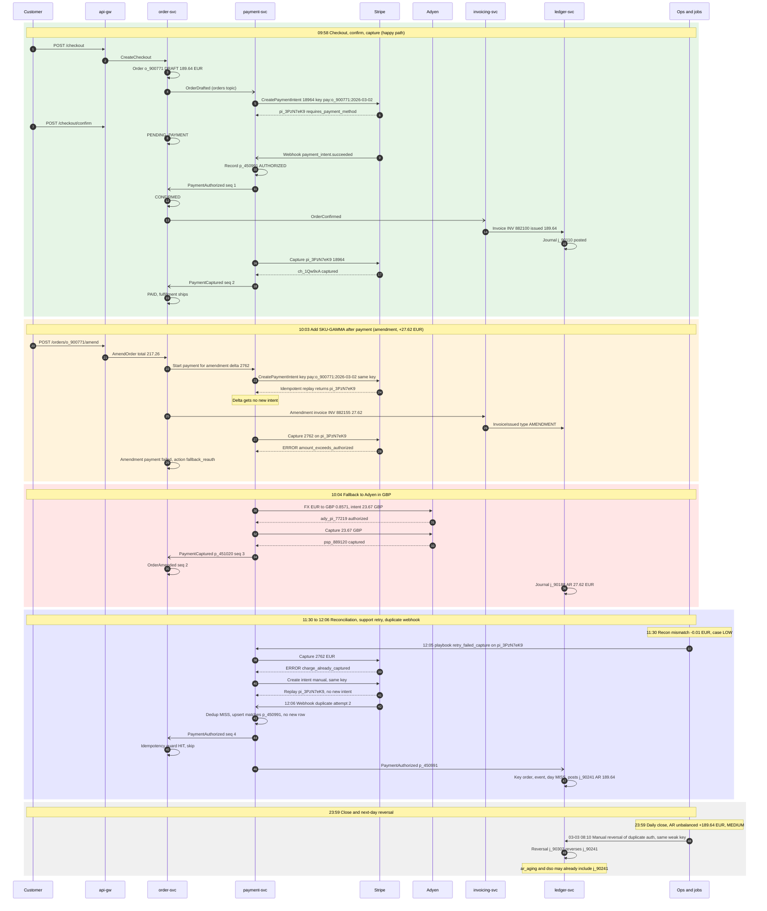
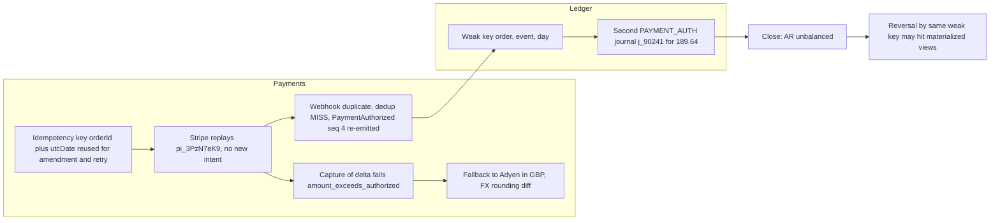

# Incident: duplicate authorization and unbalanced AR (order o_900771)

Source: [incident.logs](./incident.logs). Period: 2026-03-02 09:58 to 2026-03-03 08:10.

Mermaid type: `sequenceDiagram` for the timeline, `flowchart` for the causal chain.

## Timeline

## Causal chain

## Legend

| Term | Meaning |
|---|---|
| `pi_3PzN7eK9` | Stripe PaymentIntent for order o_900771 (189.64 EUR) |
| `p_450991` | Internal payment record for the authorization |
| `p_451020` | Internal payment record for the Adyen fallback capture |
| `j_90110`, `j_90188`, `j_90241`, `j_90302` | Ledger journals: original, amendment, duplicate auth, reversal |
| `seq` | Sequence number on the event |

## Notes

- Amounts are in EUR unless marked GBP. Times are local (+01:00).
- The amendment delta (27.62 EUR) was never charged on its own intent. The reused key made Stripe return the original intent, so the fallback to Adyen was needed.
- The duplicate authorization is booked in the ledger, not in payments. Payments upserted the same row, but the ledger's weaker key let it post again.
- Customer contact data and card identifiers from the log are left out of the diagram.
